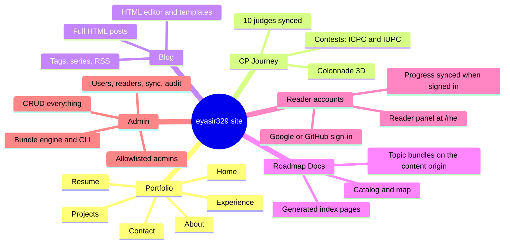

# 01 — Product Requirements Document (PRD)

> Status: **Draft v0.3** · Related: [00 Charter](00-project-charter.md), [02 NFRs](02-non-functional-requirements.md), [03 IA](03-information-architecture.md), [16 Delivery](16-delivery-plan.md)
>
> **Revision 0.2 changes:** blog posts are **full HTML** (FR-BLOG rewritten); **guest accounts** with
> a reader panel (FR-GUEST); **roadmap progress only for signed-in readers** (FR-PROG);
> **CP tracking on 10 judges** for the owner (FR-CP, FR-SYNC).
>
> **Revision 0.3:** learner (guest) CP tracking is **removed** (FR-CPT withdrawn). Guests track roadmap
> progress only.

---

## 1. Personas

| ID | Persona | Context | Needs | Frustrations |
|---|---|---|---|---|
| `P-01` | **Rina, technical recruiter** | Screens 40 candidates a day, often on a phone; ~60–90 s per profile | Role fit, stack keywords, 2–3 standout projects, CV PDF, a contact route | Slow sites, heavy animations that block content, no CV link, vague claims |
| `P-02` | **Tanvir, senior engineer / interviewer** | Desktop, has time, sceptical | Architecture decisions, trade-offs, real code, writing quality, CP depth | Buzzwords, screenshots without substance |
| `P-03` | **Nabila, CS student / CP learner** | Reads roadmap topics on a phone at night, in short sessions, on two devices | A clear roadmap, readable topics, **progress saved to their account** and synced across devices, practice problems | Losing their place, progress stuck on one device, walls of text |
| `P-04` | **Eyasir, owner / admin** | Laptop; fixes a typo in 30 s, pushes 60 topics at once, writes posts in HTML | Fast editing, bulk import, an HTML editor with live preview, rollback, confidence nothing breaks | Redeploys, manual copy-paste, silent sync failures |
| `P-05` | **Organiser / collaborator** | Arrives from a contest page, Discord or GitHub | Who Eyasir is, the club (NEUPC), how to get in touch | Hidden contact details |

### 1.1 Key journeys

| Journey | Steps | Success looks like |
|---|---|---|
| J-1 Recruiter skim (`P-01`) | Home → hero line → proof strip → featured project **or** CV | CV or project in ≤ 2 clicks; 3D never blocks the first paint |
| J-2 Engineer deep dive (`P-02`) | Case study → architecture → GitHub → related post | Decisions explained; live repo stats |
| J-3 Learner study session (`P-03`) | Opens a topic → sees "Sign in to track progress" → signs in with Google (one redirect) → ticks "mark read" → continues on another device from `/me` → "Continue where you left off" | Progress saved to the account and identical on both devices |
| J-4 Owner publishes a topic (`P-04`) | Admin → Docs → upload zip → report → preview → Publish | Live within 60 s; the previous version is one click away |
| J-5 Owner writes a post (`P-04`) | Admin → Blog → New from template → edit HTML with live preview → add assets → Save version → Schedule | Post goes live at the scheduled time, rendered exactly as written |

---

## 2. Feature map

---

## 3. Functional requirements

Priorities: **M** Must · **S** Should · **C** Could · **W** Won't (v1).

### 3.1 Global (`FR-GEN`)

| ID | Requirement | Pri |
|---|---|---|
| FR-GEN-01 | Persistent header: wordmark, primary navigation (Work, Experience, CP, Blog, Docs, About), search trigger, theme toggle, account entry (FR-GEN-12), "Contact" call to action. Collapses below 768 px | M |
| FR-GEN-02 | Light, dark and system themes, persisted, with no flash of the wrong theme | M |
| FR-GEN-03 | Global search (⌘K / Ctrl K / `/`) across projects, posts (section-level), docs topics (section-level) and static pages | S |
| FR-GEN-04 | Footer colophon: social links, RSS, "last updated", "built with", copyright/licence | M |
| FR-GEN-05 | Availability badge ("Open to: Software Engineering · DevOps & Cloud · QA · AI/ML"), editable | S |
| FR-GEN-06 | Fully responsive 320 px → ≥ 1920 px | M |
| FR-GEN-07 | Custom 404 (optional 3D "broken column") and error pages | S |
| FR-GEN-08 | Respects `prefers-reduced-motion`; user "3D on/off" toggle persisted | M |
| FR-GEN-09 | Privacy-friendly analytics; no tracking cookies | S |
| FR-GEN-10 | Announcement bar (admin-controlled) | C |
| FR-GEN-11 | Print stylesheet for About and Projects | C |
| FR-GEN-12 | Account entry in the header: "Sign in" for visitors (subtle, not a primary CTA); avatar menu for signed-in users (My progress, Settings, Admin if allowed, Sign out) | M |

### 3.2 Home (`FR-HOME`)

| ID | Requirement | Pri |
|---|---|---|
| FR-HOME-01 | Hero: name, role line, positioning statement, CTAs **View work** and **Download CV**, 3D "Plaster Graph" (poster fallback) | M |
| FR-HOME-02 | Proof strip: 4–6 key figures from DB/sync (combined solves across judges, ICPC 2025 Dhaka line, CF max rating, public repos…), each linked to evidence | M |
| FR-HOME-03 | "Selected work": 3 featured projects as wall-label cards | M |
| FR-HOME-04 | CP highlight block → `/cp` | M |
| FR-HOME-05 | "Latest writing": 3 most recent posts (hidden when none) | S |
| FR-HOME-06 | "From the docs": featured roadmaps, recently updated topics | S |
| FR-HOME-07 | Journey teaser: 4–6 milestones | S |
| FR-HOME-08 | Closing contact call to action | M |
| FR-HOME-09 | Section order/visibility configurable in admin | S |

### 3.3 About (`FR-ABOUT`)

| ID | Requirement | Pri |
|---|---|---|
| FR-ABOUT-01 | Long bio (Markdown) + optional portrait | M |
| FR-ABOUT-02 | Education | M |
| FR-ABOUT-03 | Skills grouped by category (no percentage bars) | M |
| FR-ABOUT-04 | Certifications | M |
| FR-ABOUT-05 | Leadership & activities summary | S |
| FR-ABOUT-06 | "Now" block | C |
| FR-ABOUT-07 | "Uses" | C |

### 3.4 Projects (`FR-PROJ`)

| ID | Requirement | Pri |
|---|---|---|
| FR-PROJ-01 | Index with filters (stack, type, status); featured first | M |
| FR-PROJ-02 | "Museum wall label" card: title, years, *Medium:* stack, one line, status | M |
| FR-PROJ-03 | Case-study page (Markdown body): overview, problem, role, architecture, features, challenges, results, gallery, links, stack, related posts/docs | M |
| FR-PROJ-04 | Live GitHub stats for linked repos | S |
| FR-PROJ-05 | 3D exhibit header | C |
| FR-PROJ-06 | "Additional projects" compact list | M |
| FR-PROJ-07 | Gallery lightbox with keyboard navigation and credits | S |

### 3.5 Experience (`FR-EXP`)

| ID | Requirement | Pri |
|---|---|---|
| FR-EXP-01 | Reverse-chronological timeline (work, internship, freelance, leadership, teaching, volunteer), filterable | M |
| FR-EXP-02 | Entry: role, organisation, dates ("Present"), location, highlights, skills, links | M |
| FR-EXP-03 | Links between entries and projects | S |

### 3.6 CP Journey — owner's public page (`FR-CP`)

| ID | Requirement | Pri |
|---|---|---|
| FR-CP-01 | Overview: combined distinct solves across **all public judge accounts** (or a manual override), plus a card per judge (handle, rating/max/rank where the judge has ratings, solved) for Codeforces, AtCoder, LeetCode, CodeChef, LightOJ, UVa, SPOJ, CSES, Toph, VJudge | M |
| FR-CP-02 | Rating history chart per rated judge (Codeforces, AtCoder, LeetCode, CodeChef), with an accessible data table | M |
| FR-CP-03 | Combined activity heatmap (365 days) | S |
| FR-CP-04 | Onsite contests (ICPC 2025 Asia Dhaka Regional: BUBT, 112th of 300+, Mymensingh Divisional Champion; IUPCs) with team, rank, award, photos, optional write-up | M |
| FR-CP-05 | Tag and difficulty distribution (where the judge provides them) | S |
| FR-CP-06 | 3D "Colonnade" (monthly combined solves) with a 2D/table twin | S |
| FR-CP-07 | Milestones timeline | C |
| FR-CP-08 | Links to the CP roadmap and NEUPC | S |
| FR-CP-09 | Any synced number can be overridden in admin | M |

### 3.7 Blog — full HTML (`FR-BLOG`)

| ID | Requirement | Pri |
|---|---|---|
| FR-BLOG-01 | Each post is a **full HTML document** (its own `<head>`, CSS, JavaScript and assets), rendered **exactly as written** on the content origin (`read…/blog/{slug}/`). Interactive demos, custom layouts and embedded scripts work, like roadmap topics ([10](10-roadmap-docs-system.md)) | M |
| FR-BLOG-02 | Authoring path 1: **in-admin HTML editor**: file tree, CodeMirror for HTML/CSS/JS, drag-and-drop assets into the post bundle, live sandboxed preview (mobile/tablet/desktop widths), autosaved drafts, "Save version" | M |
| FR-BLOG-03 | Authoring path 2: upload a zip bundle (`index.html` + assets) or push with the CLI | M |
| FR-BLOG-04 | Start from a **template** (e.g. "Marble & Ink essay" with title, date, reading time, OG/canonical tags, footer licence) or a blank document | S |
| FR-BLOG-05 | Listing metadata (title, excerpt, tags, series, cover, date, reading time, sections) is **extracted from the HTML** and can be overridden in admin | M |
| FR-BLOG-06 | Main-site blog index (paginated), tag pages, series pages; `/blog/{slug}` on the main domain redirects (308) to the post | M |
| FR-BLOG-07 | Versions: every save is a version; publish, schedule (future time), unpublish, roll back, compare | M |
| FR-BLOG-08 | Secret, expiring preview links for drafts and unpublished versions | M |
| FR-BLOG-09 | RSS/Atom/JSON feeds with title, summary and link (`Q-28`) | M |
| FR-BLOG-10 | Dynamic OG image per post (used when the post has no `og:image`) | S |
| FR-BLOG-11 | Post sections in global search, with deep links | S |
| FR-BLOG-12 | Validation report on each version (broken links, missing alt/meta, external hosts blocked by CSP) | M |
| FR-BLOG-13 | View counter via the reader runtime | C |
| FR-BLOG-14 | Comments (Giscus inside the template) | C |

### 3.8 Roadmap Docs (`FR-DOCS`) — full design in [10](10-roadmap-docs-system.md)

| ID | Requirement | Pri |
|---|---|---|
| FR-DOCS-01 | `/docs` catalog of public roadmaps | M |
| FR-DOCS-02 | `/docs/{roadmap}` map (phases → modules → topics, status, serials, search/filter); per-topic progress dots when signed in | M |
| FR-DOCS-03 | Topic pages served from the content origin **exactly as authored** (stored bytes immutable), preserving the folder tree so relative links resolve. The only platform addition is the reader-runtime block in the HTML `<head>` | M |
| FR-DOCS-04 | Generated root/phase/module index pages in the roadmap's style | M |
| FR-DOCS-05 | Generated "coming soon" pages for planned topics (noindex) | M |
| FR-DOCS-06 | Progress tracking **only for signed-in readers**: see FR-PROG | M |
| FR-DOCS-07 | Topic sections in global search with deep links | S |
| FR-DOCS-08 | Private folders per roadmap (default `data/`) | M |
| FR-DOCS-09 | Content-origin sitemap, robots, canonical headers | M |
| FR-DOCS-10 | Admin: outline editor, zip upload, bulk import with dry run, CLI, versions, preview, publish, rollback, link report, file browser | M |
| FR-DOCS-11 | Create/edit topics in the in-admin HTML editor (same editor as the blog) | S |
| FR-DOCS-12 | ~~Match practice problems to judge problems for auto-verification~~ (withdrawn in 0.3) | W |

### 3.9 Reading progress (`FR-PROG`) — design in [19 §3–4](19-guest-accounts-and-progress.md)

| ID | Requirement | Pri |
|---|---|---|
| FR-PROG-01 | **Anonymous readers can read everything but cannot track progress.** "Mark read" and "solved" controls are disabled, with the explanation "Sign in to track your progress"; nothing is saved (not even in the browser) | M |
| FR-PROG-02 | Signed-in readers' section and practice ticks are saved to their account and synced across devices; the server is the source of truth | M |
| FR-PROG-03 | A one-click "Sign in to track progress" chip on every topic returns the reader to the same page (and position) after sign-in | M |
| FR-PROG-04 | Offline/failed writes are queued and retried; no progress is lost | M |
| FR-PROG-05 | Generated roadmap index pages show the signed-in reader's per-topic progress and "Continue where you left off" | M |
| FR-PROG-06 | Reading position (last section reached) is remembered per topic | S |
| FR-PROG-07 | ~~Practice problems auto-ticked from linked judges~~ (withdrawn in 0.3; readers tick practice themselves) | W |
| FR-PROG-08 | Reset progress for a topic or a whole roadmap | S |

### 3.10 Guest accounts & reader panel (`FR-GUEST`) — design in [19](19-guest-accounts-and-progress.md)

| ID | Requirement | Pri |
|---|---|---|
| FR-GUEST-01 | Anyone can create an account by signing in with Google or GitHub (`Q-26`); no password | M |
| FR-GUEST-02 | `/me` dashboard: continue reading, roadmap progress cards, activity calendar/streak, next recommended topic | M |
| FR-GUEST-03 | `/me/roadmaps/[roadmap]`: per-topic progress tree | M |
| FR-GUEST-04 | `/me/settings`: display name/avatar, linked providers, sign out everywhere | M |
| FR-GUEST-05 | Export my data (JSON) and delete my account (hard delete ≤ 30 days) | M |
| FR-GUEST-06 | Guests can never access admin pages or other users' data | M |
| FR-GUEST-07 | Public learner profiles / leaderboards | W (v2) |

### 3.11 CP tracking for learners (`FR-CPT`) — withdrawn

| ID | Requirement | Pri |
|---|---|---|
| FR-CPT-01 | ~~Learners link judge handles, sync CP progress, see a CP hub, use extension tokens, and get practice problems auto-verified~~. **Removed in revision 0.3 at the owner's request.** Multi-judge tracking remains only for the owner's public CP Journey (FR-CP, FR-SYNC) | W |

### 3.12 Contact (`FR-CONTACT`)

| ID | Requirement | Pri |
|---|---|---|
| FR-CONTACT-01 | Form with Turnstile, stored + owner notified | M |
| FR-CONTACT-02 | Direct links: email, LinkedIn, GitHub, Codeforces | M |
| FR-CONTACT-03 | Phone hidden by default | M |

### 3.13 Resume (`FR-RES`)

| ID | Requirement | Pri |
|---|---|---|
| FR-RES-01 | `/resume` serves the current CV PDF (inline + download as `Eyasir_Ahamed_CV.pdf`) | M |
| FR-RES-02 | Version history; switch the current CV | M |
| FR-RES-03 | "Last updated" date shown | S |
| FR-RES-04 | Store the LaTeX source privately with each version | C |

### 3.14 Authentication & roles (`FR-AUTH`) — see [08](08-auth-and-security.md)

| ID | Requirement | Pri |
|---|---|---|
| FR-AUTH-01 | One sign-in page (`/login`) with Google and GitHub; `/admin/login` is an alias that returns to `/admin` | M |
| FR-AUTH-02 | **Admin rights only for allowlisted emails** (`admin_users`); everyone else is a guest | M |
| FR-AUTH-03 | Roles: `owner`, `editor`, `guest` | M |
| FR-AUTH-04 | Sign out everywhere (main site + content origin); silent session refresh; return to the original page after sign-in | M |
| FR-AUTH-05 | Owner manages the admin allowlist | M |
| FR-AUTH-06 | Admin can ban/unban a user; sign-ups from disposable-email domains are rejected | M |

### 3.15 Admin (`FR-ADM`) — see [09](09-admin-panel.md)

| ID | Requirement | Pri |
|---|---|---|
| FR-ADM-01 | Dashboard: content, drafts, messages, sync health, import jobs, reader counts | M |
| FR-ADM-02 | CRUD for every content type with validation, draft/publish, unsaved-changes guard | M |
| FR-ADM-03 | Drag-and-drop ordering | M |
| FR-ADM-04 | Media library (alt text required, credits, licence) | M |
| FR-ADM-05 | Markdown editor with live preview for site-rendered text (bio, case studies, contest write-ups, privacy page) | M |
| FR-ADM-06 | Signed, expiring previews for drafts and bundle versions | M |
| FR-ADM-07 | Bundle management for roadmaps and posts (FR-DOCS-10, FR-BLOG-02/03/07) | M |
| FR-ADM-08 | Sync centre: owner accounts, platform health per judge, per-platform enable/disable, "Run now", run logs | M |
| FR-ADM-09 | Messages inbox | M |
| FR-ADM-10 | Settings (profile, social links, SEO, home sections, flags, maintenance) | M |
| FR-ADM-11 | Audit log | S |
| FR-ADM-12 | API tokens for the bundle CLI (owner) | S |
| FR-ADM-13 | Redirect manager | S |
| FR-ADM-14 | Content health checks | C |
| FR-ADM-15 | Admin command palette | C |
| FR-ADM-16 | Users screen: all accounts, roles, last seen, ban/unban, delete (owner) | M |
| FR-ADM-17 | Reader analytics in aggregate (registered/active readers, completion funnels, drop-off sections) | S |
| FR-ADM-18 | HTML templates library for the editor | S |

### 3.16 SEO & sharing (`FR-SEO`)

| ID | Requirement | Pri |
|---|---|---|
| FR-SEO-01 | Unique title, description, canonical, OG/Twitter tags on every main-site page | M |
| FR-SEO-02 | JSON-LD: `Person`, `WebSite`, `CreativeWork`/`SoftwareSourceCode`, `BreadcrumbList`; `Course`/`ItemList` on generated roadmap pages. Posts and topics carry their own meta as authored (templates include `BlogPosting`) | M |
| FR-SEO-03 | Sitemaps and robots per host; RSS autodiscovery | M |
| FR-SEO-04 | Dynamic OG images | S |

### 3.17 Sync (`FR-SYNC`) — see [12](12-integrations-and-sync.md), [20](20-cp-multi-platform-tracking.md)

| ID | Requirement | Pri |
|---|---|---|
| FR-SYNC-01 | Daily GitHub sync for the owner | M |
| FR-SYNC-02 | Judge adapters for all 10 judges, API-first, with scraping only where no API exists (flag per platform) and the extension where neither works | M |
| FR-SYNC-03 | Per-platform scheduled runs (daily, staggered) with incremental cursors and rate budgets for the owner's accounts; "Run now" per platform | M |
| FR-SYNC-04 | Every run logged; "Run now"; stale warnings | M |
| FR-SYNC-05 | Failures never break public pages (last good snapshot); the owner is emailed after 3 consecutive failures of an owner account or a platform-wide outage | M |
| FR-SYNC-06 | CLIST.by fallback for contest results where direct sources fail (`Q-31`) | C |

---

## 4. Key user stories and acceptance criteria

**US-001 — Admin signs in; non-admins become guests** (FR-AUTH-01/02)
- **Given** `eyasir329@gmail.com` is an active `owner` in `admin_users` **when** they sign in with Google **then** they can open `/admin` and the role is shown.
- **Given** any other Google/GitHub account **when** it signs in **then** a **guest** account is created and it lands on `/me`; opening `/admin` returns 403 with no admin data.
- **Given** an email on a disposable-domain blocklist **when** it signs up **then** sign-up is refused.

**US-010 — Edit a project without deploying** (FR-ADM-02): unchanged: saved edits appear on the public page within ~5 s; slug changes create redirects.

**US-020 — Recruiter downloads the CV** (FR-RES-01): unchanged.

**US-030 — Owner CP stats refresh daily across judges** (FR-CP-01, FR-SYNC-02/03)
- **Given** the owner's public accounts on the 10 judges **when** the daily run completes **then** each account shows fresh rating/solved data (or "needs extension" where the judge has no public solved list), combined solves are recomputed, and the CP page updates. A failing judge keeps its last snapshot.

**US-040 — Publish the `std::vector` topic** (FR-DOCS-03/10)
- **Given** roadmap `cp` **when** I upload `3_std_vector.zip` to `phase-1/1_basics` **then** the report shows 45 files, title "std::vector", serial `01.01.14`, 13 sections, 11 simulations, 11 practice problems, 5 videos, 0 errors.
- **When** I publish **then** `https://read.eyasir329.dev/docs/cp/phase-1/1_basics/3_std_vector/` serves it within 60 s; with the runtime block removed, the served `index.html` is byte-identical to the uploaded file, and every other file is byte-identical.

**US-041 — Roll back a topic or post** (FR-DOCS-10, FR-BLOG-07): the previous version is served ≤ 60 s later; audit-logged.

**US-042 — Links to unpublished topics don't 404** (FR-DOCS-05): a generated "coming soon" page, `noindex`.

**US-043 — Bulk import a phase** (FR-DOCS-10): dry-run diff first; apply creates `ready` versions; one-click publish.

**US-050 — Visitor sends a message** (FR-CONTACT-01): unchanged.

**US-060 — Visitor turns 3D off** (FR-GEN-08): unchanged.

**US-070 — Signed-in reader continues a roadmap** (FR-PROG-05)
- **Given** a signed-in reader with ticks on several topics **when** they open the generated module index **then** each topic shows "8/13 read · 3/11 solved", and the next unread topic is highlighted.

**US-080 — Anonymous reader is read-only** (FR-PROG-01)
- **Given** a visitor who is not signed in **when** they open a topic **then** all content, quizzes, demos and videos work, but every "mark read" and "solved" control is disabled with the text "Sign in to track your progress", and no progress key is written to `localStorage`.

**US-081 — Sign in from a topic and keep reading** (FR-PROG-03)
- **Given** an anonymous reader on section 4 of a topic **when** they click "Sign in to track progress" and complete Google sign-in **then** they return to the same topic (≤ 3 redirects), the controls are enabled, and the chip shows their avatar.

**US-082 — Progress follows the reader across devices** (FR-PROG-02/04)
- **Given** a guest ticks sections 1–5 on a phone **when** they open the same topic on a laptop **then** sections 1–5 are ticked (server state wins). Ticks made offline are uploaded on the next visit.

**US-085 — Export and delete** (FR-GUEST-05)
- **When** a guest exports **then** they download a JSON file with their profile and reading progress. **When** they delete their account **then** they're signed out everywhere immediately and all their rows are gone within 30 days.

**US-090 — Owner writes an HTML post in admin** (FR-BLOG-01/02/04)
- **Given** the "Marble & Ink essay" template **when** I create a post, write HTML with an interactive `<canvas>` demo, drop two images into `assets/` and click *Save version* **then** the preview renders it exactly (scripts run inside the sandbox), the validation report is clean, and metadata (title, description, reading time, sections) is extracted.

**US-091 — Schedule a post** (FR-BLOG-07)
- **Given** a ready version **when** I schedule it for tomorrow 09:00 (Asia/Dhaka) **then** it becomes visible at `read…/blog/{slug}/` within 5 minutes of that time, appears on `/blog` and in the feeds, and `eyasir329.dev/blog/{slug}` redirects to it.

---

## 5. Out of scope for v1

**Learner CP tracking on judges (removed in 0.3)** · comments (Could, via template) · newsletter · Bengali localisation · public learner profiles and
leaderboards · reader notes/bookmarks · paid content · multi-author workflow · generating the CV from
the database. Rationale: [00 §4.2](00-project-charter.md).

## 6. Traceability

Each `FR-*` maps to backlog stories ([16 §4](16-delivery-plan.md)), a design section and at least one
check in [15](15-testing-and-qa.md). The audit checklist ([21](21-audit-checklist.md)) asks the owner
to confirm every **S**/**C** priority.
