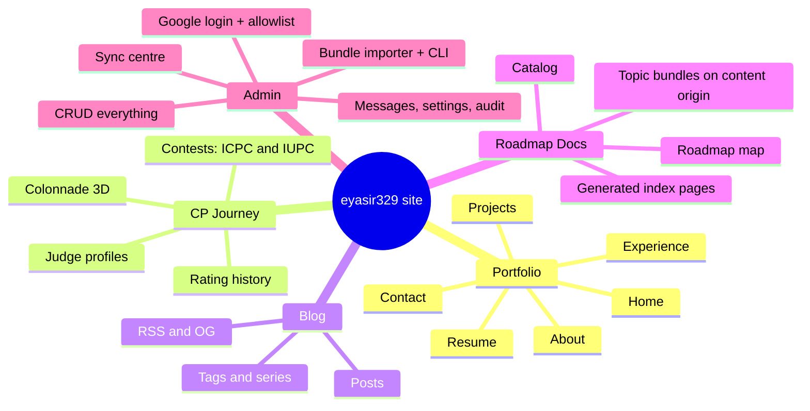

# 01 — Product Requirements Document (PRD)

> Status: **Draft v0.1** · Related: [00 Charter](00-project-charter.md), [02 NFRs](02-non-functional-requirements.md), [03 IA](03-information-architecture.md), [16 Delivery](16-delivery-plan.md)

---

## 1. Personas

| ID | Persona | Context | Needs | Frustrations |
|---|---|---|---|---|
| `P-01` | **Rina, technical recruiter** | Screens 40 candidates a day, often on a phone between calls; ~60–90 s per profile | Role fit, stack keywords, 2–3 standout projects, CV PDF, a contact route | Slow sites, heavy animations that block content, no CV link, vague claims |
| `P-02` | **Tanvir, senior engineer / interviewer** | Desktop, has time, is sceptical | Architecture decisions, trade-offs, real code (GitHub), writing quality, CP depth | Buzzwords, screenshots with no substance, broken demos |
| `P-03` | **Nabila, CS student / CP learner** | Phone at night (dark mode), reading in short sessions | A clear roadmap, readable topic pages, progress that remembers where they stopped, practice problems | Walls of text, losing their place, pages that break offline or on slow data |
| `P-04` | **Eyasir, owner / admin** | Laptop; wants to fix a typo in 30 s and push 60 topics in one go | Fast editing, bulk import, preview before publish, rollback, confidence nothing breaks | Having to redeploy, manual copy-paste, silent sync failures |
| `P-05` | **Organiser / collaborator** | Arrives from a contest page, Discord or GitHub | Who Eyasir is, the club (NEUPC), how to get in touch | Hidden contact details |

### 1.1 Key journeys

| Journey | Steps | Success looks like |
|---|---|---|
| J-1 Recruiter skim (`P-01`) | Lands on Home → reads the hero line → scans the proof strip → opens a featured project **or** downloads the CV | CV or project reached in ≤ 2 clicks, with no 3D blocking the first paint |
| J-2 Engineer deep dive (`P-02`) | Project case study → architecture section → GitHub repo → related blog post | Case study explains decisions; stars and last commit shown live |
| J-3 Learner study session (`P-03`) | `/docs` → CP roadmap → picks the next unread topic → reads, ticks "mark read", solves practice problems → next topic | Progress remembered; the roadmap shows where to continue |
| J-4 Owner publishes a topic (`P-04`) | Admin → Docs → Upload zip → review validation report → preview → Publish | Live within 1 minute; the previous version is one click away |
| J-5 Owner fixes content (`P-04`) | Admin → Projects → edit → Save | Public page updated within seconds, with no deploy |

---

## 2. Feature map

---

## 3. Functional requirements

Priorities: **M** Must · **S** Should · **C** Could · **W** Won't (v1).

### 3.1 Global (`FR-GEN`)

| ID | Requirement | Pri |
|---|---|---|
| FR-GEN-01 | A persistent header shows the wordmark, primary navigation (Work, Experience, CP, Blog, Docs, About), a search trigger, the theme toggle and a "Contact" call to action. Collapses to a menu below 768 px | M |
| FR-GEN-02 | Light, dark and system themes. The choice is persisted, with no flash of the wrong theme (an inline script sets it before first paint) | M |
| FR-GEN-03 | Global search (⌘K / Ctrl K / `/`) across projects, posts, docs topics (section-level deep links) and static pages | S |
| FR-GEN-04 | The footer "colophon" shows social links, an RSS link, "last updated", a "set in…/built with…" line and a copyright notice | M |
| FR-GEN-05 | Availability badge ("Open to: Software Engineering · DevOps & Cloud · QA · AI/ML"), editable and hideable | S |
| FR-GEN-06 | Fully responsive from 320 px to ≥ 1920 px, with no horizontal scroll | M |
| FR-GEN-07 | Custom 404 (optional 3D "broken column") and error pages with a way back | S |
| FR-GEN-08 | Respects `prefers-reduced-motion`. A user-facing "3D: on/off" toggle is persisted | M |
| FR-GEN-09 | Privacy-friendly analytics with no tracking cookies, so no cookie banner is needed | S |
| FR-GEN-10 | Announcement bar (text + link, admin-controlled, dismissible, expiry date) | C |
| FR-GEN-11 | Print stylesheet for About, Projects and Blog posts (clean black-on-white, URLs printed) | C |

### 3.2 Home (`FR-HOME`)

| ID | Requirement | Pri |
|---|---|---|
| FR-HOME-01 | Hero: name, role line ("Full-Stack Developer · Software Engineer"), a 1–2 sentence positioning statement, CTAs **View work** and **Download CV**, and the 3D "Plaster Graph" (with poster fallback) | M |
| FR-HOME-02 | Proof strip: 4–6 key figures (e.g. *1000+ problems solved*, *ICPC 2025 Dhaka — 112th, Divisional Champion*, *Codeforces max 1101*, *N public repos*). Values come from the DB or sync; each links to its evidence | M |
| FR-HOME-03 | "Selected work": 3 featured projects as wall-label cards | M |
| FR-HOME-04 | CP highlight block linking to `/cp` | M |
| FR-HOME-05 | "Latest writing": 3 most recent posts; the section hides when there are none | S |
| FR-HOME-06 | "From the docs": featured roadmaps and recently updated topics | S |
| FR-HOME-07 | Journey teaser: 4–6 timeline milestones (education, leadership, contests) | S |
| FR-HOME-08 | Closing contact call to action | M |
| FR-HOME-09 | Section order and visibility are configurable in admin | S |

### 3.3 About (`FR-ABOUT`)

| ID | Requirement | Pri |
|---|---|---|
| FR-ABOUT-01 | Long bio (Markdown) with an optional portrait (credited, alt text required) | M |
| FR-ABOUT-02 | Education: degree, institution, dates, result (e.g. CGPA 3.51/4.00), notes | M |
| FR-ABOUT-03 | Skills grouped by category (Languages, Frontend, Backend & DB, Tools & DevOps, Concepts). **No percentage bars.** Optionally links to the projects that used each skill | M |
| FR-ABOUT-04 | Certifications: title, issuer, date, credential link, short description | M |
| FR-ABOUT-05 | Leadership and activities summary (links to Experience) | S |
| FR-ABOUT-06 | "Now" block (what I'm focused on this month) | C |
| FR-ABOUT-07 | "Uses" (hardware, editor, tools) | C |

### 3.4 Projects (`FR-PROJ`)

| ID | Requirement | Pri |
|---|---|---|
| FR-PROJ-01 | Index listing all published projects; filter by stack, type and status; default order is featured first, then most recent | M |
| FR-PROJ-02 | Card uses the "museum wall label" pattern: **title**, years, *Medium:* stack, one-line summary, status (Ongoing / Completed / Maintained / Archived) | M |
| FR-PROJ-03 | Detail page (case study): overview, problem, my role, architecture (diagram image or Mermaid), key features, challenges and decisions, results/metrics, gallery, links (repo, live, demo video), stack, related posts and docs | M |
| FR-PROJ-04 | Projects linked to a GitHub repo show live stars, forks, primary languages and last-commit date from sync | S |
| FR-PROJ-05 | 3D "exhibit" header (hero screenshot on a plinth) with an image fallback | C |
| FR-PROJ-06 | "Additional projects" compact list for smaller work (Tourmate, Eduflow329, Surveillance Car) | M |
| FR-PROJ-07 | Gallery lightbox with keyboard navigation and captions/credits | S |

### 3.5 Experience (`FR-EXP`)

| ID | Requirement | Pri |
|---|---|---|
| FR-EXP-01 | Reverse-chronological timeline of entries of kind *work, internship, freelance, leadership, teaching, volunteer*, with a filter by kind | M |
| FR-EXP-02 | Each entry shows role, organisation (+ link), dates ("Present" when open-ended), location, highlights, skills used and related links | M |
| FR-EXP-03 | Entries can link to projects (e.g. *Programming Secretary* ↔ *NEUPC platform*) | S |

### 3.6 CP Journey (`FR-CP`)

| ID | Requirement | Pri |
|---|---|---|
| FR-CP-01 | Overview: total problems solved (sum of synced counts, or a manual override such as "1000+"), and a per-judge profile card with handle, current/max rating and rank title (in Codeforces rank colours) | M |
| FR-CP-02 | Rating history chart (Codeforces first; other judges when their adapter exists), with contest names in tooltips and an accessible data table | M |
| FR-CP-03 | Activity heatmap of daily accepted submissions over the last 365 days | S |
| FR-CP-04 | Onsite contests: name, date, venue/host, team name, teammates, rank / total teams, award, standings link, photos, optional write-up. Seeded with ICPC 2025 Asia Dhaka Regional (BUBT, 112th of 300+ teams, Mymensingh Divisional Champion) and the listed IUPCs | M |
| FR-CP-05 | Solved-problem distribution by tag and by difficulty (from Codeforces submissions) | S |
| FR-CP-06 | 3D "Colonnade": one column per month, height = accepted problems. Paired with an equivalent 2D chart/table | S |
| FR-CP-07 | Milestones timeline (first contest, rating thresholds, ICPC) | C |
| FR-CP-08 | Links to the CP roadmap in Docs and to NEUPC | S |
| FR-CP-09 | Every synced number can be overridden manually in admin (for judges without an API) | M |

### 3.7 Blog (`FR-BLOG`)

| ID | Requirement | Pri |
|---|---|---|
| FR-BLOG-01 | Index: title, date, reading time, excerpt, tags; tag filter; pagination (10/page) | M |
| FR-BLOG-02 | Post page: title, subtitle, published and updated dates, reading time, auto table of contents (h2/h3), body, tags, series navigation, previous/next, related posts, share links | M |
| FR-BLOG-03 | Markdown features: GFM (tables, task lists, strikethrough), footnotes (rendered as sidenotes on wide screens), syntax-highlighted code with filename, line highlighting and copy, KaTeX math, callouts, figures with caption and credit, YouTube facade embed, Codeforces/CSES problem card | M |
| FR-BLOG-04 | Mermaid diagrams (rendered client-side, lazily, theme-aware) | S |
| FR-BLOG-05 | Series (ordered multi-part posts) | S |
| FR-BLOG-06 | Tag pages | M |
| FR-BLOG-07 | RSS 2.0 / Atom feed (full content) and JSON Feed | M |
| FR-BLOG-08 | Dynamic Open Graph image per post | S |
| FR-BLOG-09 | Draft, scheduled and published states; secret preview link for drafts | M |
| FR-BLOG-10 | Reading-progress bar | S |
| FR-BLOG-11 | View counter | C |
| FR-BLOG-12 | Comments via Giscus | C |

### 3.8 Roadmap Docs (`FR-DOCS`) — see [10](10-roadmap-docs-system.md) for the full design

| ID | Requirement | Pri |
|---|---|---|
| FR-DOCS-01 | `/docs` catalog: every public roadmap with description, published/planned topic counts and last-updated date | M |
| FR-DOCS-02 | `/docs/{roadmap}` map: phases → modules → topics as a vertical roadmap with status (published / coming soon), serials, "Topic N of M", in-roadmap search and filters. Each topic links to its page on the content origin | M |
| FR-DOCS-03 | Topic pages are served **byte-for-byte as uploaded** on the content origin, preserving the folder tree so every relative link (`../index.html`, `assets/…`, `../../../phase-0/…`) resolves | M |
| FR-DOCS-04 | For any roadmap root, phase or module without its own `index.html`, the platform generates one that matches the roadmap's look (theme CSS extracted from its topics) | M |
| FR-DOCS-05 | Links to planned-but-unpublished topics resolve to a generated "coming soon" page (noindex), not a 404 | M |
| FR-DOCS-06 | Reader progress: the per-page features built into bundles keep working; generated index pages summarise per-topic progress from the same browser storage | S |
| FR-DOCS-07 | Topic sections appear in global search with deep links (`…/3_std_vector/#s4`) | S |
| FR-DOCS-08 | Per-roadmap control over which folders are public (e.g. `data/` verbatim book excerpts can be private); private files return a friendly notice | M |
| FR-DOCS-09 | Content-origin `sitemap.xml`, `robots.txt` and HTTP canonical headers | M |
| FR-DOCS-10 | Admin: roadmap outline editor, single-topic zip upload, bulk tree import with dry-run diff, CLI push, version history, preview, publish, rollback, link report, file browser, quick-edit a file into a new version | M |
| FR-DOCS-11 | Writing topics inside admin (Markdown → roadmap template) | W (v1.1) |

### 3.9 Contact (`FR-CONTACT`)

| ID | Requirement | Pri |
|---|---|---|
| FR-CONTACT-01 | Form: name, email, subject (optional), message (20–5000 chars), protected by Cloudflare Turnstile. Clear success and error states. Stored in DB; owner notified by email | M |
| FR-CONTACT-02 | Direct links: email, LinkedIn, GitHub, Codeforces | M |
| FR-CONTACT-03 | Phone number is **hidden by default** (privacy); an admin toggle can show it | M |

### 3.10 Resume (`FR-RES`)

| ID | Requirement | Pri |
|---|---|---|
| FR-RES-01 | `/resume` serves the current CV PDF inline, with a download action named `Eyasir_Ahamed_CV.pdf` | M |
| FR-RES-02 | Admin keeps a version history of CV PDFs and can switch which one is current | M |
| FR-RES-03 | "Last updated" date is shown next to the download buttons | S |
| FR-RES-04 | The LaTeX source (`.tex`) can be stored alongside each PDF version (private) | C |

### 3.11 Authentication (`FR-AUTH`) — see [08](08-auth-and-security.md)

| ID | Requirement | Pri |
|---|---|---|
| FR-AUTH-01 | Admin sign-in is **Google only**, at `/admin/login` (not linked in public navigation) | M |
| FR-AUTH-02 | Only allowlisted emails can create an account. Anyone else sees "Not authorised" and **no user record is created** | M |
| FR-AUTH-03 | Roles: `owner` (everything) and `editor` (content only; no users, tokens or security settings) | M |
| FR-AUTH-04 | Sign out; sessions refresh silently; an expired session redirects to login and returns to the original page | M |
| FR-AUTH-05 | Owner manages the allowlist (add/remove email, change role) | M |

### 3.12 Admin (`FR-ADM`) — see [09](09-admin-panel.md)

| ID | Requirement | Pri |
|---|---|---|
| FR-ADM-01 | Dashboard: content counts, drafts, unread messages, sync health, recent activity, KB import jobs | M |
| FR-ADM-02 | Create/read/update/delete (CRUD) for every content type, with validation, draft/publish and "unsaved changes" guard | M |
| FR-ADM-03 | Drag-and-drop ordering wherever order is visible publicly | M |
| FR-ADM-04 | Media library: upload, alt text (required), caption, credit, licence, source URL, usage references, delete-protection when in use | M |
| FR-ADM-05 | Markdown editor with live preview that uses the **same renderer** as the public site; autosave and revision history for posts | M |
| FR-ADM-06 | Secret, expiring preview links for any draft (post, project, KB version) | M |
| FR-ADM-07 | Docs management (see FR-DOCS-10) | M |
| FR-ADM-08 | Sync centre: status per integration, last run, "Run now", run logs, stale-data warnings | M |
| FR-ADM-09 | Messages inbox: read/unread, archive, spam, reply via `mailto:` | M |
| FR-ADM-10 | Settings: profile, social links, SEO defaults, home sections, availability, navigation toggles, maintenance mode | M |
| FR-ADM-11 | Audit log of every admin write (who, what, when, diff) | S |
| FR-ADM-12 | Personal API tokens (scoped, expiring) for the KB CLI | S |
| FR-ADM-13 | Redirect manager; redirects are created automatically when a slug changes | S |
| FR-ADM-14 | Content health: missing alt text, broken links, stale syncs, unpublished references | C |
| FR-ADM-15 | Admin command palette (jump to any record) | C |

### 3.13 SEO & sharing (`FR-SEO`)

| ID | Requirement | Pri |
|---|---|---|
| FR-SEO-01 | Every page: unique title, meta description, canonical URL, Open Graph and Twitter tags, with admin overrides | M |
| FR-SEO-02 | JSON-LD: `Person` + `WebSite` (home), `BlogPosting` (posts), `CreativeWork`/`SoftwareSourceCode` (projects), `BreadcrumbList` (deep pages), `Course`/`LearningResource` (roadmap pages generated by the platform only; uploaded topics are never modified) | M |
| FR-SEO-03 | `sitemap.xml` and `robots.txt` per host; RSS autodiscovery link | M |
| FR-SEO-04 | Dynamic OG images for posts, projects and roadmap pages in the site's typographic style | S |

### 3.14 Sync (`FR-SYNC`) — see [12](12-integrations-and-sync.md)

| ID | Requirement | Pri |
|---|---|---|
| FR-SYNC-01 | Daily GitHub sync: profile counts, repos (stars, forks, languages, pushed_at), contribution calendar, pinned repos | M |
| FR-SYNC-02 | Daily Codeforces sync: user info, rating history, submissions (→ solved set, daily activity, tags) | M |
| FR-SYNC-03 | Pluggable adapters for AtCoder, LeetCode, CodeChef and others; manual values until then | C |
| FR-SYNC-04 | "Run now" per integration; each run is logged with status, counts, duration and error | M |
| FR-SYNC-05 | Failure never breaks public pages (the last good snapshot is served); 3 consecutive failures email the owner | M |

---

## 4. Key user stories and acceptance criteria

> Format: *As a … I want … so that …* then Given / When / Then. Full backlog: [16 §4](16-delivery-plan.md).

**US-001 — Allowlisted admin signs in with Google** (FR-AUTH-01/02)
- *As the owner I want to sign in with my Google account so that I can manage the site.*
- **Given** `eyasir329@gmail.com` is in `admin_users` with role `owner` **when** I choose "Continue with Google" on `/admin/login` and consent **then** I land on `/admin` and my role is shown in the user menu.
- **Given** any Google account that is **not** allowlisted **when** it completes Google consent **then** Supabase rejects the sign-up (no row in `auth.users`), and the page shows "This account is not authorised" with no admin data exposed.
- **Given** I'm signed out **when** I open `/admin/projects` directly **then** I'm redirected to `/admin/login?next=/admin/projects` and returned there after sign-in.

**US-010 — Edit a project and see it live without deploying** (FR-ADM-02, G-04)
- **Given** a published project **when** I change its summary and click *Save* **then** the admin shows "Saved", an audit-log entry is written, and the public `/projects/{slug}` shows the new text on the next request (target ≤ 5 s).
- **Given** I change the slug **when** I save **then** a 308 redirect from the old URL to the new one is created automatically.

**US-020 — Recruiter downloads the CV** (FR-RES-01)
- **Given** a current CV version exists **when** a visitor clicks *Download CV* anywhere **then** the browser downloads `Eyasir_Ahamed_CV.pdf` with `Content-Disposition: attachment`, and a `resume_download` analytics event is recorded (no personal data).
- **Given** no CV has been uploaded **then** every CV button is hidden, never broken.

**US-030 — CP stats refresh daily** (FR-SYNC-02, FR-CP-01)
- **Given** Codeforces handle `eyasir329` is enabled for sync **when** the daily job runs **then** current/max rating, rating history and solved set are upserted, the run is logged as `succeeded`, and the CP page shows the new values after revalidation.
- **Given** the Codeforces API is down **when** the job runs **then** the run is logged `failed` with the error, public pages keep the previous snapshot, and after 3 consecutive failures the owner receives one email.

**US-040 — Publish the `std::vector` topic** (FR-DOCS-03/10)
- **Given** roadmap `cp` exists **when** I upload `3_std_vector.zip` into node `phase-1/1_basics` **then** the validation report shows: 45 files, title "std::vector", serial `01.01.14`, 13 sections, 11 simulations, 11 practice problems, 5 videos, 0 errors, and warnings for links to topics not yet published.
- **When** I click *Preview* **then** a signed preview URL on the content origin renders the page exactly as the local file, including quizzes, "mark read" checkboxes, theme toggle and video facades.
- **When** I click *Publish* **then** `https://kb.{domain}/cp/phase-1/1_basics/3_std_vector/` serves the new version within 60 s, and the served `index.html` is byte-identical (same SHA-256) to the uploaded file.

**US-041 — Roll back a topic** (FR-DOCS-10)
- **Given** version 3 is published and version 2 exists **when** I choose *Roll back to v2* **then** v2 is served within 60 s, v3 remains in history, and the action is audit-logged.

**US-042 — Links to unpublished topics don't 404** (FR-DOCS-05)
- **Given** `2_lambdas_and_comparators` is in the outline but unpublished **when** a reader clicks "← Lambdas & Comparators" on the `std::vector` page **then** they see a generated "Coming soon" page in the roadmap's style, with the topic title, its position in the roadmap and a link back to the module. The response carries `X-Robots-Tag: noindex`.

**US-043 — Bulk import a whole phase** (FR-DOCS-10)
- **Given** a zip containing `phase-1/…` with 20 topic folders **when** I run a dry-run import **then** I see a diff (new / changed / unchanged / would-archive) with per-topic validation before anything is written; **when** I confirm, all valid topics become `ready` (not yet published) and I can publish them in one action.

**US-050 — Visitor sends a message** (FR-CONTACT-01)
- **Given** valid inputs and a passed Turnstile check **when** the visitor submits **then** the message is stored, the owner is emailed, and the visitor sees a confirmation. More than 5 submissions per hour from one IP are rejected with a friendly message.

**US-060 — Visitor turns 3D off** (FR-GEN-08)
- **Given** the site uses 3D **when** the visitor toggles 3D off (or has `prefers-reduced-motion: reduce`) **then** every scene is replaced by its static poster, no WebGL context is created, and the preference persists across visits.

**US-070 — Reader continues a roadmap** (FR-DOCS-06, J-3)
- **Given** a reader ticked "mark read" on sections of several topics **when** they open the roadmap's generated module index on the content origin **then** each topic shows its progress (e.g. "8/13 read"), and the next unread topic is highlighted.

---

## 5. Out-of-scope features (explicit "Won't" for v1)

Visitor accounts · synced reader progress across devices · comments (Could in v1.1) · newsletter ·
Bengali localisation · in-admin topic authoring · paid content · multi-author workflow. Rationale:
[00 §4.2](00-project-charter.md).

## 6. Traceability

Each `FR-*` maps to one or more stories in the backlog ([16 §4](16-delivery-plan.md)), to a design
section (IA, DB, API docs) and to at least one check in [15](15-testing-and-qa.md). The audit
checklist ([19](19-audit-checklist.md)) asks the owner to confirm the priority of every **S** and
**C** item.
