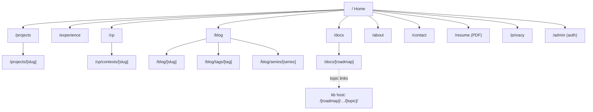
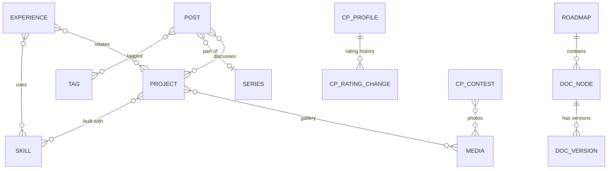

# 03 — Information Architecture

> Status: **Draft v0.1** · Related: [01 PRD](01-product-requirements.md), [04 Design](04-design-system.md), [09 Admin](09-admin-panel.md), [10 Roadmap Docs](10-roadmap-docs-system.md)

Domain names below are **placeholders** until `Q-01` is answered:
main origin `eyasir329.dev`, content origin `kb.eyasir329.dev`.

---

## 1. Hosts

| Host | Purpose | Who uses it | Cookies |
|---|---|---|---|
| `eyasir329.dev` | Portfolio, blog, docs catalog/map, admin panel, APIs | Everyone; admin under `/admin` | Supabase auth cookies (host-only, admin only) |
| `www.eyasir329.dev` | 308 → apex | — | — |
| `kb.eyasir329.dev` | **Content origin**: serves roadmap bundles byte-for-byte, plus generated index/coming-soon pages | Readers of Roadmap Docs | **None** from the app (a signed preview cookie only on `/__preview/*`) |

Both hosts are served by **one** Next.js deployment. `proxy.ts` routes by `Host` header
([06 §5](06-system-architecture.md)).

## 2. Sitemap

## 3. Route inventory

### 3.1 Public routes — main origin

| Route | Page | Rendering | Cache tags | Index? |
|---|---|---|---|---|
| `/` | Home | Static shell + cached data | `profile`, `projects`, `posts`, `cp`, `docs`, `settings` | ✅ |
| `/about` | About | Cached | `profile`, `education`, `skills`, `certifications` | ✅ |
| `/projects` | Projects index | Cached; filters via search params, rendered on the server | `projects` | ✅ |
| `/projects/[slug]` | Case study | Cached per slug; `generateStaticParams` for published | `project:{id}`, `github` | ✅ |
| `/experience` | Timeline | Cached | `experiences` | ✅ |
| `/cp` | CP Journey | Cached; client islands for charts/3D | `cp` | ✅ |
| `/cp/contests/[slug]` | Contest write-up (optional, only if write-up exists) | Cached | `cp` | ✅ |
| `/blog` | Blog index (`?page=`, `?tag=`) | Cached | `posts` | ✅ |
| `/blog/[slug]` | Post | Cached per slug | `post:{id}` | ✅ |
| `/blog/tags/[tag]` | Tag archive | Cached | `posts` | ✅ |
| `/blog/series/[series]` | Series landing | Cached | `posts` | ✅ |
| `/docs` | Roadmap catalog | Cached | `docs` | ✅ |
| `/docs/[roadmap]` | Roadmap map (phases → modules → topics) | Cached | `docs:{roadmapId}` | ✅ |
| `/contact` | Contact form | Static + server action | — | ✅ |
| `/resume` | Redirect/stream of current CV PDF | Route handler | `resume` | ✅ (PDF) |
| `/privacy` | Privacy notice | Static (Markdown from settings) | `settings` | ✅ |
| `/feed.xml`, `/atom.xml`, `/feed.json` | Blog feeds | Route handlers | `posts` | — |
| `/sitemap.xml`, `/robots.txt`, `/manifest.webmanifest` | Metadata routes | Generated | all content tags | — |
| `/og/[type]/[id]` | Dynamic OG image (`next/og`) | Route handler, cached | per entity | ❌ |
| `/search` | Full search results page (fallback for ⌘K without JS) | Dynamic | — | ❌ |

### 3.2 Admin routes — main origin (all `noindex`, all require an admin session)

| Route | Screen |
|---|---|
| `/admin/login` | Google sign-in (public, noindex) |
| `/admin` | Dashboard |
| `/admin/profile` | Profile, bio, portrait, availability |
| `/admin/projects`, `/admin/projects/new`, `/admin/projects/[id]` | Projects list / editor |
| `/admin/experience[/…]` | Experience entries |
| `/admin/education[/…]` | Education |
| `/admin/skills` | Skill categories and skills (inline editing) |
| `/admin/certifications[/…]` | Certifications and achievements |
| `/admin/cp` | CP profiles (handles, sync toggles, overrides) |
| `/admin/cp/contests[/…]` | Onsite contests |
| `/admin/blog`, `/admin/blog/new`, `/admin/blog/[id]` | Posts; editor with preview |
| `/admin/blog/tags`, `/admin/blog/series` | Taxonomies |
| `/admin/docs` | Roadmaps list |
| `/admin/docs/[roadmapId]` | Roadmap outline tree + settings |
| `/admin/docs/[roadmapId]/nodes/[nodeId]` | Node detail: versions, upload, files, links, preview, publish |
| `/admin/docs/imports[/…]` | Bulk import jobs and dry-run diff reports |
| `/admin/media` | Media library |
| `/admin/resume` | CV versions |
| `/admin/messages[/…]` | Inbox |
| `/admin/sync` | Sync centre and run logs |
| `/admin/settings` | Site settings (SEO, nav, home sections, social links, maintenance) |
| `/admin/redirects` | Redirect manager |
| `/admin/users` | Allowlist and roles (**owner only**) |
| `/admin/tokens` | API tokens (**owner only**) |
| `/admin/audit` | Audit log |

### 3.3 API routes — main origin (route handlers; everything else uses server actions)

| Route | Caller | Auth |
|---|---|---|
| `GET /auth/callback` | Google → Supabase → browser | OAuth code exchange (PKCE) |
| `POST /auth/signout` | Admin UI | Session |
| `POST /api/cron/[job]` | pg_cron (pg_net) / Vercel Cron | `Authorization: Bearer CRON_SECRET` |
| `POST /api/revalidate` | Supabase DB webhook | HMAC signature |
| `POST /api/kb/uploads` | Admin UI / CLI — returns a signed upload URL | Session or API token |
| `POST /api/kb/imports` | Admin UI / CLI — start import job (dry-run or apply) | Session or API token |
| `GET /api/kb/imports/[id]` | Admin UI / CLI — poll job status/report | Session or API token |
| `POST /api/kb/nodes/[id]/publish` | CLI (UI uses a server action) | API token (scope `kb:publish`) |
| `POST /api/views` | Public page beacon (optional view counter) | Anonymous, rate-limited |
| `GET /api/health` | Uptime monitor | Public (no data) |

Contract details: [13 — API & data flow](13-api-and-data-flow.md).

### 3.4 Content origin routes — `kb.eyasir329.dev`

| Pattern | Serves |
|---|---|
| `/` | Roadmap directory (generated), links back to the main site |
| `/{roadmap}/` | Roadmap root `index.html` (uploaded or generated) |
| `/{roadmap}/{…node path}/` | Node `index.html` (uploaded topic bundle, or generated phase/module index, or generated "coming soon") |
| `/{roadmap}/{…node path}/{file}` | A file inside the node's published bundle (`assets/…`, `data/…`, …) |
| `/{roadmap}/{…node path}` (no trailing slash) | **308 → same path + `/`** so relative links resolve |
| `/__preview/{token}/{roadmap}/{…}` | Draft version preview (signed, expiring, noindex) |
| `/sitemap.xml`, `/robots.txt` | Content-origin SEO files |

Resolution algorithm: [10 §8](10-roadmap-docs-system.md).

## 4. Navigation model

### 4.1 Primary navigation (public)

`Work` (→ `/projects`) · `Experience` · `CP` · `Blog` · `Docs` · `About` — plus the search, theme and
**Contact** buttons.

*Why "Work" and not "Projects"?* It's short, and it leaves room for later case studies from
employment. The page title stays "Projects". (`Q-05` lets the owner rename any label.)

### 4.2 Footer (colophon)

Columns: *Index* (all primary links + Resume, Privacy) · *Elsewhere* (GitHub, LinkedIn, Codeforces,
email, RSS) · *Colophon* ("Set in Newsreader & Geist. Built with Next.js, Three.js and Supabase.
Last updated {date}.") · © year, name.

### 4.3 Breadcrumbs

Shown on depth ≥ 2 pages: `Work / NEUPC`, `Blog / Series / Post`, `Docs / CP Knowledge Base`.
Emitted as `BreadcrumbList` JSON-LD.

### 4.4 Cross-linking rules

| From | Links to |
|---|---|
| Project | Related posts, related docs roadmap, skills (About), experience entry |
| Post | Related projects, series siblings, docs topics mentioned |
| CP page | CP roadmap (Docs), NEUPC project, contest write-ups |
| Experience entry | Linked projects |
| Docs topic (uploaded HTML) | Unchanged; the platform never injects links into bundles. Generated pages link back to the main site |

## 5. Page blueprints

Section order for each page (top → bottom). Every section with empty data **hides itself**; there
are no empty placeholders in production.

### 5.1 Home `/`
1. **Hero** — kicker "Portfolio · MMXXVI"; `h1` name; role line; positioning sentence; CTAs; 3D
   *Plaster Graph* (right/behind on desktop, below the text on mobile); availability badge.
2. **Proof strip** — 4–6 figures in small caps with hairline dividers.
3. **I. Selected work** — 3 wall-label cards → "All work".
4. **II. The contest record** — CP summary (rating, solved, ICPC line) + mini sparkline → `/cp`.
5. **III. Writing** — 3 latest posts (title, date, reading time).
6. **IV. The library** — featured roadmaps and recently updated topics → `/docs`.
7. **V. Chronology** — 4–6 milestones.
8. **Coda** — contact call to action: "Have a problem worth solving?" + email + form link.

### 5.2 Projects `/projects`
Title block → filter bar (stack chips, type, status) → featured projects (large labels) → grid of
remaining projects → "Additional projects" compact list.

### 5.3 Project `/projects/[slug]`
Breadcrumb → title block (title, years, *Medium*, role, status, links) → exhibit (3D plinth or hero
image) → sidebar facts on desktop (stack, team size, repo stats) → case-study body (Overview · Problem ·
Role · Architecture · Features · Challenges & decisions · Results) → gallery → related posts/docs →
previous/next project.

### 5.4 Experience `/experience`
Title → kind filter → vertical chronology (year markers in Roman numerals as ornament, Arabic
numerals in text) → entries → link to the CV.

### 5.5 CP Journey `/cp`
Title + summary line → per-judge profile cards → **Colonnade** (3D) with a "View as table" toggle →
rating chart → activity heatmap → onsite contests (ICPC first, then by date) → tag and difficulty
distribution → milestones → links to the CP roadmap and NEUPC. A "Data as of {time}" line under the
stats.

### 5.6 Blog `/blog` and post `/blog/[slug]`
Index: title, tag filter, list (not cards — classical table-of-contents feel), pagination.
Post: breadcrumb → title/subtitle/meta → (cover) → body with sidenotes and ToC in the margin on
≥ 1280 px → series navigation → tags → share → related → previous/next.

### 5.7 Docs `/docs` and `/docs/[roadmap]`
Catalog: intro → roadmap cards (title, description, published/planned counts, updated date, "Open
roadmap" + "Start reading" links).
Map: roadmap title → progress-free overview stats → search/filter (status, phase) → vertical roadmap:
**Phase (Roman numeral)** → **Module** → **Topic rows** (serial, title, reading time, status dot) →
each published topic links to the content origin; planned topics show "Coming soon".

### 5.8 About `/about`
Portrait + long bio → Education → Skills → Leadership → Certifications → (Now) → CV download.

### 5.9 Contact `/contact`
Short invitation → form → direct links → response-time note.

## 6. URL & slug rules

| Rule | Detail |
|---|---|
| Slug format | `^[a-z0-9]+(?:-[a-z0-9]+)*$`, ≤ 80 chars, unique per type |
| Generation | Auto from the title (transliterate, lowercase, hyphenate); editable |
| Changes | Old slug → new slug redirect stored in `redirects` (308) |
| Trailing slash | Main origin: **no** trailing slash. Content origin: **directories always end in `/`** (needed for relative links in bundles) |
| KB path segments | Kept **exactly** as the bundle's folder names (`phase-1`, `1_basics`, `3_std_vector`), including underscores and digits, because bundle HTML links to them |
| Case | Main origin lowercase only (uppercase → 308 lowercase). Content origin case-sensitive (like a file system); the importer warns about segments that differ only by case |
| Query strings | Only for filters/pagination on index pages; canonical excludes them except `page` |

## 7. Content relationships

Full schema: [07 — Database design](07-database-design.md).

## 8. Empty, loading and error states

| State | Rule |
|---|---|
| Empty section | Hidden on public pages; admin shows an explanation and a "Create" button |
| Loading | Streaming with skeletons that match final dimensions (no CLS); 3D shows its poster |
| Sync stale | Public: "as of {date}" stays accurate; admin: amber badge after 48 h |
| Not found | 404 page with search and links; deleted slugs get redirects where possible |
| Server error | Friendly page with retry; error reported to Sentry with a digest ID shown to the user |
