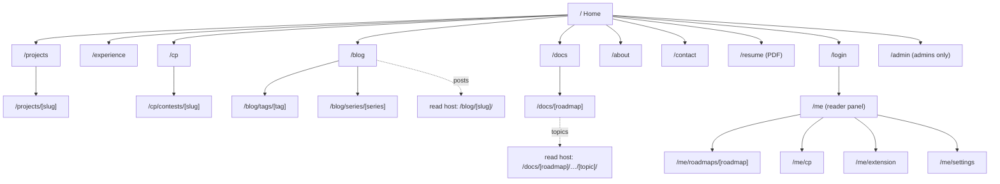
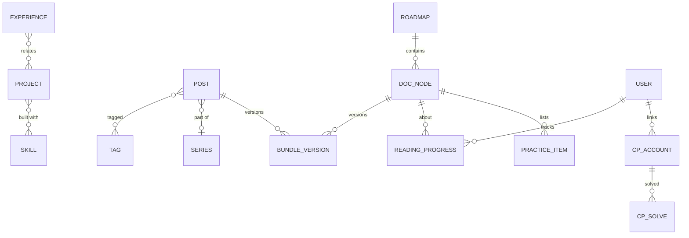

# 03 — Information Architecture

> Status: **Draft v0.2** · Related: [01 PRD](01-product-requirements.md), [04 Design](04-design-system.md), [09 Admin](09-admin-panel.md), [10 Bundles & Docs](10-roadmap-docs-system.md), [19 Guests](19-guest-accounts-and-progress.md)
>
> **Revision 0.2:** the content origin is renamed `read.eyasir329.dev` and hosts **docs and blog
> posts**. New routes: `/login`, `/me/**`, content-origin `/__rt`, `/__api`, `/__auth`.

Domain names are **placeholders** until `Q-01` / `Q-04` are answered.

---

## 1. Hosts

| Host | Purpose | Who uses it | Cookies |
|---|---|---|---|
| `eyasir329.dev` | Portfolio, blog index, docs catalog/map, **sign-in, reader panel (`/me`)**, admin, APIs | Everyone | Supabase auth cookies (host-only) for signed-in users (guests and admins) |
| `www.eyasir329.dev` | 308 → apex | — | — |
| `read.eyasir329.dev` | **Content origin ("reading room")**: roadmap topics (`/docs/…`), **blog posts (`/blog/…`)**, generated pages, reader runtime and reader API | Readers | Only the narrow reader session (`__Host-rt_session`, HttpOnly) + `rt_signed_in` hint, and signed preview cookies |

One Next.js deployment serves both hosts; `proxy.ts` routes by `Host` ([06 §5](06-system-architecture.md)).

## 2. Sitemap

## 3. Route inventory

### 3.1 Public routes — main origin

| Route | Page | Rendering | Cache tags | Index? |
|---|---|---|---|---|
| `/` | Home | Static shell + cached data | `profile`, `projects`, `posts`, `cp`, `docs`, `settings` | ✅ |
| `/about` | About | Cached | `profile`, `education`, `skills`, `certifications` | ✅ |
| `/projects`, `/projects/[slug]` | Projects, case study | Cached | `projects`, `project:{id}`, `github` | ✅ |
| `/experience` | Timeline | Cached | `experiences` | ✅ |
| `/cp`, `/cp/contests/[slug]` | CP Journey (owner) | Cached; chart/3D islands | `cp` | ✅ |
| `/blog` (`?page=`) | Post list (metadata) | Cached | `posts` | ✅ |
| `/blog/tags/[tag]`, `/blog/series/[series]` | Archives | Cached | `posts` | ✅ |
| `/blog/[slug]` | **308 → `read…/blog/{slug}/`** | Route handler | `posts` | — |
| `/docs`, `/docs/[roadmap]` | Catalog, roadmap map (+ progress dots when signed in: dynamic hole) | Cached shell + dynamic progress | `docs`, `docs:{id}` | ✅ |
| `/contact`, `/privacy`, `/terms` | Contact, legal | Static | `settings` | ✅ |
| `/resume` | Current CV | Route handler | `resume` | ✅ |
| `/login` | Sign in (Google, GitHub) | Dynamic | — | ❌ |
| `/feed.xml`, `/atom.xml`, `/feed.json` | Feeds | Cached | `posts` | — |
| `/sitemap.xml`, `/robots.txt`, `/manifest.webmanifest` | Metadata | Generated | all | — |
| `/og/[type]/[id]` | OG images | Cached | per entity | ❌ |
| `/search` | Search results | Dynamic | — | ❌ |

### 3.2 Reader panel — main origin (session required, all `noindex`, never cached)

| Route | Screen |
|---|---|
| `/me` | Dashboard: continue reading, roadmap progress, activity, CP summary, next topic |
| `/me/roadmaps/[roadmap]` | Roadmap progress tree, reset |
| `/me/cp` | Linked judge accounts, sync status, stats, charts, solved list |
| `/me/extension` | Extension tokens, install guide |
| `/me/settings` | Profile, providers, export, delete, sign out everywhere |

### 3.3 Admin routes — main origin (admins only, `noindex`)

`/admin/login` (alias of `/login`) · `/admin` · `/admin/profile` · `/admin/projects[/…]` ·
`/admin/experience[/…]` · `/admin/education[/…]` · `/admin/skills` · `/admin/certifications[/…]` ·
`/admin/cp[/contests…]` · `/admin/blog[/…]` (HTML editor) · `/admin/blog/tags`, `/series` ·
`/admin/docs[/…]` · `/admin/templates` · `/admin/media` · `/admin/resume` · `/admin/messages` ·
`/admin/users` · `/admin/readers` · `/admin/sync` · `/admin/settings` · `/admin/redirects` ·
`/admin/audit` · `/admin/admins` 🔒 · `/admin/tokens` 🔒.

### 3.4 API routes — main origin

Auth (`/auth/callback`, `/auth/bridge`, `/auth/signout`), cron, revalidate, bundle imports/uploads
(admin/CLI), **extension ingestion** (`/api/cp/ext/*` + NEUPC-compatible aliases), views, health.
Contracts: [13 §4.1](13-api-and-data-flow.md).

### 3.5 Content origin routes — `read.eyasir329.dev`

| Pattern | Serves |
|---|---|
| `/` | Reading-room home (generated: roadmaps + latest posts) |
| `/docs/{roadmap}/` · `/docs/{roadmap}/{…node path}/` | Roadmap root / phase / module / topic `index.html` (uploaded or generated) |
| `/docs/{roadmap}/{…}/{file}` | Files of a topic bundle |
| `/blog/{slug}/` · `/blog/{slug}/{file}` | Blog post bundle |
| Any directory path without `/` | 308 → with `/` |
| `/__rt/runtime.v1.js` | Reader runtime |
| `/__api/me`, `/__api/progress`, `/__api/progress/summary`, `/__api/visit` | Reader API ([13 §4.2](13-api-and-data-flow.md)) |
| `/__auth/callback`, `/__auth/signout` | Reader session bridge |
| `/__preview/{token}/…` | Draft/version previews (noindex, no-store) |
| `/sitemap.xml`, `/robots.txt` | Content-origin SEO |

## 4. Navigation model

### 4.1 Primary navigation

`Work` · `Experience` · `CP` · `Blog` · `Docs` · `About` + search, theme, **account entry**, and
**Contact**.

**Account entry:** anonymous → a quiet "Sign in" text link (the site is a portfolio first; sign-in
isn't a hero CTA). Signed in → avatar menu: *My progress* (`/me`), *CP tracking* (`/me/cp`),
*Settings*, *Admin* (admins only), *Sign out*.

### 4.2 Footer (colophon)

*Index* (primary links + Resume, Privacy, Terms) · *Elsewhere* (GitHub, LinkedIn, Codeforces, email,
RSS) · *Readers* ("Track your progress" → `/login` or `/me`) · *Colophon*.

### 4.3 Breadcrumbs

Depth ≥ 2 pages (main origin); `BreadcrumbList` JSON-LD. Content-origin pages use their own
breadcrumbs as authored.

### 4.4 Cross-linking rules

| From | Links to |
|---|---|
| Project | Related posts (content origin), docs roadmap, skills, experience |
| Post listing | The post on the content origin; series and tags on the main site |
| CP page | CP roadmap, NEUPC, contest write-ups, "Track your own CP progress" → `/me/cp` |
| Docs map | Topics on the content origin; "Sign in to track progress" |
| Topic / post (content origin) | As authored + the runtime chip (sign-in / "My progress") |
| `/me` | Content-origin deep links ("Continue: std::vector §4") |

## 5. Page blueprints

Sections hide when empty.

| Page | Top → bottom |
|---|---|
| **Home** | Hero (3D) → proof strip → I. Selected work → II. Contest record → III. Writing → IV. The library → V. Chronology → Coda |
| **Projects / Project** | As in revision 0.1 |
| **Experience** | Title → filters → chronology → CV link |
| **CP Journey** | Summary → 10 judge cards → Colonnade + table → rating charts (judge toggle) → heatmap → onsite contests → tags/difficulty → milestones → links ("Track your own progress") |
| **Blog index** | Title → tag filter → list (title, date, reading time, excerpt) → pagination |
| **Docs catalog / map** | Catalog cards → map: phases (Roman numerals) → modules → topics (serial · title · time · status · progress dot if signed in) |
| **About / Contact** | As in revision 0.1 |
| **Login** | Title "Sign in" → one-line promise ("Save your roadmap progress and track your CP journey across 10 judges") → Google / GitHub buttons → what we store (3 bullets) → Privacy link |
| **`/me`** | Greeting → *Continue reading* card → roadmap progress cards → activity calendar/streak → CP summary strip → next recommended topic |
| **`/me/cp`** | Linked accounts table (+ Add account) → combined summary → per-judge cards → charts → solved list → roadmap practice solved |
| **`/me/settings`** | Profile → sign-in providers → sessions (sign out everywhere) → data (export, delete) |

## 6. URL & slug rules

| Rule | Detail |
|---|---|
| Slug format | `^[a-z0-9]+(?:-[a-z0-9]+)*$`, ≤ 80 chars, unique per type |
| Changes | Main-origin redirects (`redirects`) and content-origin redirects (`content_redirects`) |
| Trailing slash | Main origin: none. Content origin: directories always end in `/` |
| KB path segments | Exactly as bundle folder names (`phase-1`, `1_basics`, `3_std_vector`) |
| Case | Main origin lowercase; content origin case-sensitive |
| Return URLs | `/login?return=` accepts main-origin relative paths or content-origin URLs only |

## 7. Content relationships

## 8. Empty, loading and error states

| State | Rule |
|---|---|
| Empty section | Hidden publicly; admin explains and offers "Create" |
| Loading | Streaming skeletons with final dimensions; 3D posters |
| Signed out on `/me/**` | Redirect to `/login?return=` |
| Guest on `/admin/**` | 403 page with a link to `/me` |
| Sync stale / failing | Public: "as of {date}". `/me/cp`: per-account status with a fix hint (e.g. "Install the extension for CSES") |
| Not found | 404 with search; redirects where possible |
| Server error | Friendly page with a digest ID |
