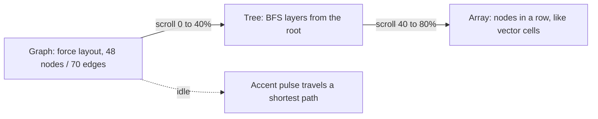
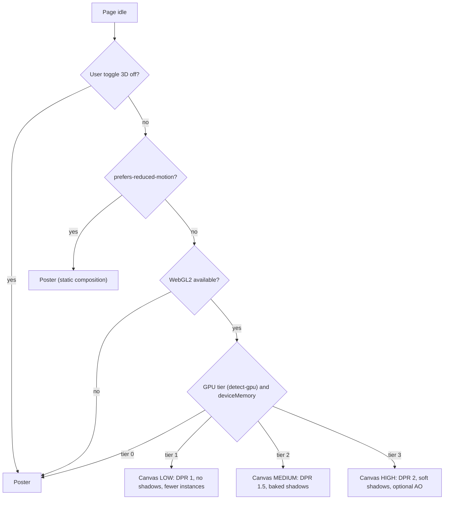

# 05 — 3D Experience

> Status: **Draft v0.1** · Related: [04 Design](04-design-system.md), [02 NFR-PERF-09/10, NFR-A11Y-04/05](02-non-functional-requirements.md), [ADR-008](17-risks-and-decisions.md)

---

## 1. Intent

3D is the **sculpture in the gallery**. It must:

1. **Mean something.** Each scene shows a real idea from Eyasir's work (graphs, contest history,
   shipped projects), not generic particles.
2. **Stay quiet.** Monochrome plaster, soft studio light, slow motion, one object per view.
3. **Never block content.** Text paints first; 3D fades in over a matching poster image.
4. **Degrade gracefully.** No WebGL2, low-tier GPU, reduced motion or the user's "3D off" toggle all
   get the poster. Every piece of information is also in the DOM.

## 2. Scene catalogue

| ID | Scene | Page | Idea | Priority |
|---|---|---|---|---|
| **S1** | **Plaster Graph** | Home hero | "The shapes I think in." A plaster graph of ~48 nodes that re-forms, as you scroll, into a **tree** and then an **array**. The accent colour traces a shortest path | M |
| **S2** | **The Colonnade** | CP Journey | One fluted classical column per month since the first solve; **height = problems accepted that month**. Capitals with contests get the accent. The camera walks along it as you scroll | S |
| **S3** | **Exhibit Plinth** | Project detail header | The project's hero screenshot as a thin framed slab on a plinth; slow turntable on pointer move | C |
| **S4** | **Broken Column** | 404 | A fallen column drum. "This page is lost to antiquity." | S |

No 3D on Blog, Docs, About or admin: those are for reading and working.

### 2.1 S1 — Plaster Graph (hero)

| Aspect | Specification |
|---|---|
| Geometry | `InstancedMesh` of spheres (icosphere detail 3, ~320 triangles each) for nodes; `InstancedMesh` of thin cylinders for edges (instance matrices updated per frame during a morph) |
| Layouts | Pre-computed at build time into `scene-graph.json` (seeded force layout, BFS tree, array row), so there is no physics at runtime. Positions are interpolated with `--ease-in-out` |
| Material | `MeshStandardMaterial`: colour `--plaster`, roughness 0.9, metalness 0; subtle noise normal map (256 px, tiling) for a plaster grain |
| Light | drei `Environment` with 3 `Lightformer`s (key softbox top-left, fill right, rim back) — no HDR download; one shadow-casting directional light, or baked `AccumulativeShadows` / `ContactShadows` onto a paper-coloured ground |
| Accent | One path of 5–7 nodes/edges turns `--accent` in sequence every ~6 s (idle only) |
| Interaction | Pointer parallax (±4° rotation, damped); scroll drives layout morph t ∈ [0,1]; no click targets (decorative) |
| Caption | DOM text under the canvas: "Graph → tree → array: the shapes I think in." (visible, so screen readers get it too) |
| Mobile | 32 nodes, DPR ≤ 1.5, no shadows (baked blob instead), morph on scroll only |

### 2.2 S2 — The Colonnade (CP)

| Aspect | Specification |
|---|---|
| Data | `cp_activity_monthly` view: month, accepted count, contest count, max rating that month |
| Geometry | One column = `LatheGeometry` shaft with 16 flutes (normal-mapped, not modelled) + simple Doric capital and base; `InstancedMesh`, height scaled per instance. Stylobate (stepped base) as a single box mesh |
| Scale | Height ∝ √(accepted) so that one huge month doesn't flatten the rest; axis labels every year in DOM overlay (drei `Html`, occluded) |
| Encoding | Accent capital = a month with a rated contest; ICPC month gets a small accent laurel (torus) |
| Interaction | Hover/focus on a column (raycast) shows a DOM tooltip "Mar 2025 · 64 solved · 3 contests". **Keyboard:** the equivalent table rows are the focus targets; focusing a row highlights its column |
| Camera | Scroll-scrubbed dolly from the first month to today (Lenis progress → camera along a spline) |
| Accessible twin | "View as table" toggle + an SVG bar chart fallback with the same data (always in the DOM, visually hidden when 3D is on) |

### 2.3 S3 — Exhibit Plinth (projects, Could)

A 3 mm framed slab textured with the project's hero screenshot (KTX2/AVIF → texture), on a plaster
plinth; ±8° turntable following the pointer; falls back to the flat hero image. Uses the shared
canvas `View` so there is no second WebGL context.

### 2.4 S4 — Broken Column (404)

A single glTF (≤ 60 KB, Meshopt-compressed) fallen drum and capital; slow 0.05 rad/s idle rotation;
poster fallback.

## 3. Technical architecture

| Choice | Decision |
|---|---|
| Renderer | **Three.js** (WebGL2) via **React Three Fiber v9** (React 19) + **drei** helpers. WebGPU renderer is out of scope for v1 (re-evaluate in v2) |
| Canvas strategy | **One shared `<Canvas>`** mounted once in the public layout (fixed, full-viewport, `pointer-events: none` except when a scene needs hover), with **drei `<View>`** portals tracking DOM placeholders. Route changes swap views without recreating the WebGL context |
| Loading | The canvas module is loaded with `next/dynamic({ ssr: false })` **after** the page is idle (`requestIdleCallback`, 2 s timeout) and only if the capability gate passes |
| Frame loop | `frameloop="demand"`; `invalidate()` on scroll, pointer move and active tweens. The idle accent pulse runs at a capped 30 fps. Nothing renders while a View is offscreen (IntersectionObserver) or the tab is hidden |
| Adaptivity | drei `PerformanceMonitor` → lower DPR (2 → 1.5 → 1), disable shadows, then fall back to the poster if fps stays < 24 for 3 s |
| Post-processing | None by default. Optional N8AO ambient occlusion on the "high" tier only, if `SP-05` shows it's worth the cost |
| Colour management | `SRGBColorSpace` output, ACES Filmic tone mapping, exposure tuned so plaster matches `--plaster` against `--paper` in both themes (theme change updates materials and the environment) |
| Assets | Procedural geometry first. Any glTF: authored in Blender → `gltf-transform` (Meshopt, KTX2/WebP textures, `dedup`, `prune`) → `gltfjsx --types` for a typed component. Stored in `/public/3d/` with immutable caching |
| State | Scroll progress and quality tier live in a tiny Zustand store shared by DOM and canvas |

### 3.1 Capability gate (decides poster vs. canvas)

### 3.2 Posters

- Each scene has a pre-rendered poster (AVIF + WebP, light and dark, 1x/2x) generated by a script
  that renders the scene headlessly at the "high" preset (Phase 6 tooling). Posters use the same
  camera as frame 0, so the swap is seamless (cross-fade 480 ms).
- Posters are regular `next/image` elements with explicit dimensions: zero CLS, and they're what
  Lighthouse sees.

## 4. Budgets

| Metric | Desktop (high) | Mobile (low/medium) |
|---|---|---|
| JS for 3D (three + r3f + drei subset + scenes), gzip | ≤ 250 KB (lazy) | same chunk, loaded only if the gate passes |
| Assets per scene (textures + models) | ≤ 300 KB | ≤ 150 KB |
| Draw calls | ≤ 40 | ≤ 20 |
| Triangles | ≤ 150k | ≤ 50k |
| Frame time | ≤ 16.7 ms (60 fps) | ≤ 33 ms (30 fps) |
| GPU memory (textures) | ≤ 48 MB | ≤ 24 MB |
| Time from idle to first 3D frame | ≤ 800 ms on a cached visit | ≤ 1500 ms |

Measured with `r3f-perf` in development, and with a Playwright check that samples
`requestAnimationFrame` deltas on a reference device profile (see [15](15-testing-and-qa.md)).

## 5. Accessibility rules for 3D

- Canvas and View containers have `aria-hidden="true"` and `role="presentation"`; no focusable
  elements inside the canvas.
- Every scene has a visible text caption, and every data-bearing scene has a DOM twin (table/SVG).
- No flashing (< 3 flashes/second); the accent pulse is a slow colour ease, not a flash.
- Reduced motion shows a static composition (poster or a frozen frame), with no parallax or
  auto-rotation.
- 3D never captures scrolling or wheel events (no scroll-jacking); Lenis stays off on touch devices.

## 6. Delivery steps

| Step | Output | Phase |
|---|---|---|
| `SP-05` Art-direction spike (2 days) | Prototype of S1 at three quality tiers; stills for design sign-off; measured fps on laptop + phone | Phase 1 |
| Canvas infrastructure | Shared canvas, View system, capability gate, quality store, poster swap | Phase 6 |
| S1 production | Build-time layout generator, morph, accent path, posters | Phase 6 |
| S2 production | Monthly data view, instanced columns, tooltip/table sync, posters | Phase 6 |
| S4, then S3 | 404 scene; project plinth (if time) | Phase 6 |
| Perf and a11y pass | Budgets verified; reduced motion verified | Phase 6 / 7 |
