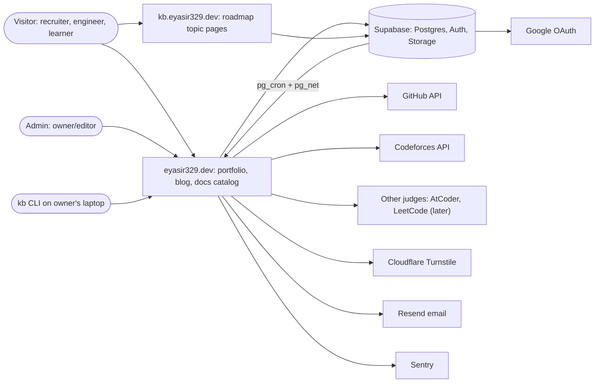
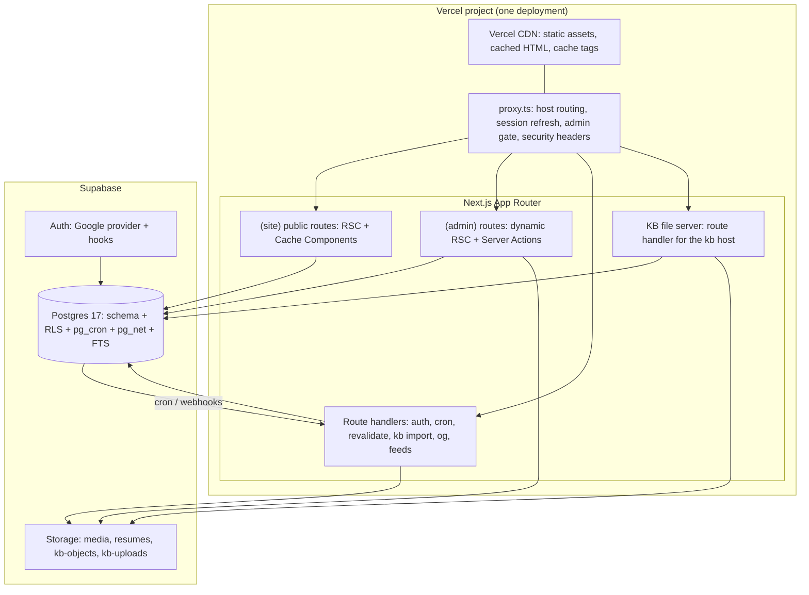
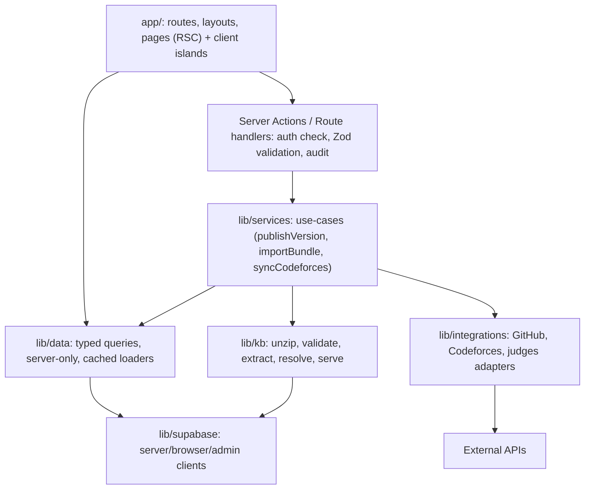
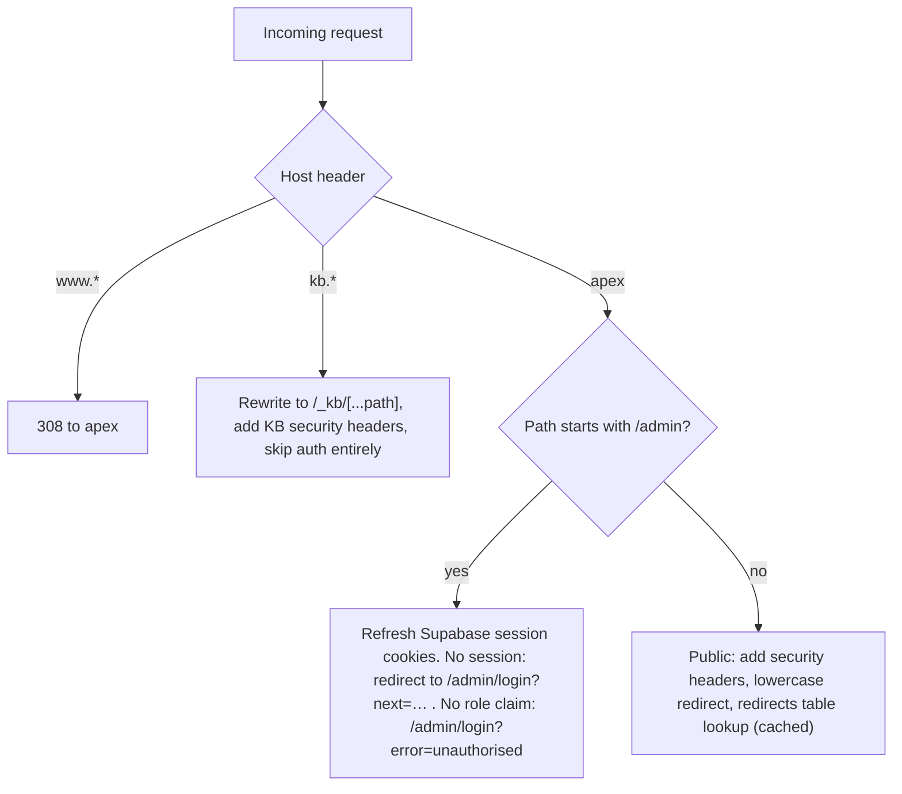
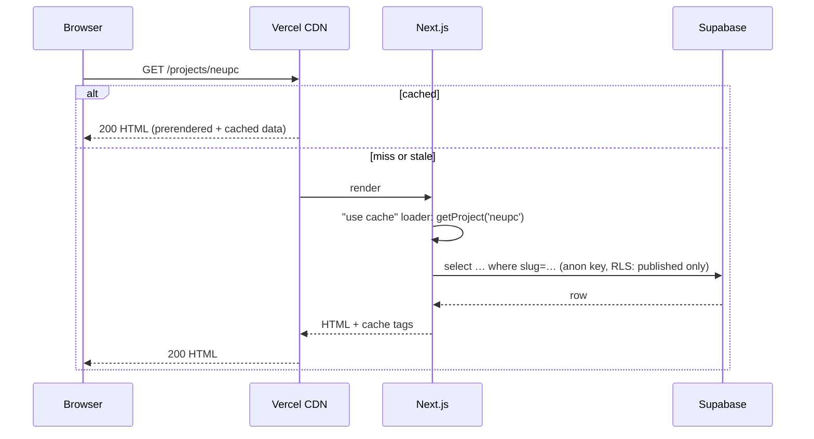
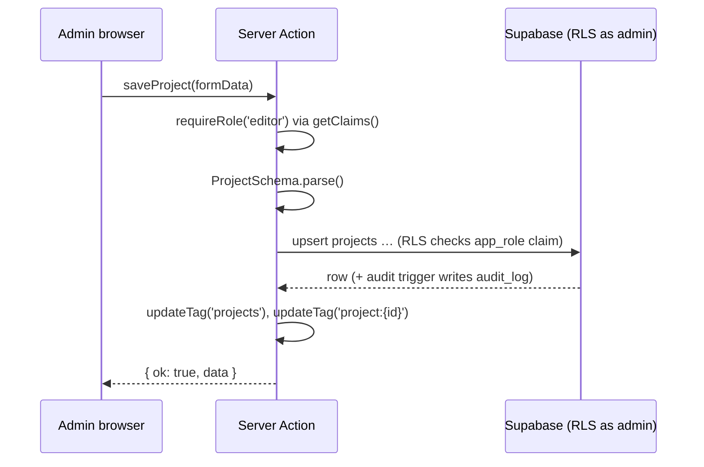
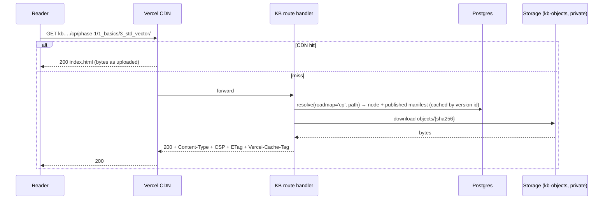
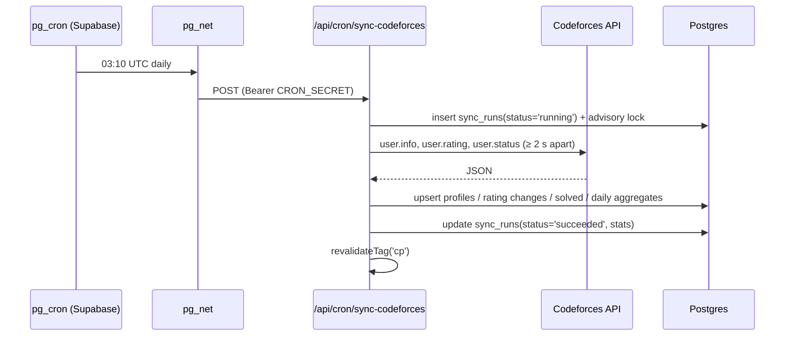

# 06 — System Architecture

> Status: **Draft v0.1** · Related: [07 DB](07-database-design.md), [08 Security](08-auth-and-security.md), [10 Roadmap Docs](10-roadmap-docs-system.md), [13 API](13-api-and-data-flow.md), [14 DevOps](14-devops-and-environments.md), [17 ADRs](17-risks-and-decisions.md)

---

## 1. Architecture at a glance

A **single Next.js 16 application** deployed on **Vercel** serves two hostnames: the portfolio and
admin (main origin), and the isolated Roadmap Docs **content origin**. **Supabase** provides Postgres
(with RLS), Auth (Google OAuth) and Storage. Scheduled work is triggered by **pg_cron + pg_net**
inside Supabase, which calls authenticated route handlers.

### 1.1 System context (C4 level 1)



### 1.2 Containers (C4 level 2)



## 2. Technology stack

Versions are the **targets at scaffold time**. The exact minor versions get pinned in
`package.json` during Phase 1 and recorded in the Phase 1 PR.

| Layer | Choice | Why | ADR |
|---|---|---|---|
| Framework | **Next.js 16** (App Router, Turbopack, Cache Components, `proxy.ts`) | RSC for zero-JS content pages, Server Actions for admin, first-class Vercel support; mandated | ADR-001 |
| UI runtime | **React 19** | Required by Next 16; Actions, `useOptimistic`, `useFormStatus` | — |
| Language | **TypeScript 5.x** `strict` | Safety across DB types → UI | — |
| Styling | **Tailwind CSS v4** (CSS-first `@theme`) + CSS custom-property tokens | Fast, token-driven, tiny CSS | ADR-011 |
| Admin UI kit | **shadcn/ui** (Radix primitives) | Accessible primitives we own as source | ADR-011 |
| 3D | **three.js** + **@react-three/fiber v9** + **@react-three/drei** + `detect-gpu` | Mandated Three.js; R3F fits React | ADR-008 |
| Motion | **Motion** (DOM), **Lenis** (smooth scroll, 3D pages only) | Small, accessible (reduced-motion aware) | — |
| Data | **Supabase** Postgres 17, `@supabase/supabase-js` v2 + `@supabase/ssr`, generated types | Mandated; RLS-first; no ORM layer to keep in sync | ADR-002 |
| Validation | **Zod** (v4) | One schema for forms, actions and APIs | — |
| Forms | React Hook Form + `@hookform/resolvers/zod` | Mature, fast | — |
| Tables | TanStack Table | Server-side pagination/sort for admin | — |
| Markdown | unified: `remark-parse`, `remark-gfm`, `remark-math`, `remark-directive`, `remark-rehype`, `rehype-katex`, `rehype-slug`, `rehype-autolink-headings`, **Shiki** (`@shikijs/rehype`), custom directive handlers | Safe (no raw HTML), fast, cacheable | ADR-007 |
| Editor | CodeMirror 6 (Markdown mode) | Lightweight, extensible, great for code-heavy posts | ADR-007 |
| KB ingestion | `fflate` (streaming unzip), `parse5` / `node-html-parser` (metadata extraction), Node `crypto` (SHA-256) | Pure JS, works in Vercel functions | ADR-004/005/006 |
| Search | Postgres full-text search (`tsvector`, GIN) + `pg_trgm` | No extra service | ADR-009 |
| Charts | Hand-rolled SVG (server-rendered) + small client tooltip; **visx** as a fallback for complex charts | Tiny, themeable, accessible | — |
| Email | **Resend** + React Email templates | Simple, free tier | — |
| Bot protection | **Cloudflare Turnstile** | Privacy-friendly CAPTCHA alternative | — |
| Analytics | **Vercel Web Analytics + Speed Insights** (cookieless) | Zero setup; field Core Web Vitals | — |
| Errors | **Sentry** (`@sentry/nextjs`) | Errors + traces, free tier | — |
| Scheduling | **pg_cron + pg_net** (primary), Vercel Cron (daily backup trigger) | Vercel Hobby cron is limited to once/day | ADR-010 |
| Package manager | **pnpm** | Fast, strict | — |
| Lint/format | ESLint (flat config, `eslint-config-next`) + Prettier (+ Tailwind plugin) | Standard | — |
| Tests | Vitest, Testing Library, Playwright, `@axe-core/playwright`, Lighthouse CI, pgTAP (`supabase test db`) | See [15](15-testing-and-qa.md) | — |
| Hosting | **Vercel** (Hobby at launch) | Mandated by the existing workflow; CDN + functions | — |

## 3. Rendering & caching strategy

Next.js 16 **Cache Components** is enabled (`cacheComponents: true`), so nothing is cached unless
explicitly marked. Public data loaders are `"use cache"` functions tagged per entity. Admin
mutations invalidate those tags.

| Surface | Strategy | Invalidation |
|---|---|---|
| Public pages | Static shell (prerendered) + cached data functions (`"use cache"`, `cacheLife('days')`, `cacheTag(...)`). Dynamic holes (e.g. theme-independent) are avoided; search params pages stream | `updateTag()` in server actions (read-your-writes for the admin); `revalidateTag()` from cron/webhook handlers |
| Admin pages | Fully dynamic (per-request, session-bound); never cached | n/a |
| Feeds, sitemaps, OG | Route handlers with `"use cache"` + tags | Same tags as the content |
| KB content origin | Route handler streams from Storage. Responses carry `Cache-Control: public, max-age=60, s-maxage=31536000, stale-while-revalidate=86400` and a `Vercel-Cache-Tag` of `kb:{roadmapId}` + `kb-node:{nodeId}` | On publish/rollback: `invalidateByTag('kb-node:{id}')` via `@vercel/functions` (validated in `SP-02`) |
| Static assets | Hashed filenames, `immutable` | New deploy |

**Cache tag catalogue** (single source of truth: `lib/cache/tags.ts`):

| Tag | Invalidated when |
|---|---|
| `settings`, `profile` | Settings/profile saved |
| `projects`, `project:{id}` | Project saved/published/reordered |
| `experiences`, `education`, `skills`, `certifications` | Respective entity saved |
| `cp` | CP profile/contest saved; sync finished |
| `github` | GitHub sync finished |
| `posts`, `post:{id}` | Post saved/published/scheduled publish fired |
| `docs`, `docs:{roadmapId}` | Roadmap/outline/node status changed, version published |
| `kb-node:{nodeId}` (CDN) | Version published/rolled back, visibility changed |
| `resume` | CV version switched |
| `redirects` | Redirect added/removed |

## 4. Layered code architecture



Rules:
- `lib/data/*` and `lib/services/*` import `server-only`. Client components get data as props or
  through server actions only.
- Three Supabase clients: `createServerClient` (cookie session, RLS as the user), `createBrowserClient`
  (admin UI realtime/uploads only), `createAdminClient` (secret key, bypasses RLS). The admin client
  is allowed **only** in `lib/services/*` for cron, sync, contact insert and KB serving, never in
  code paths that run with user input unless the user is already authorised.
- Every server action follows the same shape:
  `requireRole()` → `schema.parse()` → service call → `audit()` → `updateTag()` → typed result.

## 5. Host routing (`proxy.ts`)



- `/_kb/*` is **only** reachable through the kb host (a direct request on the apex returns 404).
- Proxy runs on the Node.js runtime (Next 16), so it can use the same Supabase SSR helper as route
  handlers.

## 6. Key sequences

### 6.1 Public page request (cache hit / miss)



### 6.2 Admin edits content



### 6.3 Content-origin request (topic page)



### 6.4 Bundle import & publish

Covered step by step in [10 §6](10-roadmap-docs-system.md).

### 6.5 Scheduled sync



## 7. Repository layout (planned)

```text
/
├─ app/
│  ├─ (site)/                      # public portfolio (Marble & Ink layout, shared 3D canvas)
│  │  ├─ page.tsx                  # Home
│  │  ├─ about/ projects/ experience/ cp/ blog/ docs/ contact/ privacy/
│  │  └─ layout.tsx
│  ├─ (admin)/admin/               # admin panel (shadcn layout); login is public
│  ├─ _kb/[...path]/route.ts       # content-origin file server (reached only via kb host rewrite)
│  ├─ auth/callback/route.ts
│  ├─ api/{cron,revalidate,kb,views,health}/…
│  ├─ og/[type]/[id]/route.tsx
│  ├─ feed.xml/route.ts  sitemap.ts  robots.ts  manifest.ts
│  └─ not-found.tsx  error.tsx  global-error.tsx
├─ components/{ui,site,admin,three,prose}/
├─ lib/
│  ├─ supabase/{server,browser,admin}.ts
│  ├─ auth/{require-role,claims}.ts
│  ├─ data/…                       # cached loaders per entity (server-only)
│  ├─ services/…                   # use-cases (server-only)
│  ├─ kb/{unzip,validate,extract,manifest,resolve,serve,generate}/…
│  ├─ integrations/{github,codeforces,judges}/…
│  ├─ markdown/{pipeline,directives,toc,reading-time}.ts
│  ├─ cache/tags.ts  seo/…  validation/…  security/{csp,headers,rate-limit}.ts
├─ proxy.ts
├─ supabase/
│  ├─ config.toml
│  ├─ migrations/*.sql             # forward-only, timestamped
│  ├─ seed.sql                     # generated from docs/18 inventory
│  └─ tests/*.sql                  # pgTAP RLS tests
├─ scripts/
│  ├─ kb-cli/                      # `pnpm kb push` (bulk upload via API)
│  ├─ build-scene-layouts.ts       # 3D layout precompute
│  └─ render-posters.ts            # 3D posters
├─ public/{3d,posters,fonts?}/
├─ tests/{unit,e2e,fixtures/kb}/
├─ docs/                           # ← this planning set
└─ .github/workflows/ci.yml …
```

## 8. Cross-cutting concerns

| Concern | Approach |
|---|---|
| Configuration | Typed env loader (`lib/env.ts`, Zod): fail fast at boot if a required variable is missing |
| Feature flags | `site_settings.flags` (JSON): `threeD`, `comments`, `viewCounter`, `announcement`; read through the cached `settings` loader |
| Logging | Structured `console` JSON in route handlers/actions (Vercel logs) + Sentry breadcrumbs; secrets and emails redacted |
| Errors | `error.tsx` boundaries per segment; server actions return typed errors, never throw to the client; Sentry captures with a digest ID |
| Time | All timestamps `timestamptz` in UTC; displayed in `Asia/Dhaka` by default (configurable) |
| i18n readiness | Strings for public chrome in one `lib/copy.ts`; content is single-language in v1 |
