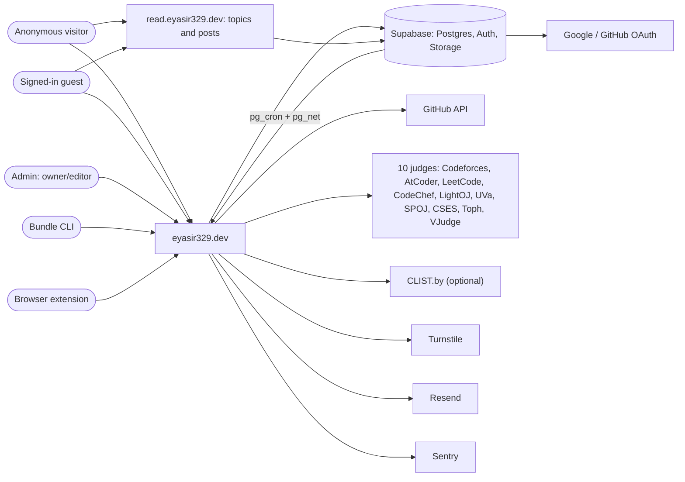
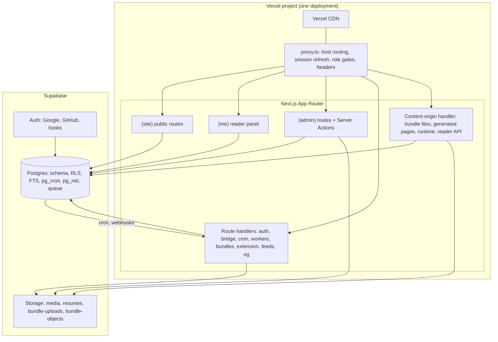
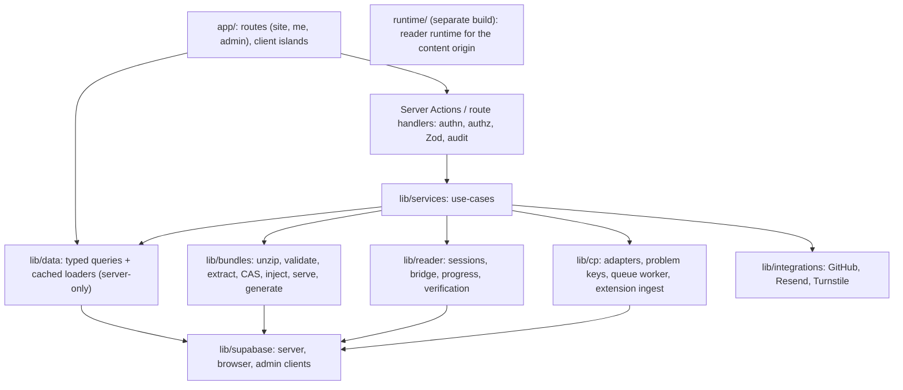
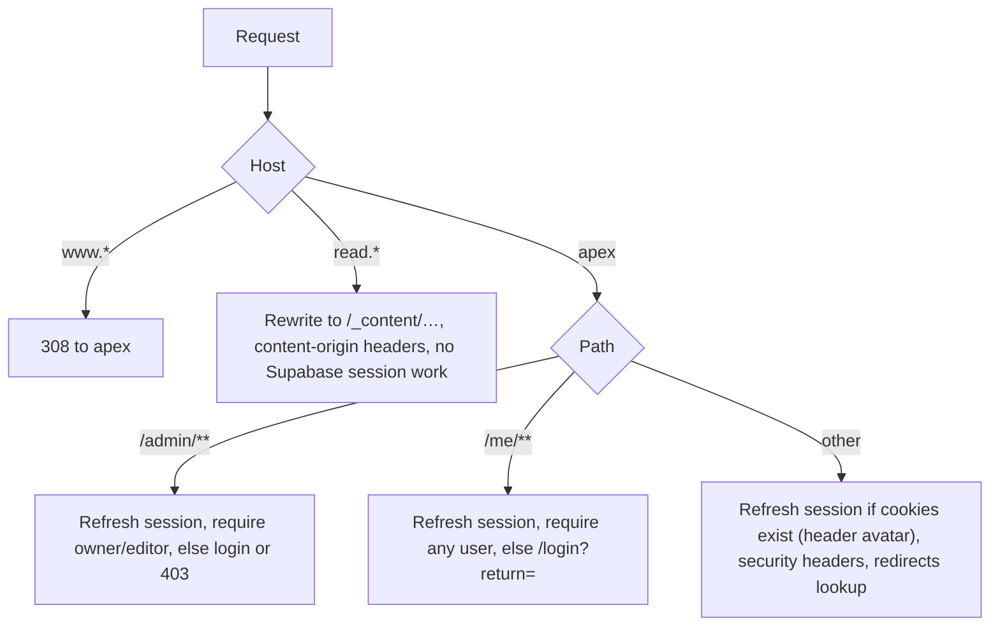
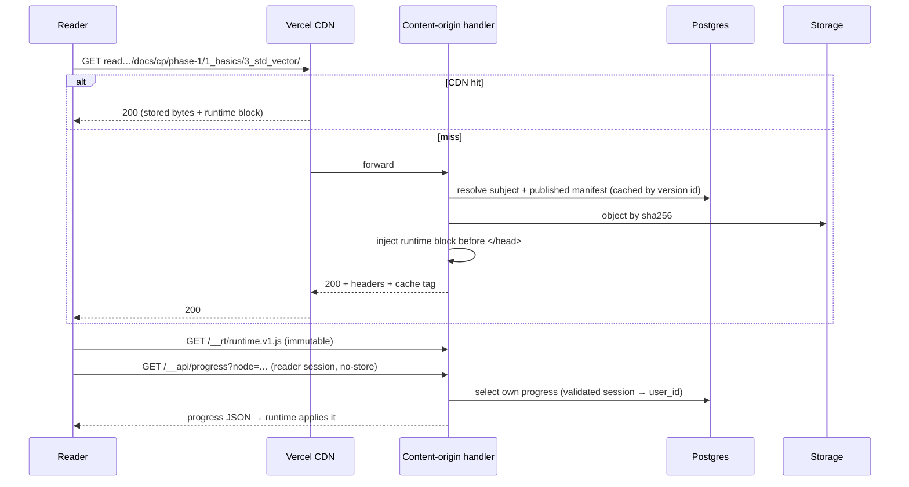
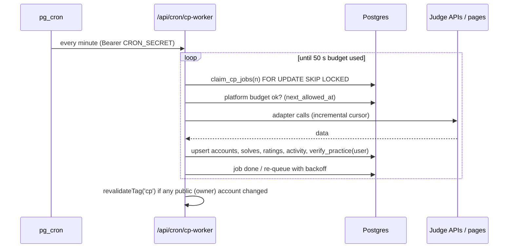

# 06 — System Architecture

> Status: **Draft v0.2** · Related: [07 DB](07-database-design.md), [08 Security](08-auth-and-security.md), [10 Bundles & Docs](10-roadmap-docs-system.md), [13 API](13-api-and-data-flow.md), [14 DevOps](14-devops-and-environments.md), [17 ADRs](17-risks-and-decisions.md), [19 Guests](19-guest-accounts-and-progress.md), [20 CP tracking](20-cp-multi-platform-tracking.md)
>
> **Revision 0.2:** content origin renamed `read.` and extended to blog posts; reader runtime, reader
> API and session bridge; guest accounts; CP worker queue for 10 judges; extension ingestion.

---

## 1. Architecture at a glance

A **single Next.js 16 application** on **Vercel** serves two hosts:

- the **main origin**: portfolio, blog index, docs map, sign-in, reader panel, admin and APIs;
- the **content origin**: HTML bundles for topics and posts, generated pages, reader runtime and
  reader API.

**Supabase** provides Postgres (RLS), Auth (Google + GitHub) and Storage. **pg_cron + pg_net** drive
scheduled work, including a CP sync worker every minute.

### 1.1 System context (C4 level 1)



### 1.2 Containers (C4 level 2)



## 2. Technology stack

| Layer | Choice | Why | ADR |
|---|---|---|---|
| Framework | **Next.js 16** (App Router, Turbopack, Cache Components, `proxy.ts`) | RSC, Server Actions, Vercel-native | ADR-001 |
| UI runtime | **React 19** | Required by Next 16 | — |
| Language | **TypeScript** strict | End-to-end types | — |
| Styling | **Tailwind CSS v4** + CSS tokens | Token-driven | ADR-011 |
| Admin UI | **shadcn/ui** (Radix) | Accessible, owned source | ADR-011 |
| 3D | three.js + R3F v9 + drei + detect-gpu | Mandated; progressive enhancement | ADR-008 |
| Motion | Motion, Lenis (3D pages only) | Small, reduced-motion aware | — |
| Data | Supabase Postgres + `@supabase/supabase-js` + `@supabase/ssr`, generated types, SQL migrations | RLS-first, no ORM | ADR-002 |
| Auth | Supabase Auth (Google, GitHub) + hooks; custom reader-session bridge for the content origin | Guests + allowlisted admins in one system | ADR-003, ADR-015 |
| Validation / forms / tables | Zod · React Hook Form · TanStack Table | — | — |
| Site-rendered rich text | Markdown via unified/remark/rehype + Shiki + KaTeX (case studies, bio, write-ups, privacy) | Safe on the main origin | ADR-007 (narrowed) |
| **Author HTML** (topics, posts) | **Bundle engine**: `fflate` (zip), `parse5` (metadata extraction, runtime injection), SHA-256 CAS | Faithful rendering, versioning | ADR-004/005/006/014/020 |
| **HTML editor** | CodeMirror 6 (HTML/CSS/JS), Prettier standalone in a worker | Write posts/topics in admin | ADR-014 |
| **Reader runtime** | Vanilla TS → `runtime.v1.js` (≤ 8 KB gzip), built by esbuild | Runs inside untrusted pages; no framework | ADR-016 |
| **Judge adapters** | TypeScript ports of NEUPC services; `node-html-parser` for HTML adapters | Reuse proven logic | ADR-017, ADR-018 |
| Queue | Postgres table + `FOR UPDATE SKIP LOCKED`, pg_cron worker | No extra service | ADR-019 |
| Search | Postgres FTS + `pg_trgm` | No extra service | ADR-009 |
| Charts | Server-rendered SVG + small client tooltips | Tiny, accessible | — |
| Email · bot protection · analytics · errors | Resend · Turnstile · Vercel Analytics/Speed Insights · Sentry | Free tiers | — |
| Scheduling | pg_cron + pg_net (primary), Vercel Cron (daily backup) | Hobby cron limit | ADR-010 |
| Tooling | pnpm, ESLint + Prettier, Vitest, Playwright, axe, Lighthouse CI, pgTAP | — | — |
| Hosting | Vercel (Hobby at launch) | — | — |

## 3. Rendering & caching

| Surface | Strategy | Invalidation |
|---|---|---|
| Public main-origin pages | Prerendered shell + `"use cache"` loaders with tags | `updateTag` in actions; `revalidateTag` from jobs |
| `/docs/[roadmap]` progress dots | Dynamic hole (per user) inside a cached page | n/a (no-store) |
| `/me/**`, `/admin/**` | Dynamic, never cached | n/a |
| Content-origin HTML and files | Same bytes for every visitor (runtime block is identical for all) → CDN cached; `Vercel-Cache-Tag: content:{subjectId}` | `invalidateByTag` on publish/rollback |
| Reader API (`/__api/*`) | `private, no-store` | n/a |
| Feeds, sitemaps, OG | Cached with content tags | Same tags |

**Tag catalogue** (`lib/cache/tags.ts`): `settings`, `profile`, `projects`, `project:{id}`,
`experiences`, `education`, `skills`, `certifications`, `cp` (owner's public CP data), `github`,
`posts`, `post:{id}`, `docs`, `docs:{roadmapId}`, `resume`, `redirects`; CDN tags
`content:{subjectId}`.

## 4. Layered code architecture



Rules: `lib/data`, `lib/services`, `lib/bundles`, `lib/reader`, `lib/cp` are `server-only`. The
secret-key client is used only in services for cron/workers, contact, bundle serving, reader-API
writes (after session validation) and extension ingestion (after token validation).

## 5. Host routing (`proxy.ts`)



`/_content/*` is reachable only through the content host (404 on the apex).

## 6. Key sequences

### 6.1 Public page request

Unchanged from revision 0.1: CDN hit, or render with cached loaders under RLS.

### 6.2 Admin edits content

`requireRole` → Zod → upsert under RLS → audit trigger → `updateTag` → typed result.

### 6.3 Content-origin request (topic or post)



### 6.4 Guest sign-in from the content origin

See [19 §2.2](19-guest-accounts-and-progress.md) (main-origin OAuth → one-time code → reader
session).

### 6.5 Scheduled and queued sync



### 6.6 Bundle import & publish

[10 §6.2](10-roadmap-docs-system.md).

## 7. Repository layout (planned)

```text
/
├─ app/
│  ├─ (site)/            # public portfolio, blog index, docs catalog/map, login
│  ├─ (me)/me/           # reader panel
│  ├─ (admin)/admin/     # admin panel (HTML editor under blog/, docs/, templates/)
│  ├─ _content/[...path]/route.ts   # content-origin handler (files, generated pages, /__api, /__auth, /__rt)
│  ├─ auth/{callback,bridge,signout}/route.ts
│  ├─ api/{cron,revalidate,bundles,cp/ext,problem-solving,views,health}/…
│  ├─ blog/[slug]/route.ts          # 308 to the content origin
│  ├─ og/[type]/[id]/route.tsx  feed.xml/  sitemap.ts  robots.ts
├─ components/{ui,site,me,admin,three,prose,editor}/
├─ lib/{supabase,auth,data,services,bundles,reader,cp,integrations,markdown,cache,seo,validation,security}/
├─ runtime/                          # reader runtime source (vanilla TS) → public/__rt/runtime.v1.js
├─ proxy.ts
├─ supabase/{config.toml,migrations/,seed.sql,tests/}
├─ scripts/{bundle-cli/,build-scene-layouts.ts,render-posters.ts}
├─ public/{3d,posters}/
├─ tests/{unit,e2e,fixtures/{bundles,judges,markdown}}/
└─ docs/
```

## 8. Cross-cutting concerns

| Concern | Approach |
|---|---|
| Configuration | Typed env (`lib/env.ts`); fail fast |
| Feature flags | `site_settings.flags` + per-platform `cp_platforms.enabled`/`scraping_enabled` |
| Logging | Structured logs; secrets, emails and tokens redacted; judge responses never logged in full |
| Errors | Segment error boundaries; typed action errors; Sentry with digests |
| Time | UTC storage; display in the viewer's timezone (`/me`), `Asia/Dhaka` for owner pages |
| Privacy by design | Guest data behind RLS; aggregates for admin; export/delete built in from day one |
