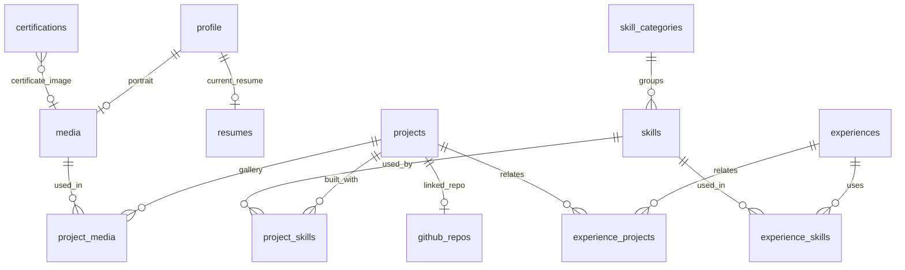
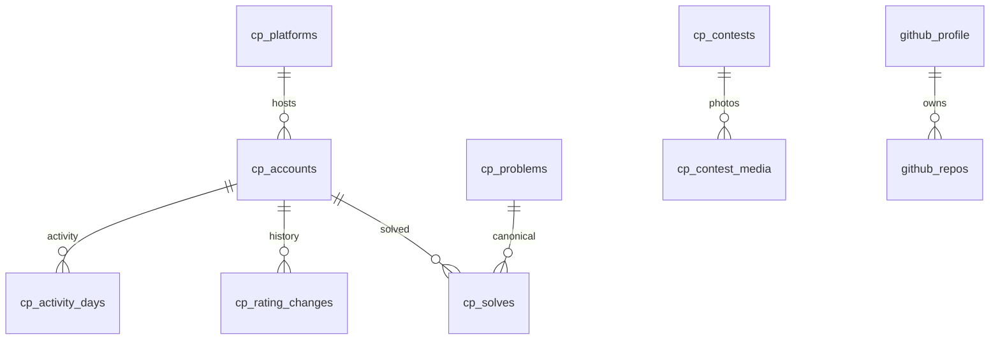
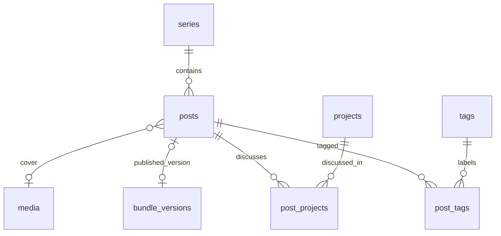
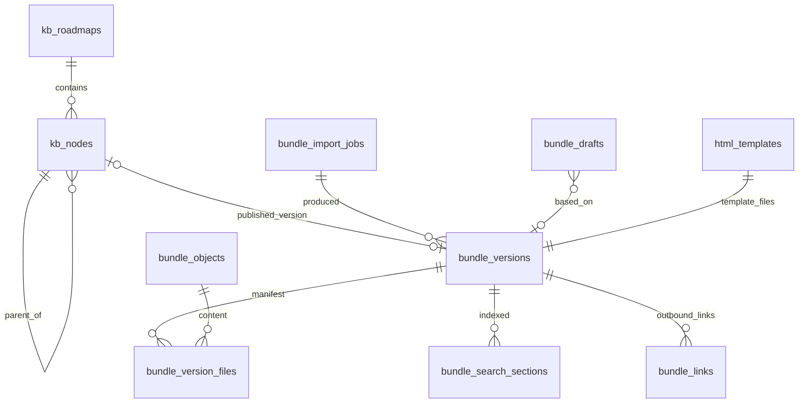
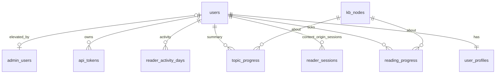
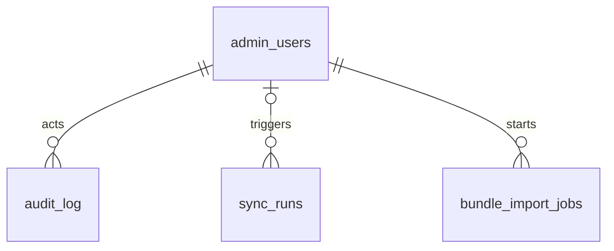

# 07 — Database Design (Supabase / Postgres)

> Status: **Draft v0.3** · Related: [06 Architecture](06-system-architecture.md), [08 Security](08-auth-and-security.md), [10 Bundles & Docs](10-roadmap-docs-system.md), [19 Guest accounts](19-guest-accounts-and-progress.md), [20 CP tracking](20-cp-multi-platform-tracking.md), [18 Content inventory](18-content-inventory.md)
>
> **Revision 0.2:** accounts & progress tables (§4.9); CP tables are now **per user**, with
> canonical problems and a sync queue (§4.3); the KB storage tables are generalised into a
> **bundle engine** shared by roadmap nodes and blog posts (§4.6); posts lose `body_md` (§4.5).
>
> **Revision 0.3:** learner CP tracking removed. CP tables are **owner-only** again (no `user_id`,
> visibility, sync queue or practice-verification tables); guests own only reading-progress rows.

---

## 1. Principles

| # | Principle |
|---|---|
| 1 | **RLS on every table** in `public`, default deny. Internal tables and `SECURITY DEFINER` functions live in a non-exposed `private` schema |
| 2 | `uuid` keys (`gen_random_uuid()`), except natural keys (`bundle_objects.sha256`, `site_settings.key`, `cp_problems.problem_key`) |
| 3 | `timestamptz` (UTC); `created_at`/`updated_at` via trigger |
| 4 | `snake_case`, plural tables; enums for closed sets, lookup tables for open sets |
| 5 | Publishable content: `status publish_status` + `published_at`; public = `status='published' and published_at <= now()` |
| 6 | Explicit `sort_order` wherever order is visible |
| 7 | Every **admin** write is audited (`audit_log`); guest writes are not audited individually (privacy, volume) |
| 8 | **User-owned rows carry `user_id uuid not null references auth.users on delete cascade`**, and guest RLS is always `user_id = (select auth.uid())` |
| 9 | Schema changes only via migrations; types regenerated in the same PR |
| 10 | External data stored as snapshots, never fetched on page load |

Extensions: `pgcrypto`, `pg_trgm`, `citext`, `pg_cron`, `pg_net`, `unaccent`.

## 2. Enums

```sql
create type publish_status       as enum ('draft', 'scheduled', 'published', 'archived');
create type admin_role           as enum ('owner', 'editor');                 -- allowlist roles
create type app_role             as enum ('owner', 'editor', 'guest');        -- JWT claim
create type user_status          as enum ('active', 'banned', 'deleting');
create type experience_kind      as enum ('work', 'internship', 'freelance', 'leadership', 'teaching', 'volunteer');
create type project_status       as enum ('ongoing', 'completed', 'maintained', 'archived');
create type project_kind         as enum ('web', 'ai', 'systems', 'hardware', 'tooling', 'other');
create type media_kind           as enum ('image', 'video', 'document', 'model');
create type message_status       as enum ('new', 'read', 'archived', 'spam');
create type sync_status          as enum ('running', 'succeeded', 'partial', 'failed');
create type kb_node_kind         as enum ('root', 'phase', 'module', 'topic');
create type kb_node_status       as enum ('planned', 'draft', 'published', 'archived');
create type bundle_subject       as enum ('kb_node', 'post');
create type bundle_version_status as enum ('processing', 'ready', 'failed');
create type bundle_version_source as enum ('upload', 'bulk', 'cli', 'editor', 'rollback');
create type bundle_import_status as enum ('uploaded', 'analysing', 'awaiting_confirmation', 'applying', 'done', 'failed', 'cancelled');
create type runtime_mode         as enum ('inject', 'self', 'off');
create type cp_account_status    as enum ('pending', 'syncing', 'synced', 'needs_extension', 'failing', 'paused');
create type cp_solve_source      as enum ('api', 'scrape', 'extension', 'vjudge', 'clist', 'manual');
```

## 3. Entity-relationship diagrams

### 3.1 Profile, portfolio and media



### 3.2 Competitive programming (owner only)



### 3.3 Blog



### 3.4 Bundle engine & Roadmap Docs



### 3.5 Accounts, sessions & reading progress



### 3.6 System



## 4. Table specifications

Notation: **PK**, **FK**, **UQ**, `?` nullable. `created_at`/`updated_at` omitted below.

### 4.1 Core

**`profile`** (singleton, `id smallint PK check (id = 1)`): `full_name`, `headline`, `positioning`,
`short_bio`, `long_bio_md`, `location`, `email_public citext?`, `phone text?` + `show_phone bool
default false`, `portrait_media_id?`, `availability jsonb`, `current_resume_id?`, `timezone default
'Asia/Dhaka'`, **`owner_user_id uuid? FK auth.users`** (links the owner's user account, e.g. for
`/me`).

**`site_settings`** (`key text PK`, `value jsonb`): `seo`, `nav`, `home_sections`, `flags`,
`announcement`, `footer`, `privacy_md`, `docs_defaults`, `blog_defaults`, **`auth`** (enabled
providers), **`cp`** (global CP settings, e.g. CLIST enabled).

**`social_links`**, **`media`** (alt required for images; credit/licence/source fields),
**`resumes`**, **`redirects`** (main-origin paths): as in revision 0.1.

### 4.2 Portfolio

`skill_categories`, `skills`, `projects` (+ `project_skills`, `project_media`), `experiences`
(+ `experience_skills`, `experience_projects`), `education`, `certifications`, `achievements`:
unchanged from revision 0.1 (`projects.body_md` stays Markdown; case studies are site-rendered).

### 4.3 Competitive programming

**`cp_platforms`** (lookup, seeded with the 10 judges + extensible)

| Column | Type | Notes |
|---|---|---|
| id | smallint PK | |
| slug | text UQ | codeforces, atcoder, leetcode, codechef, lightoj, uva, spoj, cses, toph, vjudge |
| name | text | |
| handle_label | text | "Handle", "Username", "User ID (numeric)" (CSES) |
| handle_pattern | text | Regex validated on add |
| profile_url_template | text | e.g. `https://atcoder.jp/users/{handle}` |
| capabilities | jsonb | `{ "profile": "api", "ratingHistory": "api", "solved": "api" \| "scrape" \| "extension" \| "none" }` (matrix in [20 §2](20-cp-multi-platform-tracking.md)) |
| has_rating | bool | false for UVa, CSES, VJudge, SPOJ |
| rank_scheme | jsonb? | rating → title/colour bands |
| budget_per_min | int | politeness budget |
| min_interval_ms | int | |
| next_allowed_at | timestamptz | throttle between runs (e.g. after a 429) |
| enabled | bool | global kill switch (admin) |
| scraping_enabled | bool | per-platform flag for HTML adapters (`Q-29`) |
| health | jsonb | last success/failure, error rate (admin sync centre) |

**`cp_accounts`** (replaces `cp_profiles`; **the owner's accounts only**)

| Column | Type | Notes |
|---|---|---|
| id | uuid PK | |
| platform_id | smallint FK | |
| handle | text | UQ(platform_id, handle) |
| platform_user_id | text? | uHunt id (UVa), numeric id (CSES) |
| is_primary | bool | per platform |
| status | cp_account_status | |
| sync_enabled | bool | |
| sync_state | jsonb | cursors: CF last submission id, AtCoder `from_second`, VJudge offset, uHunt last id |
| current_rating, max_rating | int? | |
| rank_title, max_rank_title | text? | |
| solved_count | int? | distinct canonical solves on this account |
| contests_count | int? | |
| override | jsonb | manual values (e.g. `"solved_label": "1000+"`) |
| last_synced_at, last_error | timestamptz?, text? | |
| consecutive_failures | smallint | |
| sort_order, show_on_site | int, bool | owner's public page |

**`cp_problems`** (shared canonical catalogue): `problem_key text PK` (`codeforces:704A`),
`platform_id`, `platform_problem_id`, `name?`, `url`, `difficulty int?`, `tags text[]`,
`updated_at`. Filled from judge problem lists (Codeforces problemset, AtCoder problems.json) and
from the owner's solves.

**`cp_solves`**: `id bigserial`, `account_id FK`, `problem_key FK → cp_problems`, `first_ac_at
timestamptz`, `source cp_solve_source`, `external_submission_id text?`. UQ(account_id, problem_key).
Indexes: `(problem_key)` (cross-judge dedupe), `(first_ac_at)`.

**`cp_rating_changes`**: `id`, `account_id FK`, `external_contest_id`, `contest_name`,
`contest_date`, `rank`, `old_rating`, `new_rating`. UQ(account_id, external_contest_id).

**`cp_activity_days`**: `account_id`, `day date`, `accepted int`, `submissions int`, PK(account_id,
day).

**`cp_contests`**, **`cp_contest_media`**, **`cp_milestones`**: the owner's onsite contests and
milestones, unchanged.

### 4.4 GitHub

`github_profile`, `github_repos`: unchanged (owner only).

### 4.5 Blog (posts are bundles)

**`posts`**

| Column | Type | Notes |
|---|---|---|
| id, slug | uuid PK, text UQ | slug = path segment on the content origin (`/blog/{slug}/`) |
| title, excerpt | text | **Listing overrides**; default from extracted metadata |
| tags | via `post_tags` | defaults from `article:tag` meta on first save |
| series_id, series_order | uuid?, smallint? | |
| cover_media_id | uuid? | overrides `og:image` for listings |
| status | publish_status | |
| published_at | timestamptz? | publish/scheduled time |
| published_version_id | uuid? FK → bundle_versions | the served version |
| scheduled_version_id | uuid? FK → bundle_versions | version to publish at `published_at` |
| reading_minutes, sections_count, word_count | int? | copied from the published version's metadata |
| runtime_mode | runtime_mode | default `inject` |
| chip_mode | text | `hidden` (default for posts) / `compact` / `full` |
| csp_extra | jsonb | per-post CSP additions (e.g. a chart library CDN) |
| private_globs | text[] | default `{}` |
| canonical_url | text? | if cross-posted elsewhere |
| seo_title, seo_description, og_media_id | | used on the main-site listing and OG image |
| is_featured | bool | |
| view_count | bigint | only if the view counter is enabled |

`tags`, `post_tags`, `series`, `post_projects`, `content_views`: unchanged. **Removed:**
`posts.body_md`, `posts.toc` (now in version metadata) and `post_revisions` (replaced by
`bundle_versions` + `bundle_drafts`).

### 4.6 Bundle engine & Roadmap Docs

**`kb_roadmaps`**: as in rev 0.1 (`slug` → `/docs/{slug}/`, `theme_css`, `theme_storage_key`,
`progress_key_pattern`, `private_globs`, `csp_extra`, `licence`) **plus** `runtime_mode runtime_mode
default 'inject'`, `chip_mode text default 'full'`, `controls jsonb default '{"section":
"input[data-done]", "practice": "input.pchk"}'`.

**`kb_nodes`**: as in rev 0.1 (root/phase/module/topic, `segment`, `path`, `serial`, `status`,
`published_version_id → bundle_versions`, listing stats, `prerequisites`) **plus** `section_keys
text[]` and `practice_keys text[]` (copied from the published version, used for progress totals).

**`bundle_objects`** (CAS): `sha256 text PK`, `bytes`, `storage_path`
(`bundle-objects/{xx}/{sha}`), `sniffed_type`, `first_seen_at`, `last_referenced_at`.

**`bundle_versions`**

| Column | Type | Notes |
|---|---|---|
| id | uuid PK | |
| subject_type | bundle_subject | `kb_node` / `post` |
| subject_id | uuid | FK enforced by trigger (polymorphic) |
| version_no | int | UQ(subject_type, subject_id, version_no) |
| status | bundle_version_status | |
| source | bundle_version_source | |
| import_job_id | uuid? | |
| based_on_version_id | uuid? | editor saves and quick edits |
| entry_file | text | `index.html` |
| file_count, total_bytes | int, bigint | |
| bundle_sha256 | text | hash of the sorted manifest |
| meta | jsonb | extracted metadata ([10 §5.3](10-roadmap-docs-system.md)) |
| report | jsonb | `{errors, warnings, infos}` |
| notes | text? | change note |
| first_published_at | timestamptz? | |
| created_by | uuid | |

**`bundle_version_files`**: `version_id`, `path`, `sha256 FK`, `bytes`, `content_type`, `is_private`,
PK(version_id, path).

**`bundle_links`**: `version_id`, `from_file`, `href`, `resolved_path?`, `kind`, `target_subject_id?`,
`status` (ok | missing | planned | private), PK(version_id, from_file, href).

**`bundle_search_sections`**: `id`, `version_id`, `subject_type`, `subject_id`, `anchor?`, `heading`,
`body`, `tsv` (generated, weighted), GIN(tsv).

**`bundle_drafts`** (new, editor working copy): `id`, `subject_type`, `subject_id`,
`base_version_id?`, `files jsonb` (overlay: `{ "index.html": { "text": "…" }, "assets/a.png": {
"sha256": "…" }, "old.css": { "deleted": true } }`), `updated_by`, `updated_at`. One active draft per
subject; autosaved every 5 s while dirty; text files ≤ 2 MB each in the overlay.

**`bundle_import_jobs`**: as rev 0.1 (`kind` single | tree | post), with `subject_type`.

**`html_templates`** (new): `id`, `name`, `kind` (post | topic), `description`, `version_id FK →
bundle_versions` (template files are a bundle), `is_default bool`.

**`content_redirects`** (replaces `kb_redirects`; content origin): `id`, `from_path` (e.g.
`/docs/cp/phase-1/old_name/`, `/blog/old-slug/`), `to_path`, UQ(from_path).

### 4.7 Contact

`messages`: unchanged.

### 4.8 System

**`admin_users`**: unchanged (email PK, `user_id`, `role admin_role`, `is_active`).

**`audit_log`**: unchanged (admin actions; also logs bans, deletions, role changes).

**`private.api_tokens`** (**admins only**: bundle CLI and the owner's browser extension): `id`,
`user_id`, `name`, `token_hash`, `prefix`, `scopes text[]` (`bundle:read`, `bundle:write`,
`bundle:publish`, `cp:ingest`), `expires_at`, `last_used_at?`, `revoked_at?`. A check function
rejects tokens for users without an active `admin_users` row.

**`sync_runs`**: every run of GitHub and of each judge platform (status, stats, cursor progress, error).

**`private.rate_limits`**: unchanged.

### 4.9 Accounts, sessions & reading progress (new)

**`user_profiles`** (created by trigger on `auth.users` insert)

| Column | Type | Notes |
|---|---|---|
| user_id | uuid PK FK auth.users (cascade) | |
| display_name | text | from the OAuth provider, editable |
| avatar_url | text? | |
| status | user_status | `banned` blocks sign-in (hook) and API use |
| timezone | text | default from the browser on first visit |
| last_seen_at | timestamptz? | updated at most hourly |
| deletion_requested_at | timestamptz? | deletion job runs ≤ 30 days later |
| inactivity_notice_at | timestamptz? | retention policy (`Q-34`) |

**`private.reader_sessions`**: `id_hash text PK` (SHA-256 of the cookie value), `user_id`,
`created_at`, `last_seen_at`, `expires_at` (30 days sliding), `revoked_at?`, `ua_hash?`.

**`private.reader_bridge_codes`**: `code_hash PK`, `user_id`, `return_url`, `expires_at` (60 s),
`used_at?`.

**`reading_progress`**: `user_id`, `node_id FK kb_nodes`, `key text` (`s4`, `p2`), `done bool`,
`updated_at`, PK(user_id, node_id, key). Writes via the reader API
(service key after session validation) or the verification job.

**`topic_progress`** (maintained by trigger on `reading_progress` and on visits): `user_id`,
`node_id`, `sections_done`, `practice_done`, `started_at`, `completed_at?`,
`last_visited_at?`, `last_anchor?`, PK(user_id, node_id). Totals come from `kb_nodes.section_keys` /
`practice_keys` at read time, so they follow republished topics.

**`reader_activity_days`**: `user_id`, `day date` (user's timezone), `events int`, PK(user_id, day).

**`private.blocked_email_domains`**: `domain text PK` (disposable-email list, refreshed monthly).

## 5. Views

| View | Purpose | Access |
|---|---|---|
| `v_public_stats` | Proof-strip numbers: combined distinct solves across the owner's shown accounts (override-aware), CF max rating, repos, stars, projects, published topics and posts | anon |
| `v_timeline` | Chronology union | anon |
| `cp_activity_monthly_public` | Monthly accepted solves for the owner's shown accounts (Colonnade) | anon |
| `kb_roadmap_outline` | Flattened tree with status, serials, counts | anon |
| `v_my_roadmap_progress` | Per-user, per-roadmap totals (sections done/total, topics completed) | `authenticated`, own rows (`security_invoker`) |
| `v_reader_analytics` | Aggregates only: registered/active users, completion per topic, drop-off section per topic | admin (`security_invoker` + admin check) |

## 6. Functions & triggers

| Name | Purpose |
|---|---|
| `private.set_updated_at()`, `private.audit_row()`, `private.slug_redirect()`, `private.kb_node_path()` | As rev 0.1 (`slug_redirect` also writes `content_redirects` for posts) |
| `private.is_admin()`, `private.is_owner()` | Check an active `admin_users` row for `auth.uid()` |
| `public.hook_before_user_created(event)` | **Revised:** rejects emails from `blocked_email_domains` and banned addresses; everyone else may sign up as a guest |
| `public.custom_access_token_hook(event)` | **Revised:** `app_role` = `owner` / `editor` (active allowlist row) or `guest`; adds `user_status`; banned users get no role |
| `private.handle_new_user()` | Trigger on `auth.users` insert: creates `user_profiles`; links `admin_users.user_id` by email |
| `private.recompute_topic_progress()` | Trigger on `reading_progress`: updates `topic_progress` and `reader_activity_days` |
| `private.delete_user_data(user_id)` | Called by the deletion job: revokes sessions, then deletes the auth user (cascades to profile and progress) |
| `public.search_all(q, lim)` | FTS over projects, published bundle sections (posts + topics) |
| `public.increment_view(entity, id)` | Optional view counter |
| `private.rate_limit(key, max, per)` | Generic limiter |
| `private.publish_due_posts()` | Publishes scheduled post versions whose time has come; calls revalidation |

## 7. Row Level Security

```sql
-- guest-owned table pattern
alter table reading_progress enable row level security;
create policy "owner of the row reads" on reading_progress for select to authenticated
  using (user_id = (select auth.uid()));
-- no insert/update policies for authenticated: writes go through the reader API / server actions,
-- which validate keys against kb_nodes.section_keys/practice_keys, then write with the service key.

-- owner CP data: public read of shown accounts, admin writes
create policy "shown accounts are readable" on cp_accounts for select to anon, authenticated
  using (show_on_site);
create policy "admins manage accounts" on cp_accounts for all to authenticated
  using ((select private.is_admin())) with check ((select private.is_admin()));
```

### 7.1 Policy matrix

| Table(s) | anon | guest (own rows) | editor | owner-only |
|---|---|---|---|---|
| Portfolio content, profile, settings (public keys), media, tags, series, skills, platforms, redirects | read published | read published | R/W | — |
| posts, kb_roadmaps, kb_nodes | read published (nodes: planned + published) | same | R/W | delete |
| bundle_* (versions, files, links, drafts, imports, templates, objects), content_redirects | ❌ (content origin uses the server key) | ❌ | R/W | purge |
| bundle_search_sections | via `search_all` / server only | same | R | — |
| user_profiles | ❌ | read own; update `display_name`, `timezone` | read all | ban, delete |
| reading_progress, topic_progress, reader_activity_days | ❌ | read own (writes via API) | aggregate views only | — |
| cp_accounts | read `show_on_site` rows | same as anon | R/W | platform kill switches |
| cp_solves, cp_rating_changes, cp_activity_days | read rows of shown accounts | same as anon | R (writes by sync jobs) | — |
| cp_problems | read | read | R/W | — |
| cp_contests, cp_milestones, github_* | read published / shown | same | R/W | — |
| messages | ❌ | ❌ | R/W status | delete |
| audit_log, sync_runs | ❌ | ❌ | R | — |
| admin_users | ❌ | ❌ | read own | R/W |
| private.* (sessions, bridge codes, tokens, rate limits, blocked domains) | not exposed | not exposed (tokens via server actions) | not exposed | not exposed |

pgTAP tests cover every row of this matrix (T-DB-*, T-GU-*).

## 8. Storage buckets

| Bucket | Public | Contents | Write | Read |
|---|---|---|---|---|
| `media` | yes | Site images/videos/docs | admin | anyone (via `next/image`) |
| `resumes` | no | CV PDFs (+ `.tex`) | admin | `/resume` handler |
| `bundle-uploads` | no | Zips awaiting import (TUS) | admin / CLI token | import job; deleted after 7 days |
| `bundle-objects` | no | CAS files of topics, posts, templates and editor assets | server (secret key) | content-origin handler |

## 9. Scheduled jobs (pg_cron)

| Job | Schedule (UTC) | Action |
|---|---|---|
| `sync-github` | `05 3 * * *` | → `/api/cron/sync-github` |
| `sync-cp-{platform}` (10 jobs) | `10 3 * * *`, `15 3 * * *`, … (5 min apart) | → `/api/cron/sync-cp?platform=…` (50 s budget, cursor-resumable) |
| `publish-due-posts` | `*/5 * * * *` | `private.publish_due_posts()` |
| `prune-rate-limits` | `0 * * * *` | delete old windows |
| `reader-sessions-cleanup` | `20 * * * *` | delete expired/revoked sessions and used bridge codes |
| `account-deletions` | `40 3 * * *` | process `deletion_requested_at` (≤ 30 days) |
| `inactive-accounts` | `50 3 * * 1` | notices after 24 months inactive; deletion 30 days after notice (`Q-34`) |
| `retention` | `30 3 * * 0` | messages 12 months, sync_runs 90 days, audit_log 24 months |
| `bundle-gc` | `0 4 * * 0` | → `/api/cron/bundle-gc` |
| `bundle-uploads-cleanup` | `15 4 * * *` | → `/api/cron/bundle-uploads-cleanup` |
| `blocked-domains-refresh` | `0 5 1 * *` | → `/api/cron/blocked-domains` |

## 10. Migrations & seed

> **Revision 0.5:** the groups below are **logical**. They are introduced phase by phase, each file
> creating its tables together with their RLS policies and pgTAP tests (no separate "RLS later"
> migration), with CLI-generated timestamped names. See [DEV-03 §4–5](dev/dev-03-supabase-workflow.md).

1. `0001_extensions_enums` → `0002_core` → `0003_portfolio` → `0004_accounts` (user_profiles,
   sessions, bridge codes, tokens) → `0005_bundles` → `0006_kb` → `0007_blog` → `0008_cp` →
   `0009_progress` → `0010_system` → `0011_rls` → `0012_functions_triggers` → `0013_storage` →
   `0014_cron`.
2. `seed.sql`: allowlist row, the 10 `cp_platforms`, skill categories, CV-derived drafts
   ([18](18-content-inventory.md)), an empty `cp` roadmap with nodes known from the reference links,
   the default post and topic templates, settings defaults.

## 11. Capacity estimate (year 1)

| Table | Rows | Size |
|---|---|---|
| reading_progress | ≈ 2,000 users × 20 topics × 20 keys ≈ 0.8M (worst case) | ~80 MB (**largest**) |
| topic_progress, reader_activity_days | ≈ 40k + 100k | ~15 MB |
| cp_solves, cp_activity_days, cp_rating_changes (owner) | ~5k | < 5 MB |
| bundle tables | ~66 topics + ~30 posts, ~3 versions each | ~15 MB |
| Everything else | — | < 30 MB |
| **Total** | | **~150 MB worst case** vs the 500 MB free limit; the upgrade trigger at 350 MB ([14 §9](14-devops-and-environments.md)) is unlikely in year 1 |
