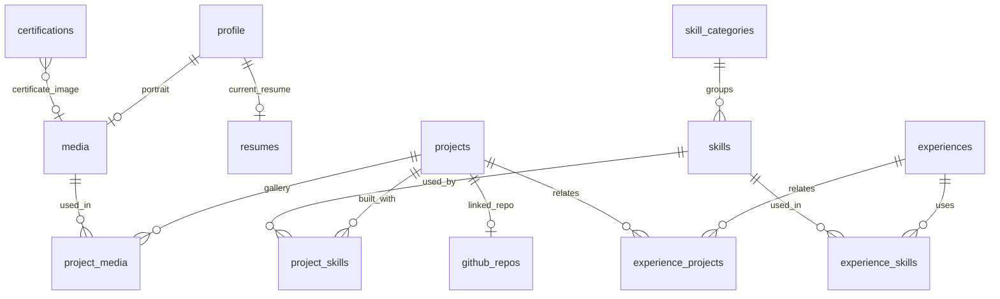
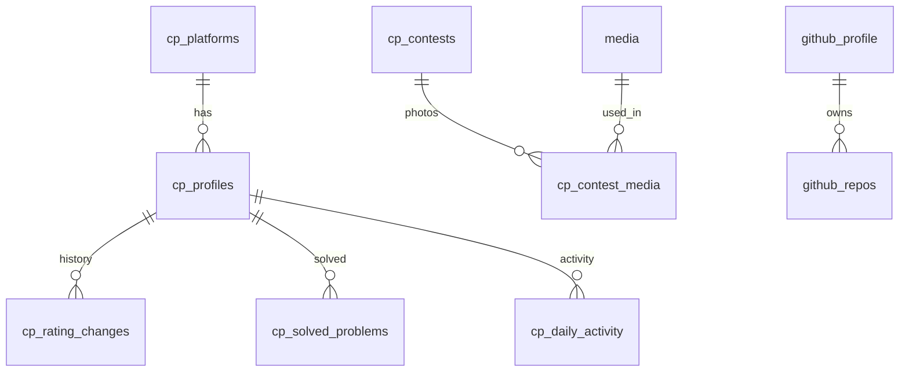
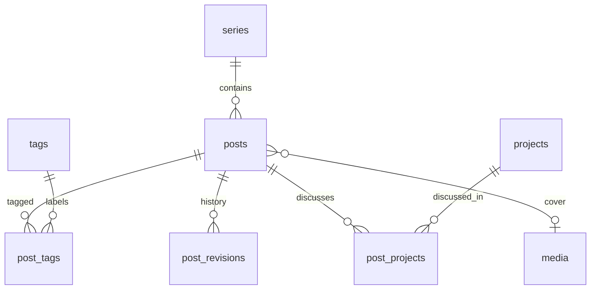
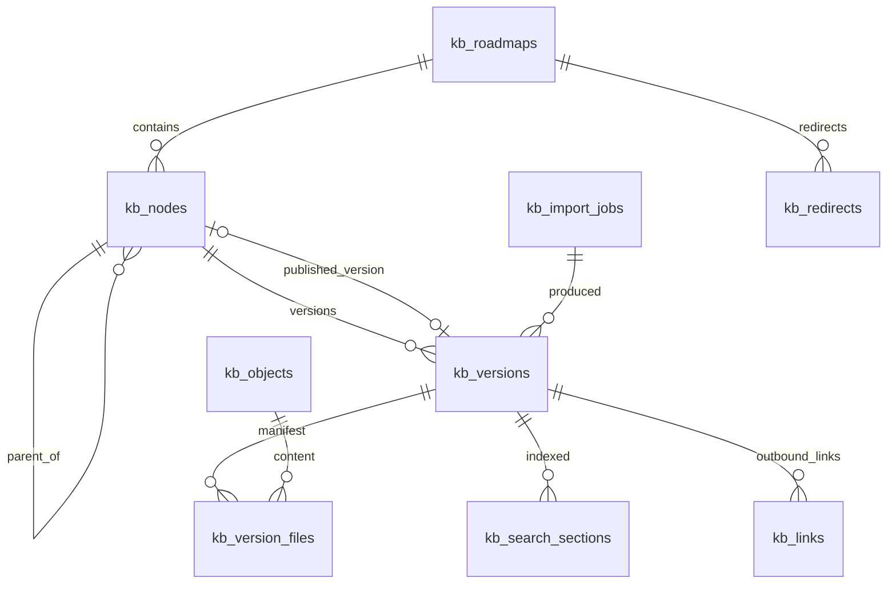
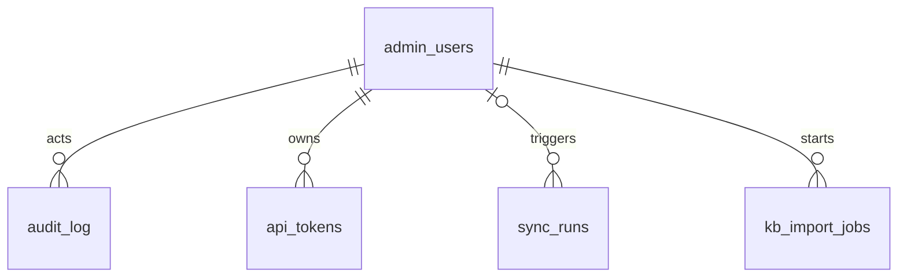

# 07 — Database Design (Supabase / Postgres)

> Status: **Draft v0.1** · Related: [06 Architecture](06-system-architecture.md), [08 Security](08-auth-and-security.md), [10 Roadmap Docs](10-roadmap-docs-system.md), [12 Integrations](12-integrations-and-sync.md), [18 Content inventory](18-content-inventory.md)

---

## 1. Principles

| # | Principle |
|---|---|
| 1 | **RLS on every table** in the exposed `public` schema, default deny. Internal tables and `SECURITY DEFINER` functions live in a non-exposed `private` schema |
| 2 | `uuid` primary keys (`gen_random_uuid()`), except natural keys where meaningful (`kb_objects.sha256`, `site_settings.key`) |
| 3 | `timestamptz` everywhere (UTC); `created_at default now()`, `updated_at` maintained by trigger |
| 4 | `snake_case`; plural table names; enums for closed sets, lookup tables for open sets (judges) |
| 5 | Publishable content uses `status publish_status` + `published_at`; public visibility = `status = 'published' and published_at <= now()` |
| 6 | Ordering is explicit: `sort_order integer not null default 0` wherever order is visible |
| 7 | Every admin write is audited by a generic trigger → `audit_log` |
| 8 | Schema changes only via timestamped migrations in `supabase/migrations`; types regenerated in the same PR |
| 9 | Store derived numbers from sync as **snapshots** (never computed on page load from raw external data) |
| 10 | Slugs: `text` + check `^[a-z0-9]+(?:-[a-z0-9]+)*$` + unique index |

Extensions: `pgcrypto`, `pg_trgm`, `citext`, `pg_cron`, `pg_net`, `unaccent` (search).

## 2. Enums

```sql
create type publish_status    as enum ('draft', 'scheduled', 'published', 'archived');
create type admin_role        as enum ('owner', 'editor');
create type experience_kind   as enum ('work', 'internship', 'freelance', 'leadership', 'teaching', 'volunteer');
create type project_status    as enum ('ongoing', 'completed', 'maintained', 'archived');
create type project_kind      as enum ('web', 'ai', 'systems', 'hardware', 'tooling', 'other');
create type media_kind        as enum ('image', 'video', 'document', 'model');
create type message_status    as enum ('new', 'read', 'archived', 'spam');
create type sync_status       as enum ('running', 'succeeded', 'partial', 'failed');
create type kb_node_kind      as enum ('root', 'phase', 'module', 'topic');
create type kb_node_status    as enum ('planned', 'draft', 'published', 'archived');
create type kb_version_status as enum ('processing', 'ready', 'failed');
create type kb_version_source as enum ('upload', 'bulk', 'cli', 'quick_edit', 'rollback');
create type kb_import_status  as enum ('uploaded', 'analysing', 'awaiting_confirmation', 'applying', 'done', 'failed', 'cancelled');
```

## 3. Entity-relationship diagrams

### 3.1 Profile, portfolio and media



### 3.2 Competitive programming and GitHub



### 3.3 Blog



### 3.4 Roadmap Docs (KB)



### 3.5 System



## 4. Table specifications

Notation: **PK** primary key · **FK** foreign key · **UQ** unique · `?` nullable. Every table also
has `created_at timestamptz not null default now()` and (for mutable tables) `updated_at timestamptz
not null default now()`. These are omitted below.

### 4.1 Core

**`profile`** — singleton (`id smallint PK default 1 check (id = 1)`)

| Column | Type | Notes |
|---|---|---|
| full_name | text | "Eyasir Ahamed" |
| headline | text | "Full-Stack Developer · Software Engineer" |
| positioning | text | 1–2 sentence hero statement |
| short_bio | text | ≤ 280 chars (meta description default) |
| long_bio_md | text | About page body (Markdown) |
| location | text | "Netrokona, Bangladesh" |
| email_public | citext? | Shown on the site |
| phone | text? | Stored for admin use; `show_phone boolean default false` |
| portrait_media_id | uuid? FK → media | |
| availability | jsonb | `{ "open": true, "roles": ["Software Engineering","DevOps & Cloud","QA","AI/ML"], "note": "…" }` |
| current_resume_id | uuid? FK → resumes | |
| timezone | text | default `'Asia/Dhaka'` |

**`site_settings`** — key/value, each key validated by a Zod schema in the app

| Column | Type | Notes |
|---|---|---|
| key | text PK | `seo`, `nav`, `home_sections`, `flags`, `announcement`, `footer`, `privacy_md`, `kb_defaults` |
| value | jsonb | e.g. `home_sections = [{ "id":"work","visible":true }, …]` |

**`social_links`**: `id`, `platform text` (github, linkedin, codeforces, email, discord, x, youtube…),
`label text`, `url text` (https only, check), `handle text?`, `show_in_header bool`,
`show_in_footer bool`, `sort_order int`.

**`media`**

| Column | Type | Notes |
|---|---|---|
| id | uuid PK | |
| bucket | text | `media` |
| path | text UQ(bucket, path) | `yyyy/mm/{uuid}.{ext}` |
| kind | media_kind | |
| mime | text | validated against an allowlist |
| bytes | integer | ≤ 10 MB images, ≤ 50 MB video |
| width, height | integer? | images/video |
| lqip | text? | base64 blur placeholder (≤ 1 KB) |
| alt | text | **required** for images (check `kind <> 'image' or length(alt) > 0`) |
| caption | text? | |
| credit | text? | e.g. "Infrogmation of New Orleans · Wikimedia Commons" |
| licence | text? | e.g. "CC BY-SA 3.0" |
| source_url | text? | |
| created_by | uuid FK → auth.users | |

**`resumes`**: `id`, `label text` ("Aug 2026"), `pdf_path text` (bucket `resumes`, private),
`tex_path text?`, `bytes int`, `notes text?`, `uploaded_by uuid`. Current = `profile.current_resume_id`.

**`redirects`**: `id`, `from_path text UQ`, `to_path text`, `status_code smallint default 308 check in
(301,302,307,308)`, `hits int default 0`, `source text` ('auto_slug' | 'manual').

### 4.2 Portfolio

**`skill_categories`**: `id`, `name text UQ` (Languages, Frontend, Backend & Databases, Tools & DevOps,
Concepts), `sort_order`.

**`skills`**: `id`, `category_id FK`, `name text`, `slug UQ`, `icon text?` (Simple Icons slug),
`featured bool`, `sort_order`. UQ(category_id, name).

**`projects`**

| Column | Type | Notes |
|---|---|---|
| id | uuid PK | |
| slug | text UQ | `neupc` |
| title | text | "NEUPC — Full-Stack Club Management Platform" |
| tagline | text | one line for the wall label |
| summary | text | 2–3 sentences for cards/meta |
| body_md | text | Case study (Markdown) |
| kind | project_kind | |
| project_status | project_status | ongoing/completed/… |
| role | text? | "Lead developer" |
| team_size | smallint? | |
| started_on | date? | |
| ended_on | date? | null = ongoing |
| repo_url | text? | |
| live_url | text? | |
| demo_video_url | text? | |
| github_repo | text? | `owner/name` → joins `github_repos.full_name` |
| highlights | text[] | bullet points for cards/CV parity |
| cover_media_id | uuid? FK → media | |
| is_featured | bool | home "Selected work" |
| is_additional | bool | shown in the compact "Additional projects" list |
| sort_order | int | |
| status | publish_status | |
| published_at | timestamptz? | |
| seo_title, seo_description | text? | overrides |

`project_skills(project_id, skill_id, PK both)` · `project_media(project_id, media_id, caption?,
sort_order, PK both)`.

**`experiences`**: `id`, `kind experience_kind`, `title` ("Programming Secretary"), `organization`
("Netrokona University Programming Club"), `org_url?`, `location?`, `started_on date`,
`ended_on date?`, `description_md?`, `highlights text[]`, `sort_order`, `status`, `published_at`.
Joins: `experience_skills`, `experience_projects`.

**`education`**: `id`, `degree` ("B.Sc. in Computer Science and Engineering"), `institution`,
`field?`, `started_on`, `ended_on?`, `is_expected bool`, `result text?` ("CGPA 3.51 / 4.00"),
`result_note text?` ("after 6 semesters"), `notes_md?`, `sort_order`, `status`, `published_at`.

**`certifications`**: `id`, `title`, `issuer`, `issued_on date?`, `credential_url?`, `description?`,
`media_id?`, `sort_order`, `status`, `published_at`.

**`achievements`** (non-CP awards: academic, hackathon, scholarship): `id`, `title`, `event?`,
`date?`, `rank_text?`, `description?`, `link?`, `media_id?`, `sort_order`, `status`, `published_at`.

### 4.3 Competitive programming

**`cp_platforms`** (lookup, seeded): `id smallint PK`, `slug UQ` (codeforces, atcoder, leetcode,
codechef, cses, vjudge, spoj, toph, lightoj, hackerrank…), `name`, `profile_url_template`
(`https://codeforces.com/profile/{handle}`), `problem_url_template?`, `has_adapter bool`,
`rank_scheme jsonb?` (rating → title/colour bands).

**`cp_profiles`**

| Column | Type | Notes |
|---|---|---|
| id | uuid PK | |
| platform_id | smallint FK | |
| handle | text | UQ(platform_id, handle) |
| is_primary | bool | Codeforces = primary |
| sync_enabled | bool | |
| current_rating, max_rating | int? | synced |
| rank_title, max_rank_title | text? | "Newbie", "Pupil"… |
| solved_count | int? | synced (distinct accepted problems) |
| contests_count | int? | synced |
| override | jsonb | manual values that win over synced ones, e.g. `{ "solved_count": 1000, "solved_label": "1000+" }` |
| last_synced_at | timestamptz? | |
| last_sync_error | text? | |
| sort_order, show_on_site | int, bool | |

**`cp_rating_changes`**: `id bigserial`, `profile_id FK`, `external_contest_id text`, `contest_name`,
`contest_date timestamptz`, `rank int`, `old_rating int`, `new_rating int`. UQ(profile_id,
external_contest_id).

**`cp_solved_problems`**: `id bigserial`, `profile_id FK`, `problem_key text` (e.g. `1621A`),
`name`, `difficulty int?`, `tags text[]`, `first_accepted_at timestamptz`, `url?`. UQ(profile_id,
problem_key). Index on `(profile_id, first_accepted_at)`.

**`cp_daily_activity`**: `profile_id FK`, `day date`, `accepted int`, `submissions int`,
PK(profile_id, day).

**`cp_contests`** (onsite / team contests, entered manually)

| Column | Type | Notes |
|---|---|---|
| id, slug | uuid PK, text UQ | `icpc-2025-asia-dhaka` |
| name | text | "ICPC 2025 Asia Dhaka Regional" |
| short_name | text? | "ICPC Dhaka '25" |
| series | text? | ICPC / IUPC / NCPC / other |
| held_on | date | |
| host / venue | text? | "BUBT" |
| team_name | text? | |
| teammates | text[] | names (consent `Q-18`) |
| rank | int? | 112 |
| total_teams | int? | 300 (displayed as "300+" via `total_teams_label`) |
| total_teams_label | text? | "300+" |
| award | text? | "Mymensingh Divisional Champion" |
| standings_url | text? | |
| writeup_md | text? | if present, `/cp/contests/[slug]` exists |
| is_featured | bool | |
| sort_order, status, published_at | | |

`cp_contest_media(contest_id, media_id, caption?, sort_order)`.

**`cp_milestones`**: `id`, `happened_on date`, `title`, `description?`, `link?`, `sort_order`,
`status`, `published_at`.

### 4.4 GitHub

**`github_profile`** (one row per login; one expected): `login text PK`, `name`, `avatar_url`,
`followers int`, `following int`, `public_repos int`, `total_stars int`,
`contributions_last_year int`, `contribution_calendar jsonb` (weeks → days → count/level),
`top_languages jsonb`, `pinned jsonb`, `fetched_at timestamptz`.

**`github_repos`**: `full_name text PK`, `name`, `description?`, `html_url`, `homepage?`,
`stars int`, `forks int`, `primary_language?`, `languages jsonb` (bytes by language), `topics text[]`,
`is_fork bool`, `is_archived bool`, `pushed_at timestamptz`, `show_on_site bool default false`,
`fetched_at`.

### 4.5 Blog

**`posts`**

| Column | Type | Notes |
|---|---|---|
| id, slug | uuid PK, text UQ | |
| title, subtitle | text, text? | |
| excerpt | text | ≤ 300 chars, used for lists, meta and feeds |
| body_md | text | Markdown source (the source of truth) |
| reading_minutes | smallint | computed on save (≈ 230 wpm, code blocks weighted) |
| toc | jsonb | computed on save: `[{ depth, text, id }]` |
| cover_media_id | uuid? FK → media | |
| series_id | uuid? FK → series | |
| series_order | smallint? | UQ(series_id, series_order) |
| status | publish_status | |
| published_at | timestamptz? | set on publish, or the scheduled time |
| updated_display_at | timestamptz? | "Updated on" shown only when a meaningful edit is flagged |
| canonical_url | text? | if cross-posted |
| seo_title, seo_description, og_media_id | | overrides |
| is_featured | bool | |
| view_count | bigint default 0 | only if the view counter is enabled |

`post_revisions`: `id`, `post_id FK`, `title`, `body_md`, `created_by`, `created_at` (autosave
every 30 s while editing when changed; keep the last 50 + every published revision).
`tags`: `id`, `slug UQ`, `name`. `post_tags(post_id, tag_id)`. `series`: `id`, `slug UQ`, `title`,
`description?`. `post_projects(post_id, project_id)`.

**`content_views`** (optional counter): `entity_type text`, `entity_id uuid`, `day date`,
`views int`, PK(entity_type, entity_id, day).

### 4.6 Roadmap Docs (KB) — behaviour in [10](10-roadmap-docs-system.md)

**`kb_roadmaps`**

| Column | Type | Notes |
|---|---|---|
| id | uuid PK | |
| slug | text UQ | `cp` (first path segment on the content origin) |
| title | text | "CP Knowledge Base" |
| description_md | text | catalog blurb |
| cover_media_id | uuid? | |
| status | publish_status | roadmap visible in the catalog when published |
| theme_css | text? | CSS used by generated pages (auto-extracted, editable) |
| theme_storage_key | text | `cpkb-theme` (matches the bundles' own key) |
| progress_key_pattern | text | `cpkb-{serial_nodots}-{section}` (how bundles store "mark read") |
| private_globs | text[] | default `{'data/**'}`: files never served publicly |
| csp_extra | jsonb | per-roadmap CSP additions (e.g. a CDN for KaTeX) |
| licence | text? | e.g. "CC BY-NC-SA 4.0" |
| sort_order, published_at | | |

**`kb_nodes`**

| Column | Type | Notes |
|---|---|---|
| id | uuid PK | |
| roadmap_id | uuid FK | |
| parent_id | uuid? FK → kb_nodes | null **only** for the hidden `root` node (exactly one per roadmap, segment `''`, path `''`) |
| kind | kb_node_kind | root / phase / module / topic (topics are always leaves) |
| segment | text | folder name exactly as in bundles: `phase-1`, `1_basics`, `3_std_vector`. Check `^[A-Za-z0-9._-]+$` |
| path | text | materialised: `phase-1/1_basics/3_std_vector`. UQ(roadmap_id, path) |
| title | text | "std::vector" |
| serial | text? | "01.01.14" |
| summary | text? | standfirst (extracted) |
| sort_order | int | position among siblings |
| status | kb_node_status | planned / draft / published / archived |
| published_version_id | uuid? FK → kb_versions | the served version |
| reading_minutes, section_count, simulation_count, practice_count | int? | copied from the published version for fast listing |
| prerequisites | jsonb | `[{ "title": "…", "href": "../../../phase-0/…" , "node_id": "…" }]` |
| updated_content_at | timestamptz? | last publish time (shown as "updated") |

A trigger keeps `path` consistent when a parent's segment changes, and inserts `kb_redirects` rows
for the old paths of the node and its descendants.

**`kb_objects`** (content-addressed blobs)

| Column | Type | Notes |
|---|---|---|
| sha256 | text PK | hex, 64 chars |
| bytes | integer | |
| storage_path | text | `kb-objects/{sha[0:2]}/{sha}` |
| sniffed_type | text | detected MIME |
| first_seen_at | timestamptz | |
| last_referenced_at | timestamptz | used by garbage collection |

**`kb_versions`**

| Column | Type | Notes |
|---|---|---|
| id | uuid PK | |
| node_id | uuid FK | |
| version_no | int | UQ(node_id, version_no), increments per node |
| status | kb_version_status | processing / ready / failed |
| source | kb_version_source | |
| import_job_id | uuid? FK | |
| entry_file | text | default `index.html` |
| file_count, total_bytes | int, bigint | |
| bundle_sha256 | text | hash of the sorted manifest (detects "unchanged" re-uploads) |
| meta | jsonb | extracted metadata ([10 §5.3](10-roadmap-docs-system.md)): title, description, serial, standfirst, kicker, stats, toc, pager, videos, practice, breadcrumbs |
| report | jsonb | validation `{ errors:[], warnings:[], infos:[] }` |
| notes | text? | change note from the uploader |
| first_published_at | timestamptz? | |
| created_by | uuid | |

**`kb_version_files`**: `version_id FK`, `path text` (relative, normalised, e.g.
`assets/growth.svg`), `sha256 FK → kb_objects`, `bytes`, `content_type`, `is_private bool` (from
`private_globs`), PK(version_id, path).

**`kb_links`** (outbound links per version, for the link report and "who links here"):
`version_id`, `from_file`, `href`, `resolved_path text?`, `kind` (internal_file | internal_node |
external | anchor), `target_node_id uuid?`, `status` (ok | missing | planned | private), PK(version_id,
from_file, href).

**`kb_search_sections`**: `id bigserial`, `version_id FK`, `node_id FK`, `anchor text` (`s4`),
`heading text`, `body text` (plain text, ≤ 20k chars), `tsv tsvector generated always as
(setweight(to_tsvector('english', unaccent(heading)),'A') || setweight(to_tsvector('english',
unaccent(body)),'B')) stored`, GIN(tsv). Only rows of **published** versions are exposed by the
search RPC.

**`kb_redirects`**: `id`, `roadmap_id FK`, `from_path text`, `to_path text`, `created_at`. UQ(roadmap_id,
from_path). Consulted by the content origin before returning a 404 ([10 §8.1](10-roadmap-docs-system.md)).

**`kb_import_jobs`**: `id`, `kind` (single | tree), `roadmap_id`, `target_node_id?`, `upload_path`
(in `kb-uploads`), `status kb_import_status`, `dry_run bool`, `plan jsonb` (diff: new, changed,
unchanged, missing), `result jsonb`, `error text?`, `created_by`, `started_at?`, `finished_at?`.

### 4.7 Contact

**`messages`**: `id`, `name`, `email citext`, `subject?`, `body` (20–5000 chars), `status
message_status default 'new'`, `ip_hash text`, `user_agent text?`, `turnstile_ok bool`, `read_at?`.

### 4.8 System

**`admin_users`**

| Column | Type | Notes |
|---|---|---|
| email | citext PK | allowlist key (Google account email) |
| user_id | uuid? UQ FK → auth.users | linked on first successful sign-in |
| role | admin_role | |
| display_name | text? | |
| is_active | bool default true | deactivate without deleting |
| invited_by | citext? | |
| last_sign_in_at | timestamptz? | |

**`audit_log`**: `id bigserial`, `actor_id uuid?`, `actor_email citext?`, `action text`
(insert/update/delete/publish/rollback/login/sync_run/…), `entity_type text`, `entity_id text`,
`diff jsonb` (changed columns only; large text fields truncated/hashed), `ip_hash?`, `at timestamptz`.
Append-only (no update/delete policies; retention 24 months).

**`private.api_tokens`**: `id`, `user_id`, `name`, `token_hash text` (SHA-256 of the random token; the
plaintext is shown once), `prefix text` (first 8 chars for identification), `scopes text[]`
(`kb:read`, `kb:write`, `kb:publish`), `expires_at`, `last_used_at?`, `revoked_at?`.

**`sync_runs`**: `id`, `integration text` (github | codeforces | atcoder | …), `trigger text` (cron |
manual), `triggered_by uuid?`, `status sync_status`, `started_at`, `finished_at?`, `stats jsonb`
(`{ "inserted": 12, "updated": 3, "api_calls": 3 }`), `error text?`. Retention 90 days.

**`private.rate_limits`**: `key text`, `window_start timestamptz`, `count int`, PK(key,
window_start). Pruned hourly.

## 5. Views

| View | Purpose |
|---|---|
| `v_public_stats` | One row for the proof strip: total solved (override-aware), CF max rating, repos, stars, projects count, published topics count |
| `v_timeline` | `UNION ALL` of education, experiences, cp_contests, cp_milestones, certifications → `(date, kind, title, subtitle, href)` for chronology blocks |
| `cp_activity_monthly` | Monthly accepted/contests per profile (feeds the Colonnade and its table) |
| `kb_roadmap_outline` | Flattened tree per roadmap with status, serials and counts (feeds `/docs/[roadmap]` and generated index pages) |

Views are `security_invoker = true`, so the RLS of the underlying tables applies.

## 6. Functions & triggers

| Name | Kind | Purpose |
|---|---|---|
| `private.set_updated_at()` | trigger | `new.updated_at = now()` |
| `private.audit_row()` | trigger (AFTER I/U/D) | Writes `audit_log` with `auth.uid()`, the table and a column diff |
| `private.slug_redirect()` | trigger (BEFORE UPDATE OF slug) | Inserts `redirects(from, to)` for projects/posts/series/tags/contests |
| `private.kb_node_path()` | trigger | Recomputes `path` for a node and its descendants on segment/parent change |
| `private.is_admin()` / `private.is_owner()` | SQL, `SECURITY DEFINER`, `STABLE` | `exists (select 1 from admin_users where user_id = auth.uid() and is_active and role in (…))`. Used in policies as `(select private.is_admin())` so it's evaluated once per statement |
| `public.custom_access_token_hook(event jsonb)` | Auth hook | Adds `app_role` (owner/editor) to the JWT for UI and proxy use |
| `public.hook_before_user_created(event jsonb)` | Auth hook | Rejects sign-up unless `email` is an active row in `admin_users` (see [08 §2](08-auth-and-security.md)) |
| `private.link_admin_user()` | trigger on `auth.users` insert | Sets `admin_users.user_id` for the matching email |
| `public.search_all(q text, lim int)` | SQL, `SECURITY INVOKER` | Unified FTS across published posts, projects and KB sections → `(type, title, url, snippet, rank)` using `websearch_to_tsquery` + `ts_headline` |
| `public.increment_view(entity text, id uuid)` | `SECURITY DEFINER` | Upserts `content_views` (rate-limited per `ip_hash`) |
| `private.rate_limit(key text, max int, per interval)` | SQL | Returns true if allowed; increments the window |
| `private.publish_due_posts()` | cron | `scheduled` → `published` when `published_at <= now()`; calls `/api/revalidate` via `pg_net` |

## 7. Row Level Security

Policy pattern (example):

```sql
alter table projects enable row level security;

create policy "public reads published projects"
  on projects for select to anon, authenticated
  using (status = 'published' and published_at <= now());

create policy "admins read everything"
  on projects for select to authenticated
  using ((select private.is_admin()));

create policy "admins write"
  on projects for all to authenticated
  using ((select private.is_admin()))
  with check ((select private.is_admin()));
```

### 7.1 Policy matrix

| Table(s) | anon SELECT | admin (editor) | owner only |
|---|---|---|---|
| profile, site_settings, social_links | ✅ all rows (settings: only whitelisted public keys via a view) | R/W | — |
| media | ✅ | R/W | — |
| resumes | ❌ (served via route handler) | R/W | — |
| projects, experiences, education, certifications, achievements, posts, series (+ joins), cp_contests, cp_milestones | ✅ published only | R/W | — |
| tags, skills, skill_categories, cp_platforms | ✅ | R/W | — |
| cp_profiles, cp_rating_changes, cp_solved_problems, cp_daily_activity, github_* | ✅ (`show_on_site` rows) | R (writes by service) | — |
| post_revisions | ❌ | R/W | — |
| kb_roadmaps | ✅ published | R/W | — |
| kb_nodes | ✅ where roadmap published and node status in (planned, published) | R/W | — |
| kb_versions, kb_version_files, kb_links, kb_import_jobs, kb_objects, kb_redirects | ❌ (the content origin uses the server key) | R/W | — |
| kb_search_sections | ✅ only rows whose `version_id` = the node's `published_version_id` | R | — |
| messages | ❌ (insert via server action with secret key after Turnstile) | R/W (status) | delete |
| redirects | ✅ | R/W | — |
| sync_runs | ❌ | R | — |
| audit_log | ❌ | R | — (append-only; no update/delete for anyone) |
| admin_users | ❌ | R (own row) | R/W |
| private.* | not exposed | not exposed | not exposed |

## 8. Storage buckets

| Bucket | Public | Contents | Write | Read | Limits |
|---|---|---|---|---|---|
| `media` | yes | Images, videos, documents for the site | admin | anyone (CDN via `next/image`) | 10 MB images, 50 MB video; MIME allowlist |
| `resumes` | no | CV PDFs (+ `.tex`) | admin | route handler `/resume` (secret key) | 5 MB, `application/pdf`, `text/x-tex` |
| `kb-uploads` | no | Raw zips awaiting import (resumable/TUS uploads) | admin (signed upload URL) or CLI token via API | import job | 100 MB per zip; deleted after 7 days |
| `kb-objects` | no | Content-addressed bundle files `xx/{sha256}` | import job (secret key) | KB route handler (secret key) | 25 MB per file |

Storage RLS policies on `storage.objects` mirror the table above with `bucket_id` conditions and
`(select private.is_admin())`.

## 9. Scheduled jobs (pg_cron)

| Job | Schedule (UTC) | Action |
|---|---|---|
| `sync-github` | `05 3 * * *` | `pg_net.http_post` → `/api/cron/sync-github` |
| `sync-codeforces` | `10 3 * * *` | → `/api/cron/sync-codeforces` |
| `publish-due-posts` | `*/5 * * * *` | `private.publish_due_posts()` |
| `prune-rate-limits` | `0 * * * *` | delete windows older than 2 h |
| `retention` | `30 3 * * 0` | delete messages > 12 months (spam > 30 days), sync_runs > 90 days, audit_log > 24 months |
| `kb-gc` | `0 4 * * 0` | → `/api/cron/kb-gc` (removes unreferenced `kb_objects` older than 30 days; deletion goes through the Storage API) |
| `kb-uploads-cleanup` | `15 4 * * *` | → `/api/cron/kb-uploads-cleanup` (zips > 7 days) |

`CRON_SECRET` and the site URL are stored in Supabase **Vault** and read by the jobs.

## 10. Migrations & seed

1. `0001_extensions_enums.sql` → `0002_core.sql` → `0003_portfolio.sql` → `0004_cp_github.sql` →
   `0005_blog.sql` → `0006_kb.sql` → `0007_system.sql` → `0008_rls.sql` → `0009_functions_triggers.sql`
   → `0010_storage.sql` → `0011_cron.sql`.
2. `seed.sql` contains the owner's allowlist row (`Q-02`), cp_platforms, skill categories and the CV
   content mapped in [18](18-content-inventory.md), all as **draft** so the owner reviews it before
   publishing.
3. CI runs `supabase db reset` (migrations + seed) and pgTAP tests on every PR
   ([14 §4](14-devops-and-environments.md)).

## 11. Capacity estimate

| Table | Rows (yr 1) | Size |
|---|---|---|
| cp_solved_problems | ~1–3k | < 2 MB |
| cp_daily_activity | ~1.5k | < 0.5 MB |
| kb_version_files | ~66 topics × ~45 files × ~3 versions ≈ 9k | ~2 MB |
| kb_search_sections | ~66 × 14 ≈ 1k | ~10 MB |
| audit_log | ~5–10k | ~10 MB |
| **Total DB** | | **< 100 MB** (free tier: 500 MB) |
