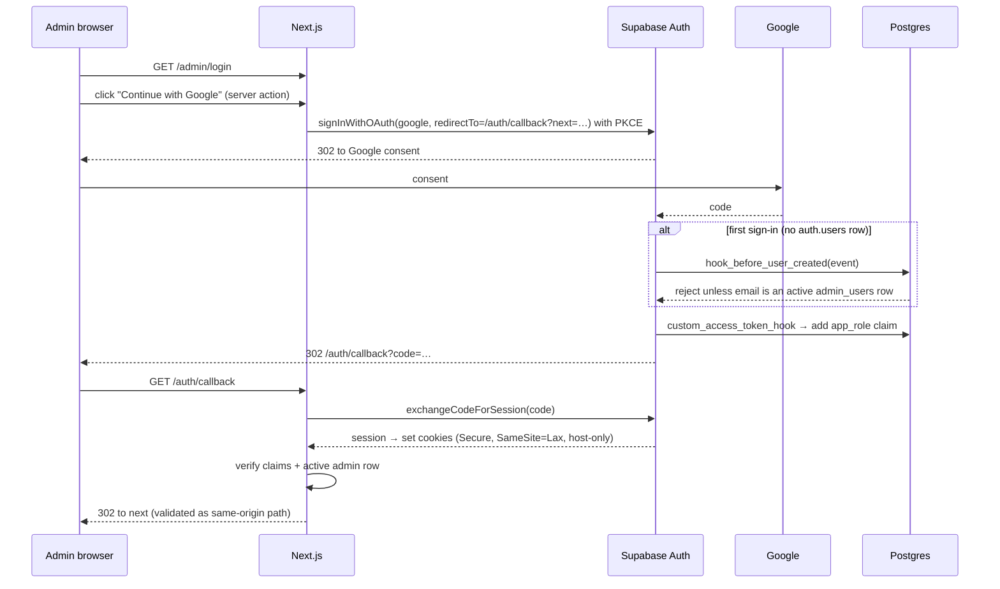

# 08 — Authentication, Authorisation & Security

> Status: **Draft v0.1** · Related: [07 DB §6–8](07-database-design.md), [06 §5](06-system-architecture.md), [10 §8](10-roadmap-docs-system.md), [02 NFR-SEC](02-non-functional-requirements.md)

---

## 1. Summary

- **Who can sign in:** only Google accounts whose email is an **active row in `admin_users`**.
  Everyone else is rejected **before an account is created**.
- **Visitors never sign in** in v1. All public content is readable anonymously through RLS.
- **Defence in depth:** `proxy.ts` → admin layout → every server action / route handler → Postgres
  RLS. Any single layer failing still leaves the others.
- **Untrusted HTML never runs next to the admin session.** Roadmap bundles execute only on the
  separate content origin, which has no auth cookies.

## 2. Google OAuth setup (one-time, owner)

| Step | Where | Setting |
|---|---|---|
| 1 | Google Cloud Console → *APIs & Services → OAuth consent screen* | User type **External**; app name "eyasir329.dev admin"; scopes `openid`, `email`, `profile` only; publishing status **In production** (no sensitive scopes, so no verification review) |
| 2 | *Credentials → Create OAuth client ID → Web application* | Authorised redirect URI: `https://<project-ref>.supabase.co/auth/v1/callback` (one client per Supabase project: staging and production) |
| 3 | Supabase → *Authentication → Providers → Google* | Enable; paste client ID and secret (stored by Supabase, **not** in the app) |
| 4 | Supabase → *Authentication → URL configuration* | Site URL `https://eyasir329.dev`; redirect allowlist: `https://eyasir329.dev/auth/callback`, `http://localhost:3000/auth/callback`, Vercel preview pattern for the staging project only |
| 5 | Supabase → *Authentication → Hooks* | **Before User Created** → `public.hook_before_user_created`; **Custom Access Token** → `public.custom_access_token_hook` |
| 6 | Supabase → *Authentication → Providers → Email* | **Disabled** (Google is the only way in) |
| 7 | Supabase → *Auth settings* | JWT expiry 3600 s (default); refresh-token rotation on; reuse interval 10 s |

## 3. Sign-in flow



**Edge cases:**

| Case | Behaviour |
|---|---|
| Non-allowlisted Google account | Sign-up rejected by the hook → callback receives an error → `/admin/login?error=not_authorised`. No `auth.users` row exists |
| Allowlisted user later deactivated (`is_active=false`) | `private.is_admin()` fails immediately in RLS (it checks the table, not only the claim); proxy/layout also re-check → sign-out + message |
| Existing user whose email was removed from `admin_users` | Same as above; the owner can additionally delete the auth user from `/admin/users` |
| `next` parameter tampering | Only relative paths starting with `/admin` are accepted; anything else → `/admin` |
| Owner locked out (e.g. lost Google access) | Break-glass: run the documented SQL with the Supabase dashboard (project owner login) to add a new owner email ([14 §8](14-devops-and-environments.md)) |

## 4. Authorisation

### 4.1 Roles & permissions

| Capability | editor | owner |
|---|:-:|:-:|
| Read admin dashboard, content, messages, sync logs, audit log | ✅ | ✅ |
| Create/edit/publish content (profile, projects, experience, education, skills, certs, CP, blog, media, resume) | ✅ | ✅ |
| KB: upload, import, preview, publish, rollback | ✅ | ✅ |
| KB: delete a roadmap / purge versions | ❌ | ✅ |
| Run sync now | ✅ | ✅ |
| Site settings (SEO, nav, home sections, flags) | ✅ | ✅ |
| Security settings, allowlist and roles | ❌ | ✅ |
| API tokens | ❌ | ✅ |
| Delete messages permanently | ❌ | ✅ |

### 4.2 Enforcement layers

| Layer | Check | Failure |
|---|---|---|
| `proxy.ts` (all `/admin/**` except `/admin/login`) | Refreshes the session with `@supabase/ssr`; validates the JWT with `getClaims()` (local verification with asymmetric signing keys); requires the `app_role` claim | Redirect to login |
| `app/(admin)/admin/layout.tsx` | `requireRole('editor')`: confirms the active admin row (DB lookup, cached per request) | `notFound()` / redirect |
| Server actions & route handlers | `requireRole(min)` at the top of **every** action; owner-only actions call `requireRole('owner')` | Typed `{ ok:false, code:'FORBIDDEN' }` |
| Postgres RLS | `(select private.is_admin())` / `is_owner()` in policies | Query returns 0 rows / write rejected |

`getSession()` is **never** trusted on the server (it doesn't revalidate the token).

### 4.3 API tokens (for the KB CLI)

- Created by the owner in `/admin/tokens`; plaintext shown **once** (`kbt_` + 32 random bytes,
  base62). Only its SHA-256 hash is stored.
- Scopes: `kb:read`, `kb:write`, `kb:publish`; expiry required (≤ 90 days); revocable.
- Sent as `Authorization: Bearer kbt_…` to `/api/kb/*` only. Token routes use the service client but
  enforce scope + roadmap checks in code, and every call is audit-logged with the token's prefix.

## 5. Session & cookie security

| Item | Setting |
|---|---|
| Cookie scope | **Host-only** on the apex (no `Domain=` attribute), so the `kb.` subdomain never receives it. Name prefixed `__Host-` if `@supabase/ssr` cookie-name options allow it (`SP-03`) |
| Flags | `Secure`, `SameSite=Lax`, `Path=/` |
| CSRF | Server Actions: Next.js checks `Origin` against `Host` (built-in). Route handlers that mutate require `Content-Type: application/json` + an Origin check or a bearer token |
| Idle | Admin UI signs out after 12 h of inactivity (client timer + short JWT) |

## 6. Content-origin isolation (Roadmap Docs)

**Threat:** bundle HTML contains inline JavaScript (the reference page has three inline scripts). If
it ran on the main origin, a malicious or compromised bundle could read the Supabase session from
cookies/localStorage and act as the admin.

**Controls:**

1. Bundles are served **only** from `kb.eyasir329.dev` (a different origin). The main origin never
   serves bundle files, and `/_kb/*` returns 404 on the apex host.
2. No auth cookies exist on the content origin. Preview access uses a signed, path-scoped,
   short-lived token (HMAC-SHA256 with `KB_PREVIEW_SECRET`, `exp` ≤ 30 min, bound to a version id).
3. A strict CSP on the content origin blocks network exfiltration (`connect-src 'none'`,
   `form-action 'none'`), while still allowing the bundles' own inline scripts and styles.
4. The admin preview embeds the content origin in an `<iframe sandbox="allow-scripts
   allow-popups">` (no `allow-same-origin`), so even the preview runs in an opaque origin.
5. If there's no custom domain (`A-01`), use a separate `*.vercel.app` alias; `vercel.app` is on the
   Public Suffix List, so it's a different site entirely.

> Why not just an iframe on the main site, or Supabase public URLs? See ADR-004 in
> [17](17-risks-and-decisions.md): Supabase Storage serves `.html` as `text/plain` on its default
> domain, and an iframe on the main origin hurts SEO and deep-linking while adding no isolation
> beyond what a separate origin gives.

## 7. Content Security Policy & headers

### 7.1 Main origin (public pages)

```text
default-src 'self';
script-src 'self' 'unsafe-inline' https://challenges.cloudflare.com https://va.vercel-scripts.com;
style-src 'self' 'unsafe-inline';
img-src 'self' data: blob: https://<project-ref>.supabase.co https://avatars.githubusercontent.com https://i.ytimg.com;
font-src 'self';
connect-src 'self' https://<project-ref>.supabase.co https://*.ingest.sentry.io https://vitals.vercel-insights.com;
frame-src https://www.youtube-nocookie.com https://challenges.cloudflare.com;
worker-src 'self' blob:;
object-src 'none'; base-uri 'self'; form-action 'self'; frame-ancestors 'none';
upgrade-insecure-requests
```

`'unsafe-inline'` for scripts is needed for statically cached pages (nonces force dynamic rendering).
The risk is contained because the main origin **never renders user-supplied HTML**: Markdown is
rendered without raw HTML, and the only author is the admin. `SP-04` evaluates Next.js hash-based
CSP (SRI) to remove `'unsafe-inline'` if it's stable.

### 7.2 Main origin (`/admin/**`)

Same as above, but `script-src 'self' 'nonce-{random}' 'strict-dynamic'` (admin is dynamic anyway),
`frame-src https://kb.eyasir329.dev` (preview) and `connect-src` extended for Storage uploads.

### 7.3 Content origin

```text
default-src 'self';
script-src 'self' 'unsafe-inline';
style-src 'self' 'unsafe-inline';
img-src 'self' data: https://i.ytimg.com;
media-src 'self';
font-src 'self' data:;
frame-src https://www.youtube-nocookie.com;
connect-src 'none';
form-action 'none';
base-uri 'none';
object-src 'none';
frame-ancestors 'self' https://eyasir329.dev;
```

Per-roadmap additions (`kb_roadmaps.csp_extra`) are allow-listed by the owner (e.g. a KaTeX CDN or
Pyodide for runnable code in future bundles). `connect-src` stays `'none'` unless the owner
explicitly opts in for that roadmap.

### 7.4 Headers on every response

| Header | Value |
|---|---|
| `Strict-Transport-Security` | `max-age=63072000; includeSubDomains; preload` (added after the domain is stable) |
| `X-Content-Type-Options` | `nosniff` (critical on the content origin: every file gets an explicit type) |
| `Referrer-Policy` | `strict-origin-when-cross-origin` |
| `Permissions-Policy` | `camera=(), microphone=(), geolocation=(), payment=(), usb=()` |
| `Cross-Origin-Opener-Policy` | `same-origin` (main); `same-origin-allow-popups` (kb, for YouTube links) |
| `X-Robots-Tag` | `noindex` on admin, API, previews and coming-soon pages |

## 8. Threat model (STRIDE)

| # | Threat | Asset | Mitigation | Residual |
|---|---|---|---|---|
| S1 | **Spoofing:** stranger signs in with Google | Admin | Before-user-created hook + allowlist; RLS checks the table | Low |
| S2 | Stolen admin session cookie | Admin | Host-only Secure cookies; short JWT; no untrusted JS on the main origin; strict admin CSP | Low |
| T1 | **Tampering:** malicious bundle (zip slip) writes outside its folder | Storage | Paths normalised; reject absolute, `..`, backslashes, NUL, symlinks; content-addressed storage (no path-based writes) | Very low |
| T2 | Zip bomb / resource exhaustion | Functions | Max 100 MB zip, 300 MB uncompressed, 3,000 files, 25 MB per file, ratio > 100:1 rejected; streaming unzip with counters | Low |
| T3 | Stored XSS through Markdown | Visitors | No raw HTML in Markdown; directive components whitelist props; URLs validated (`https:`, `mailto:`, relative) | Low |
| R1 | **Repudiation:** "who published this?" | Integrity | `audit_log` via triggers + action-level entries; append-only | Low |
| I1 | **Information disclosure:** drafts leak via the API | Content | RLS published-only for anon; preview tokens expire; drafts `noindex` | Low |
| I2 | Secret key leaks into the client bundle | Everything | Server-only modules; CI grep for `sb_secret_`/`SUPABASE_SECRET` in `.next/static`; env var naming | Low |
| I3 | Copyrighted book excerpts in bundle `data/` published | Legal | `private_globs` default `data/**`; owner confirmation (`Q-14`) | Medium until decided |
| D1 | **Denial of service:** contact form spam | Inbox, email quota | Turnstile + 5/h/IP + length limits + spam status | Low |
| D2 | Hammering the content origin | Bandwidth | CDN caching (cache hits never reach Supabase); Vercel Firewall rules if needed | Low |
| E1 | **Elevation of privilege:** editor becomes owner | Admin | Role changes owner-only (RLS + action check); owner cannot demote the last owner (constraint trigger) | Low |
| E2 | Bundle JS exfiltrates visitor data from the KB origin | Visitors | Nothing sensitive lives on the KB origin; `connect-src 'none'`, `form-action 'none'` | Very low |

## 9. Input validation & output encoding

- **Zod schemas** in `lib/validation/*` are shared by client forms (UX) and server actions (truth).
  The server always re-parses.
- **URLs** in content: only `https:`, `mailto:`, `tel:` and relative; `javascript:` and `data:`
  (except images in media) are rejected.
- **Files:** MIME sniffed from magic bytes (not the extension) for media uploads; SVG uploads to
  `media` are sanitised (DOMPurify SVG profile) because they're served from the main origin. KB
  SVGs are served as-is on the isolated origin.
- **React** escapes text by default; `dangerouslySetInnerHTML` is used only for the Markdown
  pipeline output (sanitised AST) and JSON-LD (`JSON.stringify` + `<` escaped).

## 10. Rate limiting & abuse

| Surface | Limit | Mechanism |
|---|---|---|
| Contact form | 5/h and 20/day per IP hash | Turnstile + `private.rate_limit` |
| View beacon | 1 per entity per IP hash per 6 h | `increment_view` |
| `/api/kb/*` with a token | 60/min per token | `private.rate_limit` |
| Auth endpoints | Supabase built-in limits | Supabase |
| Search | 30/min per IP hash | `private.rate_limit` |

## 11. Secrets inventory

| Secret | Where it lives | Used by | Rotation |
|---|---|---|---|
| `NEXT_PUBLIC_SUPABASE_URL` | Vercel env | Browser + server | — |
| `NEXT_PUBLIC_SUPABASE_PUBLISHABLE_KEY` (`sb_publishable_…`) | Vercel env | Browser + server (RLS-bound) | Yearly |
| `SUPABASE_SECRET_KEY` (`sb_secret_…`) | Vercel env (server only) | Services: cron, sync, contact insert, KB serve/import | Yearly or on suspicion |
| Google OAuth client ID/secret | Supabase dashboard | Supabase Auth | Yearly |
| `CRON_SECRET` | Vercel env + Supabase Vault | `/api/cron/*` | Yearly |
| `REVALIDATE_WEBHOOK_SECRET` | Vercel env + Supabase Vault | `/api/revalidate` HMAC | Yearly |
| `KB_PREVIEW_SECRET` | Vercel env | Preview tokens | Yearly (invalidates open previews) |
| `IP_HASH_SALT_SEED` | Vercel env | Daily salt derivation | Yearly |
| `GITHUB_TOKEN` (fine-grained, read-only public data) | Vercel env | GitHub sync | 90 days (expiry enforced by GitHub) |
| `TURNSTILE_SECRET_KEY` / `NEXT_PUBLIC_TURNSTILE_SITE_KEY` | Vercel env | Contact form | Yearly |
| `RESEND_API_KEY` | Vercel env | Email | Yearly |
| `SENTRY_DSN`, `SENTRY_AUTH_TOKEN` | Vercel env / CI | Errors, source maps | Yearly |
| `SUPABASE_ACCESS_TOKEN`, `SUPABASE_DB_PASSWORD` | GitHub Actions secrets | Migrations, backups | Yearly |

Local development uses `.env.local` (git-ignored) and a checked-in `.env.example` with names only.

## 12. Dependency & supply-chain security

- Renovate (weekly, grouped) with automerge only for patch updates of dev dependencies after CI
  passes.
- `pnpm audit --prod` in CI (fail on high/critical); GitHub secret scanning + push protection on.
- Lockfile committed; `pnpm install --frozen-lockfile` in CI; no `postinstall` scripts from
  untrusted packages (`onlyBuiltDependencies` allowlist in `pnpm` config).
- GitHub Actions pinned to commit SHAs; minimal `permissions:` per workflow.

## 13. Incident response (mini runbook)

1. **Suspected admin compromise:** revoke sessions (Supabase → Auth → sign out user), rotate
   `SUPABASE_SECRET_KEY`, rotate Google OAuth secret, review `audit_log`, restore content from
   backup if needed.
2. **Malicious KB bundle discovered:** roll back or unpublish the node (one click); purge the CDN tag;
   review the import audit entries; the content-origin CSP limits the blast radius.
3. **Secret committed to git:** rotate immediately (history rewrite doesn't un-leak it); push
   protection should prevent this in the first place.
4. Record every incident as a short post-mortem in `docs/incidents/YYYY-MM-DD-*.md`.
