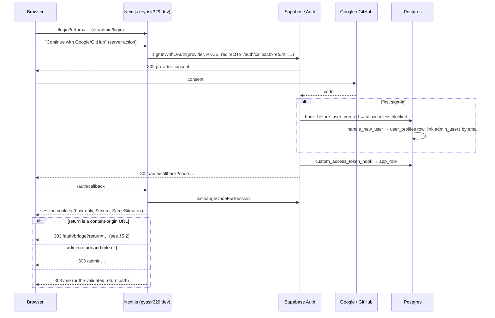

# 08 — Authentication, Authorisation & Security

> Status: **Draft v0.3** · Related: [07 DB §6–8](07-database-design.md), [06 §5](06-system-architecture.md), [10 §8](10-roadmap-docs-system.md), [19 Guest accounts](19-guest-accounts-and-progress.md), [20 §7 Extension](20-cp-multi-platform-tracking.md), [02 NFR-SEC](02-non-functional-requirements.md)
>
> **Revision 0.2:** sign-up is **open to guests** (Google, GitHub); admin rights still come only from
> the allowlist. The content origin gets its own **reader session** via a one-time-code bridge. Blog
> posts join topics as untrusted-HTML-on-an-isolated-origin. New: guest privacy.
>
> **Revision 0.3:** learner CP tracking removed, so guests hold **no tokens** and have no CP data;
> extension tokens (`cp:ingest`) are admin-only, for the owner's own submissions.

---

## 1. Summary

- **Anyone** can create a **guest** account with Google or GitHub. **Admin rights** (`owner`,
  `editor`) come only from an active row in `admin_users`.
- **Anonymous visitors** read everything public; roadmap progress needs an account.
- **Defence in depth for admin:** `proxy.ts` → admin layout → every server action/route handler →
  RLS (`private.is_admin()` checks the table on every query, so revocation is instant).
- **Guest data isolation:** every user-owned table has RLS `user_id = auth.uid()`; guest writes to
  progress go through validated server endpoints.
- **Author HTML (topics and posts) never runs on the main origin.** It runs on the content origin,
  which holds only a narrow, HttpOnly reader session scoped to progress.

## 2. Identity providers & sign-up policy

| Step | Where | Setting |
|---|---|---|
| 1 | Google Cloud → OAuth consent screen | External; scopes `openid email profile`; in production |
| 2 | Google Cloud → OAuth client (per Supabase project) | Redirect URI `https://<ref>.supabase.co/auth/v1/callback` |
| 3 | **GitHub → Developer settings → OAuth App** (per Supabase project) | Callback `https://<ref>.supabase.co/auth/v1/callback`; scope `read:user user:email` only |
| 4 | Supabase → Auth → Providers | Google ✅, GitHub ✅ (`Q-26`), Email ❌ |
| 5 | Supabase → Auth → URL configuration | Site URL `https://eyasir329.dev`; redirects `https://eyasir329.dev/auth/callback`, localhost, staging previews |
| 6 | Supabase → Auth → Hooks | **Before User Created** → `hook_before_user_created` (blocks disposable domains and banned emails; everything else becomes a guest) · **Custom Access Token** → `custom_access_token_hook` (`app_role` = owner/editor/guest, `user_status`) |
| 7 | Supabase → Auth → settings | JWT expiry 3600 s; refresh-token rotation on; **manual account linking** off (different providers with the same email become separate accounts unless the user links them in `/me/settings`) |

## 3. Main-origin sign-in flow



| Case | Behaviour |
|---|---|
| Guest opens `/admin/**` | 403 page ("This area is for site administrators"), no redirect loop, no admin data |
| Allowlisted email signs in | Same account system; `app_role` = owner/editor → admin allowed |
| Allowlisted admin later deactivated | `is_admin()` fails at once in RLS; proxy/layout re-check → admin area hidden; the account stays a guest |
| Banned user | Hook denies new sessions; existing reader sessions revoked; API returns 403 |
| `return` tampering | Only relative main-origin paths or URLs on the content origin are accepted |
| Owner locked out | Break-glass SQL runbook ([14 §8](14-devops-and-environments.md)) |

## 4. Authorisation

### 4.1 Roles & capabilities

| Capability | anonymous | guest | editor | owner |
|---|:-:|:-:|:-:|:-:|
| Read public content | ✅ | ✅ | ✅ | ✅ |
| Save roadmap progress; `/me`; export/delete own data | ❌ | ✅ | ✅ | ✅ |
| Admin panel: content, bundles, messages, sync, settings | ❌ | ❌ | ✅ | ✅ |
| Users: view list | ❌ | ❌ | ✅ | ✅ |
| Users: ban/unban, delete; allowlist & roles; API tokens (bundle CLI, CP extension); security settings; purge bundles | ❌ | ❌ | ❌ | ✅ |

### 4.2 Enforcement layers

| Layer | Admin routes | Guest routes (`/me/**`, reader API) |
|---|---|---|
| `proxy.ts` | Session refresh; `getClaims()`; requires `app_role ∈ {owner, editor}` | Session refresh; requires a session for `/me/**` (else `/login?return=`) |
| Layouts | `requireRole('editor')` (DB check) | `requireUser()` (status active) |
| Actions / handlers | `requireRole(min)` in every action | `requireUser()` + ownership checks on every id |
| RLS | `private.is_admin()` / `is_owner()` | `user_id = (select auth.uid())` |

## 5. Sessions & cookies

### 5.1 Main origin

| Item | Setting |
|---|---|
| Cookies | Supabase SSR cookies, **host-only** on the apex (never sent to `read.`), `Secure`, `SameSite=Lax`; `__Host-` prefix if supported (`SP-03`) |
| CSRF | Server Actions: built-in `Origin` check. Mutating route handlers: `Origin` must equal the main origin, or bearer-token auth |
| Idle | Admin: sign-out after 12 h idle. Guests: standard refresh (weeks) |

### 5.2 Content-origin reader session (bridge)

| Item | Setting |
|---|---|
| Issue | `GET /auth/bridge?return=` (main origin, requires a session) → random 32-byte code, SHA-256 stored in `private.reader_bridge_codes` (60 s, single use, bound to `user_id` and `return`) → 303 to `read…/__auth/callback?code&return` |
| Exchange | Content origin consumes the code (atomic `update … where used_at is null and expires_at > now()`), creates `private.reader_sessions`, sets `__Host-rt_session` (random 32 bytes; only the hash stored; `HttpOnly; Secure; SameSite=Lax; Path=/`) and `rt_signed_in=1` (non-secret hint) |
| Lifetime | 30 days sliding; revoked on sign-out (either origin), "sign out everywhere", ban, deletion |
| Scope | The reader session can **only** call `/__api/*` (own progress, visits, own display name/avatar). It is not a Supabase JWT and grants nothing on the main origin |
| CSRF (`/__api/*`) | `SameSite=Lax` + `Content-Type: application/json` + custom header `X-RT: 1` + `Origin` = content origin. Cross-site forms can't meet these conditions |

## 6. Content-origin isolation (topics **and** blog posts)

**Threat:** author HTML contains JavaScript (the reference topic has three inline scripts; HTML
posts can have any). On the main origin, a malicious or compromised script could read the Supabase
session or call admin server actions.

**Controls:**

1. Topics and posts are served **only** from `read.eyasir329.dev`. `/_content/*` returns 404 on the
   main host; the main site's `/blog/[slug]` is a redirect, never a render.
2. Main-origin cookies never reach the content origin (host-only). The content origin has only
   the narrow reader session (§5.2).
3. CSP on the content origin allows the bundles' inline scripts but restricts network access to
   **same origin only** (`connect-src 'self'`, for the reader API) and forbids form posts elsewhere.
4. Admin previews run in `<iframe sandbox="allow-scripts allow-popups">` (opaque origin; no cookies,
   no reader API).
5. Without a custom domain, a separate `*.vercel.app` alias still gives a different site (Public
   Suffix List). The bridge doesn't depend on shared cookies.

**Accepted residual risk:** bundle JS shares the content origin with the runtime, so it could call
`/__api/*` as the current reader, which would affect only that reader's progress data. Bundles are
owner-authored (ADR-015).

## 7. Content Security Policy & headers

### 7.1 Main origin (public, `/me`)

```text
default-src 'self';
script-src 'self' 'unsafe-inline' https://challenges.cloudflare.com https://va.vercel-scripts.com;
style-src 'self' 'unsafe-inline';
img-src 'self' data: blob: https://<ref>.supabase.co https://avatars.githubusercontent.com https://lh3.googleusercontent.com https://i.ytimg.com;
font-src 'self';
connect-src 'self' https://<ref>.supabase.co https://*.ingest.sentry.io https://vitals.vercel-insights.com;
frame-src https://www.youtube-nocookie.com https://challenges.cloudflare.com;
object-src 'none'; base-uri 'self'; form-action 'self' https://<ref>.supabase.co; frame-ancestors 'none';
upgrade-insecure-requests
```

The main origin renders **no author HTML** (Markdown fields are rendered without raw HTML), so
`'unsafe-inline'` for scripts is contained. `SP-04` checks whether hash-based CSP can remove it.

### 7.2 Main origin (`/admin/**`)

Nonce-based `script-src 'self' 'nonce-…' 'strict-dynamic'`; `frame-src https://read.eyasir329.dev`
(previews); `connect-src` adds Storage upload endpoints.

### 7.3 Content origin

```text
default-src 'self';
script-src 'self' 'unsafe-inline';
style-src 'self' 'unsafe-inline';
img-src 'self' data: https://i.ytimg.com;
media-src 'self';
font-src 'self' data:;
frame-src https://www.youtube-nocookie.com;
connect-src 'self';
form-action 'self';
base-uri 'none';
object-src 'none';
frame-ancestors 'self' https://eyasir329.dev;
```

Per-roadmap/per-post `csp_extra` (owner-approved), e.g. `script-src https://cdn.jsdelivr.net` for a
charting library in a post. `connect-src` to third parties requires an explicit owner opt-in.

### 7.4 Headers on every response

HSTS (preload after stabilising) · `X-Content-Type-Options: nosniff` · `Referrer-Policy:
strict-origin-when-cross-origin` · `Permissions-Policy: camera=(), microphone=(), geolocation=(),
payment=(), usb=()` · COOP (`same-origin` main; `same-origin-allow-popups` content origin) ·
`X-Robots-Tag: noindex` on admin, `/me`, APIs, previews, coming-soon.

## 8. Threat model (STRIDE)

| # | Threat | Asset | Mitigation | Residual |
|---|---|---|---|---|
| S1 | Someone gains admin by signing up | Admin | Admin = allowlist only; RLS checks the table; guest role has no admin policies | Low |
| S2 | Stolen admin cookie | Admin | Host-only cookies; no author JS on the main origin; strict admin CSP | Low |
| S3 | **Account takeover of a guest** via the bridge (code theft, open redirect) | Guest data | 60 s single-use codes bound to user + return URL; return URL allowlist; HTTPS only | Low |
| T1 | Zip slip / zip bomb in bundles | Storage/functions | Path normalisation, CAS writes, streaming limits | Very low |
| T2 | **Forged progress** (a user writes others' rows) | Integrity | Writes only through validated endpoints; RLS own-rows; keys validated against the node | Low |
| T3 | **Stolen owner extension token** used to inject fake solves on the public CP page | Integrity | Admin-only token, scoped `cp:ingest`, expiring, revocable; only the owner's handles accepted; source marked `extension` | Low |
| R1 | "Who published/banned this?" | Integrity | `audit_log` | Low |
| I1 | Drafts leak | Content | RLS; signed previews | Low |
| I2 | **Guest personal data exposure** (emails, reading progress) | Privacy | RLS own-rows; admin sees aggregates for progress; exports only to the owner of the data; no public profiles | Low |
| I3 | Secret key in the client bundle | Everything | Server-only modules; CI grep | Low |
| I4 | Copyrighted `data/` excerpts published | Legal | Private by default (`Q-14`) | Medium until decided |
| D1 | Contact spam | Inbox | Turnstile + rate limits | Low |
| D2 | **Sign-up abuse / bot accounts** | Quotas | OAuth-only sign-up; disposable-domain blocklist; ban; per-user rate limits on sync and API | Low |
| D3 | **Judge sites blocking us** (too many requests) | Availability of CP data | Per-platform budgets, backoff, caching, low frequency, kill switches | Medium (fragile judges) |
| E1 | Editor becomes owner | Admin | Owner-only role changes; last-owner guard | Low |
| E2 | Bundle JS abuses the reader API | Reader progress | Same-origin only; affects only the current reader; owner-authored bundles | Low (accepted) |

## 9. Input validation & output encoding

- Zod everywhere (shared schemas); URLs limited to `https:`, `mailto:`, `tel:` and relative.
- **Reader API:** keys must be in the node's current `section_keys ∪ practice_keys`; batch ≤ 100
  items; timestamps clamped to server time.
- **Judge handles** (owner accounts, admin only): validated against `cp_platforms.handle_pattern`;
  existence checked through the adapter before saving.
- **Extension payloads:** size-limited; verdict normalised; timestamps sanity-checked; unknown
  platforms rejected.
- Media uploads: MIME sniffed; SVG sanitised (main origin). Bundle SVGs served as-is on the
  isolated origin.

## 10. Rate limiting & abuse

| Surface | Limit |
|---|---|
| Contact form | 5/h, 20/day per IP hash |
| Reader API writes | 120/min per session (batched client) |
| `/auth/bridge` | 20/min per user |
| CP "Run now" (admin) | 1 per platform per 10 min |
| Extension ingestion (owner token) | 600 submissions/min |
| CLI | 60 req/min per token |
| Search | 30/min per IP hash |

## 11. Secrets inventory

| Secret | Where | Used by |
|---|---|---|
| `NEXT_PUBLIC_SUPABASE_URL`, `NEXT_PUBLIC_SUPABASE_PUBLISHABLE_KEY` | Vercel env | Browser + server (RLS-bound) |
| `SUPABASE_SECRET_KEY` | Vercel env (server only) | Services: cron, workers, contact, bundle serving, reader API writes |
| Google OAuth client, **GitHub OAuth app** secrets | Supabase dashboard | Supabase Auth |
| `CRON_SECRET`, `REVALIDATE_WEBHOOK_SECRET` | Vercel env + Supabase Vault | Jobs |
| `CONTENT_PREVIEW_SECRET` | Vercel env | Preview tokens |
| `IP_HASH_SALT_SEED` | Vercel env | Rate limiting |
| `GITHUB_TOKEN` | Vercel env | Owner GitHub sync |
| `CLIST_API_USERNAME`, `CLIST_API_KEY` (optional) | Vercel env | CLIST fallback (`Q-31`) |
| Turnstile, Resend, Sentry keys | Vercel env / CI | As before |
| `SUPABASE_ACCESS_TOKEN`, DB password | GitHub Actions | Migrations, backups |

## 12. Supply chain

Renovate, `pnpm audit`, frozen lockfile, pinned Actions, secret scanning + push protection. The
browser extension (if forked) gets the same treatment, and its releases are signed by the store.

## 13. Incident response

1. **Admin compromise:** revoke sessions, rotate the secret key and OAuth secrets, review
   `audit_log`, restore if needed.
2. **Guest data incident:** contain (revoke sessions/tokens), assess scope, notify affected users by
   email within 72 hours, post-mortem.
3. **Malicious bundle/post:** unpublish or roll back, purge the CDN tag; CSP limits the blast radius.
4. **Judge complaint about scraping:** disable that platform's scraping flag immediately; switch to
   extension-only.
5. Post-mortems in `docs/incidents/`.
