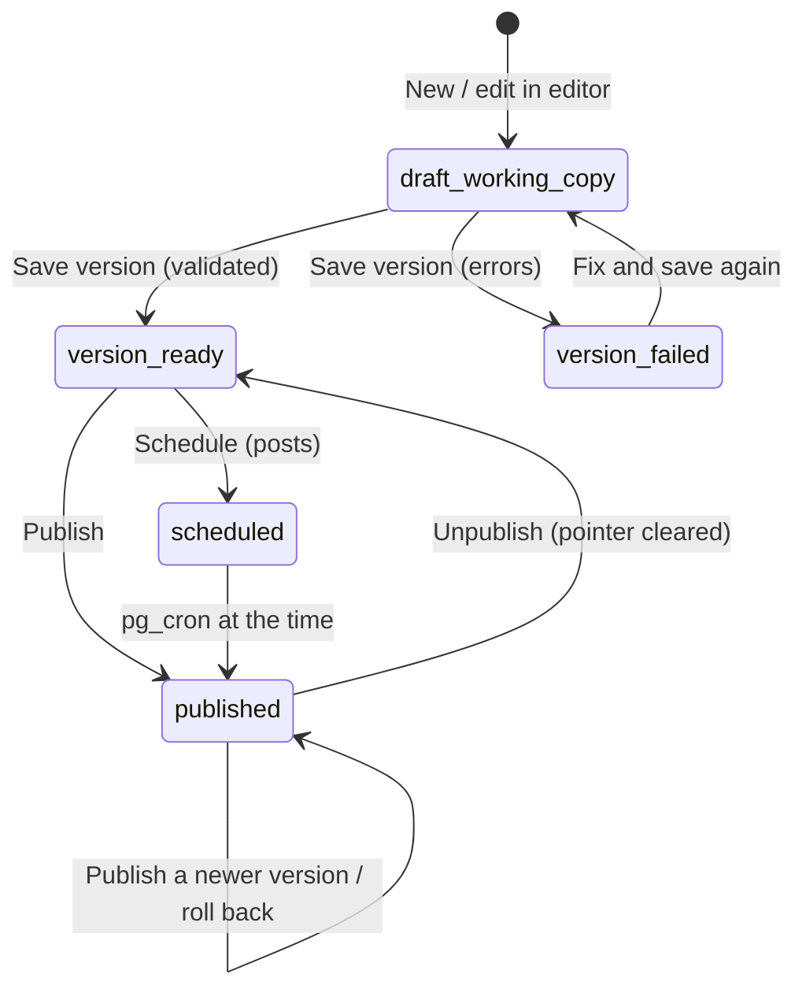

# 09 — Admin Panel

> Status: **Draft v0.2** · Related: [01 FR-ADM](01-product-requirements.md), [03 §3.2](03-information-architecture.md), [07 DB](07-database-design.md), [08 Security](08-auth-and-security.md), [10 Bundles](10-roadmap-docs-system.md), [19 Guests](19-guest-accounts-and-progress.md), [20 CP tracking](20-cp-multi-platform-tracking.md)
>
> **Revision 0.2:** the blog uses the shared **HTML editor** (§4.7) and **templates** (§4.9). New
> **Users** and **Readers** screens (§4.15–4.16). **Sync** becomes a judge-platform health centre
> (§4.13).

---

## 1. Goals

1. **Everything public is editable here**; no content change needs a deploy (`G-04`).
2. **Fast for one person**: keyboard-first, autosave where it matters.
3. **Safe**: drafts, previews, versions, audit log, typed confirmations.
4. **Respectful of readers' privacy**: aggregates by default, individual data only where needed for
   moderation (ban/delete).

## 2. Layout & navigation

```text
┌──────────────────────────────────────────────────────────────────────────┐
│  ◧ eyasir329 · admin        [⌘K Search…]      ● Judges 9/10 ok   (E) ▾   │
├───────────────┬──────────────────────────────────────────────────────────┤
│ Dashboard     │  Blog                                        [+ New post] │
│ ─ Content ─   │  ┌ filters: status ▾  tag ▾  series ▾   search…        ┐ │
│ Profile       │  │ Title                     Status      Version  Updated │ │
│ Projects      │  │ Measuring std::vector     Published   v3       2 d ago │ │
│ Experience    │  │ ICPC Dhaka notes          Scheduled   v2       5 h ago │ │
│ Education     │  └───────────────────────────────────────────────────────┘ │
│ Skills        │                                                          │
│ Certifications│                                                          │
│ CP Journey    │                                                          │
│ Blog          │                                                          │
│ Docs          │                                                          │
│ Templates     │                                                          │
│ Media         │                                                          │
│ Resume        │                                                          │
│ ─ People ─    │                                                          │
│ Messages (2)  │                                                          │
│ Users         │                                                          │
│ Readers       │                                                          │
│ ─ System ─    │                                                          │
│ Sync & judges │                                                          │
│ Settings      │                                                          │
│ Redirects     │                                                          │
│ Audit log     │                                                          │
│ Admins 🔒     │                                                          │
│ Tokens 🔒     │                                                          │
└───────────────┴──────────────────────────────────────────────────────────┘
```

🔒 = owner only. Responsive down to phone width for quick fixes and messages.

## 3. Shared patterns

### 3.1 Publish workflows

**Site-rendered entities** (projects, experience, …): draft → published → archived; edits to a
published item are live on save.

**Bundle subjects** (blog posts, roadmap nodes):



Readers only ever see the published version. Working copies and ready versions are private until
published.

### 3.2 Editing UX rules

| Rule | Detail |
|---|---|
| Forms | React Hook Form + Zod; inline errors; `⌘S` saves |
| Unsaved changes | Navigation guard; dirty marker in the tab title |
| Autosave | Bundle editor working copies every 5 s when dirty; other entities save explicitly |
| Optimistic UI | Reorders and toggles roll back on error |
| Destructive actions | Typed confirmation for deleting published items, roadmaps, users and bans |
| Preview | Site entities: signed `?preview=` link. Bundles: signed content-origin preview in a sandboxed iframe |
| Slugs | Auto from the title until edited; changes create redirects (main and content origin) |
| Keyboard | `⌘K` palette, `g p` projects, `g b` blog, `g d` docs, `n` new, `/` search |

### 3.3 List views

TanStack Table: server pagination, sort, filters, column visibility, bulk actions, drag ordering
where relevant; state in URL search params.

## 4. Screen specifications

### 4.1 Dashboard `/admin`
Health strip (owner judge accounts and platform health, GitHub, imports, storage and DB quotas) ·
Inbox · Drafts and scheduled posts · Ready-but-unpublished versions · **Readers** (registered, active
this week, new this week) · Activity · Quick actions (New post, Upload topic, Run sync, Replace CV).

### 4.2 Profile · 4.3 Projects · 4.4 Experience/Education/Certifications/Achievements · 4.5 Skills
Unchanged from revision 0.1: profile form with live hero preview; project editor tabs (Basics · Case
study (Markdown) · Media · Links · Relations · SEO); single-page forms with drag ordering; two-pane
skills editor.

### 4.6 CP Journey `/admin/cp`
- **Owner accounts:** the owner's judge accounts (10 platforms): handle, visibility (public),
  show-on-site, status, last sync, last error, "Sync now", **Overrides** drawer.
- **Contests & milestones:** as before.
- **Preview** of the public CP overview.

### 4.7 Blog `/admin/blog/[id]` — HTML editor

```text
┌ Measuring std::vector ▾   Status: Draft (v3 published)   [Preview] [Save version] [Publish ▾] ┐
│ Slug: measuring-std-vector  Tags: [c++] [stl] [+]  Series: STL in depth ▾  Runtime: inject ▾  │
├──────────────┬──────────────────────────────────────┬──────────────────────────────────────────┤
│ Files        │ index.html                    ● auto │ Preview  [360] [768] [1280]  ↻  ⤢        │
│  index.html  │ <!doctype html>                      │ ┌──────────────────────────────────────┐ │
│  style.css   │ <html lang="en">                     │ │  sandboxed iframe (content origin    │ │
│  script.js   │ <head> …                             │ │  preview URL): scripts run, nothing  │ │
│  assets/     │ <article> …                          │ │  can reach the admin session         │ │
│   growth.svg │                                      │ └──────────────────────────────────────┘ │
│  + Add file  │                                      │                                          │
│  ⇪ Drop files│                                      │                                          │
├──────────────┴──────────────────────────────────────┴──────────────────────────────────────────┤
│ Draft autosaved 4 s ago · 2,310 words · 11 min read · Report: 0 errors, 1 warning ▸ · Versions ▸│
└────────────────────────────────────────────────────────────────────────────────────────────────┘
```

- **Files pane:** add/rename/delete files; drag-and-drop images/SVG/fonts into `assets/` (uploaded to
  CAS immediately; the draft overlay references them by hash); "Insert" puts a relative path
  (`assets/growth.svg`) at the cursor.
- **Code pane:** CodeMirror 6 with HTML/CSS/JS modes, Emmet-style abbreviations, format-on-demand
  (Prettier in a worker), lint hints (unclosed tags, missing `alt`).
- **Preview pane:** reloads on save (debounced 800 ms) from a short-lived preview token for the draft
  overlay; device widths; open in a new tab.
- **Report:** runs the same validation as imports (W01–W19) on every "Save version"; errors block
  the version.
- **Listing panel** (right drawer): title/excerpt/cover/SEO overrides, extracted-metadata view,
  series, schedule.
- **Versions drawer:** list, compare (file diff + text diff), preview, publish, roll back, download
  zip.
- **Publish menu:** Publish now · Schedule… · Unpublish.
- Other ways in: *Upload zip* (new version from a bundle) or CLI.

### 4.8 Docs `/admin/docs`
Roadmaps list; roadmap page tabs: *Outline* (tree editor, outline import) · *Settings* (theme CSS,
theme key, progress key pattern, **runtime mode, chip mode, control selectors**, private globs, CSP
extras, licence) · *Imports* (bulk jobs, dry-run reports) · *Link report* · **Readers** (aggregate
completion per topic). Node page: metadata, **Versions**, **Upload**, **Open in editor** (same HTML
editor as the blog), **Files**, **Practice items** (extracted links with canonical keys, "unmatched"
warnings).

### 4.9 Templates `/admin/templates`
Library of starter bundles for posts and topics (name, kind, description, default flag); edited in
the same HTML editor; "New post" asks which template to use.

### 4.10 Media · 4.11 Resume · 4.12 Messages
Unchanged.

### 4.13 Sync & judges `/admin/sync`
| Panel | Content |
|---|---|
| Platform health | One tile per judge: enabled switch, scraping switch (HTML adapters), success rate (24 h / 7 d), last error, current budget/next-allowed time, "needs extension" share |
| Queue | Depth by status and platform, oldest queued job age, worker last run, throughput |
| Owner accounts | As in §4.6 |
| Runs | GitHub and scheduler runs (`sync_runs`) with stats and errors |
| CLIST | Key configured, usage this hour (`Q-31`) |

### 4.14 Settings `/admin/settings`
Tabs: Site · Navigation · Home · Social links · Flags · Announcement · Privacy & terms pages ·
**Accounts** (enabled providers, blocked email domains list, inactivity policy) · Maintenance.

### 4.15 Users `/admin/users`
All accounts: display name, email, provider, role (guest/editor/owner), status, created, last seen,
linked judges (count), roadmap topics started (count). Row actions: **Ban / Unban** (owner, typed
reason → audit log), **Delete** (owner), **Promote to editor** (owner → adds the allowlist row).
Individual reading histories and solve lists are **not** shown (privacy).

### 4.16 Readers `/admin/readers` (aggregate analytics)
Registered and weekly-active readers; sign-up sources; per roadmap: topics started/completed
funnel; per topic: section drop-off chart (the section where most readers stop), practice solve
rates (self vs verified); judges linked by platform. All counts; no personal drill-down.

### 4.17 Redirects · Audit log · Admins 🔒 · Tokens 🔒
As before. *Admins* is the allowlist (`admin_users`); *Tokens* are CLI tokens (`bundle:*` scopes).
Guest extension tokens are managed by guests themselves in `/me/extension`.

## 5. Admin technology

| Concern | Choice |
|---|---|
| Components | shadcn/ui (Radix) |
| Tables | TanStack Table v8 |
| Forms | React Hook Form + Zod + `useActionState` |
| Drag & drop | dnd-kit |
| Editors | CodeMirror 6: Markdown mode (site-rendered fields) and **HTML/CSS/JS modes** (bundle editor) |
| Formatting | Prettier (standalone) in a Web Worker |
| Uploads | TUS resumable (zips, large assets); direct signed uploads for small assets |
| Preview | Sandboxed iframe (`allow-scripts allow-popups`) pointing at signed content-origin preview URLs |
| Diffs | `diff` for text; hash-based file lists |
| Live progress | Supabase Realtime only for import jobs and the sync queue depth widget |

## 6. Permission matrix (screens)

| Screen | editor | owner |
|---|:-:|:-:|
| Dashboard, content screens, Blog, Docs, Templates, Media, Resume, Messages, Sync & judges (view + owner accounts), Settings (except Accounts), Redirects, Audit log, Users (view), Readers | ✅ | ✅ |
| Users: ban/unban/delete/promote · Settings → Accounts · platform kill switches · Docs/blog purge · Admins · Tokens | ❌ | ✅ |

## 7. Non-functional notes

Admin routes are dynamic and uncached; code-split per section (the HTML editor chunk loads only on
editor routes); `noindex`; WCAG 2.2 AA.
