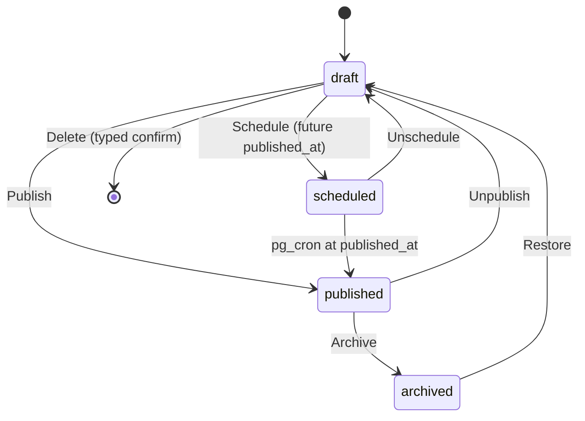

# 09 — Admin Panel

> Status: **Draft v0.1** · Related: [01 FR-ADM](01-product-requirements.md), [03 §3.2](03-information-architecture.md), [07 DB](07-database-design.md), [08 Security](08-auth-and-security.md), [10 Roadmap Docs](10-roadmap-docs-system.md)

---

## 1. Goals

1. **Everything public is editable here.** No content change needs a code deploy (`G-04`).
2. **Fast for one person.** Keyboard-first, sensible defaults, autosave where it matters.
3. **Safe.** Drafts, previews, versioned KB, audit log, typed confirmations for destructive actions.

## 2. Layout & navigation

```text
┌──────────────────────────────────────────────────────────────────────────┐
│  ◧ eyasir329 · admin        [⌘K Search…]          ● Synced 3h ago   (E) ▾ │  ← top bar: palette, sync health, user menu
├───────────────┬──────────────────────────────────────────────────────────┤
│ Dashboard     │  Projects                                   [+ New]      │
│ ─ Content ─   │  ┌ filters: status ▾  kind ▾  featured ☐   search…  ┐    │
│ Profile       │  │ ⠿  Title                    Status     Updated     │    │
│ Projects      │  │ ⠿  NEUPC                    Published  2 d ago  ⋯  │    │
│ Experience    │  │ ⠿  Joborx                   Draft      5 h ago  ⋯  │    │
│ Education     │  └────────────────────────────────────────────────────┘    │
│ Skills        │                                                          │
│ Certifications│                                                          │
│ CP Journey    │                                                          │
│ Blog          │                                                          │
│ Docs          │                                                          │
│ Media         │                                                          │
│ Resume        │                                                          │
│ ─ Inbox ─     │                                                          │
│ Messages (2)  │                                                          │
│ ─ System ─    │                                                          │
│ Sync          │                                                          │
│ Settings      │                                                          │
│ Redirects     │                                                          │
│ Audit log     │                                                          │
│ Users 🔒      │                                                          │
│ Tokens 🔒     │                                                          │
└───────────────┴──────────────────────────────────────────────────────────┘
```

🔒 = owner only. The sidebar collapses to icons below 1024 px, and to a sheet below 768 px (the
admin is usable on a phone for quick fixes and reading messages).

## 3. Shared patterns

### 3.1 Publish workflow



- "Publish" validates required fields for the public page (e.g. a project needs a summary, cover
  alt text and at least one stack item).
- Editing a published item edits it **live** (no staged copy), except **posts**, which support
  *Save as draft revision* so a published post can be revised privately and then published.

### 3.2 Editing UX rules

| Rule | Detail |
|---|---|
| Forms | React Hook Form + Zod; inline errors; error summary at the top on submit; `⌘S` saves |
| Unsaved changes | Navigation guard dialog; a dot in the tab title |
| Autosave | Posts: every 30 s when dirty (to `post_revisions`); other entities save explicitly |
| Optimistic UI | Reordering and status toggles update instantly and roll back on error with a toast |
| Destructive actions | `ConfirmDialog` requiring the item's name to be typed for deletes of published items, roadmaps and users |
| Preview | "Preview" opens the public page in a new tab with a signed draft token (`?preview=…`, 30 min, noindex) |
| Slugs | Auto-generated from the title until the slug is edited manually; editing a published slug warns and creates a redirect |
| Media fields | `MediaPicker`: pick from the library or upload inline; alt text is required before saving |
| Dates | Month precision where appropriate (experience/education); "Present" toggle for open ranges |
| Empty states | Explain what the entity is for and offer **Create** + an example |
| Keyboard | `⌘K` palette (go to any page/record, "New post", "Run Codeforces sync"), `g p` projects, `g b` blog, `n` new (in lists), `/` focus search |

### 3.3 List views (TanStack Table)

Server-side pagination (25/page), sort, filter by status and type-specific facets, column visibility,
multi-select bulk actions (publish, unpublish, archive, delete — each confirmed), and a drag handle
for manual ordering when the list is sorted by `sort_order`.

## 4. Screen specifications

### 4.1 Dashboard `/admin`

| Widget | Content |
|---|---|
| Health strip | Sync status per integration (green/amber/red with "last success" times), last KB import, Supabase storage usage vs. quota |
| Inbox | Unread message count + latest 3 |
| Drafts | Draft/scheduled posts and projects, KB versions `ready` but unpublished |
| Activity | Last 10 audit entries |
| Traffic (link-out) | Links to Vercel Analytics and Speed Insights (no duplicate charts) |
| Quick actions | New post · Upload topic · Run sync · Replace CV |

### 4.2 Profile `/admin/profile`
Fields: full name, headline, positioning (hero statement), short bio (counter to 280), long bio
(Markdown editor), location, public email, phone + "show phone" toggle (off), portrait
(MediaPicker), availability (open toggle, roles multi-select with free text, note), timezone.
Live preview of the hero block on the right at ≥ 1280 px.

### 4.3 Projects `/admin/projects/[id]`
Tabs: **Basics** (title, slug, tagline, summary, kind, status, role, team size, dates) · **Case
study** (Markdown editor with preview; section scaffold button that inserts Overview / Problem / Role
/ Architecture / Features / Challenges / Results headings) · **Media** (cover, gallery with
captions/credits, sortable) · **Links** (repo, live, demo video, GitHub repo `owner/name` with a
"Verify" button that checks it exists in `github_repos`) · **Relations** (skills, experiences,
posts) · **SEO** (title/description overrides, OG preview). Toggles: featured, additional.

### 4.4 Experience / Education / Certifications / Achievements
Single-page forms (no tabs); a list with drag ordering; kind filter for experience.

### 4.5 Skills `/admin/skills`
Two-pane: categories (sortable) | skills in the category (inline editable rows: name, icon slug with
live icon preview, featured, sortable). Usage count column (projects/experiences referencing it).

### 4.6 CP Journey `/admin/cp`
- **Profiles:** table of `cp_profiles` (platform, handle, sync on/off, last synced, last error) with
  "Run sync now", and an **Overrides** drawer (JSON-backed form: solved count/label, rating, rank
  title) with a clear "overrides synced value" badge.
- **Contests `/admin/cp/contests`:** form per contest (name, series, date, venue, team, teammates,
  rank, total teams + label, award, standings URL, photos, write-up Markdown, featured).
- **Milestones:** simple list form.
- **Preview:** a live mini version of the CP overview using current data.

### 4.7 Blog `/admin/blog/[id]`
```text
┌ Title ___________________________  Status: Draft ▾   [Preview] [Save] [Publish ▾] ┐
│ Subtitle ________________________  Slug: my-post  Series: — ▾  Tags: [dp] [+]     │
├────────────────────────────────────┬───────────────────────────────────────────────┤
│ CodeMirror Markdown                │ Live preview (same Prose renderer as public)  │
│ ::: toolbar: H2 H3 B I code link   │                                               │
│ image(MediaPicker) callout math    │                                               │
│ youtube cf-problem footnote        │                                               │
├────────────────────────────────────┴───────────────────────────────────────────────┤
│ Autosaved 12 s ago · 1,840 words · 8 min read · Revisions (14) · SEO ▸ · Cover ▸   │
└────────────────────────────────────────────────────────────────────────────────────┘
```
- The preview uses the production pipeline: Markdown is rendered on the server through a debounced
  server action (400 ms), so preview output is **identical** to production.
- Paste an image → uploads to `media` and inserts a `::figure` directive with an alt-text prompt.
- Revisions drawer: diff against the current body; restore.
- Publish menu: Publish now · Schedule… · Unpublish.

### 4.8 Docs `/admin/docs` (details in [10 §11](10-roadmap-docs-system.md))
- **Roadmaps list:** title, slug, status, published/planned topics, storage used, last publish.
- **Roadmap page:** a tabbed screen:
  - *Outline* — tree editor (phase → module → topic) with drag-to-reorder/re-parent, inline
    add/rename, serial and segment fields, status chips, bulk "import outline" (JSON/YAML/Markdown
    list).
  - *Settings* — title, description, cover, theme CSS (auto-extracted, editable with a live preview
    of a generated index page), theme storage key, progress key pattern, private globs, CSP extras,
    licence.
  - *Imports* — bulk import jobs, dry-run reports, apply.
  - *Link report* — every internal link across published versions with status (ok / planned /
    missing / private), grouped by target.
- **Node page:** metadata (read-only extracted + editable overrides), **Versions** table (no.,
  status, source, files, size, created, published marker, notes) with actions *Preview*, *Publish*,
  *Roll back to this*, *Download zip*, *Compare* (file-level diff: added/removed/changed by hash);
  **Upload new version** (drop zone → resumable upload → live validation report); **Files** (tree
  browser with type, size, private flag, "View raw", "Quick edit" for text files → creates a new
  version via `quick_edit`).

### 4.9 Media `/admin/media`
Grid/list toggle; filters (kind, missing alt, unused); upload (drag & drop, multiple); detail drawer
(alt, caption, credit, licence, source URL, dimensions, "used in" list); replace file keeping the id;
delete blocked while referenced.

### 4.10 Resume `/admin/resume`
Versions list (label, uploaded, size, current ●); upload PDF (+ optional `.tex`); "Make current";
inline PDF preview.

### 4.11 Messages `/admin/messages`
Inbox list (sender, subject/first line, time, status); detail pane; actions: mark read/unread,
archive, spam, **Reply** (`mailto:` with the quoted message), delete (owner). Unread badge in the
sidebar.

### 4.12 Sync `/admin/sync`
Cards per integration (enabled, schedule, last success, last failure + error, next run) with **Run
now**. Runs table (integration, trigger, status, duration, stats, error; expandable JSON). A banner
appears if any integration has been failing for > 48 h.

### 4.13 Settings `/admin/settings`
Tabs: **Site** (title template, default description, default OG image, domain display) ·
**Navigation** (labels, visibility, order) · **Home** (section order/visibility) · **Social links**
(sortable) · **Flags** (3D, view counter, comments, announcement) · **Announcement** · **Privacy
page** (Markdown) · **Maintenance mode** (public pages show a maintenance note; admin still works).

### 4.14 Redirects, Audit log, Users, Tokens
- *Redirects:* table with hits; add/edit/delete; test a path.
- *Audit log:* filter by actor, entity, action, date; row expands to the JSON diff; CSV export.
- *Users* 🔒: allowlist rows (email, role, active, last sign-in); add email; change role (can't
  remove or demote the last owner); deactivate; delete the auth user.
- *Tokens* 🔒: create (name, scopes, expiry) → shows the token once; list with prefix, last used;
  revoke.

## 5. Admin technology

| Concern | Choice |
|---|---|
| Components | shadcn/ui (Button, Input, Select, Dialog, Sheet, Tabs, DropdownMenu, Command, Toast/sonner, Tooltip, Badge…) |
| Tables | TanStack Table v8 with server-side state in URL search params (shareable, back-button friendly) |
| Forms | React Hook Form + Zod, `useActionState` for server action results |
| Drag & drop | dnd-kit (keyboard-accessible sortable) |
| Editor | CodeMirror 6 + `@codemirror/lang-markdown` + custom directive autocomplete |
| Uploads | Supabase Storage resumable uploads (TUS) via `tus-js-client` for KB zips; standard upload for media |
| Diffs | `diff` (text) for revisions; hash-based file lists for KB versions |
| Data freshness | Server components refetch on navigation; Supabase Realtime subscription only for import-job progress |

## 6. Permission matrix (screens)

| Screen | editor | owner |
|---|:-:|:-:|
| Dashboard, all content screens, Media, Resume, Messages (no permanent delete), Sync, Settings, Redirects, Audit log (read) | ✅ | ✅ |
| Docs: delete roadmap / purge versions | ❌ | ✅ |
| Users, Tokens | ❌ (hidden) | ✅ |

## 7. Admin non-functional notes

- Admin routes are dynamic and never cached; JS is code-split per section.
- Every mutation returns within 1 s p95 for normal payloads; KB import runs as a job with progress.
- Admin is `noindex, nofollow` and `robots.txt` disallows `/admin`.
- All admin screens meet WCAG 2.2 AA (same NFRs as public pages).
