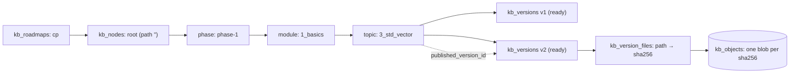
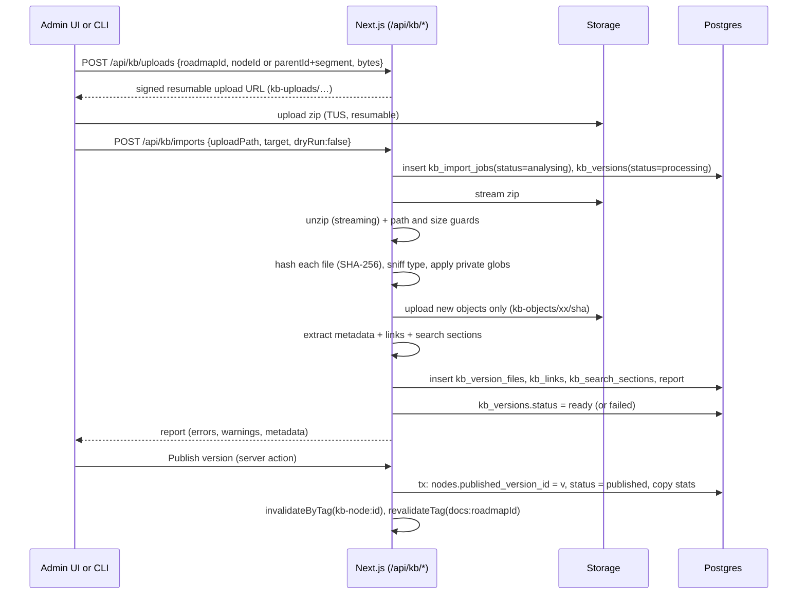
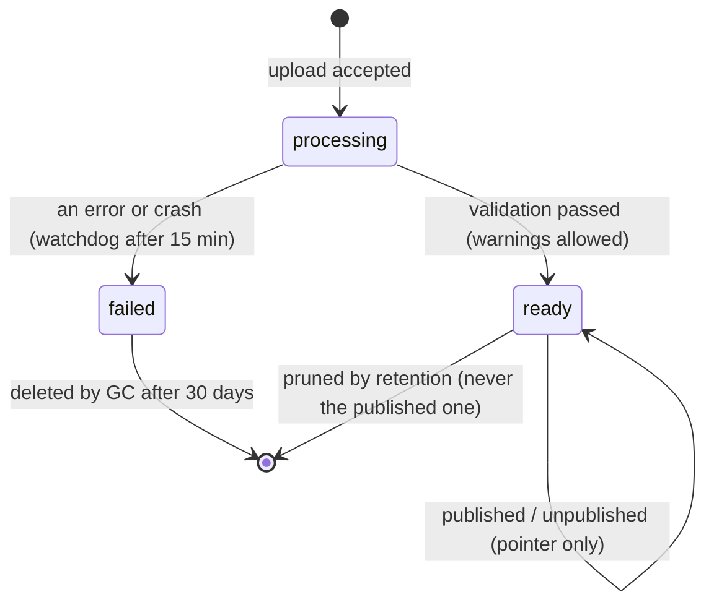

# 10 — Roadmap Docs System (Knowledge Base)

> Status: **Draft v0.1** · Related: [01 FR-DOCS](01-product-requirements.md), [07 §4.6](07-database-design.md), [08 §6–7](08-auth-and-security.md), [09 §4.8](09-admin-panel.md), ADR-004/005/006 in [17](17-risks-and-decisions.md)

This is the most unusual part of the system, so it gets the most detail. It explains how
self-contained HTML topic pages (like the `3_std_vector` reference) become a public, navigable,
versioned roadmap, **without changing a single byte of what the author produced**.

---

## 1. Purpose & principles

| # | Principle | Consequence |
|---|---|---|
| P1 | **The author's HTML is sacred.** | Files are served byte-for-byte. The platform never injects, rewrites or minifies bundle files |
| P2 | **The folder tree is the API.** | Bundles link to each other with relative paths (`../../../phase-0/…/index.html`), so the public URL tree must mirror the author's folder tree exactly |
| P3 | **Isolation by origin.** | Bundle JavaScript runs only on the content origin (`kb.…`), which holds no credentials ([08 §6](08-auth-and-security.md)) |
| P4 | **Immutable versions, movable pointer.** | Every upload is a new immutable version. Publish and rollback are one atomic pointer change |
| P5 | **Fill the gaps, never the page.** | When a link points to something that doesn't exist yet (a roadmap root, phase or module index, or a planned topic), the platform generates a page in the roadmap's own style |
| P6 | **Bulk-friendly.** | A whole phase (dozens of topics) can be imported, dry-run and published in one operation, from the admin UI or a CLI |

## 2. Reference bundle analysis — `3_std_vector`

The owner supplied `3_std_vector.zip` (1.86 MB zipped, ~2.3 MB unzipped, **45 files**) as the
reference for how topic pages look and behave. Everything below was read from that archive.

### 2.1 File anatomy

| Path | Role | Served publicly? |
|---|---|---|
| `index.html` (≈117 KB) | The complete topic page: inline `<style>`, three inline `<script>` blocks, all content | ✅ entry file |
| `assets/*.jpg` | Resized photos used in figures (mailboxes, hermit crab, paper tape) | ✅ |
| `assets/*.svg` (4) | Charts (`growth`, `costs`, `grid`, `bitpack`) generated by `figures.py` | ✅ |
| `assets/thumbs/*.jpg` + `VIDEOS.md` | YouTube thumbnails for the click-to-load facade, plus video provenance | ✅ |
| `assets/src/*.jpg` + `SOURCES.md` | Original downloads of the photos, with licence records (not referenced by the page) | ✅ (orphans, flagged for the owner, `Q-16`) |
| `assets/bench/*.cpp, *.py, *.json` | Benchmark programs, runner and recorded results: the evidence behind every number | ✅ as `text/plain` |
| `figures.py`, `figures.ipynb` | Regenerate the SVG charts from the recorded data | ✅ as `text/plain` |
| `data/00-index.md … 96_source_map.md` (14 files) | **Verbatim passages from books** (Laaksonen, Sannemo, e-maxx, *Guide to Competitive Programming*, …) with a source map | ⚠️ **private by default** (§15) |

### 2.2 Page anatomy (what the metadata extractor reads)

| UI part | Markup in the reference | Extracted as |
|---|---|---|
| Reading-progress bar | `#bar` | — |
| Top bar: brand + breadcrumb | `header.top .brand` → `../../../index.html` ("CP Knowledge Base"); `.crumb a` → "Phase 1" (`../../index.html`), "Basics" (`../index.html`) | `breadcrumbs[]`, **expected depth = 3** |
| Kicker | `.kicker .ser` = `01.01.14`; spans "Phase 1 — Core CP Toolkit", "Topic 3 of 66" | `serial`, `kicker[]` |
| Title, standfirst | `h1` = "std::vector"; `p.standfirst` | `title`, `summary` |
| Meta stats | `.meta > div > b` + label: **13** sections, **~30 min** reading time, **11** simulations, **11** practice problems, prerequisite link | `stats{}`, `prerequisites[]` |
| Evidence bar | `.evidbar p` (how numbers were measured) | `evidence` (text) |
| Table of contents | `nav.toc ol li a` → 14 entries (`#s1`…`#s13`, `#practice`) + progress box | `toc[]` |
| Sections | `section.sec[id]` with `h2[data-n]` and a "mark read" checkbox `input[data-done="sN"]` (13) | `sections[]` (search), `progress.sectionKeys[]` |
| Interactive demos | `.demo` (11): "Run it" panels replaying **recorded** program output | `stats.demos` |
| Quizzes | `.quiz[data-correct]` (9): "Check yourself" | `stats.quizzes` |
| Videos | `.vid[data-v]` (5): thumbnail facade → `youtube-nocookie.com` iframe on click | `videos[]` (id, title, channel, duration) |
| Practice | `section#practice .pr table` (11 problems: vjudge, CSES links) with injected "solved" checkboxes | `practice[]`, `progress.practiceCount` |
| Pager | `nav.pager a` → "← Lambdas & Comparators" (`../2_lambdas_and_comparators/index.html`), "std::string & Text Processing →" (`../4_std_string_and_text_processing/index.html`) | `pager{prev,next}` |
| Footer | Credits source passages and links `data/00-index.md` | `footer` |

### 2.3 Link topology

With the topic mounted at `/{roadmap}/phase-1/1_basics/3_std_vector/`, every relative link in the
reference resolves inside the roadmap:

| Link in `index.html` | Resolves to | Served by |
|---|---|---|
| `../../../index.html` (brand) | `/{roadmap}/index.html` | Generated roadmap root (or uploaded root bundle) |
| `../../index.html` ("Phase 1") | `/{roadmap}/phase-1/index.html` | Generated phase index |
| `../index.html` ("Basics") | `/{roadmap}/phase-1/1_basics/index.html` | Generated module index |
| `../2_lambdas_and_comparators/index.html` | sibling topic | Published bundle **or** generated "coming soon" |
| `../../../phase-0/1_basics/8_arrays_and_multidimensional_indexing/index.html` | topic in another phase | Published bundle or "coming soon" |
| `assets/growth.svg`, `data/00-index.md` | files in this bundle | This version's manifest |
| `https://cses.fi/…`, `https://vjudge.net/…`, `https://www.youtube.com/…` | external | Browser (new tab) |

> **Critical rule:** directory URLs must end in `/`. Without it, `assets/growth.svg` would resolve
> against the parent folder. The content origin issues a **308** from `…/3_std_vector` to
> `…/3_std_vector/`.

### 2.4 Runtime behaviour

| Behaviour | Detail | Platform implication |
|---|---|---|
| Inline scripts | Theme toggle, TOC scroll-spy, progress bar, copy buttons, quizzes, progress checkboxes, video facade, a data-driven demo engine (~25 KB) | CSP must allow `'unsafe-inline'` scripts **on the content origin only** |
| `localStorage` keys | `cpkb-theme`; `cpkb-{serialNoDots}-{sN}` for "mark read" (e.g. `cpkb-010114-s4`); `cpkb-{serialNoDots}-p{i}` for solved practice problems; `cpkb-q{N}` for quiz answers | All topics of a roadmap must share **one origin** so theme and progress persist across pages. Generated index pages read the same keys to show progress |
| Network | None at runtime except the YouTube iframe after a click; thumbnails are local | `connect-src 'none'` is safe; `frame-src` allows `youtube-nocookie.com` |
| Fonts | System font stacks only | Nothing to allow in `font-src` |

### 2.5 Observations fed back to the bundle generator (non-blocking)

| # | Observation | Suggestion |
|---|---|---|
| O1 | Quiz answers are stored as `cpkb-q2`, `cpkb-q3`… **without** the topic serial, so different topics on the same origin overwrite each other | Namespace like the section keys (`cpkb-{serial}-q2`). Low impact today: the answers are written but never read back |
| O2 | `data/` republishes verbatim book text | Keep the files private on the site; link to the original sources instead (§15) |
| O3 | `assets/src/` originals aren't referenced by the page | Either exclude them from the bundle or keep them private; they cost storage |
| O4 | "Topic 3 of 66" and serials are baked into the HTML | The platform doesn't recompute positions, to avoid contradicting the page; the outline stores the serial so lists match the page |
| O5 | Metadata is only in markup | Optionally emit a `kb.json` manifest (§5.4) so imports never depend on CSS class names |

## 3. Content model



- **Every roadmap has one hidden `root` node** (segment `''`, path `''`), so the roadmap root can
  also carry an uploaded `index.html` if the generator produces one. (DB: `kb_node_kind` includes
  `root`; see [07 §4.6](07-database-design.md).)
- **Any node can have versions.** Topics must have one to be published. Containers (root, phase,
  module) are optional: without a published version they get a **generated** index.
- A container's bundle may not contain a top-level folder with the same name as one of its child
  nodes (error `E09`). The child node always wins path resolution.
- **Content-addressed storage:** files are stored once per SHA-256; a new version that changes 1 file
  out of 45 stores 1 new object.

## 4. URL scheme

| Kind | URL on the content origin |
|---|---|
| Directory of all roadmaps | `https://kb.eyasir329.dev/` |
| Roadmap root | `https://kb.eyasir329.dev/cp/` |
| Phase index | `https://kb.eyasir329.dev/cp/phase-1/` |
| Module index | `https://kb.eyasir329.dev/cp/phase-1/1_basics/` |
| Topic | `https://kb.eyasir329.dev/cp/phase-1/1_basics/3_std_vector/` (also `…/index.html`, same bytes, canonical → the `/` form via the HTTP `Link` header) |
| Topic file | `https://kb.eyasir329.dev/cp/phase-1/1_basics/3_std_vector/assets/growth.svg` |
| Draft preview | `https://kb.eyasir329.dev/__preview/{token}/cp/phase-1/1_basics/3_std_vector/` |

The main site links into this tree from `/docs/cp` (map) and search results
(`…/3_std_vector/#s4`).

## 5. Bundle contract

### 5.1 Structure

| Item | Rule |
|---|---|
| Archive | `.zip` (Deflate/Store). A single top-level folder (e.g. `3_std_vector/`) is stripped automatically, and its name becomes the **suggested segment** |
| Entry | `index.html` at the bundle root is **required** for topics; optional for containers |
| Paths | UTF-8, forward slashes, no `..`, no absolute paths, no NUL, no symlinks, each segment ≤ 120 chars, whole path ≤ 512 chars |
| Optional manifest | `kb.json` at the root (§5.4), always private |
| Case | Paths are case-sensitive; two paths that differ only by case → warning `W15` |

### 5.2 Allowed file types & limits

| Group | Extensions | Served as |
|---|---|---|
| Pages & code the browser runs | `.html .htm .css .js .mjs .json .map .wasm` | `text/html; charset=utf-8`, `text/css`, `text/javascript`, `application/json`, `application/wasm` |
| Images | `.svg .png .jpg .jpeg .webp .avif .gif .ico` | proper `image/*` |
| Media | `.mp4 .webm .mp3 .ogg .vtt` | proper types (Range requests supported) |
| Fonts | `.woff2 .woff .ttf .otf` | `font/*` |
| Documents | `.pdf` | `application/pdf` |
| Source & data (shown as text) | `.md .txt .csv .tsv .py .ipynb .cpp .cc .c .h .hpp .java .kt .rs .go .ts .tsx .rb .sh .tex .yaml .yml .toml .xml` | `text/plain; charset=utf-8` (displays in the browser, never executes) |
| Anything else | — | Rejected (`E04`) unless the owner adds it to the roadmap's allowlist |

| Limit | Value |
|---|---|
| Zip size | 100 MB |
| Uncompressed total | 300 MB |
| Files per bundle | 3,000 |
| Single file | 25 MB |
| Compression ratio per entry | ≤ 100 : 1 (zip-bomb guard) |

### 5.3 Metadata extraction

Extraction runs over `index.html` with an HTML parser (no script execution). Each field has
fallbacks, so bundles from a different generator still import.

| Field | Primary selector (reference format) | Fallbacks |
|---|---|---|
| `title` | `h1` text | `<title>` split on ` — `; folder name |
| `description` | `meta[name=description]` | `.standfirst`; first `<p>` (≤ 300 chars) |
| `serial` | `.kicker .ser` | `kb.json`; none |
| `summary` | `p.standfirst` | `description` |
| `kicker` | `.kicker > span` texts | — |
| `breadcrumbs` | `header.top .brand`, `.crumb a` | — |
| `expectedDepth` | number of `../` in the brand link | — (used for check `W14`) |
| `stats` | `.meta > div`: number in `<b>` + label → `sections`, `readingMinutes`, `simulations`, `practice` | counts of `section[id]`, words ÷ 230 |
| `prerequisites` | `.meta` entry labelled "prerequisite" → `{title, href}` | `kb.json` |
| `toc` | `nav.toc a[href^="#"]` | `h2[id]` / `section[id] > h2` |
| `sections` (search) | `section.sec[id]`: heading = `h2` text without the "mark read" label; body = text without `script`/`style` | `h2`-delimited chunks |
| `progress.sectionKeys` | `[data-done]` values (`s1…s13`) | — |
| `progress.practiceCount` | rows of `.pr tbody tr` | — |
| `progress.keyPrefix` | `cpkb-` + serial without dots + `-` (from the roadmap's `progress_key_pattern`) | — |
| `videos` | `.vid[data-v]` → id, `.vmeta b`, `.vby`, `.vdur` | `iframe[src*=youtube]` |
| `practice` | `.pr a[href]` → title, judge (host), url | — |
| `pager` | `nav.pager a` (first = prev, last = next) | `link[rel=prev/next]` |
| `quizzes`, `demos` | counts of `.quiz`, `.demo` | — |
| `a11y` | `html[lang]`, `img` without `alt`, `<title>` present | — |

**Golden test:** importing the reference must extract exactly: title `std::vector`, serial
`01.01.14`, 13 sections, ~30 min, 11 simulations, 11 practice problems, 14 TOC entries, 13
section keys, 5 videos, 9 quizzes, 11 demos, prerequisite "Arrays & Multidimensional Indexing",
prev "Lambdas & Comparators", next "std::string & Text Processing", 45 files (`T-KB-01` in
[15](15-testing-and-qa.md)).

### 5.4 Optional `kb.json` manifest (bundle-provided, wins over extraction)

```json
{
  "schema": "kb-bundle/1",
  "kind": "topic",
  "title": "std::vector",
  "serial": "01.01.14",
  "summary": "The resizable array you will use in almost every solution…",
  "readingMinutes": 30,
  "entry": "index.html",
  "sections": [{ "id": "s1", "title": "What it is" }],
  "progress": { "keyPrefix": "cpkb-010114-", "sectionKeys": ["s1", "s2"], "practiceCount": 11 },
  "prerequisites": ["../../../phase-0/1_basics/8_arrays_and_multidimensional_indexing/"],
  "private": ["data/**", "assets/src/**"],
  "licence": "CC BY-NC-SA 4.0"
}
```

## 6. Ingestion pipeline (single topic)

### 6.1 Sequence



### 6.2 Validation rules

**Errors** block the version (`status = failed`):

| Code | Rule |
|---|---|
| E01 | No `index.html` at the root of a topic bundle |
| E02 | Unsafe entry path (absolute, `..`, backslash, NUL, drive letter) or symlink |
| E03 | A size/count/ratio limit exceeded (§5.2) |
| E04 | Disallowed file type |
| E05 | `index.html` not valid UTF-8 or unparseable |
| E06 | Zip is encrypted or corrupt |
| E09 | Container bundle contains a top-level folder named like one of its child nodes |

**Warnings** (the version is still `ready`; the owner decides):

| Code | Rule |
|---|---|
| W01 | Relative link/asset points to a file that exists neither in the bundle nor in any published version |
| W02 | Link points to a **planned** node → will show "coming soon" |
| W03 | Link points to a path with **no node** → will 404 (one-click "create planned node") |
| W04 | External script/style/font host not allowed by the roadmap CSP → will be blocked in browsers |
| W05 | Missing `<title>`, `html[lang]` or meta description |
| W06 | `` without `alt` |
| W08 | Public page links to a **private** file (e.g. footer → `data/00-index.md`) → readers will see the private notice |
| W09 | Image > 2 MB (optimisation suggested) |
| W10 | Link to `localhost`, `file://` or an absolute Windows path |
| W12 | Extracted title/serial differs from the outline node → offer "update node from bundle" |
| W13 | Root-absolute link (`/…`): breaks under the roadmap prefix and in preview |
| W14 | `expectedDepth` (from the brand link) ≠ node depth: the page's breadcrumb links will point to the wrong level |
| W15 | Paths differing only by case |
| W16 | Serial already used by another node in this roadmap |

**Infos:** orphan files (not referenced by any page; e.g. `assets/src/*`); bundle identical to the
current version (`bundle_sha256` match → no new version created); counts summary.

The report screen groups findings by code, lists the exact file and line, and offers actions where
possible (create planned node, mark path private, update node metadata).

### 6.3 Version lifecycle



## 7. Bulk import & CLI

### 7.1 Tree import (admin UI)

1. Upload a zip whose root is either the roadmap root (`phase-0/`, `phase-1/`, …) or any sub-folder
   (then choose the target node).
2. **Topic detection:** every folder that contains `index.html` and has no nested `index.html`
   folders becomes a *topic*; folders above it become containers (created as `planned` if missing);
   a container folder with its own `index.html` becomes a container bundle.
3. **Dry run** (default): per detected node, compute `bundle_sha256` and compare with the current
   version → plan = **new / changed / unchanged / only-in-DB** (nothing is deleted automatically).
   Each changed/new topic is validated; the plan shows its errors and warnings.
4. **Apply:** creates versions for new/changed topics (status `ready`), creates missing nodes, and
   records everything under one `kb_import_jobs` row. Processing runs in **steps** (a few topics per
   function invocation, driven by the UI/CLI polling `POST /api/kb/imports/{id}/step`), so no single
   invocation risks the platform's execution time limit.
5. **Publish selected / all ready** in one transaction.

### 7.2 CLI (`scripts/kb-cli`)

```text
pnpm kb login                                  # stores a token (from /admin/tokens) in the OS keychain/.env
pnpm kb outline push outline.yaml --roadmap cp # create/update planned nodes, serials, titles, order
pnpm kb push ./site/phase-1 --roadmap cp --base phase-1 [--dry-run] [--publish] [--note "…"]
pnpm kb status --roadmap cp                    # table of nodes: status, version, last publish
pnpm kb pull cp/phase-1/1_basics/3_std_vector  # download the published bundle as a zip
pnpm kb open cp/phase-1/1_basics/3_std_vector  # open the public URL
```

`kb push` zips each topic folder locally, hashes it, **skips topics whose hash matches the current
version** (nothing to upload), uploads the rest in parallel (limit 4), starts a tree job and prints
the dry-run plan and validation summary. With `--publish` it publishes everything that's `ready` and
error-free.

### 7.3 Outline file (plans topics before they exist)

```yaml
roadmap: cp
title: CP Knowledge Base
nodes:
  - { segment: phase-0, kind: phase, title: "Phase 0 — Foundations" }
  - segment: phase-1
    kind: phase
    title: "Phase 1 — Core CP Toolkit"
    children:
      - segment: 1_basics
        kind: module
        title: Basics
        children:
          - { segment: 2_lambdas_and_comparators, kind: topic, title: "Lambdas & Comparators" }
          - { segment: 3_std_vector, kind: topic, title: "std::vector", serial: "01.01.14" }
          - { segment: 4_std_string_and_text_processing, kind: topic, title: "std::string & Text Processing" }
```

The owner's full 66-topic outline is needed to seed this (`Q-13`).

## 8. Serving (content origin)

### 8.1 Resolution algorithm

```text
handle(host = kb.*, path):
  if path == "/" → generated directory of published roadmaps
  [slug, ...rest] = split(path)
  roadmap = cachedRoadmap(slug)                      # tag docs:{id}
  if !roadmap or roadmap.status != published → 404 (generated, plain)
  rel = normalise(decode(rest))                      # reject "..", "\\", NUL → 400
  outline = cachedOutline(roadmap)                   # path → node map, tag docs:{id}
  if !rel.endsWith("/") and outline.has(rel)         # a node path without the slash
     → 308 "/{slug}/{rel}/"
  node = longestPrefixNode(outline, dirname(rel))    # deepest node whose path prefixes rel
  file = rel minus node.path; if file == "" or endsWith("/") → file += "index.html"
  if node.published_version_id:
     entry = cachedManifest(version)[file]           # immutable, cached by version id
     if entry:
        if entry.is_private → 403 generated "private notice" (noindex)
        return stream(object entry.sha256) with headers(§8.2)
  if file == "index.html":
     if node.kind in (root, phase, module) → generated index (§9)
     if node.kind == topic                 → generated "coming soon" (200, noindex)
  if kbRedirects(roadmap).has(rel) → 308 to target
  → 404 generated in roadmap style
```

Only **published** roadmaps and nodes are visible. Draft/planned nodes still reserve their path so
links resolve to "coming soon". `HEAD` and conditional requests (`If-None-Match` with the SHA-256
ETag → `304`) are supported; media files support `Range`.

### 8.2 Response headers

| Header | Value |
|---|---|
| `Content-Type` | From the extension table in §5.2 (never sniffed at serve time) |
| `ETag` | `"{sha256}"` |
| `Cache-Control` (browser) | HTML: `public, max-age=0, must-revalidate`. Other files: `public, max-age=300` |
| `Vercel-CDN-Cache-Control` | `public, s-maxage=86400, stale-while-revalidate=604800` |
| `Vercel-Cache-Tag` | `kb:{roadmapId} kb-node:{nodeId}` |
| `Link` | `<https://kb…/cp/…/3_std_vector/>; rel="canonical"` on `index.html` responses |
| `Content-Security-Policy` | Content-origin CSP ([08 §7.3](08-auth-and-security.md)) + roadmap `csp_extra` |
| `X-Content-Type-Options` | `nosniff` |
| `X-Robots-Tag` | `noindex` for previews, coming-soon, private-notice and 404 pages |
| `Access-Control-Allow-Origin` | not set (same-origin only) |

### 8.3 Private files

Paths matching the roadmap's `private_globs` (default `data/**`) or the bundle's `kb.json` `private`
list are stored and versioned but **never served publicly**. They're viewable in the admin file
browser and in previews. A public request returns a generated, noindexed page: "The source notes for
this topic are private. The sources are credited in the page footer." Changing visibility is a
roadmap setting (owner) and purges the CDN tag.

### 8.4 Caching & publish latency

- Manifests and outlines are cached in the Next.js data cache, keyed by immutable version id /
  roadmap tag.
- On publish/rollback/visibility change: `invalidateByTag('kb-node:{id}')` (CDN) +
  `revalidateTag('docs:{roadmapId}')` (outline, generated pages, main-site map). Target: the new
  version is visible **≤ 60 s** after publish (`NFR-PERF-11`). `SP-02` validates CDN tag purging
  for route-handler responses; the fallback is a 5-minute `s-maxage`.

## 9. Generated pages

Rendered on the server from templates, styled with the roadmap's `theme_css` (auto-extracted from the
first published topic's `<style>` block, editable in admin) so they look like the bundles. They use
**relative links only**, so they also work under `/__preview/{token}/`.

| Page | Content |
|---|---|
| **Directory** `/` | All published roadmaps (title, description, counts) + link back to `eyasir329.dev/docs` |
| **Roadmap root** `/{slug}/` | Title, description, licence, overall progress ("37 of 180 sections read"), phases with module and topic counts, "Continue where you left off", link to the main-site map |
| **Phase index** | Kicker (phase label), title, summary, modules → topics with serial, title, reading time, status and progress; prerequisites |
| **Module index** | Topics in order: serial, title, standfirst, reading minutes, progress bar, "coming soon" badge for planned ones; the next unread topic is highlighted |
| **Coming soon** (topic without a published version) | Serial, title, position, "This topic is being written", links to the module index, neighbouring published topics and prerequisites. `noindex` |
| **Private notice**, **404** | Roadmap-styled message with links to the root and the main-site search |

**Progress aggregation (client-side, no network):** each generated page embeds, per listed topic,
`{ keyPrefix, sectionKeys[], practiceCount }` from metadata. A small inline script reads
`localStorage[keyPrefix + key]` (the exact keys the bundles write, e.g. `cpkb-010114-s4`) and renders
"8/13 read · 3/11 solved". The theme toggle uses the roadmap's `theme_storage_key` (`cpkb-theme`), so
the theme is consistent between generated and uploaded pages.

Generated pages carry JSON-LD (`Course` on the root, `ItemList` on phase/module indexes) and
proper `<title>`/description. Uploaded bundles are never modified.

## 10. Portfolio-side views (main origin)

| Route | Content | Source |
|---|---|---|
| `/docs` | Catalog of published roadmaps: cover, description, published/planned counts, last update, "Open roadmap" | `kb_roadmaps` + `kb_roadmap_outline` |
| `/docs/[roadmap]` | The full vertical roadmap in Marble & Ink style: phases (Roman numerals) → modules → topic rows (serial · title · reading time · status); filters (status, phase); in-page search; each published topic links to the content origin. No progress here (progress lives in the content origin's browser storage) | `kb_roadmap_outline` (cached, tag `docs:{id}`) |

The main-site map shows **serials** (from the outline) rather than recomputing "Topic N of M", so
it never contradicts the bundle's own kicker (O4).

## 11. Admin workflows

| Workflow | Steps | Guarantees |
|---|---|---|
| Create roadmap | Title, slug (= first path segment), description, licence → optional outline import | Slug is immutable once published (it's in every URL) |
| Upload a topic | Pick the node (or parent + segment) → drop zip → report → Preview → Publish | Nothing public changes until Publish |
| Publish / rollback | Choose any `ready` version → Publish | Single transaction; audit-logged; CDN purge; the previous pointer is recorded |
| Unpublish | Node → status `planned`/`draft`, pointer cleared | Links from other topics now show "coming soon" |
| Quick edit | Files tab → open a text file (e.g. fix a typo in `index.html`) → Save as new version | Creates version `source=quick_edit` with one changed object; still needs Publish |
| Rename / move node | Change segment or parent | Warns with every inbound link (`kb_links`) that will break; creates a `kb_redirects` 308 from the old path; suggests re-uploading the linking bundles |
| Compare versions | Pick two versions | File list diff by hash: added / removed / changed; text diff for text files |
| Delete node / roadmap | Owner only, typed confirmation | Versions deleted; objects become unreferenced → removed by GC after 30 days |
| Retention | Keep the last 10 versions per node + every version that was ever published | Configurable per roadmap |

## 12. Preview

- `Preview` creates a token: `base64url({ v: versionId | importJobId, exp }) + "." + HMAC`.
- `kb.…/__preview/{token}/cp/…` resolves like §8.1, except that the previewed version (or every
  `ready` version of the import job) **overlays** the published ones, and private files are visible.
- Preview responses: `noindex`, `Cache-Control: private, no-store`, `frame-ancestors` allows the
  admin origin; the admin shows them in a sandboxed iframe with device-width toggles (360 / 768 /
  1280 px) and a "open in new tab" link.

## 13. Search integration

- On processing, each `section.sec[id]` becomes a `kb_search_sections` row (heading, plain-text body,
  anchor).
- `search_all()` returns only rows from **published** versions, with a `ts_headline` snippet and the
  deep link `https://kb…/cp/phase-1/1_basics/3_std_vector/#s4`.
- The ⌘K dialog groups results: *Docs* (topic › section), *Blog*, *Work*, *Pages*.

## 14. SEO

| Item | Rule |
|---|---|
| Indexable | Published topic directory URLs, generated roadmap/phase/module indexes |
| Not indexable | Previews, coming-soon, private notices, 404s |
| Sitemap | `kb.…/sitemap.xml`: every indexable URL with `lastmod` = the node's `updated_content_at` |
| robots.txt | `Disallow: /__preview/` + sitemap link |
| Canonical | Directory form with a trailing slash, via the HTTP `Link` header (the bundle HTML is not modified) |
| Titles/descriptions | As authored in the bundle |
| Cross-linking | `/docs/{roadmap}` on the main site links every published topic; the generated root links back |

## 15. Copyright & licensing

| Material in bundles | Risk | Default handling |
|---|---|---|
| `data/*.md`: **verbatim** passages from books (e.g. *Competitive Programmer's Handbook*, Sannemo's books, *Guide to Competitive Programming* (Springer), e-maxx, course notes) | Republishing copyrighted text without permission | **Private** (`data/**` in `private_globs`). The owner can make a roadmap's sources public only after confirming permission or licence (`Q-14`) |
| Photos from Wikimedia Commons (CC BY-SA 3.0/4.0, public domain) | Attribution and share-alike obligations | Already credited in captions and `SOURCES.md`; keep public |
| YouTube thumbnails stored locally | Thumbnails belong to the creators | Common practice for link previews, and the videos are credited. Alternative: hotlink `i.ytimg.com` (allowed in CSP) — decision `Q-17` |
| The author's own prose, code, charts, benchmarks | — | Licence chosen by the owner (e.g. CC BY-NC-SA 4.0 for text, MIT for code) and shown on the generated root page (`Q-15`) |

## 16. Capacity & cost

| Quantity | Estimate |
|---|---|
| One topic like the reference | ~2.3 MB, 45 files |
| 66 topics, first versions | ~150 MB of objects |
| Re-uploads | Usually a few changed files each (CAS dedupe) → +5–15% per full re-import |
| Supabase Storage free tier | 1 GB → comfortably 2–4 roadmaps of this size; upgrade trigger at 70% ([14 §9](14-devops-and-environments.md)) |
| Egress | Readers hit the Vercel CDN; Supabase is read only on cache misses |

## 17. Failure modes

| Failure | Effect | Handling |
|---|---|---|
| Import crashes mid-way | Version stuck in `processing` | Watchdog marks it `failed` after 15 min; uploaded objects are harmless (GC); re-run the import |
| Storage read fails while serving | 5xx for that file | CDN keeps serving the stale copy (`stale-while-revalidate`/`stale-if-error`); Sentry alert |
| CDN purge fails after publish | Old version served until `s-maxage` expires | Publish retries the purge 3× and shows a warning with a "Purge again" button |
| Wrong version published | Readers see old/bad content | One-click rollback; audit log shows who/when |
| Bundle links to a renamed node | 404 on click | `kb_redirects` 308 + link report highlights the linking bundles |
| Supabase project paused (free tier) | Content origin cache misses fail | Daily sync keeps the project active; uptime monitor alerts ([14 §6](14-devops-and-environments.md)) |

## 18. Later (v1.1+)

- **Author topics in admin:** Markdown + directives rendered into the roadmap's template (same
  metadata model), for quick notes that don't need the full generator.
- **Reader accounts:** optional sign-in to sync progress across devices (would need a small bridge
  script, because bundles store progress in `localStorage`).
- **Offline reading:** a service worker on the content origin caching visited topics.
