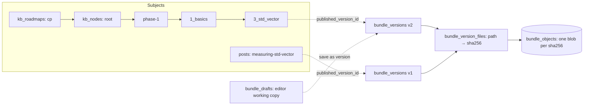
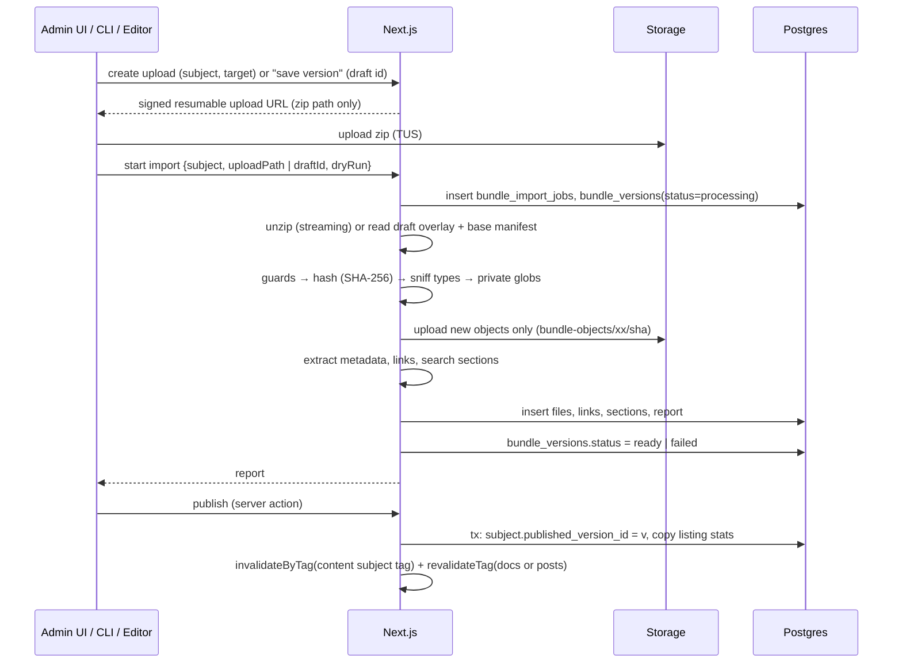
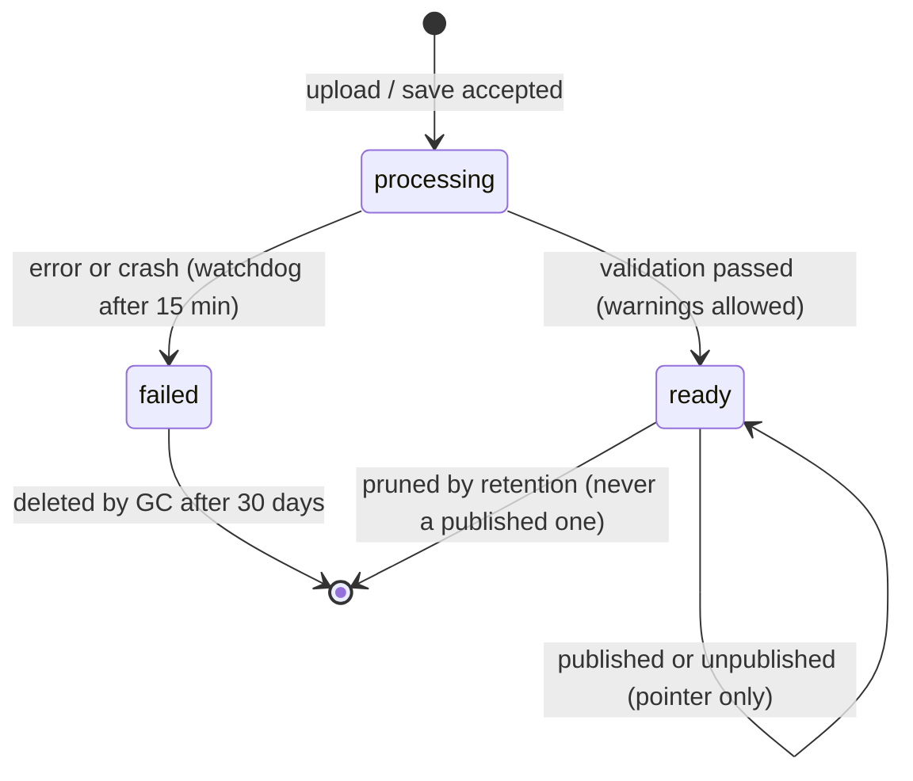

# 10 — Content Origin, HTML Bundle Engine & Roadmap Docs

> Status: **Draft v0.3** · Related: [01 FR-DOCS, FR-BLOG](01-product-requirements.md), [07 §4.6](07-database-design.md), [08 §6–7](08-auth-and-security.md), [09 §4.7–4.8](09-admin-panel.md), [11 §7 Blog](11-content-modules.md), [19 Reader runtime](19-guest-accounts-and-progress.md), ADR-004/005/006/014/020 in [17](17-risks-and-decisions.md)

> **Revision 0.2:** (1) the engine is generalised: **blog posts are HTML bundles too**; (2) the
> content origin is renamed `read.eyasir329.dev` and hosts `/docs/…` and `/blog/…`; (3) served HTML
> entry documents get **one injected runtime block** for sign-in-gated progress tracking; stored
> bytes stay immutable; (4) an **in-admin HTML editor** joins zip upload and the CLI.
>
> **Revision 0.3:** practice links are no longer matched to judge problems (no learner CP tracking,
> no auto-verification). Readers tick practice problems themselves.

This document explains how self-contained HTML pages (like the `3_std_vector` reference topic, and
now every blog post) become public, versioned, navigable pages **without changing what the author
wrote**.

---

## 1. Purpose & principles

| # | Principle | Consequence |
|---|---|---|
| P1 | **Stored bytes are immutable; serving is faithful.** | Every file is stored and versioned exactly as uploaded. Non-HTML files are served byte-for-byte. HTML **entry** documents are served with exactly one platform block inserted before `</head>` (the reader runtime, §8.3). Removing that block gives back the stored bytes |
| P2 | **The folder tree is the API.** | Bundles link with relative paths (`../../../phase-0/…/index.html`), so public URLs mirror the author's folders exactly |
| P3 | **Isolation by origin.** | Bundle JavaScript runs only on the content origin (`read.…`), which never sees main-site credentials ([08 §6](08-auth-and-security.md)) |
| P4 | **Immutable versions, movable pointer.** | Every upload/save creates a new version. Publish and rollback are one atomic pointer change |
| P5 | **Fill the gaps, never the page.** | Missing roadmap/phase/module indexes and "coming soon" pages are generated in the roadmap's own style |
| P6 | **One engine, many subjects.** | Roadmap nodes and blog posts share storage, validation, versioning, preview, search and serving |
| P7 | **Bulk-friendly.** | Whole phases import in one dry-run-then-apply operation, from admin or the CLI |

## 2. Reference bundle analysis — `3_std_vector`

The owner supplied `3_std_vector.zip` (1.86 MB zipped, ~2.3 MB unzipped, **45 files**) as the
reference. Everything below was read from that archive.

### 2.1 File anatomy

| Path | Role | Served publicly? |
|---|---|---|
| `index.html` (≈117 KB) | The complete topic page: inline `<style>`, three inline `<script>` blocks, all content | ✅ entry document (+ runtime block) |
| `assets/*.jpg` | Resized photos used in figures | ✅ |
| `assets/*.svg` (4) | Charts generated by `figures.py` | ✅ |
| `assets/thumbs/*.jpg` + `VIDEOS.md` | YouTube thumbnails for the click-to-load facade, plus video provenance | ✅ |
| `assets/src/*.jpg` + `SOURCES.md` | Original photo downloads + licence records (not referenced by the page) | ✅ orphans, flagged (`Q-16`) |
| `assets/bench/*.cpp, *.py, *.json` | Benchmarks, runner and recorded results: the evidence behind every number | ✅ as `text/plain` |
| `figures.py`, `figures.ipynb` | Regenerate the SVG charts from recorded data | ✅ as `text/plain` |
| `data/00-index.md … 96_source_map.md` (14 files) | **Verbatim passages from books** with a source map | ⚠️ **private by default** (§15) |

### 2.2 Page anatomy (what the metadata extractor reads)

| UI part | Markup in the reference | Extracted as |
|---|---|---|
| Top bar: brand + breadcrumb | `header.top .brand` → `../../../index.html`; `.crumb a` → "Phase 1" (`../../index.html`), "Basics" (`../index.html`) | `breadcrumbs[]`, **expected depth = 3** |
| Kicker | `.kicker .ser` = `01.01.14`; "Phase 1 — Core CP Toolkit", "Topic 3 of 66" | `serial`, `kicker[]` |
| Title, standfirst | `h1` "std::vector"; `p.standfirst` | `title`, `summary` |
| Meta stats | `.meta > div > b`: **13** sections, **~30 min**, **11** simulations, **11** practice problems, prerequisite link | `stats{}`, `prerequisites[]` |
| Evidence bar | `.evidbar p` | `evidence` |
| TOC + progress box | `nav.toc ol li a` (14 entries), `#pfill`, `#pct` | `toc[]` |
| Sections | `section.sec[id]`, `h2[data-n]`, "mark read" `input[data-done="sN"]` (13) | `sections[]`, `progress.sectionKeys[]`, control selector `input[data-done]` |
| Demos / quizzes | `.demo` (11) / `.quiz[data-correct]` (9) | `stats.demos`, `stats.quizzes` |
| Videos | `.vid[data-v]` (5), facade → `youtube-nocookie.com` on click | `videos[]` |
| Practice | `section#practice .pr table` (11 links: vjudge, CSES); the page script injects `input.pchk` "solved" boxes | `practice[]`, `progress.practiceKeys[]`, control selector `input.pchk` |
| Pager | `nav.pager a` → prev "Lambdas & Comparators", next "std::string & Text Processing" | `pager{}` |
| Footer | Credits sources, links `data/00-index.md` | `footer` |

### 2.3 Link topology

With the topic mounted at `/docs/{roadmap}/phase-1/1_basics/3_std_vector/`:

| Link in `index.html` | Resolves to | Served by |
|---|---|---|
| `../../../index.html` (brand) | `/docs/{roadmap}/index.html` | Generated roadmap root (or uploaded root bundle) |
| `../../index.html` / `../index.html` | phase / module index | Generated (or uploaded) |
| `../2_lambdas_and_comparators/index.html` | sibling topic | Published bundle **or** generated "coming soon" |
| `../../../phase-0/1_basics/8_arrays_and_multidimensional_indexing/index.html` | topic in another phase | Published or "coming soon" |
| `assets/growth.svg`, `data/00-index.md` | files in this bundle | This version's manifest |
| `https://cses.fi/…`, `https://vjudge.net/…` | external | Browser |

> **Critical rule:** directory URLs end in `/`. The content origin issues a **308** from
> `…/3_std_vector` to `…/3_std_vector/`, so `assets/…` resolves correctly.

### 2.4 Runtime behaviour & its interaction with sign-in-gated progress

| Behaviour | Detail | Platform implication |
|---|---|---|
| Inline scripts | Theme, TOC scroll-spy, progress bar, copy buttons, quizzes, progress checkboxes, video facade, demo engine | CSP allows inline scripts **on the content origin only** |
| Storage keys | `cpkb-theme`; `cpkb-{serialNoDots}-sN` ("mark read"); `cpkb-{serialNoDots}-p{i}` (practice); `cpkb-q{N}` (quiz answers) | The runtime gates exactly the progress keys (`cpkb-010114-*`): blocked for anonymous readers, synced for signed-in guests ([19 §3](19-guest-accounts-and-progress.md)). Theme stays local for everyone |
| Event handlers | Checkboxes update storage and UI on `change` | The runtime applies server state by setting `checked` and dispatching `change`, so the page's own UI logic does the rendering (no DOM rewriting) |
| Network | None except the click-to-load YouTube iframe | CSP `connect-src 'self'` is enough (runtime API only) |

### 2.5 Observations fed back to the bundle generator (non-blocking)

| # | Observation | Suggestion |
|---|---|---|
| O1 | Quiz answers stored as `cpkb-q2` without the serial → topics overwrite each other | Namespace like section keys (`cpkb-{serial}-q2`) |
| O2 | `data/` republishes verbatim book text | Keep private; link to the original sources (§15) |
| O3 | `assets/src/` originals aren't referenced | Exclude from bundles or keep private |
| O4 | "Topic 3 of 66" is baked into the HTML | The platform shows serials rather than recomputing positions |
| O5 | Metadata lives only in markup | Optionally emit `kb.json` (§5.4) |
| O6 | **New:** progress works through `localStorage` only | Optionally include `<script src="/__rt/runtime.v1.js">` and `<meta name="rt" content="self">` so injection isn't needed (runtime mode `self`) |

## 3. Content model



- **Subjects:** `kb_node` (root, phase, module, topic) and `post`. Each subject has any number of
  immutable versions and at most one published version.
- **Every roadmap has one hidden `root` node** (path `''`), so the roadmap root can carry an
  uploaded `index.html`.
- **Topics and posts** need a published version to be public. Containers without one get a
  generated index.
- **Content-addressed storage:** each file is stored once per SHA-256; a version that changes 1 of
  45 files adds 1 object.
- **Drafts:** the in-admin editor edits a mutable working copy (`bundle_drafts`) on top of a base
  version. "Save version" snapshots it into a new immutable version.

## 4. URL scheme (content origin `read.eyasir329.dev`, name pending `Q-04`)

| Kind | URL |
|---|---|
| Reading-room home | `https://read.eyasir329.dev/` (generated: roadmaps + latest posts, links back to the main site) |
| Roadmap root | `…/docs/cp/` |
| Phase / module index | `…/docs/cp/phase-1/`, `…/docs/cp/phase-1/1_basics/` |
| Topic | `…/docs/cp/phase-1/1_basics/3_std_vector/` (also `…/index.html`; canonical = the `/` form via the HTTP `Link` header) |
| Topic file | `…/docs/cp/phase-1/1_basics/3_std_vector/assets/growth.svg` |
| Blog post | `…/blog/measuring-std-vector/` (+ its files, e.g. `…/blog/measuring-std-vector/assets/fig1.svg`) |
| Reader runtime | `…/__rt/runtime.v1.js` (immutable, versioned filename) |
| Reader API | `…/__api/me`, `…/__api/progress`, `…/__api/progress/summary`, `…/__api/visit` ([13 §4](13-api-and-data-flow.md)) |
| Session bridge | `…/__auth/callback`, `…/__auth/signout` ([19 §2.2](19-guest-accounts-and-progress.md)) |
| Draft preview | `…/__preview/{token}/docs/cp/…/` or `…/__preview/{token}/blog/{slug}/` |

On the main site: `/docs` (catalog), `/docs/[roadmap]` (map), `/blog` (index, tags, series), and
**`/blog/[slug]` → 308 to `read…/blog/{slug}/`**, so pretty links on the main domain keep working
(`Q-27`).

## 5. Bundle contract

### 5.1 Structure

| Item | Rule |
|---|---|
| Archive | `.zip`. A single top-level folder is stripped; its name becomes the suggested segment/slug |
| Entry | `index.html` at the bundle root: **required** for topics and posts, optional for containers |
| Paths | UTF-8, forward slashes, no `..`, no absolute paths, no NUL, no symlinks; segment ≤ 120, path ≤ 512 chars |
| Optional manifest | `kb.json` (topics) / `post.json` (posts) at the root; always private |
| Case | Case-sensitive; paths that differ only by case → warning `W15` |

### 5.2 Allowed file types & limits

| Group | Extensions | Served as |
|---|---|---|
| Pages & browser code | `.html .htm .css .js .mjs .json .map .wasm` | `text/html; charset=utf-8`, `text/css`, `text/javascript`, `application/json`, `application/wasm` |
| Images | `.svg .png .jpg .jpeg .webp .avif .gif .ico` | `image/*` |
| Media | `.mp4 .webm .mp3 .ogg .vtt` | proper types, `Range` supported |
| Fonts | `.woff2 .woff .ttf .otf` | `font/*` |
| Documents | `.pdf` | `application/pdf` |
| Source & data (shown as text) | `.md .txt .csv .tsv .py .ipynb .cpp .cc .c .h .hpp .java .kt .rs .go .ts .tsx .rb .sh .tex .yaml .yml .toml .xml` | `text/plain; charset=utf-8` |
| Anything else | — | Rejected (`E04`) unless allowlisted per roadmap/post |

Limits: zip 100 MB · uncompressed 300 MB · 3,000 files · 25 MB per file · compression ratio ≤ 100:1.

### 5.3 Metadata extraction

Extraction parses the entry `index.html` (no script execution). Fallbacks let bundles from other
generators import too.

**Topics (reference format):**

| Field | Primary selector | Fallbacks |
|---|---|---|
| `title` | `h1` | `<title>` split on ` — `; folder name |
| `description` | `meta[name=description]` | `.standfirst`; first `<p>` |
| `serial` | `.kicker .ser` | `kb.json` |
| `summary` | `p.standfirst` | `description` |
| `breadcrumbs`, `expectedDepth` | `header.top .brand`, `.crumb a`; count of `../` in the brand link | — |
| `stats` | `.meta > div` (`<b>` + label) | counts of `section[id]`, words ÷ 230 |
| `prerequisites` | `.meta` "prerequisite" entry | `kb.json` |
| `toc`, `sections` | `nav.toc a[href^="#"]`; `section.sec[id]` (heading = `h2` without the "mark read" label) | `h2[id]` |
| `progress.sectionKeys` | `[data-done]` values | `kb.json` |
| `progress.practiceKeys` | `p0…p{n-1}` for `n` rows of `.pr tbody tr` | `kb.json` |
| `practice[]` | `.pr a[href]` → title, URL, judge host (listed in admin; not verified against judges) | — |
| `controls` | defaults `input[data-done]`, `input.pchk` | roadmap setting / `kb.json` |
| `videos`, `pager`, `quizzes`, `demos`, `a11y` | as in the reference | — |

**Posts:**

| Field | Primary selector | Fallbacks |
|---|---|---|
| `title` | `h1` | `<title>`; `post.json` |
| `description` | `meta[name=description]` | `meta[property="og:description"]`; first `<p>` |
| `published` | `time[datetime]` in the header / `meta[property="article:published_time"]` | admin field |
| `tags` | `meta[property="article:tag"]` (multiple) / `meta[name=keywords]` | admin field |
| `cover` | `meta[property="og:image"]` | admin field |
| `readingMinutes` | words in `article` (or `main`/`body`) ÷ 230, code blocks at half speed | — |
| `toc`, `sections` | `h2[id]`, `h3[id]` / `section[id]` | generated ids are **not** added (bytes unchanged); headings without ids are indexed without deep links |

Admin fields (title, excerpt, tags, series, cover) **override** extracted values for listings, feeds
and OG images; the post's own `<head>` stays as authored.

**Golden test (reference):** title `std::vector`, serial `01.01.14`, 13 sections, ~30 min, 11
simulations, 11 practice problems, 14 TOC entries, 13 section keys, 11 practice
keys, 5 videos, 9 quizzes, 11 demos, prerequisite, prev/next, 45 files (`T-KB-01`).

### 5.4 Optional manifests (win over extraction)

```json
{
  "schema": "kb-bundle/1",
  "kind": "topic",
  "title": "std::vector",
  "serial": "01.01.14",
  "readingMinutes": 30,
  "progress": {
    "keyPrefix": "cpkb-010114-",
    "sectionKeys": ["s1", "s2"],
    "practiceKeys": ["p0", "p1"],
    "controls": { "section": "input[data-done]", "practice": "input.pchk" }
  },
  "prerequisites": ["../../../phase-0/1_basics/8_arrays_and_multidimensional_indexing/"],
  "private": ["data/**", "assets/src/**"],
  "runtime": "inject",
  "licence": "CC BY-NC-SA 4.0"
}
```

`post.json` uses `"schema": "post-bundle/1"` with `title`, `description`, `tags[]`, `series`,
`published`, `cover`, `private[]`, `runtime`, `cspExtra`.

## 6. Authoring paths & ingestion

### 6.1 Three ways to create a version

| Path | Best for | Flow |
|---|---|---|
| **Zip upload** (admin) | Generated topics; posts with many assets | Drop zip → validation report → preview → publish |
| **CLI** (`pnpm bundle push`) | Bulk roadmap imports; posts written locally | §7 |
| **In-admin HTML editor** | Blog posts written directly in HTML; quick topic fixes | File tree + CodeMirror (HTML/CSS/JS) + asset upload + live sandboxed preview, from a **template** or an existing version → autosaved draft → "Save version" ([09 §4.7](09-admin-panel.md)) |

### 6.2 Pipeline



### 6.3 Validation rules

**Errors** (version `failed`): E01 no `index.html` for a topic/post · E02 unsafe path or symlink ·
E03 limits exceeded · E04 disallowed type · E05 unparseable/non-UTF-8 entry · E06 encrypted/corrupt
zip · E09 container bundle folder clashes with a child node segment.

**Warnings** (version `ready`): W01 missing relative target · W02 link to a planned node (coming
soon) · W03 link to a path with no node · W04 external script/style/font host not allowed by CSP ·
W05 missing `<title>`/`lang`/description · W06 `` without `alt` · W08 public page links to a
private file · W09 image > 2 MB · W10 `localhost`/`file://` links · W12 extracted title/serial ≠
outline · W13 root-absolute link (`/…`) · W14 `expectedDepth` ≠ node depth · W15 case-only
duplicates · W16 duplicate serial · **W17 (posts) missing `og:*` / canonical tags** · **W18
progress controls not found for the configured selectors (sign-in gating can't disable them)**.

**Infos:** orphan files; bundle identical to the current version (no new version); counts.

### 6.4 Version lifecycle



## 7. Bulk import & CLI

**Tree import (roadmaps):** upload a zip rooted at the roadmap root or any sub-folder → topic
detection (folders with `index.html` and no nested `index.html` folders) → **dry run** (new /
changed / unchanged / only-in-DB, with per-topic validation) → **apply** in time-boxed steps
(`POST /api/bundles/imports/{id}/step`) → **publish selected/all ready**.

**CLI (`scripts/bundle-cli`):**

```text
pnpm bundle login
pnpm bundle outline push outline.yaml --roadmap cp
pnpm bundle push ./site/phase-1 --roadmap cp --base phase-1 [--dry-run] [--publish] [--note "…"]
pnpm bundle post push ./posts/measuring-std-vector --slug measuring-std-vector [--publish | --schedule 2026-10-01T09:00+06:00]
pnpm bundle status --roadmap cp
pnpm bundle pull docs/cp/phase-1/1_basics/3_std_vector
```

Unchanged bundles (same hash) are skipped before uploading. The outline YAML format is unchanged:

```yaml
roadmap: cp
title: CP Knowledge Base
nodes:
  - segment: phase-1
    kind: phase
    title: "Phase 1 — Core CP Toolkit"
    children:
      - segment: 1_basics
        kind: module
        title: Basics
        children:
          - { segment: 2_lambdas_and_comparators, kind: topic, title: "Lambdas & Comparators" }
          - { segment: 3_std_vector, kind: topic, title: "std::vector", serial: "01.01.14" }
```

The full 66-topic outline is needed from the owner (`Q-13`).

## 8. Serving (content origin)

### 8.1 Resolution algorithm

```text
handle(host = read.*, path):
  "/__rt/*"      → static runtime files (immutable)
  "/__api/*"     → reader API (session cookie; no-store)            [19]
  "/__auth/*"    → session bridge                                   [19 §2.2]
  "/__preview/{token}/…" → verify token, then resolve with draft/ready overlay
  "/"            → generated reading-room home
  "/docs/{slug}/…" → roadmap resolution:
      roadmap = cachedRoadmap(slug); unpublished → 404
      rel = normalise(decode(rest)); reject "..", "\\", NUL → 400
      outline = cachedOutline(roadmap)
      if !rel.endsWith("/") and outline.has(rel) → 308 add "/"
      node = deepest node whose path prefixes dirname(rel)
      file = rel minus node.path; "" or "/" → "index.html"
      if node has a published version and the file is in its manifest:
          private → 403 private notice (noindex)
          else    → serve(file)
      elif file == "index.html": container → generated index; topic → generated "coming soon" (noindex)
      elif redirect exists → 308
      else → 404 (roadmap-styled)
  "/blog/{slug}/…" → post resolution:
      post = cachedPost(slug); not published → check redirects → 404
      no trailing slash on the post root → 308
      file = rest or "index.html" → serve from the published manifest (private → 403)

serve(file):
  bytes = object(sha256)                       # cached, immutable
  if file is the subject's entry document and runtime_mode == "inject":
      bytes = insertBeforeHeadClose(bytes, runtimeBlock(subject))   # §8.3
  respond with headers (§8.2)
```

### 8.2 Response headers

| Header | Value |
|---|---|
| `Content-Type` | From the extension table (§5.2) |
| `ETag` | `"{sha256}"` for plain files; `"{sha256}-rt{runtimeVersion}"` for injected entry documents |
| `Cache-Control` (browser) | HTML: `public, max-age=0, must-revalidate`. Other files: `public, max-age=300` |
| `Vercel-CDN-Cache-Control` | `public, s-maxage=86400, stale-while-revalidate=604800` (identical for all visitors, since personal data never appears in HTML) |
| `Vercel-Cache-Tag` | `content:{subjectId}` + `docs:{roadmapId}` or `posts` |
| `Link` | `rel="canonical"` to the directory form |
| `Content-Security-Policy` | Content-origin CSP ([08 §7.3](08-auth-and-security.md)) + per-roadmap/post `csp_extra` |
| `X-Content-Type-Options` | `nosniff` |
| `X-Robots-Tag` | `noindex` for previews, coming-soon, private notices, 404s |
| `/__api/*` responses | `Cache-Control: private, no-store`; JSON; CSRF checks ([08 §5](08-auth-and-security.md)) |

### 8.3 Runtime injection

| Rule | Detail |
|---|---|
| Where | Immediately before the first `</head>` (case-insensitive). If there's no `<head>`, right after `<body…>`. If neither, the start of the document |
| What | `<script id="rt-ctx" type="application/json">{…}</script><script src="/__rt/runtime.v1.js"></script>`. The context JSON holds subject type/id, roadmap, key prefix, section/practice keys, control selectors and chip mode; it is **the same for every visitor** |
| When | Only for the entry `index.html` of topics, posts and generated pages, and only when the subject's `runtime_mode = 'inject'` (default for roadmaps; posts default to `inject` with the chip hidden) |
| Modes | `inject` · `self` (the bundle includes the runtime itself; detected via `<meta name="rt" content="self">`) · `off` (no gating, no sync: pages behave exactly as authored) |
| Verification | `T-KB-02`: served entry bytes minus the injected block are byte-identical to the stored bytes; all other files are byte-identical |
| Versioning | The runtime filename carries its major version (`runtime.v1.js`); breaking changes ship as `v2` without touching stored bundles |

### 8.4 Private files

Paths matching `private_globs` (roadmap or post settings, default `data/**`) or the manifest's
`private` list are stored and versioned but **never served publicly**: a noindexed notice page is
returned instead. They're visible in admin and previews.

### 8.5 Caching & publish latency

Manifests and outlines are cached by immutable version id / subject tag. On publish, rollback or
visibility change: CDN `invalidateByTag('content:{subjectId}')` + `revalidateTag('docs:{roadmapId}' |
'posts')`. Target: live ≤ 60 s (`NFR-PERF-11`, validated in `SP-02`; fallback 5-minute `s-maxage`).

## 9. Generated pages

Rendered on the server in the roadmap's extracted `theme_css`, with relative links only (so they
work under previews), and they receive the runtime block.

| Page | Content |
|---|---|
| Reading-room home `/` | Published roadmaps + latest posts, links back to `eyasir329.dev` |
| Roadmap root | Title, description, licence, phases with counts; **signed in:** overall progress and "Continue where you left off"; **anonymous:** "Sign in to track your progress" |
| Phase / module index | Topics with serial, title, standfirst, reading time, status; **signed in:** per-topic progress ("8/13 read · 3/11 solved"); next unread topic highlighted |
| Coming soon | Serial, title, position, links to module/neighbours/prerequisites; `noindex` |
| Private notice / 404 | Roadmap-styled message |

Progress on generated pages comes from `/__api/progress/summary` (server-side data), **not** from
browser storage ([19 §3.3](19-guest-accounts-and-progress.md)). JSON-LD: `Course` (root), `ItemList`
(indexes).

## 10. Portfolio-side views (main origin)

| Route | Content |
|---|---|
| `/docs` | Catalog of published roadmaps |
| `/docs/[roadmap]` | Vertical roadmap map (phases → modules → topics with serials, status, reading time); links to the content origin. If the visitor is signed in on the main origin, per-topic progress dots are shown (server-rendered from the same tables) |
| `/blog`, `/blog/tags/[tag]`, `/blog/series/[series]` | Post listings from post metadata ([11 §7](11-content-modules.md)) |
| `/blog/[slug]` | 308 → `read…/blog/{slug}/` |

## 11. Admin workflows

| Workflow | Guarantees |
|---|---|
| Create roadmap / post | Roadmap slug and post slug are the first path segments; changing a published one creates redirects |
| Upload / edit / save version | Nothing public changes until Publish |
| Publish / rollback / unpublish | One transaction; audit-logged; CDN purge; unpublished topics show "coming soon" |
| Schedule (posts) | `scheduled` + chosen version + time → pg_cron publishes ([07 §9](07-database-design.md)) |
| Quick edit | Text file edit in the editor → new version (`source='editor'`) |
| Rename / move node | Inbound-link warning (`bundle_links`) + redirects |
| Compare versions | File diff by hash + text diff |
| Templates | Admin-managed starter bundles (e.g. "Marble & Ink essay", "KB topic") used by the editor |
| Delete / retention | Owner only; last 10 versions + every ever-published version kept; GC after 30 days |
| Runtime settings | Mode, chip mode, control selectors, key prefix, per subject |

## 12. Preview

Signed tokens `base64url({ v: versionId | draftId | importJobId, exp }) + HMAC`, ≤ 30 min, served
under `/__preview/{token}/…` with overlays, private files visible, `no-store`, `noindex`. Admin shows
them in a sandboxed iframe with 360/768/1280 px toggles. The runtime runs in preview in a **"preview"
state**: controls work locally, nothing is saved.

## 13. Search

Each version's sections become `bundle_search_sections` rows (heading, plain text, anchor). Only
**published** versions are searchable. ⌘K groups results as *Docs* (topic › section) and *Blog*
(post › section), with deep links to the content origin.

## 14. SEO

| Item | Rule |
|---|---|
| Indexable | Published topics and posts (directory URLs), generated roadmap indexes, reading-room home |
| Not indexable | Previews, coming-soon, private notices, 404s, `/__*` |
| Sitemap | `read…/sitemap.xml` (topics, posts, indexes) with `lastmod` |
| Canonical | HTTP `Link` header to the directory form; posts should also declare `<link rel="canonical">` (template default; `W17` if missing) |
| Main-site links | `/docs/[roadmap]` and `/blog` link every published page; `/blog/[slug]` redirects |

## 15. Copyright & licensing

| Material | Default |
|---|---|
| `data/*.md` verbatim book excerpts | **Private** until the owner confirms rights (`Q-14`) |
| Wikimedia images (CC BY-SA / PD) | Public; credited in captions and `SOURCES.md` |
| YouTube thumbnails (local copies) | Public as authored (`Q-17`) |
| Third-party code/libraries embedded in posts | Author's responsibility; W04 flags external hosts |
| Author's own text, code and charts | Licence per `Q-15`, shown on generated root pages and in the post template footer |

## 16. Capacity & cost

| Quantity | Estimate |
|---|---|
| One reference-size topic | ~2.3 MB, 45 files |
| 66 topics (first versions) | ~150 MB |
| Blog posts | Typically 0.2–3 MB each |
| Storage free tier | 1 GB → upgrade trigger at 70% ([14 §9](14-devops-and-environments.md)) |
| Egress | CDN serves nearly all bundle traffic; the reader API is small JSON |

## 17. Failure modes

| Failure | Handling |
|---|---|
| Import/save crashes | Watchdog marks the version `failed`; orphan objects are harmless (GC) |
| Storage read fails | CDN serves stale (`stale-while-revalidate`); Sentry alert |
| CDN purge fails | Retry ×3, then a "Purge again" button |
| Bad publish | One-click rollback |
| Runtime script fails to load | Pages remain readable; controls behave as authored (local only); nothing breaks |
| Reader API down | Signed-in progress queues locally and retries ([19 §3.1](19-guest-accounts-and-progress.md)) |
| Supabase paused | Prevented by daily jobs + uptime pings ([14 §6](14-devops-and-environments.md)) |

## 18. Later

- Reader bookmarks/notes on topics and posts (runtime extension).
- Offline reading (service worker on the content origin).
