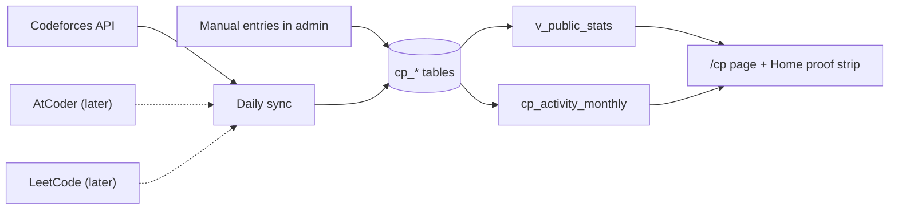
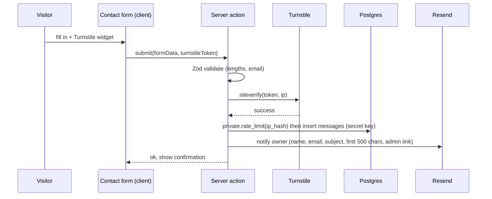

# 11 — Content Modules

> Status: **Draft v0.1** · Related: [01 PRD §3](01-product-requirements.md), [03 IA §5](03-information-architecture.md), [07 DB §4](07-database-design.md), [09 Admin §4](09-admin-panel.md), [18 Content inventory](18-content-inventory.md)

For each module: purpose, data, public behaviour, admin behaviour and rules/edge cases.

---

## 1. Profile & site identity

| Aspect | Detail |
|---|---|
| Purpose | One place for the name, headline, positioning, bio, availability and contact details used everywhere (hero, meta tags, JSON-LD, footer, OG images) |
| Data | `profile` (singleton), `social_links`, `site_settings` |
| Public | Hero, About, footer, `<title>` template "{page} — Eyasir Ahamed", `Person` JSON-LD with `sameAs` = social links |
| Rules | The phone number is never public unless `show_phone`; the email is shown as a `mailto:` link (lightly obfuscated in HTML to deter scrapers, still accessible) |

## 2. Home

| Section | Data source | Rule |
|---|---|---|
| Hero | `profile` + S1 scene | Always visible |
| Proof strip | `v_public_stats` + `cp_profiles.override` | Each figure links to its evidence (CP page, GitHub, contest) |
| Selected work | `projects` where `is_featured`, max 3, by `sort_order` | Hidden if none |
| Contest record | primary `cp_profiles` + featured `cp_contests` | ICPC line always first if present |
| Writing | 3 latest published posts | Hidden if none |
| The library | published roadmaps + 5 most recently updated topics | Hidden if none |
| Chronology | `v_timeline` top 6 by date | — |
| Coda | `profile.email_public`, contact link | — |

Section order and visibility come from `site_settings.home_sections`.

## 3. Projects

**Case-study template** (scaffolded by the admin "Insert sections" button):

```markdown
## Overview
One paragraph: what it is, who it's for, status.

## The problem
What was hard or missing.

## My role
Team size, what I owned.

## Architecture
::figure{src="media:…" alt="…" caption="…"}
Key decisions and why (link ADR-style notes if any).

## Key features
- …

## Challenges & decisions
Trade-offs, what I'd do differently.

## Results
Numbers: users, uptime, performance, adoption.
```

| Rule | Detail |
|---|---|
| Wall label | `title` · years (`2024–2025` or `2025–present`) · *Medium:* top 4 skills · `tagline` · status badge |
| Live repo stats | If `github_repo` matches a synced `github_repos` row: ★ stars, forks, languages bar, "last commit {relative}". Otherwise hidden |
| Additional projects | `is_additional` → compact list on the index with name, stack, one line and repo link (Tourmate, Eduflow329, Surveillance Car) |
| Ordering | Featured first (`sort_order`), then `ended_on desc nulls first` (ongoing on top) |
| Filters | Stack (skills), kind, status. URL state `?stack=nextjs&kind=web` |
| Related | Posts via `post_projects`; experiences via `experience_projects`; docs roadmap links via Markdown |

## 4. Experience

| Rule | Detail |
|---|---|
| Kinds | work, internship, freelance, leadership, teaching, volunteer (filter chips; "All" default) |
| Dates | Month precision; open-ended = "Present"; duration computed ("1 yr 1 mo") |
| Seed | *Programming Secretary — Netrokona University Programming Club* (Aug 2025 – Aug 2026, leadership), with highlights from the CV and links to the NEUPC project |
| Gap | The CV has no employment entries yet → `Q-12` asks whether there are internships/freelance to add. The page works with leadership entries alone |

## 5. Education, Skills, Certifications, Achievements

| Module | Public rendering | Seed |
|---|---|---|
| Education | Degree · institution · years · result + note | B.Sc. CSE, Netrokona University (2022 – Aug 2026, CGPA 3.51/4.00 after 6 semesters → final CGPA `Q-11`); HSC Govt. Ashek Mahmud College (5.00); SSC Jamalpur Zilla School (5.00) |
| Skills | Category headings with inline lists in the sans face; featured skills shown on Home/About; each skill links to a filtered projects list | Languages, Frontend, Backend & Databases, Tools & DevOps, Concepts (from the CV) |
| Certifications | Title · issuer · year · credential link | AI/ML Expert — Phitron (Batch 01, 2025); Responsive Web Design — Creative IT Institute (2021) |
| Achievements | For non-CP awards (none in the CV yet) | — |

## 6. CP Journey

### 6.1 Data flow



### 6.2 Page modules

| Module | Data | Notes |
|---|---|---|
| Summary line | total solved (override-aware: "1000+ problems across judges"), CF max rating, contests count | "Data as of {last_synced_at}" |
| Judge cards | `cp_profiles` where `show_on_site` | Handle links to the profile URL template; rating coloured by `rank_scheme` |
| Colonnade (3D) + table | `cp_activity_monthly` | S2 scene; the table is always in the DOM |
| Rating chart | `cp_rating_changes` (Codeforces) | SVG path rendered on the server; hover/focus tooltip on the client; "View as table" |
| Heatmap | `cp_daily_activity` last 365 days | 5 tint levels; summary sentence for screen readers ("312 problems on 140 active days in the last year") |
| Onsite contests | `cp_contests` | ICPC Dhaka 2025 featured: rank **112**, "of 300+ teams", award "Mymensingh Divisional Champion", venue BUBT; IUPCs (MU, NSUCEC, BUET — ranks 40–75 per contest `Q-10`; UU, DUET, UIU, KUET, IUT) |
| Tags & difficulty | `cp_solved_problems` aggregated | Horizontal bars; top 12 tags; difficulty buckets of 100 |
| Milestones | `cp_milestones` | Optional |
| Links | CP roadmap in Docs, NEUPC project | — |

### 6.3 Override precedence

`override.<field>` (manual) **>** synced value **>** hidden. The UI marks overridden values in admin
only. Example: `solved_count` synced from Codeforces = 640, override label "1000+" (across all judges)
→ the public page shows "1000+".

## 7. Blog

### 7.1 Authoring format — Markdown with directives

Markdown is the **source of truth** (`posts.body_md`): portable, diff-able, safe. Raw HTML is
disabled. Rich components use `remark-directive` syntax:

| Directive | Example | Renders |
|---|---|---|
| Callout | `:::note[Why this matters]` … `:::` (types: note, tip, warning, evidence) | `Callout` |
| Figure | `::figure{src="media:9f3c…" alt="Growth of capacity" caption="Capacity doubles" credit="…"}` | `next/image` + caption/credit (alt required) |
| YouTube | `::youtube{id="PocJ5jXv8No" title="Dynamic Arrays in C++" start="30"}` | Facade → `youtube-nocookie` on click |
| Problem card | `::problem{judge="cf" id="1621A"}` / `::problem{judge="cses" id="1621"}` | Title, judge, link, difficulty (from cache or static props) |
| Doc link | `::kb{path="cp/phase-1/1_basics/3_std_vector" section="s4"}` | Card linking to the KB topic with serial and title (resolved from `kb_nodes`) |
| Gist / code file | ```` ```cpp title="dsu.cpp" {3-5} ```` | Shiki block with filename and highlighted lines |
| Math | `$O(n \log n)$`, `$$ … $$` | KaTeX (server-rendered HTML + CSS; no client JS) |
| Diagram | ```` ```mermaid ```` | Rendered on the client, lazily, theme-aware (the only client-side piece) |
| Footnote | `text[^1]` … `[^1]: note` | Sidenote at ≥ 1280 px; inline expandable below that |

Unknown directives are rendered as a visible warning in the **admin preview only** and dropped from
public output.

### 7.2 Rendering pipeline

```mermaid
flowchart LR
  MD["body_md"] --> P["remark-parse"]
  P --> G["remark-gfm"]
  G --> M["remark-math"]
  M --> D["remark-directive + custom handlers"]
  D --> R["remark-rehype (allowDangerousHtml: false)"]
  R --> K["rehype-katex"]
  K --> SH["@shikijs/rehype (dual theme via CSS variables)"]
  SH --> SL["rehype-slug + autolink headings"]
  SL --> SN["sidenotes transform"]
  SN --> OUT["hast → React (hast-util-to-jsx-runtime) with component map"]
```



- Runs on the server inside a `"use cache"` function keyed by post id + `updated_at` (tag
  `post:{id}`), so the public page ships **no Markdown or highlighter JS**.
- On save, the server action also computes `reading_minutes` (words ÷ 230, code blocks counted at
  half speed) and `toc` (h2/h3), and stores them on the row.
- The same pipeline powers project case studies, the About bio, contest write-ups and the privacy
  page.

### 7.3 Publishing & distribution

| Feature | Rule |
|---|---|
| States | draft → scheduled/published → archived ([09 §3.1](09-admin-panel.md)) |
| Scheduled | `published_at` in the future + `status=scheduled`; pg_cron flips it every 5 min and triggers revalidation |
| "Updated" date | Shown only when the author ticks "meaningful update" (sets `updated_display_at`) |
| Feeds | `/feed.xml` (RSS 2.0, full content, last 20), `/atom.xml`, `/feed.json`; `<link rel="alternate">` in `<head>` |
| OG image | `/og/post/{id}`: title in Newsreader on paper, kicker "ESSAY · {date}", reading time, a small plaster-graph mark |
| Series | Series box at the top and bottom: "Part 2 of 4" with links |
| Related | Same tags (Jaccard similarity) + manual `post_projects` |
| Share | Copy link, LinkedIn, X, email (plain links, no third-party scripts) |
| Comments | Giscus (GitHub Discussions), off by default (flag), Could |

## 8. Roadmap Docs

Fully specified in [10](10-roadmap-docs-system.md). On the main site: `/docs` catalog and
`/docs/[roadmap]` map.

## 9. Contact



Honeypot field + minimum time-to-submit (3 s) as extra spam signals. Failed email notification never
fails the submission (the message is already stored; the admin inbox is the source of truth).

## 10. Resume

| Rule | Detail |
|---|---|
| Serving | `/resume` route handler: looks up `profile.current_resume_id` → streams the PDF from the private `resumes` bucket with `Content-Type: application/pdf`; `?download=1` adds `Content-Disposition: attachment; filename="Eyasir_Ahamed_CV.pdf"` |
| Caching | Tag `resume`; switching the current version revalidates |
| Buttons | "Download CV" in the hero, About, footer; hidden when no CV exists |
| History | All versions kept; only the current one is reachable publicly |
| Source | Optional `.tex` stored privately with each version (the LaTeX CV stays the print master) |

## 11. Search

| Aspect | Detail |
|---|---|
| Scope | Published posts (title, excerpt, body), projects (title, tagline, summary, body), KB sections (heading, body), static pages (About, CP) |
| Engine | `public.search_all(q)` → Postgres FTS (`websearch_to_tsquery('english', unaccent(q))`), weighted ranks, `pg_trgm` fallback for typos on titles |
| UI | ⌘K dialog: debounced (200 ms) server action; grouped results with snippets; keyboard navigation; recent searches in `localStorage` |
| No-JS | `/search?q=` server-rendered page |

## 12. Legal pages

`/privacy` (Markdown from settings) covering the contact form, analytics, cookies (none for
visitors), retention and a deletion request address. The licence notice sits in the footer
(`Q-15`).
