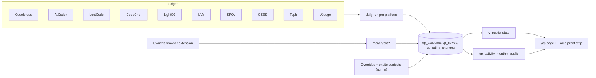

# 11 — Content Modules

> Status: **Draft v0.3** · Related: [01 PRD §3](01-product-requirements.md), [03 IA §5](03-information-architecture.md), [07 DB §4](07-database-design.md), [09 Admin §4](09-admin-panel.md), [10 Bundles](10-roadmap-docs-system.md), [18 Content inventory](18-content-inventory.md)
>
> **Revision 0.2:** the Blog (§7) is now **full HTML** on the bundle engine. CP Journey (§6) uses all
> 10 judges. Reader accounts (§13) are new. Markdown remains for site-rendered text fields (bio,
> case studies, contest write-ups, privacy page).
>
> **Revision 0.3:** CP Journey stays the owner's public record; guests have no CP tracking.

---

## 1. Profile & site identity

| Aspect | Detail |
|---|---|
| Data | `profile`, `social_links`, `site_settings` |
| Public | Hero, About, footer, `<title>` template "{page} — Eyasir Ahamed", `Person` JSON-LD with `sameAs` |
| Rules | Phone never public unless `show_phone`; email as a lightly obfuscated `mailto:` |

## 2. Home

| Section | Data source | Rule |
|---|---|---|
| Hero | `profile` + S1 scene | Always |
| Proof strip | `v_public_stats` (combined distinct solves across the owner's judge accounts, or override) | Each figure links to evidence |
| Selected work | Featured projects (max 3) | Hidden if none |
| Contest record | Owner's primary judge accounts + featured contests | ICPC first |
| Writing | 3 latest published posts (listing metadata) → links to the content origin | Hidden if none |
| The library | Published roadmaps + recently updated topics | Hidden if none |
| Chronology | `v_timeline` | — |
| Coda | Contact CTA | — |

## 3. Projects

Case studies are **Markdown** (site-rendered, safe). The "Insert sections" scaffold (Overview · The
problem · My role · Architecture · Key features · Challenges & decisions · Results) is unchanged.

| Rule | Detail |
|---|---|
| Wall label | Title · years · *Medium:* top 4 skills · tagline · status |
| Live repo stats | From `github_repos` when linked |
| Additional projects | Compact list (Tourmate, Eduflow329, Surveillance Car) |
| Ordering / filters / related | As before |

## 4. Experience

Kinds work · internship · freelance · leadership · teaching · volunteer. Seed: *Programming
Secretary — Netrokona University Programming Club* (Aug 2025 – Aug 2026). No employment entries in
the CV yet (`Q-12`).

## 5. Education, Skills, Certifications, Achievements

Unchanged ([18 §2–7](18-content-inventory.md) holds the seed data).

## 6. CP Journey (owner, public)

### 6.1 Data flow

### 6.2 Page modules

| Module | Data | Notes |
|---|---|---|
| Summary line | Combined distinct solves (canonical keys, all of the owner's shown accounts) or the owner's override ("1000+"); best CF rating; contests | "Data as of {time}" |
| Judge cards (10) | `cp_accounts` where public and shown | Rating/max/rank only for rated judges (CF, AtCoder, LeetCode, CodeChef, Toph); solved counts for all; "via extension" note where relevant |
| Colonnade (3D) + table | `cp_activity_monthly_public` | S2 scene |
| Rating charts | `cp_rating_changes` per rated judge | Toggle between judges; accessible table |
| Heatmap | `cp_activity_days` combined | Summary sentence for screen readers |
| Onsite contests | `cp_contests` | ICPC Dhaka 2025 featured; IUPC ranks per contest (`Q-10`) |
| Tags & difficulty | `cp_solves` ⋈ `cp_problems` | Where tags exist |
| Links | CP roadmap, NEUPC | — |

### 6.3 Override precedence

Owner override **>** synced value **>** hidden. Guests have no overrides (their numbers are always
computed).

## 7. Blog — full HTML posts

### 7.1 What a post is

A post is an **HTML bundle** served on the content origin at `read.eyasir329.dev/blog/{slug}/`:
`index.html` (its own `<head>`, CSS, JS) plus any assets. It's rendered **exactly as written**:
scripts, canvases, interactive demos and custom layouts all work, just like roadmap topics. It uses
the same engine: versions, CAS storage, validation, preview, publish/rollback, search indexing
([10](10-roadmap-docs-system.md)). The only platform addition is the reader-runtime block, whose chip
is hidden on posts by default.

### 7.2 Authoring

| Path | Flow |
|---|---|
| **In-admin HTML editor** (primary) | New post → choose a template (e.g. *Marble & Ink essay*, *Blank HTML*) → edit `index.html`, `style.css`, `script.js` in CodeMirror; drag assets into `assets/`; live preview in a sandboxed iframe (360/768/1280 px); autosave (draft overlay, every 5 s); **Save version** → validation report |
| **Zip upload** | Drop a zip (`index.html` + assets) → report → preview |
| **CLI** | `pnpm bundle post push ./posts/{slug} --slug {slug} [--publish \| --schedule …]` |

### 7.3 The default template ("Marble & Ink essay")

Stored in `html_templates` as a bundle; editable by the owner. It includes:

- `<head>`: `<title>`, `meta description`, `link rel=canonical` → `https://read.eyasir329.dev/blog/{slug}/`,
  Open Graph/Twitter tags (`og:image` → `https://eyasir329.dev/og/post/{id}` unless replaced),
  `article:published_time`, `article:tag`, `BlogPosting` JSON-LD, the Marble & Ink fonts and tokens.
- Body: header with a link back to `eyasir329.dev/blog`, kicker ("ESSAY · {date}"), `h1`, standfirst,
  reading-time slot, `article` with drop cap and sidenote styles, footer with licence and "More
  writing".
- Placeholders such as `{{title}}` and `{{date}}` are filled **once**, when the post is created
  from the template. After that the HTML is entirely the author's.

### 7.4 Metadata & listings

| Field | Source (in order) |
|---|---|
| Title | Admin override → `h1` → `<title>` |
| Excerpt | Admin override → `meta description` → first paragraph |
| Tags | Admin tags (seeded from `article:tag` on first save) |
| Date | `published_at` (the publish action) |
| Reading time, sections, word count | Extracted from the published version |
| Cover / OG | Admin cover → `og:image` → generated `/og/post/{id}` |

### 7.5 Publishing & distribution

| Feature | Rule |
|---|---|
| States | draft → scheduled/published → archived; the post points to a published version |
| Scheduling | Choose a `ready` version and a time; pg_cron publishes within 5 minutes |
| Main-site pages | `/blog` (list), `/blog/tags/[tag]`, `/blog/series/[series]`; `/blog/[slug]` → **308** to the content origin |
| Feeds | RSS/Atom/JSON with title, excerpt, date, tags, link (full HTML isn't embedded because scripts and styles wouldn't work in readers; `Q-28`) |
| OG images | `/og/post/{id}` (used by the template by default) |
| Series | Series listing on the main site; posts link to siblings in their own HTML (the template includes a series slot) |
| Search | Sections from `h2[id]`/`h3[id]`/`section[id]` of the published version |
| Comments | Giscus inside the template if enabled later (Could) |
| Views | Optional runtime beacon to `/api/views` |

### 7.6 Safety rules for posts

Same as topics: served only on the content origin; CSP per post (`csp_extra` for approved CDNs);
validation warns about external hosts (W04), missing meta (W05/W17), broken links (W01), heavy
images (W09).

## 8. Roadmap Docs

Full design in [10](10-roadmap-docs-system.md). Progress rules: [19](19-guest-accounts-and-progress.md).

## 9. Contact

Server action: Zod → Turnstile `siteverify` → rate limit → insert (secret key) → Resend notification
→ confirmation. Honeypot + minimum time-to-submit. Email failure never fails the submission.

## 10. Resume

`/resume` streams the current PDF (`?download=1` → attachment named `Eyasir_Ahamed_CV.pdf`); tag
`resume`; version history; optional private `.tex`.

## 11. Search

| Aspect | Detail |
|---|---|
| Scope | Projects (Markdown), **posts and topics (bundle sections of published versions)**, static pages |
| Engine | `search_all(q)`: Postgres FTS with weighted ranks + trigram fallback on titles |
| UI | ⌘K dialog grouped as *Work*, *Blog*, *Docs*, *Pages*; blog and docs results deep-link to the content origin (`…/#section`) |
| No-JS | `/search?q=` |

## 12. Legal pages

`/privacy` covers: the contact form; cookieless analytics; **accounts** (what we store from
Google/GitHub, reading progress, retention, export and deletion); strictly necessary auth cookies
on both origins; where the owner's CP data comes from. Licence notice in the footer (`Q-15`). A short `/terms` page covers acceptable use of accounts (no abuse,
automated sign-ups, or scraping of other users).

## 13. Reader accounts

Guest sign-in, the reader panel (`/me`), sign-in-gated progress and privacy lifecycle are specified
in [19](19-guest-accounts-and-progress.md). Guests don't have CP tracking (removed in revision 0.3).
