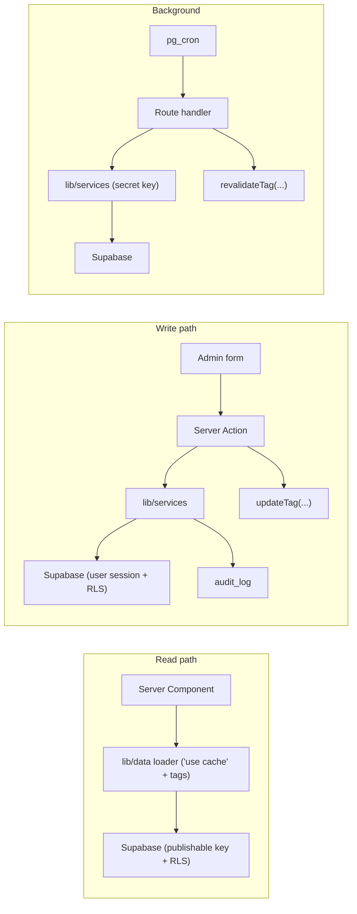

# 13 — API & Data Flow

> Status: **Draft v0.1** · Related: [03 §3.3](03-information-architecture.md), [06 §3–4](06-system-architecture.md), [08 §4](08-auth-and-security.md), [10 §6–8](10-roadmap-docs-system.md)

---

## 1. Principles

1. **Reads** on public pages are server-side cached loaders (`lib/data/*`, `"use cache"`), queried
   with the publishable key under RLS. No public REST API is exposed for content.
2. **Admin writes** are **Server Actions** (typed, CSRF-protected by Next.js, colocated with forms).
3. **Route handlers** exist only for callers that aren't our own React forms: OAuth callback, cron,
   webhooks, the CLI, feeds, OG images, the content origin, health.
4. One **Zod schema per input**, shared by client and server. The server always re-validates.
5. Every mutation: `requireRole` → `parse` → service → audit → invalidate tags → typed result.

## 2. Server Action contract

```ts
// design sketch
type ActionResult<T> =
  | { ok: true; data: T; message?: string }
  | { ok: false; code: 'VALIDATION' | 'FORBIDDEN' | 'NOT_FOUND' | 'CONFLICT' | 'RATE_LIMITED' | 'INTERNAL';
      message: string; fieldErrors?: Record<string, string[]> };
```

- Never throws to the client; unexpected errors are logged to Sentry and returned as `INTERNAL`
  with a digest ID.
- `CONFLICT` covers optimistic concurrency: forms send the `updated_at` they loaded; the update
  includes `where updated_at = $loaded`, and 0 rows → "Someone else changed this; reload".

## 3. Server Action catalogue

| Module | Action | Min role | Invalidates |
|---|---|---|---|
| Profile | `updateProfile`, `setAvailability`, `setCurrentResume` | editor | `profile`, `resume` |
| Settings | `updateSetting(key, value)`, `reorderSocialLinks`, `upsertSocialLink`, `deleteSocialLink` | editor | `settings` |
| Media | `createMedia` (after direct upload), `updateMedia`, `replaceMediaFile`, `deleteMedia` (blocked if referenced) | editor | tags of referencing entities |
| Projects | `createProject`, `updateProject`, `publishProject`, `unpublishProject`, `archiveProject`, `deleteProject`, `reorderProjects`, `setProjectSkills`, `setProjectMedia` | editor | `projects`, `project:{id}` |
| Experience | `create/update/delete/reorderExperience`, `setExperienceLinks` | editor | `experiences` |
| Education, Certifications, Achievements | CRUD + reorder | editor | respective tags |
| Skills | `upsertCategory`, `upsertSkill`, `deleteSkill`, `reorderSkills` | editor | `skills`, `projects` |
| CP | `upsertCpProfile`, `setCpOverride`, `create/update/delete/reorderContest`, milestones CRUD, `runSync(integration)` | editor | `cp` |
| Blog | `createPost`, `savePost` (autosave → revision), `publishPost`, `schedulePost`, `unpublishPost`, `deletePost`, `restoreRevision`, `renderPreview(md)`, tags/series CRUD | editor | `posts`, `post:{id}` |
| Docs | `createRoadmap`, `updateRoadmap`, `importOutline`, `upsertNode`, `moveNode`, `deleteNode` (owner), `publishVersion`, `rollback`, `unpublishNode`, `quickEditFile`, `createPreviewToken`, `setVisibility` (owner) | editor (unless noted) | `docs`, `docs:{id}`, CDN `kb-node:{id}` |
| Messages | `setMessageStatus`, `deleteMessage` (owner) | editor | — |
| Redirects | CRUD | editor | `redirects` |
| Users | `addAdmin`, `setRole`, `deactivateAdmin`, `deleteAuthUser` | **owner** | — |
| Tokens | `createToken` (returns plaintext once), `revokeToken` | **owner** | — |
| Public | `sendContactMessage`, `search(q)` | anonymous (rate-limited) | — |

## 4. Route handlers

| Method & path | Auth | Request | Response | Notes |
|---|---|---|---|---|
| `GET /auth/callback?code&next` | OAuth | — | 302 to `next` | PKCE exchange, next-path validation |
| `POST /auth/signout` | session | — | 302 `/` | Clears cookies |
| `POST /api/cron/{job}` | `Bearer CRON_SECRET` | `{}` | `200 {runId, status}` | Jobs: `sync-github`, `sync-codeforces`, `sync-all`, `kb-gc`, `kb-uploads-cleanup` |
| `POST /api/revalidate` | HMAC header | `{tags: string[]}` | `200 {revalidated}` | Tag allowlist |
| `POST /api/kb/uploads` | session or token `kb:write` | `{roadmapId, target, bytes, sha256?}` | `200 {uploadUrl, uploadPath, token}` | Signed resumable upload to `kb-uploads` |
| `POST /api/kb/imports` | session or token `kb:write` | `{roadmapId, uploadPath, kind:'single'\|'tree', target, dryRun, note?}` | `202 {jobId}` | Starts analysis |
| `POST /api/kb/imports/{id}/step` | same | `{}` | `200 {status, progress, done}` | Processes the next batch (time-boxed) |
| `GET /api/kb/imports/{id}` | same | — | `200 {status, plan, report, versions}` | Poll |
| `POST /api/kb/imports/{id}/apply` | same | `{publish?: boolean}` | `202` | Turns a dry-run into an apply |
| `POST /api/kb/nodes/{id}/publish` | token `kb:publish` | `{versionId}` | `200` | CLI publish |
| `GET /api/kb/nodes?roadmap=cp` | token `kb:read` | — | `200 [nodes]` | CLI status |
| `GET /api/kb/versions/{id}/zip` | session or token `kb:read` | — | zip stream | CLI pull / backup |
| `POST /api/views` | anonymous | `{entity, id}` | `204` | Only if the view counter flag is on |
| `GET /api/health` | public | — | `200 {ok, db:'ok'}` | No sensitive data |
| `GET /resume` | public | `?download=1` | PDF | [11 §10](11-content-modules.md) |
| `GET /feed.xml` · `/atom.xml` · `/feed.json` | public | — | feed | Cached, tag `posts` |
| `GET /og/{type}/{id}` | public | — | PNG 1200×630 | `next/og`, cached |
| `GET kb.*/*` | public / preview token | — | bundle file or generated page | [10 §8](10-roadmap-docs-system.md) |

### 4.1 Error envelope (route handlers)

```json
{ "error": { "code": "VALIDATION", "message": "target.segment is required", "details": { "field": "target.segment" } } }
```

| HTTP | code |
|---|---|
| 400 | `VALIDATION`, `BAD_PATH` |
| 401 | `UNAUTHENTICATED` |
| 403 | `FORBIDDEN`, `SCOPE` |
| 404 | `NOT_FOUND` |
| 409 | `CONFLICT` |
| 413 | `TOO_LARGE` |
| 429 | `RATE_LIMITED` (with `Retry-After`) |
| 500 | `INTERNAL` (with `digest`) |

## 5. Validation schemas (inventory)

Located in `lib/validation/`, one file per module: `profile.ts`, `settings.ts` (one schema per
settings key), `media.ts`, `project.ts`, `experience.ts`, `education.ts`, `certification.ts`,
`skill.ts`, `cp.ts`, `post.ts`, `kb.ts` (roadmap, node, outline YAML, import request, `kb.json`),
`contact.ts`, `users.ts`, `tokens.ts`. Shared primitives: `slug`, `httpsUrl`, `monthDate`,
`markdown` (max 200k chars), `mediaRef`, `semverish`, `segment` (`^[A-Za-z0-9._-]+$`).

## 6. Pagination, sorting & filtering

- Admin lists: `?page=1&per=25&sort=updated_at.desc&status=draft&q=…` → validated by a generic
  `listQuery` schema; implemented with Supabase `.range()` and `count: 'exact'` (fine at this scale).
- Public lists: blog `?page=`, projects filter params; canonical keeps `page` only.

## 7. Data flow summary


