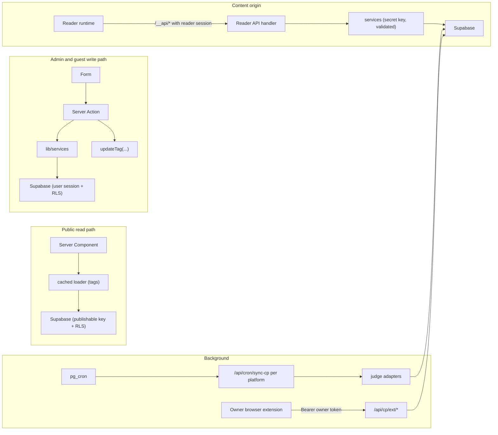

# 13 — API & Data Flow

> Status: **Draft v0.3** · Related: [03 §3.3–3.4](03-information-architecture.md), [06 §3–4](06-system-architecture.md), [08 §4–5](08-auth-and-security.md), [10 §6–8](10-roadmap-docs-system.md), [19](19-guest-accounts-and-progress.md), [20](20-cp-multi-platform-tracking.md)

---

## 1. Principles

1. **Public reads** are cached server loaders under RLS (publishable key). No public content API.
2. **Admin and guest writes from our own UI** are **Server Actions** (typed, CSRF-protected).
3. **Route handlers** serve callers that aren't our React forms: OAuth callbacks and the session
   bridge, cron/webhooks, CLI, the owner's browser extension, feeds, OG images, and the **content origin**
   (files + reader API).
4. One Zod schema per input; the server always re-validates.
5. Every mutation: authenticate → authorise (`requireRole` / `requireUser` + ownership) → parse →
   service → audit (admin) → invalidate tags → typed result.

## 2. Server Action contract

```ts
type ActionResult<T> =
  | { ok: true; data: T; message?: string }
  | { ok: false; code: 'VALIDATION' | 'UNAUTHENTICATED' | 'FORBIDDEN' | 'NOT_FOUND' | 'CONFLICT' | 'RATE_LIMITED' | 'INTERNAL';
      message: string; fieldErrors?: Record<string, string[]> };
```

Optimistic concurrency on admin forms (`updated_at` match → otherwise `CONFLICT`). Unexpected errors
go to Sentry and return `INTERNAL` with a digest ID.

## 3. Server Action catalogue

### 3.1 Admin (`requireRole`)

| Module | Actions | Min role | Invalidates |
|---|---|---|---|
| Profile & settings | `updateProfile`, `setAvailability`, `setCurrentResume`, `updateSetting`, social links CRUD/reorder | editor | `profile`, `settings`, `resume` |
| Media | create/update/replace/delete (guarded) | editor | referencing tags |
| Projects, experience, education, certifications, achievements, skills | CRUD, publish, reorder, relations | editor | respective tags |
| CP (owner) | `upsertOwnerAccount`, `setOverride`, contests/milestones CRUD, `runPlatformSync(platform)`, `setPlatformEnabled`, `setScrapingEnabled` | editor (platform switches: owner) | `cp` |
| Bundles (shared) | `createSubject` (roadmap node or post), `saveDraft`, `saveDraftAsVersion`, `publishVersion`, `scheduleVersion`, `unpublish`, `rollback`, `compareVersions`, `createPreviewToken`, `setRuntimeSettings`, `setVisibility` (owner), `purgeVersions` (owner) | editor | `docs:{id}` / `posts` / `post:{id}` + CDN `content:{subjectId}` |
| Docs | `createRoadmap`, `updateRoadmap`, `importOutline`, `upsertNode`, `moveNode`, `deleteNode` (owner) | editor | `docs`, `docs:{id}` |
| Blog | post listing metadata (title, excerpt, tags, series, cover, SEO), tags/series CRUD | editor | `posts` |
| Templates | `saveTemplate`, `setDefaultTemplate` | editor | — |
| Messages | `setMessageStatus`, `deleteMessage` (owner) | editor | — |
| Users | `banUser`, `unbanUser`, `deleteUser` (owner) · allowlist: `addAdmin`, `setRole`, `deactivateAdmin` (owner) | owner (list view: editor) | — |
| Tokens | `createToken(name, scopes)` (bundle CLI and/or `cp:ingest` for the owner's extension), `revokeToken` | owner | — |
| Redirects | CRUD | editor | `redirects` |

### 3.2 Guest (`requireUser`, own rows only)

| Area | Actions | Notes |
|---|---|---|
| Profile | `updateMyProfile` (display name, timezone) | — |
| Progress | `resetTopicProgress(nodeId)`, `resetRoadmapProgress(roadmapId)` | Typed confirmation in UI |
| Account | `exportMyData()` → JSON download (profile + reading progress), `requestAccountDeletion()`, `signOutEverywhere()` | Deletion revokes sessions immediately |

### 3.3 Public

`sendContactMessage` (Turnstile + rate limit), `search(q)`.

## 4. Route handlers

### 4.1 Main origin

| Method & path | Auth | Purpose |
|---|---|---|
| `GET /auth/callback` | OAuth code | PKCE exchange; routes by role/return |
| `GET /auth/bridge?return=` | Main-origin session | Mint a one-time code → 303 to the content origin ([08 §5.2](08-auth-and-security.md)) |
| `POST /auth/signout?return=` | Session | Clear the main session → chain to `read…/__auth/signout` |
| `POST /api/cron/{job}` | `Bearer CRON_SECRET` | `sync-github`, `sync-cp?platform=…` (10 staggered jobs), `bundle-gc`, `bundle-uploads-cleanup`, `blocked-domains`, `account-deletions` |
| `POST /api/revalidate` | HMAC | Tag revalidation |
| `POST /api/bundles/uploads` | Admin session or CLI token (`bundle:write`) | Signed resumable upload URL |
| `POST /api/bundles/imports` · `…/{id}/step` · `GET …/{id}` · `POST …/{id}/apply` | same | Import jobs (single, tree, post) |
| `POST /api/bundles/subjects/{id}/publish` | CLI token (`bundle:publish`) | CLI publish / schedule |
| `GET /api/bundles/versions/{id}/zip` | Admin session or `bundle:read` | Download a version |
| `POST /api/cp/ext/submissions` · `POST /api/cp/ext/bulk` | Owner token (`cp:ingest`) | The owner's extension ingestion ([20 §7](20-cp-multi-platform-tracking.md)) |
| `POST /api/problem-solving/extension-sync` · `/bulk-import` · `GET /sync-status` · `GET /existing-submissions` | same | **NEUPC-extension compatibility aliases** (`Q-30`) |
| `POST /api/views` | anonymous, rate-limited | Optional view counter (used by the runtime) |
| `GET /api/health` | public | Uptime (`select 1`) |
| `GET /resume` | public | Current CV PDF |
| `GET /feed.xml`, `/atom.xml`, `/feed.json` | public | Blog feeds (summary + link) |
| `GET /og/{type}/{id}` | public | OG images |
| `GET /blog/{slug}` | public | 308 → `read…/blog/{slug}/` |

### 4.2 Content origin (`read.eyasir329.dev`)

| Method & path | Auth | Request → Response |
|---|---|---|
| `GET /docs/**`, `/blog/**`, `/` | public | Bundle file / generated page (runtime block injected into entry HTML) |
| `GET /__rt/runtime.v1.js` | public | Immutable script |
| `GET /__auth/callback?code&return` | one-time code | Sets `__Host-rt_session` + `rt_signed_in` → 303 `return` |
| `GET /__auth/signout?return` | session (optional) | Revokes the reader session, clears cookies → 303 |
| `GET /__api/me` | reader session | `{ signedIn, user: { displayName, avatarUrl }, links: { me, signOut } }` or `{ signedIn: false, links: { signIn } }` |
| `GET /__api/progress?node={id}` | reader session | `{ keys: { s1: {done:true, at}, p3: {done:true, at} }, lastAnchor }` |
| `PUT /__api/progress` | reader session + CSRF headers | `{ node, items: [{ key, done, at }] }` (≤ 100) → `{ applied, rejected[] }`; keys validated against the node |
| `GET /__api/progress/summary?roadmap={slug}&node={id?}` | reader session | Per-topic `{ sectionsDone, sectionsTotal, practiceDone, practiceVerified, practiceTotal, completedAt }` + `continue: { href, anchor }` |
| `POST /__api/visit` | reader session | `{ node, anchor }` → 204 (throttled) |
| `GET /sitemap.xml`, `/robots.txt` | public | Content-origin SEO |

### 4.3 Error envelope (all route handlers)

```json
{ "error": { "code": "VALIDATION", "message": "items[3].key is not a section of this topic", "details": { "index": 3 } } }
```

400 `VALIDATION`/`BAD_PATH` · 401 `UNAUTHENTICATED` · 403 `FORBIDDEN`/`SCOPE`/`BANNED` · 404
`NOT_FOUND` · 409 `CONFLICT` · 413 `TOO_LARGE` · 429 `RATE_LIMITED` (+ `Retry-After`) · 500
`INTERNAL` (+ `digest`).

## 5. Validation schemas (inventory)

`lib/validation/`: `profile`, `settings` (per key), `media`, `project`, `experience`, `education`,
`certification`, `skill`, `cp` (owner accounts, overrides, contests), `bundle` (subject, upload,
import, draft overlay, runtime settings, `kb.json`, `post.json`), `roadmap` (outline YAML, node),
`post` (listing metadata), `contact`, `users`, `tokens`, **`reader`** (progress batch, visit),
**`judge`** (owner accounts: platform + handle per `cp_platforms.handle_pattern`), **`extension`** (submission
payloads, NEUPC-compatible shapes). Shared primitives: `slug`, `segment`, `httpsUrl`, `problemKey`,
`isoDate`.

## 6. Cache tags & invalidation

The catalogue lives in `lib/cache/tags.ts` ([06 §3](06-system-architecture.md)). Guest-specific
pages (`/me/**`) and the reader API are **never cached** (`no-store`). The owner's public CP data
revalidates `cp` after each platform sync.

## 7. Data flow summary


