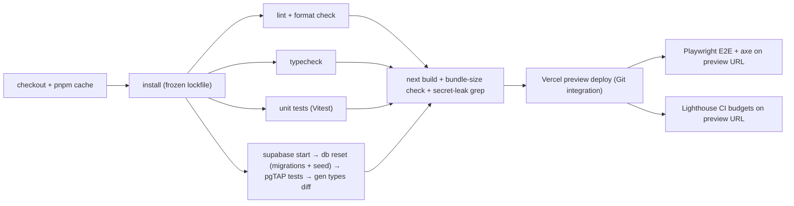

# 14 — DevOps, Environments & Operations

> Status: **Draft v0.1** · Related: [06 Architecture](06-system-architecture.md), [08 §11 Secrets](08-auth-and-security.md), [15 QA](15-testing-and-qa.md), [17 Risks](17-risks-and-decisions.md)

---

## 1. Environments

| Env | Web | Database / Auth / Storage | Domain | Data |
|---|---|---|---|---|
| **Local** | `pnpm dev` (Turbopack) | Supabase CLI local stack (Docker): Postgres, Auth, Storage, Studio | `localhost:3000` + `kb.localhost:3000` (host routing works locally because `*.localhost` resolves to loopback) | `seed.sql` + fixture bundles |
| **Preview** | Vercel preview deployment per PR | **Staging** Supabase project (free project #1) | `*.vercel.app` preview URL; KB via preview host alias (`SP-01`) | Seed + test content; reset on demand |
| **Production** | Vercel production (`main`) | **Production** Supabase project (free project #2) | `eyasir329.dev`, `kb.eyasir329.dev` | Real content |

Why two Supabase projects instead of Supabase Branching: branching needs a paid plan; the free tier
allows two active projects, which is exactly staging + production (ADR-012).

## 2. Domains & DNS (after `Q-01`)

| Record | Value |
|---|---|
| `eyasir329.dev` (apex) | Vercel (A / ALIAS as instructed by Vercel) |
| `www` | CNAME → Vercel; 308 to apex (Vercel domain setting) |
| `kb` | CNAME → Vercel, same project; routed by `proxy.ts` |
| Email (optional) | Keep Gmail as the public address; `SPF`/`DKIM` for Resend's sending domain (e.g. `mail.eyasir329.dev`) |
| HSTS preload | Submit after 2 weeks of stable HTTPS on all subdomains |

## 3. Source control

| Practice | Rule |
|---|---|
| Branching | Trunk-based: `main` is always deployable; short-lived feature branches; PRs required |
| Protection | `main`: required checks (CI), linear history, no force-push |
| Commits | Conventional Commits (`feat:`, `fix:`, `docs:`, `chore:`, `db:`); PR titles follow the same |
| PR template | Summary · Linked IDs (FR/US/ADR) · Screenshots (both themes) · Migration? · Test evidence · Checklist |
| Reviews | Self-review checklist + Claude review for larger PRs; the owner approves |
| Releases | Every merge to `main` deploys; a `CHANGELOG.md` is generated from commit messages at milestones |

## 4. CI pipeline (GitHub Actions)

| Job | Fails the PR when |
|---|---|
| lint/format | ESLint errors, Prettier diffs |
| typecheck | Any `tsc` error |
| unit | Test failure or `lib/` coverage < 80% |
| db | Migration fails on a fresh DB, pgTAP failure, or generated types differ from the committed `lib/supabase/types.ts` |
| build | Build error; the route JS budget is exceeded (`NFR-PERF-06`); `sb_secret_` or `SUPABASE_SECRET` found in `.next/static` |
| e2e | Any Must user story scenario fails; any axe serious/critical violation |
| lighthouse | Below the budgets in [02 §1](02-non-functional-requirements.md) |
| audit | `pnpm audit --prod` high/critical |

Scheduled workflows: **nightly backup** (§7), **weekly integration-contract check**
([12 §9](12-integrations-and-sync.md)), **weekly Renovate**.

## 5. Deployments & migrations

| Step | Mechanism |
|---|---|
| App | Vercel Git integration: PR → preview, `main` → production |
| DB migrations | GitHub Action on PR merge to `main`: `supabase db push --linked` against staging first, then production (a manual approval environment gate for production) |
| Ordering | **Expand → deploy → contract.** Additive migrations ship before the code that uses them; destructive changes ship one release later |
| Rollback | App: Vercel "Instant Rollback" to the previous deployment. DB: forward-fix migration (no down migrations); restore from backup only for data loss |
| Seed | Only on local/staging; production content is entered through admin (the seed rows arrive as drafts) |
| Auth hooks & cron | Defined in migrations (SQL), so staging and production stay identical; secrets set once in Vault per project |

## 6. Monitoring & alerting

| Signal | Tool | Alert |
|---|---|---|
| Uptime (`/api/health` main + a KB URL) | Free external monitor (e.g. UptimeRobot / Better Stack), 5–10 min | Email + push after 2 failures |
| Errors | Sentry (server + client), release-tagged | New issue email; spike alert |
| Web vitals | Vercel Speed Insights | Weekly review; regression → issue |
| Traffic | Vercel Web Analytics | — |
| Sync health | `sync_runs` + admin dashboard | Email after 3 consecutive failures |
| Quotas | Supabase usage page (DB size, storage, egress); Vercel usage | Monthly check in the ops checklist; alert thresholds at 70% |
| KB imports | `kb_import_jobs` failed status | Shown on the dashboard |

## 7. Backups & recovery

| What | How | Frequency | Retention | RPO / RTO |
|---|---|---|---|---|
| Postgres (schema + data) | GitHub Action: `supabase db dump` (schema, data, roles) → encrypted with `age` → uploaded as a workflow artifact **and** to a private backup repo/bucket | Nightly | 30 daily + 12 monthly | RPO ≤ 24 h |
| Storage: `media`, `resumes` | Same workflow lists objects changed in the last day and copies them to the backup target | Nightly (incremental) | 90 days | ≤ 24 h |
| Storage: `kb-objects` | Content-addressed and reproducible from the owner's local generator; plus a weekly manifest export (all published versions → sha lists) | Weekly | 12 weeks | Re-import from source |
| Code & docs | GitHub | Continuous | — | — |

**Restore drill** once per quarter on the staging project (documented time-to-restore, target
**RTO ≤ 4 h**).

## 8. Runbooks

| Situation | Steps |
|---|---|
| **Supabase free project paused** | Dashboard → Project → *Restore*; wait for healthy; run "Sync all" from admin; check the uptime monitor. Root cause: were the daily jobs failing? |
| **Rotate the Supabase secret key** | Create a new secret key in the dashboard → update Vercel env (prod + preview) → redeploy → revoke the old key → verify cron/sync/contact/KB serving |
| **Rotate `CRON_SECRET` / webhook secret** | Update Vercel env + Supabase Vault in the same maintenance window → trigger each job manually |
| **Owner locked out** | Supabase dashboard (project owner account) → SQL editor: `insert into admin_users(email, role) values ('new@…','owner')` → sign in with that Google account → fix the original account |
| **Bad deploy** | Vercel → Deployments → Instant Rollback → open an issue → forward-fix |
| **Bad KB publish** | Admin → Docs → node → Roll back (or CLI `kb publish --version N`) |
| **Content deleted by mistake** | Check `audit_log` diff → re-create from the diff, or restore the table from the latest dump into staging and copy the rows |
| **Leaked secret** | Rotate first, investigate second; see [08 §13](08-auth-and-security.md) |

## 9. Cost plan

| Service | Launch plan | Cost | Upgrade trigger | Next plan |
|---|---|---|---|---|
| Vercel | Hobby | $0 | Commercial use, team members, > quotas, or need of sub-daily Vercel cron | Pro ($20/mo) |
| Supabase | Free × 2 projects | $0 | DB > 350 MB, storage > 700 MB, egress > 70%, or need for PITR/daily backups/no pausing | Pro ($25/mo, production only) |
| Domain | `.dev` | ~$12–15/yr | — | — |
| Resend | Free (3,000 emails/mo) | $0 | — | — |
| Sentry | Developer (free) | $0 | Error volume | Team |
| Turnstile | Free | $0 | — | — |
| Uptime monitor | Free | $0 | — | — |
| **Total** | | **≈ $1/month (domain)** | | **≈ $46/month** if both upgrades are ever needed |

## 10. Environment variables

| Variable | Local | Preview | Production | Exposed to browser |
|---|:-:|:-:|:-:|:-:|
| `NEXT_PUBLIC_SITE_URL` | ✅ | ✅ | ✅ | ✅ |
| `NEXT_PUBLIC_KB_URL` | ✅ | ✅ | ✅ | ✅ |
| `NEXT_PUBLIC_SUPABASE_URL` | ✅ | ✅ (staging) | ✅ (prod) | ✅ |
| `NEXT_PUBLIC_SUPABASE_PUBLISHABLE_KEY` | ✅ | ✅ | ✅ | ✅ |
| `SUPABASE_SECRET_KEY` | ✅ | ✅ | ✅ | ❌ |
| `CRON_SECRET`, `REVALIDATE_WEBHOOK_SECRET`, `KB_PREVIEW_SECRET`, `IP_HASH_SALT_SEED` | ✅ | ✅ | ✅ | ❌ |
| `GITHUB_TOKEN` | optional | ✅ | ✅ | ❌ |
| `NEXT_PUBLIC_TURNSTILE_SITE_KEY` / `TURNSTILE_SECRET_KEY` | test keys | ✅ | ✅ | site key only |
| `RESEND_API_KEY`, `OWNER_NOTIFY_EMAIL` | optional | ✅ | ✅ | ❌ |
| `SENTRY_DSN` / `NEXT_PUBLIC_SENTRY_DSN`, `SENTRY_AUTH_TOKEN` | optional | ✅ | ✅ | DSN only |

`lib/env.ts` validates these with Zod at startup and fails fast with a readable message.

## 11. Local developer setup (to be written as `CONTRIBUTING.md` in Phase 1)

1. Install Node LTS, pnpm, Docker, Supabase CLI.
2. `pnpm install` → `supabase start` → `supabase db reset` (migrations + seed).
3. Copy `.env.example` → `.env.local` (local Supabase keys are printed by `supabase start`).
4. `pnpm dev` → `http://localhost:3000` and `http://kb.localhost:3000`.
5. Local Google OAuth: a separate OAuth client for `localhost`, or Supabase's local auth with a
   test Google client. The allowlist seed contains the owner's email.
