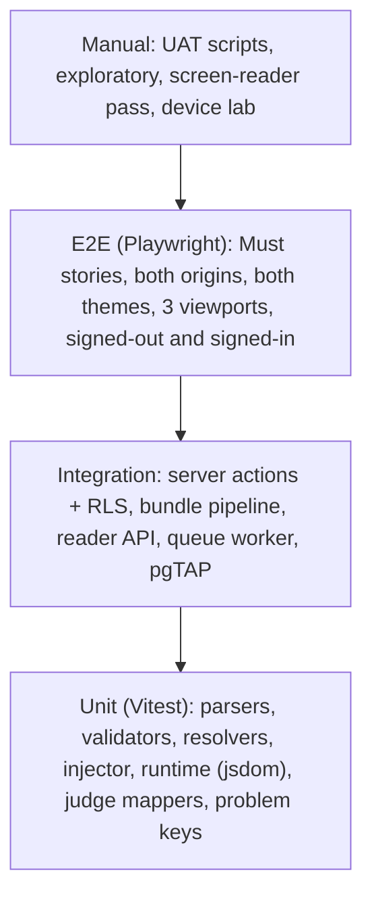

# 15 — Testing & Quality Assurance

> Status: **Draft v0.3** · Related: [01 §4 user stories](01-product-requirements.md), [02 NFRs](02-non-functional-requirements.md), [14 §4 CI](14-devops-and-environments.md)
>
> **Revision 0.2:** new test groups for the reader runtime (T-RT), session bridge (T-BR), guest data
> isolation (T-GU), judge adapters/extension (T-CPT) and HTML posts (T-BLOG); new UAT scripts
> for guests.
>
> **Revision 0.3:** learner-CP tests replaced by owner-only CP tests (run lock, resumable backfill,
> owner extension) and reset-progress tests.

---

## 1. Strategy

| Level | Tool | Runs |
|---|---|---|
| Static | TypeScript strict, ESLint, Prettier | CI |
| Unit | Vitest (+ Testing Library, jsdom for the runtime) | CI |
| Database | pgTAP (`supabase test db`) | CI |
| Integration | Vitest against local Supabase | CI |
| E2E | Playwright (Chromium, WebKit, Firefox) against the preview URL, with **seeded test users** (owner, editor, two guests) signed in through a test-only auth helper on staging | CI |
| Accessibility | axe in every E2E visit + manual per release | CI + release |
| Performance | Lighthouse CI, bundle/runtime size checks, 3D fps sampling | CI + release |
| Security | Header/CSP assertions, RLS matrix, hostile bundles, CSRF on the reader API, token scopes | CI + release |
| UAT | Owner scripts (§7) on staging | Milestones |

## 2. Fixtures

| Fixture | Purpose |
|---|---|
| `tests/fixtures/bundles/3_std_vector.zip` | **The owner's reference topic** (golden file) |
| `tests/fixtures/bundles/tree-sample/` | Synthetic roadmap: 2 phases, 3 modules, 6 topics (one `kb.json`, one container bundle, one non-reference generator format) |
| `tests/fixtures/bundles/posts/` | HTML posts: template-based essay; post with `<canvas>` demo and inline scripts; post with an external CDN script (W04); post missing OG tags (W17) |
| `tests/fixtures/bundles/hostile/*.zip` | Zip slip, absolute paths, symlink, zip bomb, 3,001 files, `.exe`, encrypted, non-UTF-8 |
| `tests/fixtures/judges/{platform}/…` | Recorded responses for all 10 judges: success, empty, `FAILED`, 429, Cloudflare challenge HTML, malformed |
| `tests/fixtures/judges/problem-urls.csv` | URL/id → canonical key table (every pattern in [20 §4](20-cp-multi-platform-tracking.md)) for cross-judge dedupe of the owner's solves |
| `tests/fixtures/extension/*.json` | NEUPC-extension payloads (single and bulk) for the owner's ingestion endpoint |
| `supabase/seed.sql` + `tests/seed.test.sql` | Allowlist, test guests, CV drafts, the 10 platforms |

## 3. Test catalogue

### 3.1 Bundles, Docs & content origin (T-KB)

| ID | Test | Expected |
|---|---|---|
| T-KB-01 | Import the reference bundle | Metadata exactly as in [10 §5.3](10-roadmap-docs-system.md), including 11 practice keys |
| T-KB-02 | Byte fidelity | Served `index.html` minus the injected block == stored SHA-256; every other file byte-identical |
| T-KB-03 | Missing trailing slash | 308 |
| T-KB-04 | `…/index.html` | 200, same bytes, canonical `Link` header |
| T-KB-05 | Crawl every relative link of the reference | All 200 (file, generated index or coming-soon) |
| T-KB-06 | Planned sibling | Coming-soon, `noindex` |
| T-KB-07 | Hostile zips | Rejected with the right error codes |
| T-KB-08 | Path traversal on serve | 400 |
| T-KB-09 | Private file | 403 notice; visible in preview |
| T-KB-10 | Content types + `nosniff` | As specified |
| T-KB-11 | CSP | Header present; `connect-src 'self'`; the reference page's own scripts work (quiz, theme, video facade) |
| T-KB-12 | Cookies | No main-origin cookie ever reaches `read.*`; public responses set no cookies |
| T-KB-13 | Re-upload an identical bundle | "Unchanged" info; no new version |
| T-KB-14 | Re-upload with one changed file | New version; exactly one new object |
| T-KB-15 | Rollback | Previous version served; audited |
| T-KB-16 | Preview tokens | Valid → 200; expired/tampered → 403; `no-store`; runtime in "preview" state saves nothing |
| T-KB-17 | Generated module index with a signed-in guest who has 8/13 sections | Shows "8/13 read" from the server (not from browser storage) |
| T-KB-18 | Tree import dry-run | Correct plan; no writes |
| T-KB-19 | `/_content/*` on the apex host | 404 |
| T-KB-20 | Publish latency | ≤ 60 s via the CDN |
| T-KB-21 | Node rename | Content redirect 308; link report lists inbound links |
| T-KB-22 | CLI push twice | Second run uploads nothing |
| T-KB-23 | Runtime injection placement | Before `</head>`; after `<body>` when there's no head; skipped for `self`/`off` modes; never in non-entry HTML |

### 3.2 Reader runtime (T-RT)

| ID | Test | Expected |
|---|---|---|
| T-RT-01 | Anonymous on the reference topic | Section and practice checkboxes disabled with the explanation; clicking does nothing; **no `cpkb-010114-*` key written**; theme toggle still works and persists |
| T-RT-02 | Anonymous with stale progress keys from an earlier session | Keys removed before the page script runs; page shows 0% |
| T-RT-03 | Signed in, empty server state, tick §2 | `PUT /__api/progress` within 2 s; the server row exists; the bundle UI shows §2 read |
| T-RT-04 | Signed in, server has §1–§5, browser has none | After load, §1–§5 ticked via `change` events; the page's own progress box shows 38% |
| T-RT-05 | Offline tick, then online reload | Pending queue flushed; server updated |
| T-RT-06 | Reset from `/me` | After resetting a topic in `/me`, the next page load shows no ticks and the browser cache is cleared |
| T-RT-07 | Runtime blocked (script fails) | Page fully readable; no errors breaking the bundle |
| T-RT-08 | Size and speed | ≤ 8 KB gzip; < 5 ms before first paint (performance trace) |
| T-RT-09 | Chip accessibility | Keyboard reachable, labelled, sufficient contrast in both themes |
| T-RT-10 | Blog post | Chip hidden by default; no progress gating; view beacon only when enabled |

### 3.3 Accounts, bridge & isolation (T-AUTH, T-BR, T-GU)

| ID | Test | Expected |
|---|---|---|
| T-AUTH-01 | Allowlisted Google sign-in (manual, staging) | `/admin` reachable |
| T-AUTH-02 | Non-allowlisted Google and GitHub sign-in | Guest account created; lands on `/me`; `/admin` → 403 |
| T-AUTH-03 | Disposable-domain email | Sign-up refused |
| T-AUTH-04 | Deactivate admin while signed in | Admin access gone immediately; guest features still work |
| T-AUTH-05 | Banned user | Sign-in refused; reader sessions revoked; API 403 |
| T-BR-01 | Bridge happy path from a topic | ≤ 3 redirects back to the same URL; `__Host-rt_session` HttpOnly + `rt_signed_in` set |
| T-BR-02 | Code reuse / expiry / tampering | 403 |
| T-BR-03 | `return` pointing to another site | Rejected (→ `/me`) |
| T-BR-04 | Sign out on the main origin | Content-origin session revoked too |
| T-BR-05 | CSRF on `PUT /__api/progress` (cross-site form, missing `X-RT`, wrong Origin) | Rejected |
| T-GU-01 | Guest A reads/writes guest B's progress, accounts, solves, tokens (API and direct PostgREST) | Always denied |
| T-GU-02 | Guest calls owner/admin CP actions or reads CP admin data | Denied |
| T-GU-03 | Guest tries to create any API token | Denied (tokens are admin-only) |
| T-GU-04 | Export | JSON contains exactly the user's own data |
| T-GU-05 | Delete account | Immediate sign-out everywhere; rows gone after the deletion job |

### 3.4 CP tracking — owner accounts (T-CP, T-CPT)

| ID | Test | Expected |
|---|---|---|
| T-CP-01 | Codeforces mapper | Fixtures → exact rows |
| T-CP-02 | Sync idempotency | No duplicates |
| T-CP-03 | Owner account failure | Last snapshot kept; one email after 3 failures |
| T-CP-04 | Override precedence | "1000+" shown when set |
| T-CPT-01 | Each of the 10 adapters against its fixtures | Correct profile/rating/solves; challenge pages → `needs_extension` or `failing`, never a crash |
| T-CPT-02 | Canonical keys | Every URL in `problem-urls.csv` → the expected key; VJudge-origin and direct solves dedupe |
| T-CPT-03 | Run lock | Two overlapping runs of one platform: the second is skipped (advisory lock) |
| T-CPT-04 | "Run now" limit | A second run of the same platform within 10 min → `RATE_LIMITED` |
| T-CPT-05 | Owner extension ingestion | Owner token + owner handle → solves stored (`source='extension'`); unknown handle → rejected; revoked token → 401; non-admin token impossible; NEUPC alias endpoints accept NEUPC payloads |
| T-CPT-06 | Resumable backfill | A backfill longer than the 50 s budget ends `partial`; the next run continues from the cursor without duplicates |
| T-CPT-07 | Kill switch | Disabling a platform skips its runs; its card shows the last snapshot |
| T-GH-01 | GitHub mapper | Stars, languages |

### 3.5 Blog (T-BLOG)

| ID | Test | Expected |
|---|---|---|
| T-BLOG-01 | Post with inline scripts and `<canvas>` | Renders and runs on the content origin exactly as authored |
| T-BLOG-02 | Metadata extraction and overrides | Title/excerpt/tags/reading time from HTML; admin overrides win on listings |
| T-BLOG-03 | Scheduled post | Published within 5 min of the time; listing, feed, sitemap updated |
| T-BLOG-04 | Feeds | Valid; items contain summary + link |
| T-BLOG-05 | `/blog/{slug}` on the main origin | 308 to the content origin; old slugs redirect after a rename |
| T-BLOG-06 | Editor save | Draft autosave; "Save version" creates an immutable version with a report; preview matches the published page |
| T-BLOG-07 | Main origin never renders post HTML | No post HTML in main-origin responses (grep in E2E) |

### 3.6 UI, SEO, security & database (T-UI, T-SEO, T-SEC, T-DB)

| ID | Test | Expected |
|---|---|---|
| T-UI-01 | Theme on reload (both themes) | No flash at first paint |
| T-UI-02 | 3D gate under reduced motion | Poster; no WebGL context created |
| T-UI-03 | 3D off toggle | Persists across reloads |
| T-UI-04 | Keyboard-only: Home → Project → Contact submit | Completes with visible focus |
| T-UI-05 | Colonnade vs table | Same numbers |
| T-UI-06 | Header account menu | "Sign in" when signed out; avatar menu when signed in; Admin link only for admins |
| T-UI-07 | `/me` with 0, 1 and many roadmaps/judges | Correct empty and populated states |
| T-SEO-01 | Every public main-origin route | Unique title, description, canonical; JSON-LD parses |
| T-SEO-02 | Admin, `/me`, `/login`, previews, coming-soon | `noindex` |
| T-SEC-01 | Security headers on main, admin and content origin | All headers from [08 §7.4](08-auth-and-security.md) present |
| T-SEC-02 | Markdown XSS fixtures (site-rendered fields) | No script execution, no `javascript:` links |
| T-SEC-03 | Secret-leak grep on the build | No secret key strings in client assets |
| T-SEC-04 | Contact rate limit | 6th submission in an hour → `RATE_LIMITED` |
| T-DB-01 | RLS enabled on every `public` table | True |
| T-DB-02 | anon sees only published rows | True for every publishable table |
| T-DB-03 | anon cannot read private tables | messages, audit, bundle internals, progress, accounts, jobs |
| T-DB-04 | Allowlist management | Editor can't write `admin_users`; last owner can't be demoted |
| T-DB-05 | `hook_before_user_created` | Blocks disposable/banned; allows others as guests |
| T-DB-06 | `custom_access_token_hook` | owner/editor for active allowlist rows; guest otherwise; none when banned |
| T-DB-07 | Audit trigger | One row per admin mutation with the right actor |
| T-DB-08 | Slug-change triggers | Main-origin and content-origin redirects created |
| T-DB-09 | `search_all` | Never returns drafts or unpublished versions |
| T-DB-10 | `kb_nodes.path` trigger | Descendants updated on rename |
| T-DB-11 | Full RLS matrix ([07 §7.1](07-database-design.md)) | Every cell behaves as specified |
| T-DB-12 | Deletion job | Removes all rows of a user (cascade check across every user-owned table) |
| T-DB-13 | CP tables | anon reads only `show_on_site` accounts and their rows; only admins write |
| T-DB-14 | `topic_progress` after a republish that changes section keys | Totals use the new keys |

## 4. Accessibility checklist (manual, per release)

Keyboard-only paths on the main origin **and** a reference topic (including the chip and disabled
controls) · screen reader (NVDA + Firefox, VoiceOver + Safari) · 200%/400% zoom · reduced motion ·
contrast of new colours · alt text report empty.

## 5. Performance checklist (per release)

Lighthouse CI green (Home, Project, CP, Docs map, `/me`, a topic, a post) · route JS budgets ·
runtime ≤ 8 KB · field CWV · 3D fps.

## 6. Bug severity

S1 Critical (security/privacy incident, data loss, site down, admin locked out, **progress loss for
many users**) · S2 Major · S3 Minor · S4 Trivial. Responses as before.

## 7. UAT scripts (owner, on staging)

| UAT | Script | Pass when |
|---|---|---|
| UAT-01 Sign-in & roles | Sign in as owner; sign in with a second Google account and a GitHub account | Owner reaches `/admin`; others become guests with `/me`, and get 403 on `/admin` |
| UAT-02 Edit & publish | Edit a project; publish; reorder | Live within seconds |
| UAT-03 HTML post | New post from the essay template; add a canvas demo and two images; save; preview on phone width; schedule 10 min ahead | Renders exactly; goes live on time; listing and feed updated; main-domain link redirects |
| UAT-04 Topic | Upload `3_std_vector.zip`; report; preview; publish | Page identical to the local file (besides the chip); links resolve |
| UAT-05 Bulk | CLI dry-run then publish a phase | Diff correct; topics live |
| UAT-06 Rollback | Publish a broken version and roll back | Old version back ≤ 60 s |
| UAT-07 Anonymous read-only | Open a topic signed out on a phone | Everything readable; controls disabled; nothing saved after reload |
| UAT-08 Guest progress | Sign in from the topic chip; tick sections on the phone; open on a laptop | Same ticks on both; `/me` shows "Continue" |
| UAT-09 Reset progress | In `/me`, reset one topic, then a whole roadmap | Ticks cleared on the phone and the laptop; dashboard numbers updated |
| UAT-10 Owner extension | Point the NEUPC extension at staging with an owner `cp:ingest` token; open an accepted CSES submission | The solve appears on the owner's CSES card and in the combined total |
| UAT-11 Owner CP page | Owner accounts on all 10 judges synced | Public CP page correct; "needs extension" judges labelled honestly |
| UAT-12 Privacy | Export data; delete a test guest | JSON complete; account gone; sessions revoked |
| UAT-13 CV & contact | New CV current; message from a phone | As before |
| UAT-14 3D | Laptop and phone; 3D off; reduced motion | Smooth; posters when off |

## 8. Definition of Done

> **Revision 0.5:** the per-PR checklist, deploy checklists and phase gates PG-1…PG-8 are in
> [DEV-07](dev/dev-07-quality-gates.md).

As in revision 0.1, plus: for anything touching guest data, an RLS test and a privacy-page check;
for runtime changes, T-RT-01…10 green on the reference bundle; for adapter changes, updated fixtures.

## 9. Launch checklist (M8)

- [ ] All Must stories accepted (UAT-01 … UAT-14 signed)
- [ ] Content complete (profile, projects, CV, ≥ 1 roadmap, ≥ 1 post, owner judge handles)
- [ ] Production Supabase: RLS tests pass; hooks enabled (Google + GitHub); cron jobs (including the 10 per-platform CP jobs) scheduled; Vault secrets; email provider disabled
- [ ] Google consent screen in production; GitHub OAuth app configured; only production redirect URLs
- [ ] Domains: apex, `www`, `read` (content origin); HTTPS; HSTS without preload at first
- [ ] Privacy and terms pages published **before** guest sign-up opens
- [ ] Judge platforms verified live (`SP-08` checklist); scraping flags set as decided (`Q-29`)
- [ ] Sentry, Speed Insights, Analytics, uptime monitors (main, content origin, reader API)
- [ ] Backups green; restore drill done (including the deletion-log replay)
- [ ] Sitemaps submitted for both hosts
- [ ] Final Lighthouse, axe and header checks on production
- [ ] Owner sign-off
