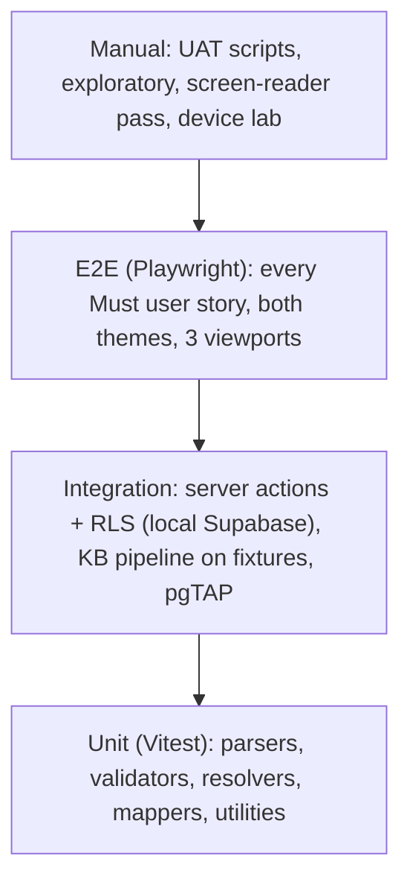

# 15 — Testing & Quality Assurance

> Status: **Draft v0.1** · Related: [01 §4 user stories](01-product-requirements.md), [02 NFRs](02-non-functional-requirements.md), [14 §4 CI](14-devops-and-environments.md)

---

## 1. Strategy

| Level | Tool | Runs | Owner |
|---|---|---|---|
| Static | TypeScript strict, ESLint, Prettier | Every commit (CI) | Dev |
| Unit | Vitest (+ Testing Library for components) | CI | Dev |
| Database | pgTAP via `supabase test db` | CI (fresh local stack) | Dev |
| Integration | Vitest against local Supabase (seeded) | CI | Dev |
| E2E | Playwright (Chromium, WebKit, Firefox; mobile + desktop viewports) | CI on preview URL | Dev |
| Accessibility | `@axe-core/playwright` in every E2E page visit + manual pass per release | CI + release | Dev + owner |
| Performance | Lighthouse CI (budgets), bundle-size check, 3D fps sampling | CI + release | Dev |
| Visual | Playwright screenshots (light/dark × mobile/desktop) for key pages, reviewed on diff | CI (non-blocking at first) | Dev |
| Security | Header/CSP assertions, RLS tests, KB hostile-bundle tests, `pnpm audit`, secret grep | CI + release | Dev |
| UAT | Scripts in §7, run by the owner on staging | Before each milestone sign-off | Owner |

## 2. Fixtures

| Fixture | Purpose |
|---|---|
| `tests/fixtures/kb/3_std_vector.zip` | **The owner's reference bundle** (golden file for extraction, serving and byte-identity) |
| `tests/fixtures/kb/tree-sample/` | Small synthetic roadmap: 2 phases, 3 modules, 6 topics (one with a `kb.json`, one container bundle) |
| `tests/fixtures/kb/hostile/*.zip` | Zip-slip (`../../evil`), absolute paths, symlink, zip bomb (high ratio), 3,001 files, `.exe`, encrypted zip, non-UTF-8 `index.html` |
| `tests/fixtures/integrations/codeforces/*.json` | Recorded `user.info`, `user.rating`, `user.status`, plus `FAILED` responses |
| `tests/fixtures/integrations/github/*.json` | Recorded GraphQL response |
| `tests/fixtures/markdown/*.md` | Every directive, math, code, footnotes, malicious input (`<script>`, `javascript:` links) |
| `supabase/seed.sql` | Owner allowlist (test email in CI), CV-derived content (drafts), CP platforms |

## 3. Test catalogue by area

### 3.1 Roadmap Docs (highest risk, most tests)

| ID | Test | Expected |
|---|---|---|
| T-KB-01 | Import the reference bundle | Metadata exactly as in [10 §5.3](10-roadmap-docs-system.md) (title, serial `01.01.14`, 13 sections, ~30 min, 11 simulations, 11 practice, 14 TOC entries, 13 section keys, 5 videos, 9 quizzes, 11 demos, prerequisite, prev/next, 45 files) |
| T-KB-02 | Serve `…/3_std_vector/` after publish | Response bytes' SHA-256 == the uploaded `index.html` SHA-256 |
| T-KB-03 | Request without the trailing slash | 308 to the slash form |
| T-KB-04 | `…/3_std_vector/index.html` | 200, same bytes, `Link: rel=canonical` to the directory URL |
| T-KB-05 | Every relative link in the reference page (E2E crawl) | Resolves to 200 (bundle file, generated index, or coming-soon); none 404 |
| T-KB-06 | Planned sibling (`2_lambdas_and_comparators`) | Generated coming-soon, 200, `X-Robots-Tag: noindex` |
| T-KB-07 | Hostile zips | Each rejected with the right error code (E02/E03/E04/E05/E06); nothing written to `kb-objects` outside CAS |
| T-KB-08 | Path traversal on serve (`/cp/..%2f..%2fetc`, `%00`, backslashes) | 400 |
| T-KB-09 | Private file (`data/00-index.md`) publicly | 403 private notice (noindex); visible in preview |
| T-KB-10 | Content types | `.md/.py/.cpp/.ipynb/.json` served as specified; `.svg` as `image/svg+xml`; `nosniff` on all |
| T-KB-11 | CSP on the content origin | Header present; `connect-src 'none'`; the reference page's scripts work (quiz, mark read, theme, video facade) in Playwright |
| T-KB-12 | Cookies | No `Set-Cookie` on public KB responses; admin cookies never sent to `kb.*` (host-only) |
| T-KB-13 | Re-upload identical bundle | "Unchanged" info, no new version |
| T-KB-14 | Re-upload with 1 changed file | New version; exactly 1 new object in `kb_objects` |
| T-KB-15 | Rollback | Previous version served; audit entry written |
| T-KB-16 | Preview token | Works before expiry; 403 after; tampered signature 403; `no-store` |
| T-KB-17 | Generated module index progress | With `localStorage['cpkb-010114-s1'..'s8']='1'`, the index shows "8/13 read" |
| T-KB-18 | Tree import dry-run | Correct new/changed/unchanged plan; no writes |
| T-KB-19 | `/_kb/*` on the apex host | 404 |
| T-KB-20 | Publish latency | New version visible via the CDN ≤ 60 s after publish (staging synthetic test) |
| T-KB-21 | Node rename | `kb_redirects` 308 from the old path; link report lists inbound links |
| T-KB-22 | CLI `kb push` twice | The second run uploads nothing (hash skip) |

### 3.2 Auth & security

| ID | Test | Expected |
|---|---|---|
| T-AUTH-01 | Allowlisted Google sign-in (staging, real account, manual) | Lands on `/admin`, role shown |
| T-AUTH-02 | Non-allowlisted Google account (manual) | "Not authorised"; **no** `auth.users` row created |
| T-AUTH-03 | Deactivate admin while signed in | Next action is forbidden; RLS blocks writes immediately |
| T-AUTH-04 | Editor calls an owner-only action (integration) | `FORBIDDEN`; no DB change |
| T-AUTH-05 | `next=https://evil.com` | Redirects to `/admin` |
| T-SEC-01 | Security headers on main, admin, kb | All headers from [08 §7.4](08-auth-and-security.md) present |
| T-SEC-02 | Markdown XSS fixtures | No `<script>`, no `javascript:` hrefs in the output |
| T-SEC-03 | Secret-leak grep on the build | No secret key strings in client assets |
| T-SEC-04 | Contact rate limit | The 6th submission within an hour → `RATE_LIMITED` |

### 3.3 Database (pgTAP)

| ID | Test |
|---|---|
| T-DB-01 | RLS is enabled on every table in `public` (query `pg_tables` + `relrowsecurity`) |
| T-DB-02 | anon sees only published rows for each publishable table |
| T-DB-03 | anon cannot read `messages`, `audit_log`, `post_revisions`, `kb_versions`, `admin_users`, `sync_runs` |
| T-DB-04 | editor cannot write `admin_users`; owner can; the last owner can't be demoted |
| T-DB-05 | `hook_before_user_created` rejects unknown emails and accepts allowlisted ones |
| T-DB-06 | `custom_access_token_hook` adds `app_role` for admins only |
| T-DB-07 | The audit trigger writes one row per mutation with the correct actor |
| T-DB-08 | The slug-change trigger creates a redirect |
| T-DB-09 | `search_all` never returns draft posts or unpublished KB versions |
| T-DB-10 | `kb_nodes.path` trigger updates descendants on a rename |

### 3.4 Content, integrations, UI

| ID | Test |
|---|---|
| T-CP-01 | Codeforces mapper: fixtures → exact rows (rating changes, solved set, daily activity in `Asia/Dhaka`) |
| T-CP-02 | Sync idempotency (run twice → same row counts) |
| T-CP-03 | Sync failure keeps the previous snapshot; the 3rd consecutive failure sends one email (mocked) |
| T-CP-04 | Override precedence ("1000+" shown when set) |
| T-GH-01 | GitHub mapper: stars total, top languages excluding forks |
| T-BLOG-01 | Every directive renders; an unknown directive is dropped publicly and warned in preview |
| T-BLOG-02 | Reading time and TOC computed on save |
| T-BLOG-03 | Scheduled post publishes within 5 min of `published_at` (pg_cron on staging) |
| T-BLOG-04 | Feeds validate (W3C feed validator on the CI artifact) |
| T-UI-01 | Theme: no flash on reload in both themes (Playwright screenshot at first paint) |
| T-UI-02 | 3D gate: reduced motion → poster, no WebGL context created (`HTMLCanvasElement.getContext` spy) |
| T-UI-03 | 3D off toggle persists across reloads |
| T-UI-04 | Keyboard-only walkthrough of Home → Project → Contact submit |
| T-UI-05 | Colonnade table and 3D show the same numbers |
| T-SEO-01 | Every public route has a unique title, description and canonical; JSON-LD parses |
| T-SEO-02 | Admin, previews and coming-soon pages are `noindex` |

## 4. Accessibility checklist (manual, per release)

- [ ] Keyboard only: every interactive element reachable, visible focus, logical order, no traps
- [ ] Screen reader (NVDA + Firefox, VoiceOver + Safari): landmarks, headings, link names, form
      errors announced, 3D ignored, tables readable
- [ ] 200% zoom and 400% reflow (320 px) without loss of content
- [ ] Reduced motion honoured everywhere; the 3D toggle works
- [ ] Contrast spot-check of any new colour usage
- [ ] Every image has meaningful alt text (media library report is empty)

## 5. Performance checklist (per release)

- [ ] Lighthouse CI green on Home, Project, CP, Post, Docs map (mobile)
- [ ] Route JS within budget; 3D chunk ≤ 250 KB gzip
- [ ] Field CWV (Speed Insights, last 28 days) within the NFR targets
- [ ] 3D fps: laptop ≥ 55 fps, reference Android ≥ 30 fps; pauses when offscreen

## 6. Bug severity

| Severity | Definition | Response |
|---|---|---|
| S1 Critical | Security issue, data loss, site down, admin locked out | Fix immediately; hotfix |
| S2 Major | A Must feature broken, no workaround | Fix before the next release |
| S3 Minor | Feature impaired with a workaround, visual defect on a key page | Schedule |
| S4 Trivial | Cosmetic | Backlog |

## 7. UAT scripts (owner, on staging)

| UAT | Script | Pass when |
|---|---|---|
| UAT-01 Sign-in | Sign in with the allowlisted account; try a second, non-allowlisted Google account | First works; second is refused with no account created |
| UAT-02 Edit & publish | Edit the NEUPC summary; publish a draft project; reorder featured projects | Public pages update in seconds; order matches |
| UAT-03 Blog | Write a post with code, math, a figure, a callout and a YouTube embed; schedule it 10 min ahead | Preview matches public; it appears on time; RSS updated |
| UAT-04 Docs single | Upload `3_std_vector.zip` to `cp/phase-1/1_basics`; read the report; preview on phone width; publish | Page identical to the local file; all widgets work; links resolve |
| UAT-05 Docs bulk | Push a phase with the CLI (dry-run, then publish) | Diff is correct; all topics live |
| UAT-06 Rollback | Publish a broken version, then roll back | Old version back ≤ 60 s |
| UAT-07 CP | Run Codeforces sync now; set an override | Numbers correct; override shown |
| UAT-08 CV | Upload a new CV and make it current | `/resume` serves the new file |
| UAT-09 Contact | Send a message from a phone | Email received; message in the inbox |
| UAT-10 3D | View Home/CP on a laptop and a phone; toggle 3D off; enable reduced motion | Smooth; posters when off; nothing blocks reading |

## 8. Definition of Done (applies to every story)

- [ ] Acceptance criteria met and demonstrated on the preview URL
- [ ] Unit/integration/E2E tests added or updated; CI green
- [ ] Accessibility: axe clean; keyboard path verified for new UI
- [ ] Both themes and mobile/desktop screenshots in the PR
- [ ] Performance budgets respected (Lighthouse CI green)
- [ ] Migrations + seed + generated types updated together (if the schema changed)
- [ ] Docs updated (this folder) if behaviour or decisions changed; ADR added if architectural
- [ ] No secrets, no `console.log` noise, no TODOs without an issue link

## 9. Launch checklist (M7)

- [ ] All Must stories accepted (UAT-01 … UAT-10 signed)
- [ ] Content complete: profile, 5 projects, education, skills, certifications, CP profiles and contests, ≥ 1 post (optional), ≥ 1 roadmap with published topics, current CV
- [ ] Production Supabase: RLS tests pass against production schema (read-only check), hooks enabled, cron jobs scheduled, Vault secrets set, email provider disabled
- [ ] Google OAuth consent screen "In production"; only production redirect URLs
- [ ] Domains, HTTPS, `www` redirect, `kb` subdomain, HSTS (without preload at first)
- [ ] Sentry, Speed Insights, Web Analytics, uptime monitors active
- [ ] Backups: first nightly dump succeeded; restore drill done on staging
- [ ] Sitemaps submitted in Google Search Console for both hosts; robots correct
- [ ] Privacy page published; licence notices in place
- [ ] Final Lighthouse, axe and security-header checks on production URLs
- [ ] Owner sign-off
