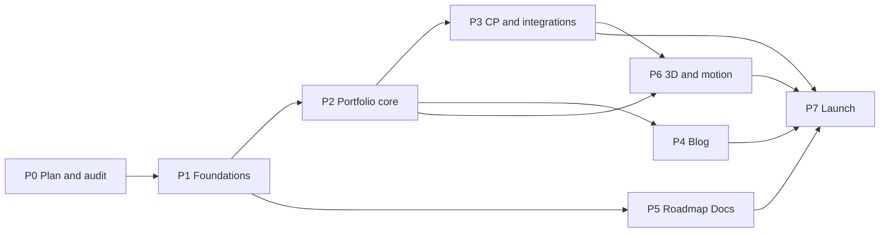

# 16 — Delivery Plan

> Status: **Draft v0.1** · Related: [00 §9 milestones](00-project-charter.md), [01 PRD](01-product-requirements.md), [15 §8 DoD](15-testing-and-qa.md), [17 Risks](17-risks-and-decisions.md)

Estimates are **ideal developer-days** for one developer working with AI assistance, and carry a
±30% uncertainty. They exist to sequence work and spot scope risk, not as promises.

---

## 1. Phases

| Phase | Goal | Epics | Est. (days) | Exit criteria |
|---|---|---|--:|---|
| **P0 Plan & audit** | Agree on what to build | — | — | [19](19-audit-checklist.md) signed; `Q-*` answered |
| **P1 Foundations** | A deployable skeleton with auth, design tokens and CI | EP-01, EP-02, EP-03, spikes | 24 | Allowlisted Google sign-in works on preview; non-allowlisted is refused; public shell in both themes; CI green; spikes answered |
| **P2 Portfolio core** | All CV content live and editable | EP-04 | 14.5 | UAT-02, UAT-08, UAT-09 pass |
| **P3 CP & integrations** | Live stats | EP-05 | 9 | UAT-07 passes; sync runs daily unattended for 3 days |
| **P4 Blog** | Publish writing | EP-06 | 8 | UAT-03 passes |
| **P5 Roadmap Docs** | Public roadmap with the reference topic | EP-07 | 19.5 | UAT-04, 05, 06 pass; T-KB-01…22 green |
| **P6 3D & motion** | The sculpture layer | EP-08 | 11.5 | UAT-10 passes; 3D budgets met |
| **P7 Launch** | Findable, safe, fast, complete | EP-09, EP-10 | 13 | Launch checklist [15 §9](15-testing-and-qa.md) all ticked |
| | | **Total** | **≈ 100** | + 20% contingency ≈ **120 days** |

**Calendar view:** full-time (5 days/week) ≈ 20–24 weeks; half-time ≈ 10–12 months. Two
alternative orderings for the owner (`Q-19`):

- **Docs-first:** P1 → P2 → **P5** → P3 → P4 → P6 → P7. The roadmap goes public sooner. P5 only
  depends on P1.
- **Early MVP launch:** P1 → P2 → P5 (single upload + serving + generated pages; no CLI or tree
  import) → minimal P7 → public launch at ≈ 12 weeks; then P3, P4, P6 and the rest of P5 as
  follow-ups.

## 2. Technical spikes (time-boxed, done in P1)

| ID | Question | Box | Decides |
|---|---|---|---|
| SP-01 | One Vercel project serving the apex + `kb.` + preview deployments: how does `proxy.ts` host routing behave on preview URLs, and what KB host do previews use? | 0.5 d | [03 §1](03-information-architecture.md), [14 §1](14-devops-and-environments.md) |
| SP-02 | Does `Vercel-Cache-Tag` + `invalidateByTag()` purge route-handler responses within 60 s? | 0.5 d | KB caching ([10 §8.4](10-roadmap-docs-system.md)) |
| SP-03 | `@supabase/ssr` cookie options (host-only, `__Host-` prefix) and `getClaims()` inside Next 16 `proxy.ts` | 0.5 d | [08 §5](08-auth-and-security.md) |
| SP-04 | Can Next.js hash-based CSP / SRI remove `'unsafe-inline'` on cached public pages? | 0.5 d | [08 §7.1](08-auth-and-security.md) |
| SP-05 | 3D art direction: S1 prototype at three quality tiers, stills, fps on laptop and phone | 2 d | [05](05-3d-experience.md), design sign-off |
| SP-06 | Streaming unzip + SHA-256 of a 100 MB zip inside a Vercel function: memory, time, limits | 0.5 d | KB import step size ([10 §7.1](10-roadmap-docs-system.md)) |
| SP-07 | Before-user-created hook + custom access token hook with Google end-to-end on staging | 0.5 d | [08 §2–3](08-auth-and-security.md) |

## 3. Epics

| Epic | Scope | FRs |
|---|---|---|
| EP-01 Foundations & DevEx | Scaffold, CI, Supabase projects, env, Sentry, host routing, headers | NFR-MAINT, NFR-SEC-05 |
| EP-02 Auth & admin shell | Google sign-in, allowlist, roles, admin layout, users, audit, media | FR-AUTH-*, FR-ADM-01/04/11 |
| EP-03 Design system & public shell | Tokens, fonts, theme, layout, core components | FR-GEN-01/02/04/06/08 |
| EP-04 Portfolio content | Profile, projects, experience, education, skills, certifications, home, about, resume, contact | FR-HOME, FR-ABOUT, FR-PROJ, FR-EXP, FR-RES, FR-CONTACT |
| EP-05 CP & integrations | Codeforces, GitHub, scheduling, sync centre, CP page | FR-CP-*, FR-SYNC-* |
| EP-06 Blog | Markdown pipeline, editor, pages, feeds, OG | FR-BLOG-* |
| EP-07 Roadmap Docs | Everything in [10](10-roadmap-docs-system.md) | FR-DOCS-* |
| EP-08 3D & motion | Canvas infrastructure, S1, S2, S4, (S3), motion | FR-HOME-01, FR-CP-06, FR-GEN-07/08 |
| EP-09 Search, SEO & analytics | ⌘K search, metadata, JSON-LD, sitemaps, analytics, redirects | FR-GEN-03/09, FR-SEO-*, FR-ADM-13 |
| EP-10 Hardening & launch | Security, a11y, performance, backups, content entry | NFR-* |

## 4. Backlog

| ID | Story (short) | Epic | Pri | Est |
|---|---|---|:-:|--:|
| US-100 | Scaffold Next.js 16 + TS strict + Tailwind v4 + ESLint/Prettier + pnpm | EP-01 | M | 1 |
| US-101 | CI: lint, typecheck, unit, build, secret grep | EP-01 | M | 1 |
| US-102 | Supabase local + staging + prod; baseline migrations; type generation in CI | EP-01 | M | 1.5 |
| US-103 | Env validation, Vercel project, preview deploys, Sentry | EP-01 | M | 1 |
| US-104 | `proxy.ts` host routing (apex / www / kb) + baseline security headers | EP-01 | M | 1 |
| US-001 | Google sign-in with allowlist (hooks, callback, proxy gate, `requireRole`) | EP-02 | M | 2 |
| US-105 | Admin shell: layout, sidebar, role-aware nav, dashboard skeleton | EP-02 | M | 1.5 |
| US-106 | Users & roles (owner): allowlist CRUD, last-owner guard | EP-02 | M | 1 |
| US-107 | Audit triggers + audit log viewer | EP-02 | S | 1 |
| US-108 | Media library: upload, alt/credit/licence, picker, usage guard | EP-02 | M | 2 |
| US-110 | Tokens, fonts, theme toggle without flash | EP-03 | M | 1.5 |
| US-111 | Public layout: header, mobile nav, colophon footer, skip link | EP-03 | M | 1.5 |
| US-112 | Core components: SectionHeading, WallLabel, Timeline, Prose base, Callout, Figure, ProofStrip | EP-03 | M | 2 |
| US-113 | Internal design specimen page | EP-03 | S | 0.5 |
| US-121 | Profile, social links and site settings (home sections, SEO defaults, flags) | EP-04 | M | 1.5 |
| US-010 | Projects CRUD: case-study editor, media, relations, publish, slug redirects | EP-04 | M | 3 |
| US-120 | Projects index (filters) + case-study page | EP-04 | M | 2 |
| US-122 | Home page (static hero; 3D comes in P6) | EP-04 | M | 1.5 |
| US-123 | Experience CRUD + timeline page | EP-04 | M | 1.5 |
| US-124 | Education, skills, certifications CRUD + About page | EP-04 | M | 2 |
| US-020 | CV versions + `/resume` | EP-04 | M | 1 |
| US-050 | Contact form (Turnstile, rate limit) + inbox + email notification | EP-04 | M | 1.5 |
| US-125 | Seed from the CV inventory (as drafts) | EP-04 | M | 0.5 |
| US-030 | Codeforces adapter + run protocol + snapshot tables | EP-05 | M | 2 |
| US-130 | GitHub sync + repo stats on projects | EP-05 | M | 1.5 |
| US-131 | pg_cron/pg_net jobs, `/api/cron/*`, sync centre UI, failure email | EP-05 | M | 1.5 |
| US-132 | CP page: cards, rating chart, heatmap, contests, tags (2D) | EP-05 | M | 3 |
| US-133 | CP contests admin + overrides | EP-05 | M | 1 |
| US-140 | Markdown pipeline + directives + Prose styles (shared) | EP-06 | M | 2.5 |
| US-141 | Blog editor: CodeMirror, live preview, autosave, revisions | EP-06 | M | 2 |
| US-142 | Blog index, post, tag and series pages | EP-06 | M | 2 |
| US-143 | Scheduling, RSS/Atom/JSON feeds, OG images | EP-06 | M | 1.5 |
| US-150 | KB schema, buckets, CAS object store | EP-07 | M | 1 |
| US-040 | Single-topic import: upload, unzip, validate, extract, report | EP-07 | M | 3 |
| US-151 | Content-origin server: resolution, headers, CSP, private files, redirects | EP-07 | M | 2 |
| US-152 | Generated pages (root/phase/module/coming soon/404), theme extraction, progress script | EP-07 | M | 2.5 |
| US-041 | Versions: publish, rollback, compare, CDN purge | EP-07 | M | 1.5 |
| US-153 | Preview tokens + sandboxed admin preview | EP-07 | M | 1 |
| US-155 | Outline editor, roadmap settings, link report | EP-07 | M | 2 |
| US-156 | `/docs` catalog + `/docs/[roadmap]` map | EP-07 | M | 1.5 |
| US-157 | KB search indexing, KB sitemap/robots | EP-07 | S | 1 |
| US-043 | Tree import: dry-run plan, stepped processing, apply | EP-07 | S | 2 |
| US-154 | KB CLI + API tokens | EP-07 | S | 2 |
| US-160 | Shared canvas, View system, capability gate, poster pipeline | EP-08 | M | 2.5 |
| US-161 | S1 Plaster Graph | EP-08 | M | 3 |
| US-162 | S2 Colonnade + table sync | EP-08 | S | 3 |
| US-163 | S4 Broken Column 404 | EP-08 | S | 0.5 |
| US-164 | Motion: reveals, view transitions, Lenis on 3D pages | EP-08 | S | 1 |
| US-165 | S3 Exhibit Plinth | EP-08 | C | 1.5 |
| US-170 | Global search: `search_all`, ⌘K dialog, `/search` | EP-09 | S | 2 |
| US-171 | SEO: metadata, JSON-LD, sitemaps, robots | EP-09 | M | 1.5 |
| US-172 | Analytics, Speed Insights, privacy page | EP-09 | S | 0.5 |
| US-173 | Redirect manager UI | EP-09 | S | 0.5 |
| US-180 | Security hardening: final CSP, header tests, rate limits | EP-10 | M | 1.5 |
| US-181 | Accessibility audit and fixes | EP-10 | M | 2 |
| US-182 | Performance audit and fixes | EP-10 | M | 2 |
| US-183 | Backup workflow, restore drill, runbooks | EP-10 | M | 1 |
| US-184 | Content entry support + launch checklist | EP-10 | M | 2 |

PRD stories delivered inside other backlog items: **US-042** (coming-soon pages) → US-152 ·
**US-060** (3D off toggle) → US-160 · **US-070** (roadmap progress on generated indexes) → US-152.

Post-launch candidates (not estimated): Giscus comments (FR-BLOG-12), view counter (FR-BLOG-11),
announcement bar (FR-GEN-10), content health (FR-ADM-14), admin command palette (FR-ADM-15), AtCoder /
LeetCode / NEUPC adapters (FR-SYNC-03), in-admin topic authoring (FR-DOCS-11), Now/Uses pages,
print stylesheet, Bengali localisation, reader accounts.

## 5. Definition of Ready (before a story starts)

- [ ] It references its FR/NFR IDs and has acceptance criteria
- [ ] Design is known (wireframe or an existing component) for UI stories
- [ ] Data model changes are identified (migration named)
- [ ] Dependencies (spikes, other stories, owner content) are resolved
- [ ] Estimate ≤ 3 days (otherwise split)

Definition of Done: [15 §8](15-testing-and-qa.md).

## 6. Ways of working

| Practice | Detail |
|---|---|
| Cadence | 1-week iterations: plan Monday (pick stories), demo Friday on the preview URL |
| Tracking | GitHub Issues (one per story, labelled by epic and priority) + a GitHub Project board (Backlog → Ready → In progress → Review → Done) |
| Demos | Each phase ends with a recorded walkthrough and the owner's sign-off against its exit criteria |
| Scope changes | New ideas go to the backlog with a priority; mid-phase changes need the owner's explicit trade-off (what moves out) |

## 7. Release plan

| Stage | Audience | Where | Gate |
|---|---|---|---|
| Internal preview | Owner | Staging / preview URLs | Each phase's exit criteria |
| Soft launch | 5–10 trusted peers (club members, a senior engineer, a recruiter friend) | Production domain, not announced | Launch checklist minus SEO submission; feedback form |
| Public launch | Everyone | Production | All launch checklist items + soft-launch fixes; announce on LinkedIn, GitHub profile README, Codeforces profile, NEUPC Discord |
| v1.1 | — | — | Top post-launch candidates chosen from analytics and feedback |

## 8. Owner-supplied content timeline

Content is often the real critical path. Needed by phase (full list in [18 §9](18-content-inventory.md)):

| Needed by | Content |
|---|---|
| P1 | Domain decision, owner Google email, accent colour and font choice |
| P2 | Portrait (optional), project screenshots and URLs, final CGPA, experience entries beyond leadership, certificate links, current CV PDF |
| P3 | Other judge handles, ICPC/IUPC details (team names, teammates' consent, ranks, photos) |
| P4 | 1–3 launch posts (drafts) |
| P5 | Roadmap outline (all planned topics with serials), published bundles, licence decision, decision on `data/` sources |
