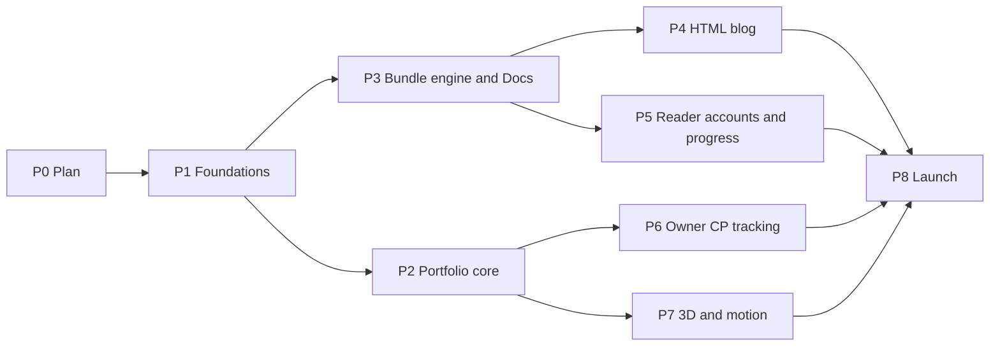

# 16 — Delivery Plan

> Status: **Draft v0.3** · Related: [00 §9 milestones](00-project-charter.md), [01 PRD](01-product-requirements.md), [15 §8 DoD](15-testing-and-qa.md), [17 Risks](17-risks-and-decisions.md)
>
> **Revision 0.2:** re-planned for the HTML blog (on the shared bundle engine), guest accounts with
> sign-in-gated progress, and CP tracking on 10 judges. The estimate grows from ≈ 100 to **≈ 142
> developer-days**.
>
> **Revision 0.3:** learner CP tracking removed (no `/me/cp`, guest judge sync, extension tokens or
> practice auto-verification; no CP queue). Estimate **≈ 135 developer-days**.

Estimates are **ideal developer-days** for one developer with AI assistance, ±30%.

---

## 1. Phases

| Phase | Goal | Epics | Est. (days) | Exit criteria |
|---|---|---|--:|---|
| **P0 Plan & audit** | Agree on what to build | — | — | [21](21-audit-checklist.md) signed; `Q-*` answered |
| **P1 Foundations** | Deployable skeleton: CI, Supabase, auth with owner/editor/guest roles, tokens, shells; spikes answered | EP-01, EP-02, EP-03, spikes | 27.5 | Admin reaches `/admin`; any other Google/GitHub account becomes a guest with 403 on `/admin`; public shell in both themes |
| **P2 Portfolio core** | All CV content live and editable | EP-04 | 16 | UAT-02, UAT-13 |
| **P3 Bundle engine & Roadmap Docs** | Content origin serving topics faithfully, with the runtime block | EP-07 | 21 | UAT-04, 05, 06; T-KB-* green |
| **P4 HTML blog** | Write, schedule and publish HTML posts | EP-06 | 9 | UAT-03; T-BLOG-* green |
| **P5 Reader accounts & progress** | Anonymous read-only, signed-in progress synced, `/me` | EP-11 | 17.5 | UAT-07, 08, 09, 12; T-RT-*, T-BR-*, T-GU-* green |
| **P6 Owner CP tracking** | 10 judges, per-platform daily runs, owner extension, public CP page | EP-05, EP-12 | 18.5 | UAT-10, 11; T-CPT-* green; daily runs unattended for 3 days |
| **P7 3D & motion** | Scenes, motion, fallbacks | EP-08 | 11.5 | UAT-14; 3D budgets met |
| **P8 Launch** | Search, SEO, privacy, security, a11y, performance, content | EP-09, EP-10 | 14 | Launch checklist [15 §9](15-testing-and-qa.md) |
| | | **Total** | **≈ 135** | + 20% contingency ≈ **162 days** |

**Calendar view:** full-time ≈ 27–33 weeks; half-time ≈ 13–16 months.

**Ordering options for the owner (`Q-19`):**

| Option | Sequence | Public launch | Notes |
|---|---|---|---|
| **A. Complete** | P1 → P2 → P3 → P4 → P5 → P6 → P7 → P8 | ≈ 32 weeks | Everything at once |
| **B. Readers first** (recommended) | P1 → P3 → P5 → P2 → P4 → launch v1 → P6 → P7 → v1.1 | v1 ≈ 21 weeks | Roadmap + accounts + blog + portfolio first; owner CP tracking and 3D follow as v1.1 releases |
| **C. Portfolio first** | P1 → P2 → P7 → launch v0.9 → P3 → P4 → P5 → P6 | v0.9 ≈ 12 weeks | Recruiter-facing site early; docs, blog and accounts later |

## 2. Technical spikes (time-boxed, P1)

| ID | Question | Box |
|---|---|---|
| SP-01 | One Vercel project serving apex + `read.` + previews: host routing on preview URLs | 0.5 d |
| SP-02 | `Vercel-Cache-Tag` + `invalidateByTag()` for route-handler responses within 60 s | 0.5 d |
| SP-03 | `@supabase/ssr` cookie options (host-only, `__Host-`) and `getClaims()` in `proxy.ts` | 0.5 d |
| SP-04 | Hash-based CSP / SRI on cached pages | 0.5 d |
| SP-05 | 3D art direction prototype | 2 d |
| SP-06 | Streaming unzip + SHA-256 in a Vercel function (limits) | 0.5 d |
| SP-07 | Auth hooks (guest vs admin claims, disposable-domain block) with Google **and GitHub** end-to-end | 0.5 d |
| SP-08 | **Judge feasibility re-check:** each of the 10 judges' endpoints, rate limits, Cloudflare behaviour and terms; update the capability matrix in [20 §2](20-cp-multi-platform-tracking.md) | 1 d |
| SP-09 | **Runtime compatibility:** prototype the storage guard + `change`-event reconciliation on the reference bundle (anonymous gating, signed-in sync, no flash) | 1 d |
| SP-10 | **NEUPC extension compatibility:** point the existing extension at a stub of the ingestion aliases; confirm payloads and auth | 0.5 d |
| SP-11 | **Session bridge on preview deployments** (preview hosts, cookie prefixes, return URL allowlist) | 0.5 d |

## 3. Epics

| Epic | Scope | FRs |
|---|---|---|
| EP-01 Foundations & DevEx | Scaffold, CI, Supabase projects, env, Sentry, host routing, headers | NFR-MAINT, NFR-SEC-05 |
| EP-02 Auth, roles & admin shell | Google + GitHub, hooks, roles, gates, admin layout, allowlist, audit, media | FR-AUTH-*, FR-ADM-01/04/11 |
| EP-03 Design system & public shell | Tokens, fonts, theme, layout, account menu, core components | FR-GEN-01/02/04/06/08/12 |
| EP-04 Portfolio content | Profile, projects, experience, education, skills, certifications, home, about, resume, contact, Markdown pipeline for site-rendered fields | FR-HOME, FR-ABOUT, FR-PROJ, FR-EXP, FR-RES, FR-CONTACT, FR-ADM-05 |
| EP-07 Bundle engine & Roadmap Docs | [10](10-roadmap-docs-system.md) | FR-DOCS-*, FR-ADM-07 |
| EP-06 HTML blog | Editor, templates, listings, scheduling, feeds, OG | FR-BLOG-*, FR-ADM-18 |
| EP-11 Reader accounts & progress | Bridge, reader API, runtime, progress model, `/me`, privacy lifecycle, users & readers admin | FR-PROG-*, FR-GUEST-*, FR-ADM-16/17 |
| EP-05 CP Journey & GitHub (owner) | GitHub sync, public CP page, contests, overrides | FR-CP-*, FR-SYNC-01 |
| EP-12 Owner multi-judge engine | Adapters ×10, per-platform runs, canonical keys, owner extension ingestion, sync centre | FR-SYNC-02…06, FR-ADM-08 |
| EP-08 3D & motion | Scenes and motion | FR-HOME-01, FR-CP-06, FR-GEN-07/08 |
| EP-09 Search, SEO & analytics | ⌘K search, metadata, sitemaps, analytics, redirects | FR-GEN-03/09, FR-SEO-*, FR-ADM-13 |
| EP-10 Hardening & launch | Security, privacy, a11y, performance, backups, content | NFR-* |

## 4. Backlog

| ID | Story (short) | Epic | Pri | Est |
|---|---|---|:-:|--:|
| US-100 | Scaffold Next.js 16 + TS strict + Tailwind v4 + lint/format + pnpm | EP-01 | M | 1 |
| US-101 | CI: lint, typecheck, unit, build, secret grep | EP-01 | M | 1 |
| US-102 | Supabase local + staging + prod; baseline migrations; type generation | EP-01 | M | 1.5 |
| US-103 | Env validation, Vercel project, previews, Sentry | EP-01 | M | 1 |
| US-104 | `proxy.ts` host routing (apex / www / read) + headers | EP-01 | M | 1 |
| US-001 | Google + GitHub sign-in; hooks (guest vs admin, blocklist); callback; gates; `requireRole`/`requireUser` | EP-02 | M | 2.5 |
| US-105 | Admin shell | EP-02 | M | 1.5 |
| US-106 | Admin allowlist management (owner) | EP-02 | M | 1 |
| US-107 | Audit triggers + viewer | EP-02 | S | 1 |
| US-108 | Media library | EP-02 | M | 2 |
| US-110 | Tokens, fonts, theme without flash | EP-03 | M | 1.5 |
| US-111 | Public layout: header (with account menu), mobile nav, colophon | EP-03 | M | 2 |
| US-112 | Core components | EP-03 | M | 2 |
| US-113 | Design specimen page | EP-03 | S | 0.5 |
| US-121 | Profile, social links, settings | EP-04 | M | 1.5 |
| US-140 | Markdown pipeline for site-rendered fields (case studies, bio, write-ups, privacy) | EP-04 | M | 1.5 |
| US-010 | Projects CRUD + case study + publish + redirects | EP-04 | M | 3 |
| US-120 | Projects index + case-study page | EP-04 | M | 2 |
| US-122 | Home (static hero) | EP-04 | M | 1.5 |
| US-123 | Experience | EP-04 | M | 1.5 |
| US-124 | Education, skills, certifications + About | EP-04 | M | 2 |
| US-020 | CV versions + `/resume` | EP-04 | M | 1 |
| US-050 | Contact form + inbox + email | EP-04 | M | 1.5 |
| US-125 | Seed from the CV inventory | EP-04 | M | 0.5 |
| US-150 | Bundle schema, buckets, CAS (subjects: nodes and posts) | EP-07 | M | 1.5 |
| US-040 | Single import pipeline + validation report | EP-07 | M | 3 |
| US-151 | Content-origin server: docs/blog namespaces, headers, CSP, private files, redirects | EP-07 | M | 2 |
| US-158 | Serve-time runtime injection + runtime modes | EP-07 | M | 1 |
| US-152 | Generated pages + theme extraction | EP-07 | M | 2.5 |
| US-041 | Versions: publish, rollback, compare, CDN purge | EP-07 | M | 1.5 |
| US-153 | Preview tokens + sandboxed preview | EP-07 | M | 1 |
| US-155 | Outline editor, roadmap settings, link report | EP-07 | M | 2 |
| US-156 | `/docs` catalog + map | EP-07 | M | 1.5 |
| US-157 | Search indexing + content-origin sitemap/robots | EP-07 | S | 1 |
| US-043 | Tree import (dry run, steps, apply) | EP-07 | S | 2 |
| US-154 | Bundle CLI + CLI tokens | EP-07 | S | 2 |
| US-141 | HTML editor: file tree, CodeMirror, assets, sandboxed preview, drafts/autosave, save version | EP-06 | M | 4 |
| US-146 | Templates library + default "Marble & Ink essay" template | EP-06 | S | 1.5 |
| US-142 | Blog listings, tags, series, overrides, `/blog/[slug]` redirect | EP-06 | M | 1.5 |
| US-143 | Scheduling, feeds (summary), OG | EP-06 | M | 1.5 |
| US-147 | Post metadata extraction + `post.json` + W17 | EP-06 | M | 0.5 |
| US-200 | `/login`, `user_profiles`, account menu wiring | EP-11 | M | 1 |
| US-201 | Session bridge + sign-out chain | EP-11 | M | 2 |
| US-202 | Reader API (me, progress, summary, visit) + validation + CSRF | EP-11 | M | 2 |
| US-203 | Reader runtime v1 (gating, sync, reconcile, pending queue, chip) + compatibility tests | EP-11 | M | 4 |
| US-204 | Progress tables/triggers + progress on generated pages and the docs map | EP-11 | M | 1.5 |
| US-205 | `/me` dashboard + `/me/roadmaps` | EP-11 | M | 2.5 |
| US-206 | `/me/settings`: export, delete, sign out everywhere; deletion job | EP-11 | M | 2 |
| US-207 | Admin Users (ban/delete) + Readers analytics | EP-11 | M | 2 |
| US-208 | Privacy/terms updates + inactivity job | EP-11 | M | 0.5 |
| US-130 | GitHub sync + repo stats | EP-05 | M | 1.5 |
| US-132 | Public CP page (10 judge cards, charts, heatmap, contests, tags) | EP-05 | M | 3 |
| US-133 | Contests admin + overrides | EP-05 | M | 1 |
| US-030 | Adapter framework + Codeforces + per-platform runs (lock, cursors, budgets) + canonical keys | EP-12 | M | 3 |
| US-210 | AtCoder adapter | EP-12 | M | 1 |
| US-211 | UVa (uHunt) adapter | EP-12 | M | 0.5 |
| US-212 | VJudge adapter | EP-12 | M | 1 |
| US-213 | LeetCode adapter (profile, contest history) | EP-12 | M | 1 |
| US-214 | Toph adapter | EP-12 | S | 1 |
| US-215 | CodeChef adapter (+ optional CLIST fallback) | EP-12 | S | 1.5 |
| US-216 | SPOJ, CSES, LightOJ profile adapters (flagged) | EP-12 | S | 1.5 |
| US-217 | Owner extension ingestion API + NEUPC-compatible aliases | EP-12 | S | 1.5 |
| US-131 | Per-platform schedules + sync centre (platform health, kill switches, Run now) | EP-12 | M | 1 |
| US-160 | Shared canvas, View system, capability gate, posters | EP-08 | M | 2.5 |
| US-161 | S1 Plaster Graph | EP-08 | M | 3 |
| US-162 | S2 Colonnade + table | EP-08 | S | 3 |
| US-163 | S4 Broken Column | EP-08 | S | 0.5 |
| US-164 | Motion | EP-08 | S | 1 |
| US-165 | S3 Exhibit Plinth | EP-08 | C | 1.5 |
| US-170 | Global search (projects, posts, topics) | EP-09 | S | 2 |
| US-171 | SEO: metadata, JSON-LD, sitemaps, robots | EP-09 | M | 1.5 |
| US-172 | Analytics, Speed Insights | EP-09 | S | 0.5 |
| US-173 | Redirect manager | EP-09 | S | 0.5 |
| US-180 | Security hardening | EP-10 | M | 1.5 |
| US-185 | Privacy & security review of guest data flows (threat model walk-through, RLS matrix review) | EP-10 | M | 1 |
| US-181 | Accessibility audit and fixes | EP-10 | M | 2 |
| US-182 | Performance audit and fixes | EP-10 | M | 2 |
| US-183 | Backups, restore drill (with deletion-log replay), runbooks | EP-10 | M | 1 |
| US-184 | Content entry support + launch checklist | EP-10 | M | 2 |

PRD stories delivered inside other items: **US-042** → US-152 · **US-060** → US-160 · **US-070** →
US-204 · **US-080/081/082** → US-203/US-201/US-202 · **US-085** → US-206 · **US-090** → US-141/US-146 · **US-091** → US-143.

Post-launch candidates: comments via template, view counter, reader bookmarks, email magic-link sign-in, CLIST-wide contest calendar, Bengali
localisation.

## 5. Definition of Ready

- [ ] References FR/NFR IDs; has acceptance criteria
- [ ] UI design known: its `WF-nn` wireframe in [`ux/`](ux/README.md) or a component in [UX-07](ux/ux-07-components-and-states.md)
- [ ] Data model changes identified
- [ ] Dependencies resolved (spikes, stories, owner content, judge fixtures recorded)
- [ ] Estimate ≤ 4 days (otherwise split)

Definition of Done: [15 §8](15-testing-and-qa.md).

## 6. Ways of working

Weekly iterations with a Friday demo on preview URLs; GitHub Issues + Project board; phase
sign-off against exit criteria; scope changes require an explicit trade-off.

## 7. Release plan

| Stage | Audience | Gate |
|---|---|---|
| Internal preview | Owner | Phase exit criteria |
| Closed beta for readers | 10–20 NEUPC members as guests (staging or production with invite-only sign-up flag) | P5 done; privacy page live; feedback form |
| Soft launch | Trusted peers, a recruiter friend | Launch checklist minus SEO submission |
| Public launch | Everyone | Full launch checklist; announce on LinkedIn, GitHub README, Codeforces profile, NEUPC Discord |
| v1.1 | — | Chosen from analytics and beta feedback (e.g. P6/P7 under option B) |

## 8. Owner-supplied content timeline

| Needed by | Content |
|---|---|
| P1 | Domain; content-origin name (`Q-04`); owner Google email; accent/fonts; GitHub OAuth app for sign-in |
| P2 | Portrait, project screenshots and URLs, final CGPA, experience entries, certificate links, current CV |
| P3 | Roadmap outline (all topics, serials) and bundles; licence; decision on `data/` sources |
| P4 | 1–3 launch posts (or drafts to finish in the editor) |
| P5 | Privacy/terms wording approval; inactivity policy (`Q-34`) |
| P6 | Owner handles on all 10 judges; ICPC/IUPC details; decisions on scraping (`Q-29`), extension (`Q-30`), CLIST (`Q-31`) |
