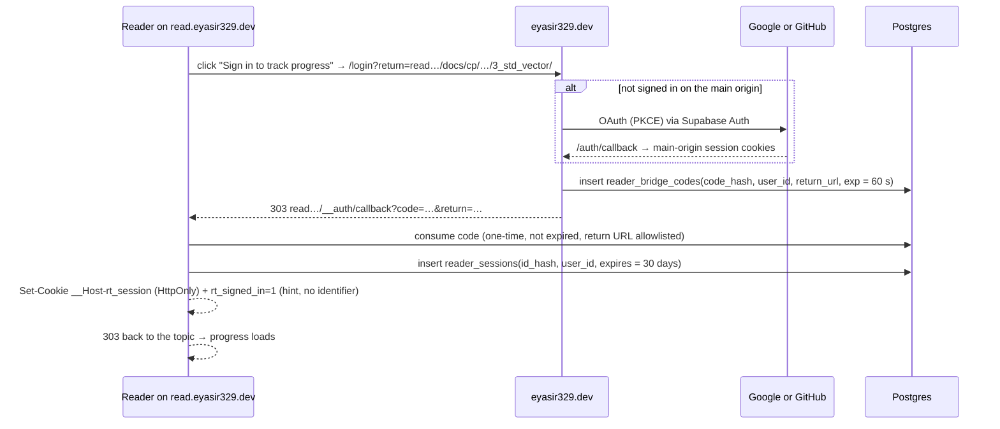

# 19 — Guest Accounts, Reader Panel & Progress Tracking

> Status: **Draft v0.3** · Related: [01 FR-GUEST, FR-PROG](01-product-requirements.md), [08 Auth & security](08-auth-and-security.md), [10 Content origin & bundles](10-roadmap-docs-system.md), [07 DB §4.9](07-database-design.md)
>
> **Revision 0.3:** guest accounts are for **roadmap progress only**. Learner CP tracking (judge
> handles, CP hub, extension tokens, auto-verified practice) was removed at the owner's request.

**Rule from the owner:** anyone can **read** every public roadmap topic and blog post. **Progress
tracking needs sign-in.** Without an account, pages are read-only: the "mark read" and "solved"
controls are disabled and nothing is saved, not even in the browser.

---

## 1. Who is a guest?

| Role | How you get it | Can do |
|---|---|---|
| **Anonymous reader** | No sign-in | Read everything public. No progress tracking |
| **Guest (signed-in reader)** | Sign in with Google or GitHub (`Q-26`); an account is created automatically | Track roadmap progress (sections read, practice problems ticked; synced across devices), see their own reader panel (`/me`), export or delete their data |
| **Editor / Owner** | Guest account **plus** an active row in the `admin_users` allowlist | Everything a guest can do, plus the admin panel ([09](09-admin-panel.md)) |

The owner's own account is also a normal user account and can use `/me` to track their own reading.
The owner's CP accounts on the 10 judges are managed in admin and are unrelated to guest accounts
([20](20-cp-multi-platform-tracking.md)).

## 2. Sign-in & sessions

### 2.1 Providers

| Provider | Why | Default |
|---|---|---|
| Google | Everyone has it; already used for admin | ✅ |
| GitHub | The natural identity for programmers | ✅ (`Q-26`) |
| Email magic link | For people without either account | ❌ (possible later; needs SMTP + CAPTCHA) |

Sign-up is **open** for guests. Admin rights still come only from the allowlist (ADR-003, revised).
The Before User Created hook now rejects only disposable-email domains and banned addresses
([08 §2](08-auth-and-security.md)).

### 2.2 Two origins, two sessions

Guests read on the **content origin** (`read.eyasir329.dev`) but sign in on the **main origin**
(`eyasir329.dev`). The content origin never receives the main site's auth cookies (isolation,
[08 §6](08-auth-and-security.md)), so it gets its **own, narrower session** through a one-time-code
bridge:



| Cookie (content origin) | Contents | Flags | Purpose |
|---|---|---|---|
| `__Host-rt_session` | Random 256-bit session id (only its hash is stored) | `HttpOnly; Secure; SameSite=Lax; Path=/` | Authenticates `/__api/*` calls |
| `rt_signed_in` | `1` | `Secure; SameSite=Lax; Path=/` (readable by JS) | Lets the runtime decide **synchronously**, before page scripts run, whether to allow progress writes. Holds no identifier, so stealing it is useless |

- If the reader is already signed in on the main origin, "Sign in" takes one click: no OAuth
  prompt, straight through the bridge.
- **Sign out** anywhere signs out everywhere: main origin → `read…/__auth/signout` → back (or the
  reverse), and `reader_sessions` rows are revoked.
- Sessions slide for 30 days of activity, and are revoked on sign-out, "sign out everywhere",
  account deletion or ban.

## 3. The reader runtime (content origin)

A small script served by the content origin, `/__rt/runtime.v1.js` (≤ 8 KB gzip, no dependencies,
immutable cache). The server inserts one fixed block before `</head>` of every **HTML entry
document** it serves (topics, generated roadmap pages, blog posts). Stored bundle bytes are never
changed ([10 §8.3](10-roadmap-docs-system.md), ADR-005 revised):

```html
<script id="rt-ctx" type="application/json">{"v":1,"subject":"kb_node","id":"…","roadmap":"cp",
 "keyPrefix":"cpkb-010114-","sectionKeys":["s1","s2","…","s13"],"practiceKeys":["p0","…","p10"],
 "controls":{"section":"input[data-done]","practice":"input.pchk"}}</script>
<script src="/__rt/runtime.v1.js"></script>
```

The block is identical for every visitor, so HTML stays CDN-cacheable. Personal data is fetched
afterwards from `/__api/*` with `Cache-Control: no-store`.

### 3.1 Behaviour

| Step | Anonymous reader | Signed-in guest |
|---|---|---|
| **In `<head>`, before page scripts** | Wraps `localStorage.setItem/removeItem` for keys starting with `keyPrefix`: **writes are dropped**. Deletes any leftover progress keys for this roadmap (e.g. from before a sign-out) | Same wrap, but writes go through to `localStorage` (a local cache for the page's own UI) **and** are queued for the server |
| **Page renders** | The bundle's own scripts find no progress → "0%", nothing ticked | The bundle renders from the cached keys, so there's usually no flash |
| **After `DOMContentLoaded`** | Disables the progress controls (`controls.section`, `controls.practice`) with `aria-describedby` → "Sign in to track your progress". Shows the account chip: **Sign in to track progress** | `GET /__api/progress?subject=…` → **server state wins**: for each key that differs, set the control's `checked` and dispatch `change`, so the bundle's own handler updates its UI and storage |
| **User ticks a box** | Control is disabled; nothing happens | The bundle writes the key → the runtime queues `{key, done, at}` → `PUT /__api/progress` (debounced 800 ms, batched). Flushed on `pagehide` with `fetch(keepalive)` |
| **Offline / API down** | — | Changes stay in a pending queue in `localStorage` (`rt:pending`) and are retried on the next page load |
| **Reading position** | — | `POST /__api/visit {anchor}` when the reader reaches a section (IntersectionObserver on `section[id]`), throttled, powering "Continue where you left off" |

**Theme and other non-progress keys** (e.g. `cpkb-theme`) are untouched, so every reader keeps
their theme preference.

### 3.2 Account chip

A small fixed chip (bottom-right, ≥ 44 px target, keyboard reachable, respects reduced motion) that
inherits the page's CSS variables when present (`--paper`, `--ink`, `--accent`), so it matches each
roadmap's look:

- Anonymous: "Sign in to track progress" → `/login?return=…`
- Signed in: avatar · "Progress saved ✓" · menu → *My progress* (`eyasir329.dev/me`), *Sign out*

Per roadmap/post, the chip can be set to hidden, compact or full. Blog posts default to hidden,
because progress tracking is for roadmaps only.

### 3.3 Generated roadmap pages

Root, phase and module index pages ([10 §9](10-roadmap-docs-system.md)) get their progress from
`GET /__api/progress/summary?roadmap=cp&node=…` instead of reading browser storage. Anonymous
readers see the structure plus a sign-in prompt, and no progress numbers.

### 3.4 Limits, honestly stated

- The gate is a **user-experience rule, not a security boundary.** A reader who blocks the runtime
  script gets the bundle's original behaviour (local-only ticks that never sync). Progress isn't
  sensitive data, so this is accepted (R-20).
- Bundle JavaScript runs on the same origin as the runtime, so a bundle could call `/__api/*` as the
  reader. It could only touch **that reader's own progress** and read their display name/avatar.
  Bundles are owner-authored; accepted (ADR-015).
- Bundles from other generators need a `controls` mapping. The default selectors match the
  reference format, and roadmaps can override them in admin.

## 4. Progress model

| Concept | Definition |
|---|---|
| **Section done** | `reading_progress(user, node, key='sN', done=true)`. Keys come from the bundle (`data-done` values) |
| **Practice solved** | `reading_progress(user, node, key='pN', done=true)`: ticked by the reader (no judge verification) |
| **Topic completed** | All current section keys done (`topic_progress.completed_at` set). Practice is tracked separately ("8/11 solved") |
| **Topic started** | Any key done, or a visit |
| **Roadmap %** | Σ sections done ÷ Σ sections of **published** topics (planned topics excluded) |
| **Streak / activity** | Days with at least one progress event (`reader_activity_days`) |
| **Next topic** | First topic in outline order that isn't completed and whose prerequisites are completed (or have no progress requirement) |
| **Version changes** | If a republished topic's section keys change, totals use the new key set. Old keys stay stored but aren't counted |

Details of the tables: [07 §4.9](07-database-design.md).

## 5. Reader panel (`/me` on the main origin)

Uses the Marble & Ink design ([04](04-design-system.md)); no 3D.

| Route | Content |
|---|---|
| `/login` | "Continue with Google / GitHub", a short explanation of what's stored, links to Privacy |
| `/me` | **Dashboard:** *Continue reading* (last topic + section, deep link), roadmap cards (% read, topics completed, practice problems ticked, last activity), activity calendar and streak, next recommended topic |
| `/me/roadmaps/[roadmap]` | The roadmap tree with per-topic progress bars (sections and practice), reset topic/roadmap progress (typed confirmation) |
| `/me/settings` | Display name and avatar, linked sign-in providers, **Export my data** (JSON), **Delete my account**, **Sign out everywhere** |

All `/me/*` pages are dynamic, `noindex`, and read data through RLS (`user_id = auth.uid()`).

## 6. Privacy & data lifecycle

| Data | Source | Retention |
|---|---|---|
| Email, name, avatar | OAuth provider | Until account deletion |
| Reading progress, visits, activity days | Reader runtime | Until deletion or reset |
| Reader sessions (content origin) | Created on sign-in | Revoked on sign-out; expire after 30 days of inactivity |
| Inactive accounts | — | After 24 months without sign-in: email notice, then deletion 30 days later (`Q-34`) |

- **Export:** one JSON file with profile and reading progress (server action, generated on demand).
- **Delete:** immediate sign-out and anonymisation; hard delete of all rows within 30 days
  (`on delete cascade` from `auth.users`).
- **No public profiles in v1** (`Q-32`). A guest's data is visible only to themselves and, in
  aggregate, to the owner (reader analytics: counts, completion funnels, never individual reading
  histories).
- The privacy page ([11 §12](11-content-modules.md)) lists all of the above. Auth cookies are
  strictly necessary, so no consent banner is required; there's still no tracking cookie.

## 7. Admin side

| Screen | Purpose |
|---|---|
| `/admin/users` | All accounts: role, provider, created, last seen, topics started, status; actions: **ban/unban**, delete (owner), promote to editor via the allowlist (owner) |
| `/admin/readers` | Aggregate reader analytics: registered/active readers, completion funnel per roadmap and topic, the sections where readers stop, share of practice problems ticked. No drill-down into individual histories |
| Roadmap settings | Runtime mode (`inject` / `self` / `off`), chip mode, control selectors, key prefix pattern |

## 8. Non-functional targets

Defined in [02](02-non-functional-requirements.md); the ones specific to this module are:

| ID | Summary |
|---|---|
| NFR-PERF-13 | Runtime ≤ 8 KB gzip; < 5 ms before first paint; no layout shift |
| NFR-PERF-14 | Reader API p95 ≤ 300 ms; ticks reach the server ≤ 2 s; `/me` LCP ≤ 2.5 s |
| NFR-REL-07 | No progress lost (pending queue + idempotent writes) |
| NFR-PRIV-07 … 10 | Data minimisation, self-service export/delete, aggregate-only admin views, inactivity policy |
| NFR-SEC-10 … 12 | Safe open registration, abuse controls, admin-only scoped tokens |
| NFR-A11Y-12 | Accessible chip and disabled controls |
