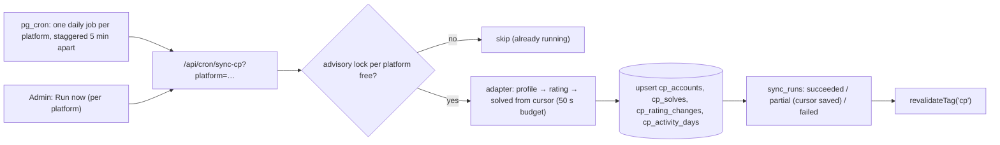

# 20 — Competitive Programming Tracking (owner, 10 judges)

> Status: **Draft v0.3** · Related: [12 Integrations & sync](12-integrations-and-sync.md), [07 DB §4.3](07-database-design.md), [11 §6 CP Journey](11-content-modules.md)
>
> **Revision 0.3:** **learner (guest) CP tracking has been removed at the owner's request.** This
> engine now tracks **only the owner's own accounts** on 10 judges to power the public CP Journey page.
> Readers still tick a topic's practice problems by hand, which is part of their roadmap progress
> ([19](19-guest-accounts-and-progress.md)); nothing is auto-verified from judges.

Supported judges: **Codeforces, AtCoder, LeetCode, CodeChef, LightOJ, UVa, SPOJ, CSES, Toph,
VJudge.** More can be added later without schema changes.

---

## 1. Grounding: what the owner's NEUPC platform already learned

The owner's NEUPC codebase (`eyasir329/NEUPC`, July 2026) already integrates these judges. It was
read for this plan, and its choices are adopted here instead of guessed:

| Finding in NEUPC | Consequence for this plan |
|---|---|
| Server-side services for every judge (`app/_lib/services/problem-solving-services/*`) with per-platform rate limits | Port the adapters to TypeScript rather than writing them from scratch (ADR-017) |
| **LeetCode submission ingestion is extension-only**; CSES and LightOJ solved lists aren't public without login; SPOJ often sits behind a Cloudflare challenge | For those judges the public page shows profile-level stats, plus full history only if the owner uses the browser extension |
| VJudge `status/data` / `user/solveDetail/{user}`; uHunt for UVa; AtCoder Problems v3 for AtCoder | Reliable server-side solved lists for UVa, AtCoder and VJudge (SPOJ via VJudge) |
| CLIST.by API v4 as a fallback for contest results | Optional (`Q-31`) |
| A browser extension (MV3, 41+ judges) with `Bearer <token>` auth and a **configurable API URL** | A small compatible ingestion API lets the **owner's** extension push their own submissions to this site too (`Q-30`) |

## 2. Capability matrix

✓ = reliable · ~ = best-effort (scraping, may break) · ✗ = not available server-side · Ext = the owner's browser extension provides it.

| Judge | Handle | Profile & rating | Rating history | Solved list (per problem) | Primary method | Stability |
|---|---|---|---|---|---|---|
| **Codeforces** | handle | ✓ `user.info` | ✓ `user.rating` | ✓ `user.status` (incremental) | Official API, ≥ 2 s between calls | High |
| **AtCoder** | user id | ✓ `atcoder.jp/users/{u}/history/json` | ✓ same | ✓ AtCoder Problems `v3/user/submissions?from_second=` (500/page) | Official JSON + community API | High |
| **LeetCode** | username | ✓ GraphQL: solved by difficulty, contest rating/ranking | ✓ GraphQL contest history | ✗ server-side · **Ext** | Undocumented GraphQL + extension | Medium |
| **CodeChef** | handle | ~ profile page: rating, stars, fully-solved count | ~ embedded in the profile page | ~ often blocked; CLIST fallback · **Ext** | Scraping (+ CLIST) + extension | Low |
| **LightOJ** | handle | ~ profile page: solved count | ✗ | ✗ · **Ext** | Scraping + extension | Low |
| **UVa** | username → uHunt id | ✓ uHunt (no rating system) | — | ✓ uHunt `subs-user/{uid}` | uHunt API | High |
| **SPOJ** | username | ~ profile page when not challenged | — | ~ profile page · VJudge fallback · **Ext** | Scraping + VJudge + extension | Low |
| **CSES** | numeric user id | ~ profile page (submission count) | — | ✗ · **Ext** | Scraping + extension | Low |
| **Toph** | handle | ✓/~ profile page (rating, solved / total) | ~ | ~ `toph.co/api/users/{h}/submissions`, scrape fallback | Unofficial API + scraping | Medium |
| **VJudge** | username | — | — | ✓ `status/data` (AC only, paged) / `solveDetail` | Unofficial JSON | Medium |

`SP-08` re-verifies every endpoint, limit and terms-of-service note before building.

## 3. Adapter architecture

```ts
// design sketch: lib/cp/adapters/types.ts
export interface JudgeAdapter {
  platform: PlatformSlug;
  capabilities: { profile: Cap; ratingHistory: Cap; solved: Cap; extension: boolean };
  budget: { minIntervalMs: number; perMinute: number };
  resolveHandle?(input: string): Promise<{ handle: string; platformUserId?: string }>;
  fetchProfile(acc: AccountRef): Promise<ProfileSnapshot>;
  fetchRatingHistory?(acc: AccountRef): Promise<RatingChange[]>;
  fetchSolved?(acc: AccountRef, cursor?: SyncCursor): Promise<{ solves: Solve[]; next?: SyncCursor }>;
}
```

- Politeness: identified `User-Agent`, per-platform budgets, backoff on 429/403/challenge pages,
  15 s timeouts, ≤ 3 retries with jitter.
- Scraping adapters (CodeChef, LightOJ, SPOJ, CSES, Toph profile pages) sit behind per-platform
  flags, read only public pages, respect `robots.txt`, and are disabled at once if a site objects
  (`Q-29`).
- Incremental cursors per account in `sync_state` (Codeforces last submission id, AtCoder
  `from_second`, VJudge offset, uHunt last id).
- Unit-tested against recorded fixtures; a weekly contract check runs against the live endpoints
  ([12 §9](12-integrations-and-sync.md)).

## 4. Canonical problem keys (deduplication)

Every solve is stored under one **canonical key**, so that a problem solved through VJudge and on its
origin judge counts **once** in the combined total on the public page.

| Judge | Canonical key | Recognised forms (examples) |
|---|---|---|
| Codeforces | `codeforces:704A` (gym → `cfgym:…`) | `codeforces.com/contest/704/problem/A`, VJudge `CodeForces-704A` |
| AtCoder | `atcoder:arc087_a` | `atcoder.jp/contests/arc087/tasks/arc087_a`, VJudge `AtCoder-arc087_a` |
| LeetCode | `leetcode:two-sum` | `leetcode.com/problems/two-sum/` |
| CodeChef | `codechef:START01` | `codechef.com/problems/START01` |
| LightOJ | `lightoj:1000` / slug | `lightoj.com/problem/…` |
| UVa | `uva:10055` | uHunt problem ids, VJudge `UVA-10055` |
| SPOJ | `spoj:TEST` | `spoj.com/problems/TEST/`, VJudge `SPOJ-TEST` |
| CSES | `cses:1621` | `cses.fi/problemset/task/1621` |
| Toph | `toph:{slug}` | `toph.co/p/{slug}` |
| Other origins via VJudge | `{origin}:{id}` (e.g. `aizu:ITP2_1_A`) | VJudge problem ids |

The parser (`lib/cp/problem-key.ts`) is shared by the adapters and the extension endpoint, with
table-driven tests.

## 5. Sync orchestration

The owner has about ten accounts, so a job queue isn't needed (the 0.2 queue design is withdrawn,
ADR-019). Each platform gets its own scheduled run:



| Rule | Detail |
|---|---|
| Schedule | Daily between 03:00 and 03:50 UTC, one platform per slot |
| Time budget | 50 s per invocation. A first full backfill that doesn't finish ends as `partial` with its cursor saved; the next run (or "Run now") continues |
| Failures | Backoff on the next run; after 3 consecutive failures of a platform the owner gets one email; the public page keeps the last snapshot |
| Kill switches | Per platform: enabled / scraping enabled (admin, owner only) |

## 6. Owner's public CP Journey

- The owner's accounts are `cp_accounts` rows with `show_on_site`.
- The public page shows a card per judge, **combined distinct solves** (canonical keys, replacing the
  hand-typed "1000+" unless the owner keeps an override), rating charts for rated judges, a combined
  heatmap, and the Colonnade fed by monthly solves.
- Judges whose per-problem history needs the extension are labelled honestly ("solved count from
  profile; full history via extension").
- Onsite contests (ICPC, IUPCs) and overrides work as before ([11 §6](11-content-modules.md)).

## 7. Browser-extension ingestion (owner only)

| Item | Design |
|---|---|
| Endpoint | `POST /api/cp/ext/submissions` and `/api/cp/ext/bulk`, plus **NEUPC-compatible aliases** `/api/problem-solving/extension-sync`, `/bulk-import`, `/sync-status`, `/existing-submissions` (`Q-30`) |
| Auth | `Authorization: Bearer …` using an **owner CLI/API token** with scope `cp:ingest` (created in `/admin/tokens`); no guest tokens exist |
| Payload | `platform, handle, problemId, problemName?, problemUrl?, verdict, submissionId, submittedAt, language?` (source code is not stored) |
| Checks | Platform + handle must match one of the owner's accounts; idempotent on `(account, submissionId)`; only ACs create solves; timestamps sanity-checked |
| Provenance | Stored with `source = 'extension'` |

## 8. Out of scope (decided in revision 0.3)

| Item | Status |
|---|---|
| Learners linking their own judge handles and tracking CP progress | **Won't do** (owner decision) |
| Auto-verifying roadmap practice problems from judge data | **Won't do**: readers tick practice problems themselves as part of roadmap progress |
| Guest extension tokens, guest sync queue, per-user CP pages (`/me/cp`) | Removed |
| Public learner profiles / leaderboards | Won't do |

## 9. Data & limits

| Item | Estimate |
|---|---|
| Owner solves | ~1,000–3,000 rows across judges |
| Rating changes, activity days | A few thousand rows |
| API calls | ~20–60 per day in total, far inside every judge's limits |
| Storage impact | < 5 MB |
