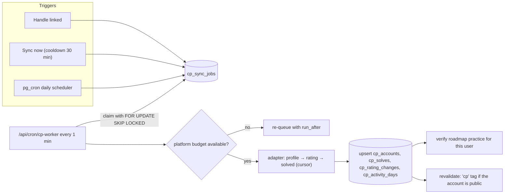

# 20 — Competitive Programming Tracking (10 judges, owner + guests)

> Status: **Draft v0.2** (new in revision 0.2) · Related: [12 Integrations & sync](12-integrations-and-sync.md), [19 Guest accounts](19-guest-accounts-and-progress.md), [07 DB §4.3](07-database-design.md), [11 §6 CP Journey](11-content-modules.md)

The same tracking engine serves two audiences:

- **The owner's public CP Journey page.** All judges are now synced, not entered by hand.
- **Every signed-in guest's private CP hub** (`/me/cp`). Guests link their own handles and track
  their progress. Solved problems also auto-verify the practice problems inside roadmap topics
  (§7).

Supported judges: **Codeforces, AtCoder, LeetCode, CodeChef, LightOJ, UVa, SPOJ, CSES, Toph,
VJudge.** The design lets more be added later without schema changes.

---

## 1. Grounding: what the owner's NEUPC platform already learned

The owner's NEUPC codebase (`eyasir329/NEUPC`, July 2026) already integrates these judges. It was
read for this plan, and its choices are adopted here instead of guessed:

| Finding in NEUPC | Consequence for this plan |
|---|---|
| Server-side services for every judge (`app/_lib/services/problem-solving-services/*`) with per-platform rate limits | Port the adapters to TypeScript rather than writing them from scratch (ADR-017) |
| **LeetCode submission ingestion is extension-only**; CSES and LightOJ solved lists aren't public without login; SPOJ often sits behind a Cloudflare challenge | Those judges need the browser extension for full per-problem history. The server shows profile-level stats only |
| VJudge `status/data` (AC, 20 per page) and `user/solveDetail/{user}`; uHunt for UVa; AtCoder Problems v3 for AtCoder | Reliable server-side solved lists for UVa, AtCoder and VJudge (plus SPOJ via VJudge) |
| CLIST.by API v4 (key, ~10 req/min) as a fallback for contest results on CodeChef and others | Optional fallback, behind a key (`Q-31`) |
| A browser extension (MV3, 41+ judges) that authenticates with `Bearer <token>` against `/api/problem-solving/*` with a **configurable API URL** | Implement a compatible ingestion API, so the existing extension (or a slim fork) can point at this site (`Q-30`) |

## 2. Capability matrix

✓ = reliable · ~ = best-effort (scraping, may break) · ✗ = not available server-side · Ext = the browser extension provides it.

| Judge | Handle | Profile & rating | Rating history | Solved list (per problem) | Primary method | Stability |
|---|---|---|---|---|---|---|
| **Codeforces** | handle | ✓ `user.info` | ✓ `user.rating` | ✓ `user.status` (incremental) | Official API, ≥ 2 s between calls | High |
| **AtCoder** | user id | ✓ `atcoder.jp/users/{u}/history/json` | ✓ same | ✓ AtCoder Problems `v3/user/submissions?from_second=` (500/page) | Official JSON + community API | High |
| **LeetCode** | username | ✓ GraphQL: solved by difficulty, contest rating/ranking | ✓ GraphQL contest history | ✗ server-side (recent ACs only) · **Ext** for full history | Undocumented GraphQL + extension | Medium |
| **CodeChef** | handle | ~ profile page: rating, stars, fully-solved count | ~ embedded in profile page | ~ internal endpoint often blocked; CLIST fallback for contest solves · **Ext** | Scraping (+ CLIST) + extension | Low |
| **LightOJ** | handle | ~ profile page: solved count | ✗ | ✗ (needs auth) · **Ext** | Scraping + extension | Low |
| **UVa** | username → uHunt id | ✓ uHunt (no rating system) | — | ✓ uHunt `subs-user/{uid}` | uHunt API | High |
| **SPOJ** | username | ~ profile page (points, rank, solved) when not challenged | — | ~ profile page · VJudge fallback · **Ext** | Scraping + VJudge + extension | Low |
| **CSES** | numeric user id | ~ profile page (submission count) | — | ✗ (needs login) · **Ext** | Scraping + extension | Low |
| **Toph** | handle | ✓/~ profile page (rating, solved / total) | ~ | ~ `toph.co/api/users/{h}/submissions`, scrape fallback | Unofficial API + scraping | Medium |
| **VJudge** | username | — (no rating) | — | ✓ `status/data` (AC only, paged) / `solveDetail` (grouped by origin judge) | Unofficial JSON | Medium |

`SP-08` re-verifies every endpoint, rate limit and terms-of-service note at build time. Anything that
changed is recorded in this table before implementation.

## 3. Adapter architecture

```ts
// design sketch: lib/cp/adapters/types.ts
export interface JudgeAdapter {
  platform: PlatformSlug;                       // 'codeforces' | 'atcoder' | …
  capabilities: { profile: Cap; ratingHistory: Cap; solved: Cap; extension: boolean };
  budget: { minIntervalMs: number; perMinute: number };   // politeness, enforced by the worker
  resolveHandle?(input: string): Promise<{ handle: string; platformUserId?: string }>; // e.g. UVa uname→uid
  fetchProfile(acc: AccountRef): Promise<ProfileSnapshot>;
  fetchRatingHistory?(acc: AccountRef): Promise<RatingChange[]>;
  fetchSolved?(acc: AccountRef, cursor?: SyncCursor): Promise<{ solves: Solve[]; next?: SyncCursor }>;
}
```

- **Politeness:** a descriptive `User-Agent` (site + contact), per-platform budgets, backoff on
  429/403/Cloudflare challenge pages, 15 s timeouts, and at most 3 retries with jitter.
- **Scraping adapters** (CodeChef, LightOJ, SPOJ, CSES, Toph profile pages) sit behind a
  per-platform flag. They read only public profile pages, at low frequency, respect `robots.txt`,
  and are disabled instantly if a site objects (`Q-29`).
- **Incremental sync:** each account stores a cursor in `sync_state` (Codeforces last submission id,
  AtCoder `from_second`, VJudge page offset, uHunt last submission id), so daily runs fetch only
  what's new.
- **Fixtures:** every adapter is unit-tested against recorded responses. A weekly contract check hits
  the live endpoints read-only and opens an issue when a shape changes ([12 §9](12-integrations-and-sync.md)).

## 4. Canonical problem keys

Every solved problem, from any source, is stored under one **canonical key** so that:
(a) the same problem solved via VJudge and on its origin judge counts once, and (b) roadmap practice
links can be matched to solves.

| Judge | Canonical key | Recognised URLs (examples) |
|---|---|---|
| Codeforces | `codeforces:704A` (contest + index; gym → `cfgym:…`) | `codeforces.com/contest/704/problem/A`, `…/problemset/problem/704/A`, `vjudge.net/problem/CodeForces-704A` |
| AtCoder | `atcoder:arc087_a` | `atcoder.jp/contests/arc087/tasks/arc087_a`, `vjudge.net/problem/AtCoder-arc087_a` |
| LeetCode | `leetcode:two-sum` (title slug) | `leetcode.com/problems/two-sum/` |
| CodeChef | `codechef:START01` (problem code) | `codechef.com/problems/START01`, `…/{contest}/problems/START01` |
| LightOJ | `lightoj:1000` / slug | `lightoj.com/problem/…` |
| UVa | `uva:10055` (problem number) | `onlinejudge.org/…&problem={id}` (mapped through uHunt), `vjudge.net/problem/UVA-10055` |
| SPOJ | `spoj:TEST` | `spoj.com/problems/TEST/`, `vjudge.net/problem/SPOJ-TEST` |
| CSES | `cses:1621` | `cses.fi/problemset/task/1621` |
| Toph | `toph:{slug}` | `toph.co/p/{slug}` |
| Other judges reached through VJudge | `{origin}:{id}`, e.g. `aizu:ITP2_1_A`, `hackerrank:vector-sort` | `vjudge.net/problem/Aizu-ITP2_1_A` (verifiable only through the reader's VJudge account) |

The parser lives in `lib/cp/problem-key.ts` and is shared by the adapters, the extension endpoint
and the bundle importer (which records `problem_key` for every practice link, [10 §5.3](10-roadmap-docs-system.md)).
Unknown URLs are kept as `unknown:{url}` and can't be auto-verified.

## 5. Sync orchestration

A **database-backed queue** (ADR-019): no extra service, safe concurrency.



| Policy | Rule |
|---|---|
| Owner's public accounts | Daily at 03:10 UTC + manual |
| Guest accounts | Immediately when linked; "Sync now" (30 min cooldown); daily if the user was active in the last 14 days; weekly up to 90 days inactive; paused after that and resumed on the next sign-in |
| Worker | Every minute via pg_cron → pg_net. Time budget 50 s per invocation; claims jobs with `FOR UPDATE SKIP LOCKED`; per-platform next-allowed timestamps enforce budgets across concurrent workers |
| Failures | Exponential backoff (5 min → 6 h); after 5 consecutive failures the account shows "Sync failing: {reason}" and pauses until the user retries. "Needs extension" is a state, not a failure |
| Capacity | Codeforces (the tightest budget) ≈ 1,800 calls/hour ≈ 600 account syncs/hour. Far above year-1 needs |

## 6. Guest CP hub (`/me/cp`)

| Section | Content |
|---|---|
| **Linked accounts** | One row per judge: handle, status (synced · syncing · needs extension · failing · unverified), last sync, "Sync now", remove. "Add account" validates the handle format and existence before saving |
| **Summary** | Combined distinct solves (canonical keys), solves per judge, best ratings, contests count |
| **Per-judge cards** | Rating/max/rank (where the judge has ratings), solved, recent activity |
| **Charts** | Rating history (per judge, toggle), combined 365-day heatmap, tag and difficulty distribution (where tags exist: Codeforces, AtCoder via problem metadata, LeetCode via the extension) |
| **Solved list** | Filter by judge, tag, difficulty, date; each row links to the problem |
| **Roadmap practice** | "Practice problems you've solved on judges" per roadmap, with links to the topics |
| **Extension** | Status of the extension token; which judges need it and why |

**Handle ownership:** handles are **unverified** by default. That's fine because everything is private
to the guest. Verification (e.g. Codeforces: submit a compilation error to a given problem within
10 minutes) is only needed if public profiles or leaderboards are ever added (`Q-35`, Could).

## 7. Roadmap practice auto-verification

1. On import, the bundle engine extracts every practice link of a topic (`section#practice .pr a`
   in the reference) with its index `p{i}` and canonical `problem_key` →
   `bundle_practice_items` ([07 §4.6](07-database-design.md)).
2. After any sync or extension ingest for a user, the worker computes the practice items whose
   `problem_key` is in the user's solves and upserts `reading_progress(key='p{i}', done=true,
   source='verified')`.
3. The reader runtime ticks and locks those items, labelled "verified via {judge}"
   ([19 §3.1](19-guest-accounts-and-progress.md)). A guest can still tick an item manually
   (`source='self'`), e.g. for a judge they haven't linked.

For the reference topic, all 11 practice links are auto-verifiable: CSES tasks with a linked CSES
account (extension) or VJudge; the AOJ, AtCoder, Codeforces and HackerRank items via VJudge, or on
their origin judges where linked.

## 8. Owner's public CP Journey

- The owner's accounts are ordinary `cp_accounts` rows with `visibility = 'public'`.
- The public page shows every public account (10 judges), combined distinct solves (replacing the
  hand-typed "1000+" unless the owner keeps an override), rating charts for rated judges, and the
  Colonnade fed by combined monthly solves.
- Manual overrides and onsite contests (ICPC, IUPCs) work as before ([11 §6](11-content-modules.md)).

## 9. Browser-extension ingestion

| Item | Design |
|---|---|
| Endpoint | `POST /api/cp/ext/submissions` (single) and `/api/cp/ext/bulk` (up to 1,000). **Compatibility aliases:** `/api/problem-solving/extension-sync`, `/bulk-import`, `/sync-status`, `/existing-submissions`, matching the NEUPC extension's contract so it can be pointed at this site (`Q-30`) |
| Auth | `Authorization: Bearer ext_…` personal token from `/me/extension`; scope `cp:ingest`; hashed at rest; revocable; 600 submissions/min |
| Payload | `platform, handle, problemId, problemName?, problemUrl?, verdict, submissionId, submittedAt, language?` (source code is **not** stored) |
| Checks | The platform + handle must be one of the user's linked accounts; the verdict is normalised; `(account, submissionId)` is idempotent; only ACs create solves; timestamps are sanity-checked (not before 2005, not > 24 h in the future, as NEUPC does) |
| Trust | Self-reported: stored with `source = 'extension'`. Fine for private tracking; public claims use API-backed data only |

## 10. Data & limits

| Item | Estimate |
|---|---|
| Solves per active guest | ~300–1,500 rows |
| 500 active guests | ≈ 0.5M `cp_solves` rows ≈ 150 MB with indexes. **This is the main pressure on the 500 MB free database** → upgrade trigger in [14 §9](14-devops-and-environments.md) |
| Mitigations | Store only accepted solves (not every submission); daily aggregates for heatmaps; purge data of accounts removed or deleted; pause syncing for inactive users |
