# DEV-03 — Supabase Workflow (CLI + MCP)

> Status: **Draft v0.5** · Related: [07 Database design](../07-database-design.md), [08 Auth & security](../08-auth-and-security.md), [14 §1, §5](../14-devops-and-environments.md), ADR-002, ADR-010, ADR-012, [DEV-01 §4–6](dev-01-toolchain-and-ai-tooling.md)

---

## 1. Project map

| Environment | Supabase | Ref | Plan | Used by | MCP access |
|---|---|---|---|---|---|
| **Local** | CLI stack in Docker (`supabase start`) | — | — | Each developer machine, CI `db` job | Full (disposable) |
| **Staging** | Existing project | **`kahrpgvddpukjbwdxhlq`** (role confirmed by `Q-43`) | Free | PR previews, the `staging` deployment, UAT, closed beta rehearsals | Project-scoped server in `.mcp.json`; read + diagnose only (DEV-01 §6) |
| **Production** | New project, created in P1 week 2 (US-102) | TBD | Free at launch → Pro on the triggers in [14 §9](../14-devops-and-environments.md) (`Q-45`) | `eyasir329.dev`, `read.eyasir329.dev` | None, or read-only (`Q-44`) |

**Region:** production in the region closest to the audience (South/South-East Asia, e.g. Mumbai),
and the Vercel function region set to the same area so server-to-database round trips stay short.
`SP-12` records the region of `kahrpgvddpukjbwdxhlq`; a different staging region is acceptable
(staging performance is not measured), but Lighthouse budgets are only signed off against production.

**Why not Supabase Branching:** it needs a paid plan (ADR-012). The `branching` MCP feature stays
inert until `Q-45` moves production to Pro; even then, staging remains a separate project.

## 2. Configuration as code

`supabase/config.toml` is committed and describes the **local** stack; the same values are
mirrored to staging and production by the release workflow (`supabase config push`, confirmed in
`SP-12`) or by the remote-settings checklist below.

| `config.toml` area | Setting |
|---|---|
| `[db]` | `major_version` equal to the remote projects' Postgres major |
| `[db.seed]` | `sql_paths = ["./seed.sql"]` (local and staging resets only) |
| `[api]` | Exposed schemas: `public` only (`private` holds internals, [07 §1](../07-database-design.md)) |
| `[auth]` | `site_url`, `additional_redirect_urls` per environment (§6); JWT expiry 3600 s |
| `[auth.external.google]`, `[auth.external.github]` | `enabled = true`, client id/secret from `env(...)` |
| `[auth.email]` | Sign-up by email **disabled** (OAuth only, [08](../08-auth-and-security.md)) |
| `[auth.hook.before_user_created]`, `[auth.hook.custom_access_token]` | `uri = "pg-functions://postgres/<schema>/<function>"` for `hook_before_user_created` and `custom_access_token_hook` |
| `[storage]` | File size limit; buckets are created by migrations (§8) |

**Remote-settings checklist** (dashboard items that must match `config.toml`; re-checked at every
phase gate): auth providers and secrets, hooks enabled, site URL and redirect URLs, email provider
off, Data API exposed schemas, Vault secrets (§9), network restrictions (production), and the
project's Postgres version.

## 3. Schema workflow decision

| Option | Pros | Cons | Decision |
|---|---|---|---|
| **Imperative migrations** (`supabase/migrations/*.sql`) | Every step reviewable; explicit expand/contract; matches [07 §10](../07-database-design.md) | Must generate or write each migration | **Chosen** |
| Declarative schemas (`supabase/schemas/`) | Desired state in one place; diffs generated | Generated diffs can hide destructive steps; contract steps need care | Not used at v1; revisit after launch |

## 4. Making a schema change

```mermaid
flowchart LR
  A["supabase migration new name"] --> B["Write SQL or iterate locally with db query or psql"]
  B --> C["supabase db reset (all migrations + seed)"]
  C --> D["pgTAP tests (supabase test db)"]
  D --> E["supabase db advisors (security + performance)"]
  E --> F["gen types into lib/supabase/types.ts"]
  F --> G["PR: migration + tests + types + 07 update"]
  G --> H["CI db job on a fresh database"]
  H --> I["Merge: release workflow pushes to staging, then production after approval"]
```

1. **Create the file** with `supabase migration new <area>_<change>`. Never invent timestamps by
   hand (the CLI names the file `YYYYMMDDHHMMSS_<name>.sql`).
2. **Iterate locally.** Run SQL against the local database (`supabase db query`, `psql`, or the
   agent's local connection). If exploring interactively, generate the final file with
   `supabase db diff -f <name>` or `supabase db pull <name> --local` and then **read and edit it**.
3. **Header comment** in every migration:
   `-- US-150 · expand · creates bundle_* tables · RLS: admin write, server read · rollback: forward-fix`.
4. **Same-file rules:** `enable row level security` and policies for every new table; explicit
   `grant`s to `anon`/`authenticated` only where the Data API needs them; indexes for every foreign
   key; `set lock_timeout = '5s'` before DDL on existing tables.
5. **Never** use MCP `apply_migration` on staging or production, and never change schema in the
   dashboard SQL editor. Shared environments only receive migrations from the release workflow.
6. **Destructive steps** (drop/rename column, tighten constraint) ship in a **later** PR, after the
   code no longer uses the old shape (expand → migrate → contract, DEV-05 §5).
7. **Large backfills** run as batched jobs (`update … where id in (select … limit 1000)`), not in the
   DDL transaction.

## 5. Phase → migration map

[07 §10](../07-database-design.md) lists the logical groups. They are introduced **per phase**, so
each phase deploys a working schema. Each file creates tables **with** their RLS policies and
pgTAP tests (no separate "RLS later" migration).

| Phase | Migrations (logical names) | Contents |
|---|---|---|
| P1 | `extensions_enums`, `core`, `accounts`, `system`, `storage_media`, `cron_base` | Extensions; enums; `site_settings`, `admin_users`, `redirects`; `user_profiles`, auth hooks, blocked domains; `audit_log`, rate limits, `sync_runs`; `media` bucket; cron `prune-rate-limits`, `blocked-domains-refresh` |
| P2 | `portfolio`, `contact`, `storage_resumes`, `cron_retention` | Profile, projects, experiences, education, skills, certifications, resumes, messages; `resumes` bucket; `retention` job |
| P3 | `bundles`, `kb`, `storage_bundles`, `search`, `cron_bundles` | `bundle_*` engine (subjects, versions, objects, import jobs), roadmaps and nodes, `bundle-uploads` + `bundle-objects` buckets, FTS/trigram indexes, `bundle-gc`, `bundle-uploads-cleanup` |
| P4 | `blog`, `cron_publish` | Posts as bundle subjects, tags, series, templates; `publish-due-posts` |
| P5 | `reader_sessions`, `progress`, `cron_accounts` | Reader sessions and bridge codes, reading progress + triggers, `reader-sessions-cleanup`, `account-deletions`, `inactive-accounts` |
| P6 | `github`, `cp`, `cron_sync` | GitHub snapshots; `cp_platforms`, owner accounts, problems, solves, contests, ratings; `sync-github`, ten `sync-cp-{platform}` jobs |
| P7 | — (flags only) | 3D and motion flags in `site_settings` seed/migration |
| P8 | `hardening` | Indexes and fixes from advisors and `pg_stat_statements`, final retention settings |

Seed (`supabase/seed.sql`) grows with the phases: allowlist row (P1), CV-derived drafts (P2), the
empty `cp` roadmap and reference bundle fixtures (P3), templates (P4), the ten platforms (P6).

## 6. Auth per environment

| Setting | Local | Staging | Production |
|---|---|---|---|
| Site URL | `http://localhost:3000` | `https://staging.eyasir329.dev` | `https://eyasir329.dev` |
| Additional redirect URLs | `http://localhost:3000/**`, `http://read.localhost:3000/**` | `https://staging.eyasir329.dev/**`, `https://read.staging.eyasir329.dev/**`, PR previews (`https://*-<vercel-team>.vercel.app/**`) | `https://eyasir329.dev/**`, `https://read.eyasir329.dev/**` only |
| Google OAuth client | Non-production client | Non-production client | Production client (consent screen published; basic scopes only) |
| GitHub OAuth app | "eyasir329 local" → `http://127.0.0.1:54321/auth/v1/callback` | "eyasir329 staging" → `https://kahrpgvddpukjbwdxhlq.supabase.co/auth/v1/callback` | "eyasir329" → `https://<prod-ref>.supabase.co/auth/v1/callback` |
| Hooks | From `config.toml` | Enabled (checklist) | Enabled (checklist) |
| Guest sign-up | Open | Open (test accounts) | **Invite-only flag until P5 privacy pages are live**, then open |
| Allowlist (`admin_users`) | Seeded owner email | Owner email + a test editor | Owner email + backup owner (`Q-02`) |

Hook functions are granted to `supabase_auth_admin` only (`revoke execute … from anon,
authenticated, public`) and live outside exposed schemas unless the hook configuration requires
otherwise; pgTAP covers "disposable domain rejected" and "allowlisted email gets `app_role=owner`".

## 7. RLS testing

| Item | Rule |
|---|---|
| Location | `supabase/tests/<area>/<table>.test.sql` |
| Helpers | `tests.as_anon()`, `tests.as_user(uuid, role)`, `tests.as_admin(email)` set `request.jwt.claims` and `role` |
| Coverage | Every cell of the policy matrix in [07 §7.1](../07-database-design.md) has a test: allowed actions succeed, forbidden ones return 0 rows or raise |
| Guest data | For every guest-owned table: user A cannot select, update or delete user B's rows (T-DB) |
| Advisors | `supabase db advisors` must report no security-level findings (RLS disabled, mutable search path, `SECURITY DEFINER` views/functions in exposed schemas) |
| CI | `supabase test db` in the `db` job; a failure blocks merge |

## 8. Storage

Buckets and their policies are created **by migrations** (`insert into storage.buckets …` plus
`storage.objects` policies), so all environments match: `media` (public read, admin write),
`resumes` (private), `bundle-uploads` (private, resumable uploads, 7-day cleanup), `bundle-objects`
(private, server-only). Upserting files needs INSERT + SELECT + UPDATE policies (a trap called out
by the Supabase skill); tests upload, replace and delete as admin and fail as a guest.

## 9. Cron, Vault and per-environment secrets

- Jobs are defined in migrations ([07 §9](../07-database-design.md)); the **target URL and secret
  come from Vault** (`app_base_url`, `cron_secret`, `revalidate_webhook_secret`), so the same
  migration works in every environment.
- Vault values are set **once per environment** by the owner in the SQL editor
  (`select vault.create_secret(<value>, '<name>')`), never committed, and re-set during rotation
  (RB-11).
- **Staging:** CP jobs exist but `cp_platforms.enabled = false` by default, so judges are not
  called twice; the P6 soak test enables them on staging for 3 days, then production takes over.
- `sync_runs` records every run; the dashboard health tile reads it (WF-60).

## 10. Supabase MCP recipes (staging)

| Task | Recipe |
|---|---|
| Before implementing a Supabase feature | `search_docs` for the feature, then check the changelog for breaking changes (skill rule 1) |
| After each staging deploy | `get_advisors` (security, then performance); file issues for findings |
| Debug a sign-in problem | `get_logs` for the auth service around the timestamp; compare redirect URLs with §6 |
| Confirm staging matches git | `list_migrations` vs `supabase/migrations/` file names |
| Inspect data for a bug | `execute_sql` with a **read** query (approval prompt); never paste results containing personal data into issues |
| Refresh staging keys in `.env` | `get_project_url`, `get_publishable_keys` (the secret key comes from the dashboard, never via chat) |
| Compare types | `generate_typescript_types` vs committed `lib/supabase/types.ts` |

## 11. Resetting staging

Staging data is disposable. A manual **"Reset staging"** workflow (DEV-05 §3) runs
`supabase db reset --linked` against `kahrpgvddpukjbwdxhlq` (migrations + seed), re-uploads fixture
bundles, and re-creates test accounts. It requires typing the project ref as confirmation and is
never pointed at production (the production ref is not stored in that workflow's environment).
