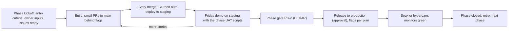

# DEV-04 — Phase-by-Phase Development & Deployment Plan

> Status: **Draft v0.5** · Related: [16 Delivery plan](../16-delivery-plan.md) (phases, stories, estimates), [15 QA](../15-testing-and-qa.md) (tests, UAT), [DEV-03](dev-03-supabase-workflow.md), [DEV-05](dev-05-cicd-and-release.md), [DEV-07](dev-07-quality-gates.md)

This document answers, for every phase: **what gets built in which order, what changes in the
database, which screens appear, which tests prove it, how it reaches staging and production, how it
is demonstrated, what closes the phase, and how it is undone if something goes wrong.** Stories,
estimates and dependencies come from [16](../16-delivery-plan.md); screens are the `WF-nn` IDs in
[`ux/`](../ux/README.md).

---

## 1. The lifecycle every phase follows

**Order of phases.** The owner chooses the order in `Q-19` ([16 §1](../16-delivery-plan.md)). The
plans below are written so each works in any allowed order; hard dependencies are
P1 → everything, P3 → P4 and P5, P2 → P6 and P7. The recommended **option B** calendar:

| Weeks (full-time) | Phase | Release |
|---|---|---|
| 1–6 | P1 Foundations | Production holding page live (end of week 6) |
| 6–10 | P3 Bundle engine & Roadmap Docs | Docs on production, hidden until P8 (`docs.public = false`) |
| 10–14 | P5 Reader accounts & progress | Closed beta (invite-only) on production |
| 14–17 | P2 Portfolio core | Content entered on production as drafts |
| 17–19 | P4 HTML blog | First posts scheduled |
| 19–21 | P8 Launch (v1 scope: everything above) | **Public v1** |
| 22–25 | P6 Owner CP tracking | v1.1a: CP page with 10 judges |
| 25–27 | P7 3D & motion | v1.1b: scenes enabled |
| 27+ | Hypercare, post-launch backlog | — |

Half-time roughly doubles these weeks ([16 §1](../16-delivery-plan.md)).

## 2. Threads that run through every phase

| Thread | Rule |
|---|---|
| Security | RLS + pgTAP with every table; `requireRole` in every admin action; CSP and headers tests stay green |
| Accessibility | Each new screen checked against its UX-08 §5 row and axe in E2E |
| Performance | Route JS budgets and Lighthouse CI on every PR from P1 |
| Observability | New routes/jobs report to Sentry; new jobs write `sync_runs` / `bundle_import_jobs`; uptime checks added for new public surfaces |
| Docs | Deviations from 07/03/ux recorded in the same PR (DEV-02 §8) |
| Content | Owner inputs from [16 §8](../16-delivery-plan.md) requested one phase ahead |

---

## 3. P1 — Foundations (≈ 27.5 d, 5–6 weeks)

**Goal:** a deployable, observable skeleton on all environments, with sign-in and roles working,
both shells in place, and every spike answered.

**Entry criteria:** [21](../21-audit-checklist.md) and [UX-09 §7](../ux/ux-09-ux-audit.md) signed;
`Q-01` (domain), `Q-04` (content host), `Q-43`–`Q-46` answered; OAuth apps and Sentry accounts exist.

### 3.1 Build order

| Week | Work | Stories / spikes | Output |
|---|---|---|---|
| 1 | Scaffold Next.js 16 + TS strict + Tailwind v4 + ESLint/Prettier + Vitest + Playwright; `CLAUDE.md`, `CONTRIBUTING.md`, `.claude/settings.json` (DEV-01 §6.2) | US-100 | `pnpm check` green locally |
| 1 | CI workflow (lint, typecheck, unit, build, secret grep) and branch protection | US-101 | Required checks on `main` |
| 1 | **Supabase tooling check**: approve/authenticate the MCP server, record staging region and Postgres version, verify tool names for the permissions file, local MCP endpoint, `config push`, advisors | `SP-12` (inside US-102) | Findings in ADR-021 |
| 1–2 | Supabase: local stack, link staging (`kahrpgvddpukjbwdxhlq`), **create the production project**, migrations `extensions_enums`, `core`, `system`; `pnpm db:types`; `db` CI job | US-102 | Same schema on local, staging, production |
| 2 | Env validation (`lib/env.ts`), Vercel project, function region, Sentry; **release workflow** with staging alias and approval-gated production (DEV-05) | US-103, `SP-13` (inside US-103) | Merge to `main` → staging; approval → production |
| 2 | `proxy.ts` host routing (apex / `www` / `read` / staging hosts), security headers, CSP spike | US-104, SP-01, SP-04 | `read.` returns 404 placeholder; headers test passes |
| 2 | Cache tags and purge; streaming unzip limits | SP-02, SP-06 | Notes for P3 |
| 3 | Auth: Google + GitHub on local and staging; hooks; callback; `requireRole` / `requireUser`; `accounts` migration | US-001, SP-03, SP-07, SP-11 | UAT-01 passes on staging |
| 3 | Admin shell (WF-60 frame), allowlist management (WF-78 admins part), audit triggers + viewer | US-105, US-106, US-107 | Owner-only screens gated |
| 4 | Media library (WF-71) + `storage_media` migration | US-108 | Upload with required alt text |
| 4 | Tokens, fonts, theme without flash; public layout (WF-00…05) | US-110, US-111 | Both themes, D/T/M |
| 5 | Core components (UX-07 §2) and design specimen page | US-112, US-113 | `/admin/design` |
| 5 | Remaining spikes: 3D art direction, judge feasibility, runtime compatibility, extension compatibility | SP-05, SP-08, SP-09, SP-10 | ADR updates; fixtures recorded |
| 6 | Hardening, gate review, first production release | — | PG-1 |

### 3.2 Database

`extensions_enums`, `core`, `accounts`, `system`, `storage_media`, `cron_base` (DEV-03 §5). Seed:
owner allowlist row, settings defaults.

### 3.3 Tests added

Unit: env schema, `requireRole`, host routing table. pgTAP: `admin_users`, `user_profiles`,
`audit_log`, hooks (disposable domain rejected, allowlisted email → owner). E2E: sign-in as owner
and guest (test OAuth accounts on staging), 403 on `/admin`, theme persistence, skip link. Headers
test on both hosts.

### 3.4 Flags at the end of P1

| Flag | Local | Staging | Production |
|---|---|---|---|
| `site.launch` (false = visitors see the holding page; signed-in admins see the real site) | true | true | **false** |
| `accounts.signup` (`closed` / `invite` / `open`) | open | open | **closed** (only allowlisted admins can create accounts) |

### 3.5 Deploy plan

1. **Vercel:** create the project (Hobby), connect GitHub, Node 24, function region near the
   production database; **turn off automatic production deployments from Git** (production is
   promoted by the release workflow after migrations, DEV-05 §4); enable deployment protection for
   previews; set env vars per scope (preview/staging = staging Supabase; production = production).
2. **DNS** (`Q-01`): apex, `www` (→ apex), `read`, `staging`, `read.staging` → Vercel.
3. **Supabase production:** link in CI only; release workflow pushes migrations; owner sets auth
   providers (production Google client, production GitHub app), hooks, site/redirect URLs, Vault
   secrets (`app_base_url`, `cron_secret`, `revalidate_webhook_secret`), and turns off email sign-up
   (remote-settings checklist, DEV-03 §2).
4. **Observability:** Sentry releases from CI; uptime monitors on `/api/health` for production and
   staging; Speed Insights on.
5. **Release:** merge → staging smoke → approve production → production smoke (DEV-07 §2).

**Demo:** sign in as owner on staging and production; a second account is a guest with 403 on
`/admin`; switch themes; show the holding page on the public URL; show CI and Sentry.

**Exit:** PG-1 (DEV-07 §3). **Rollback:** Vercel instant rollback; schema is forward-fix only;
nothing public yet. **Risks:** preview hosts for the content origin (SP-01/SP-11), OAuth redirect
mismatches (keep the §6 table of DEV-03 as the source of truth).

---

## 4. P2 — Portfolio core (≈ 16 d, 3–4 weeks)

**Goal:** all CV content live and editable; Home, Projects, Experience, About, CV and Contact built.

**Entry:** PG-1 passed; owner content for P2 ([16 §8](../16-delivery-plan.md)): portrait,
screenshots, project URLs, experience entries, certificates, current CV.

### 4.1 Build order

| Step | Work | Stories | Screens |
|---|---|---|---|
| 1 | `portfolio`, `contact`, `storage_resumes`, `cron_retention` migrations (expand) with pgTAP | — (part of US-121/US-010) | — |
| 2 | Generic admin list and form built once, first used for Profile/settings | US-121 | WF-61, WF-62, WF-80, WF-77 (site/social tabs) |
| 3 | Markdown pipeline (unified/remark/rehype, Shiki, KaTeX, sanitisation) + preview | US-140 | WF-63 preview pane |
| 4 | Projects admin (tabs, media, relations, redirects on slug change) and public pages | US-010, US-120 | WF-63, WF-12, WF-13 |
| 5 | Home with static hero and poster placeholder for S1 | US-122 | WF-10 |
| 6 | Experience; Education, Skills, Certifications and About | US-123, US-124 | WF-14, WF-11 |
| 7 | CV versions and `/resume` | US-020 | WF-18, admin Resume |
| 8 | Contact form, Turnstile, rate limit, inbox, email via Resend | US-050 | WF-17, WF-76 |
| 9 | CV-draft seed and idempotent "Import CV drafts" admin action | US-125 | — |

### 4.2 Tests

pgTAP for every portfolio table (public reads only `published`), unit tests for Markdown
sanitisation, E2E for edit → publish → visible (UAT-02) and contact (UAT-13), axe on each new page,
Lighthouse budgets on Home and Project.

### 4.3 Deploy plan

- Secrets: Turnstile (test keys locally, real keys staging/production), Resend key and sending
  domain (DNS `SPF`/`DKIM` on `mail.` subdomain), `OWNER_NOTIFY_EMAIL`.
- Production content: owner runs **Import CV drafts** once in production admin, then reviews and
  publishes each item. Seed files never run against production.
- Flags: `site.launch` stays false under option B (true only for the v0.9 launch of option C).

**Demo:** edit a project on staging and see it live within seconds; send a contact message from a
phone; download the CV. **Exit:** PG-2 (UAT-02, UAT-13). **Rollback:** app rollback; content
mistakes via `audit_log` diff (RB-09).

---

## 5. P3 — Bundle engine & Roadmap Docs (≈ 21 d, 4–5 weeks)

**Goal:** the content origin serves uploaded topics byte-faithfully, with versions, previews,
generated pages and the docs map; the runtime block is present but `off`.

**Entry:** PG-1; SP-02, SP-06, SP-09 findings; the reference bundle `3_std_vector.zip` committed as
a golden fixture; owner's roadmap outline (P3 inputs).

### 5.1 Build order

| Step | Work | Stories | Screens |
|---|---|---|---|
| 1 | `bundles`, `kb`, `storage_bundles` migrations; CAS helpers (SHA-256, dedupe) | US-150 | — |
| 2 | Import pipeline: resumable upload → unzip (streaming) → validate → extract metadata → store → report | US-040 | WF-69 |
| 3 | Content-origin handler: namespaces, headers, CSP, private files, redirects, 404 | US-151 | WF-40, WF-41 |
| 4 | Versions: publish, rollback, compare, CDN purge by `content:{subjectId}` | US-041 | WF-66, WF-65 (topic variant) |
| 5 | Serve-time runtime injection with per-roadmap `runtime_mode` (default **`off`** until P5) | US-158 | — |
| 6 | Preview tokens and sandboxed preview | US-153 | WF-69 preview |
| 7 | Generated pages + theme extraction | US-152 | WF-35, WF-36, WF-37, WF-39 |
| 8 | Outline editor, roadmap settings, link report | US-155 | WF-67, WF-68 |
| 9 | `/docs` catalog and map | US-156 | WF-33, WF-34 |
| 10 | Search indexing, content-origin sitemap and robots (`search` migration) | US-157 | — |
| 11 | Tree import (dry run, apply) and the bundle CLI with tokens | US-043, US-154 | WF-70, WF-78 |

### 5.2 Tests

T-KB-* (byte-for-byte equality with the reference bundle except the injected block, path-escape
rejection, private files, CSP), import report golden files, rollback within 60 s (UAT-06), CLI
dry-run diff (UAT-05), E2E topic upload → publish (UAT-04).

### 5.3 Deploy plan

1. Staging: upload the reference roadmap with the CLI (`pnpm bundle push --env staging`), verify
   rendering on `read.staging…`, run UAT-04/05/06.
2. Production: create a CLI token (owner, 90 days), push the same bundles, publish.
3. Verify CDN caching headers and purge on `read.eyasir329.dev` (SP-02 method).
4. Flags: `docs.public = false` on production until P8 (catalog and map hidden from navigation and
   sitemaps; direct links work for the owner's review). Content-origin pages send `noindex` while
   `site.launch = false`.

**Demo:** upload, preview on phone width, publish, break it on purpose, roll back.
**Exit:** PG-3. **Rollback:** content by version rollback (RB-06); code by app rollback; a failed
import never changes the live version.

---

## 6. P4 — HTML blog (≈ 9 d, ~2 weeks)

**Goal:** write, preview, schedule and publish HTML posts on the shared bundle engine.

**Entry:** PG-3; owner's 1–3 launch posts or drafts.

| Step | Work | Stories | Screens |
|---|---|---|---|
| 1 | `blog`, `cron_publish` migrations | — | — |
| 2 | Post metadata extraction + `post.json` | US-147 | — |
| 3 | HTML editor: file tree, CodeMirror, assets, autosave drafts, sandboxed preview, save version | US-141 | WF-64 |
| 4 | Templates library + default "Marble & Ink essay" template | US-146 | WF-79, WF-32 |
| 5 | Listings, tags, series, overrides, `/blog/[slug]` → content-origin redirect | US-142 | WF-30, WF-31 |
| 6 | Scheduling (`publish-due-posts`), feeds (summary), OG images | US-143 | WF-65 |

**Tests:** T-BLOG-*, UAT-03 (schedule 10 minutes ahead on staging), editor keyboard checks
(UX-08 §2.3), feed validation.

**Deploy plan:** confirm `publish-due-posts` is scheduled in production and reaches the app through
Vault's `app_base_url`; flag `blog.public = false` until P8 (or true if launching blog-first);
first posts drafted in production and scheduled for launch day.

**Demo:** write a post with a canvas demo, preview at 360 px, schedule, watch it go live.
**Exit:** PG-4. **Rollback:** post version rollback; unschedule; app rollback.

---

## 7. P5 — Reader accounts & progress (≈ 17.5 d, 3–4 weeks)

**Goal:** anonymous readers read everything with progress controls disabled; signed-in readers get
server-authoritative progress synced across devices, `/me`, and export/delete.

**Entry:** PG-3; SP-09 and SP-11 findings; privacy/terms wording approved (P5 input); `Q-34` answered.

| Step | Work | Stories | Screens |
|---|---|---|---|
| 1 | `reader_sessions`, `progress`, `cron_accounts` migrations + pgTAP (user A never sees user B) | — | — |
| 2 | `/login`, `user_profiles`, account menu | US-200 | WF-50, WF-03 |
| 3 | Session bridge and sign-out chain (both origins) | US-201 | — (F-03/F-04 flows) |
| 4 | Reader API (`me`, `progress`, `summary`, `visit`) with validation and CSRF | US-202 | — |
| 5 | Reader runtime v1: gating, sync, reconcile, pending queue, chip; compatibility tests on the reference bundle; size ≤ 8 KB | US-203 | WF-38, WF-55 |
| 6 | Progress on generated pages and the docs map | US-204 | WF-36, WF-37, WF-34 |
| 7 | `/me` dashboard and roadmap progress | US-205 | WF-51, WF-52 |
| 8 | Settings: export, delete, sign out everywhere; deletion job | US-206 | WF-53, WF-54 |
| 9 | Admin Users and Readers analytics | US-207 | WF-74, WF-75 |
| 10 | Privacy/terms updates and inactivity job | US-208 | WF-21 |

**Tests:** T-RT-01…10, T-BR-*, T-GU-*, UAT-07, 08, 09, 12; runtime compatibility suite in CI.

### 7.1 Staged rollout on production

| Step | Change | Check before the next step |
|---|---|---|
| 1 | Privacy and terms pages published | Pages live; linked from `/login` |
| 2 | `runtime_mode` from `off` → `inject` on the CP roadmap (CDN purge of its subjects) | Anonymous gating works; no layout shift; runtime errors = 0 in Sentry for 24 h |
| 3 | `accounts.signup = invite` → **closed beta** with 10–20 NEUPC members ([16 §7](../16-delivery-plan.md)) | Reader API error rate < 2%; feedback form reviewed; deletion job verified |
| 4 | Google consent screen published (basic scopes); GitHub app verified | Sign-in works for accounts outside the test list |
| 5 | `accounts.signup = open` (at P8 launch, or earlier if the owner wants) | Quotas and monitors watched (DEV-06 §2) |

**Demo:** read a topic signed out on a phone, sign in from the chip, tick sections, continue on a
laptop, export and delete a test account. **Exit:** PG-5.
**Rollback:** set the roadmap's `runtime_mode` back to `off` (pages behave exactly as authored,
nothing is lost server-side), then `accounts.signup = closed`; app rollback for code faults. Queued
ticks stay in readers' browsers and flush when fixed (RB-12).

---

## 8. P6 — Owner CP tracking (≈ 18.5 d, 3–4 weeks)

**Goal:** the owner's records on 10 judges and GitHub sync daily, unattended, into an honest public
CP Journey page.

**Entry:** PG-2 (portfolio exists); SP-08 fixtures and SP-10 findings; owner handles on all judges;
`Q-29`, `Q-30`, `Q-31` answered.

| Step | Work | Stories | Screens |
|---|---|---|---|
| 1 | `github`, `cp`, `cron_sync` migrations (jobs created, platforms **disabled**) | — | — |
| 2 | Adapter framework, per-platform runs (advisory lock, cursors, budgets), canonical keys, Codeforces | US-030 | — |
| 3 | Sync centre early, so every adapter lands observable | US-131 | WF-72, WF-73, WF-60 health tile |
| 4 | Adapters one per PR, each with recorded fixtures and a contract test | US-210 … US-216 | — |
| 5 | Owner extension ingestion + NEUPC-compatible aliases + `cp:ingest` token | US-217 | WF-78 |
| 6 | GitHub sync and repo stats | US-130 | — |
| 7 | Contests admin and overrides | US-133 | WF-72 |
| 8 | Public CP page with judge cards, charts, heatmap, contests; Colonnade as **table** (3D in P7) | US-132 | WF-15, WF-16 |

**Tests:** T-CP-*, T-CPT-* on fixtures (no live calls in CI), weekly contract check against live
endpoints (DEV-05 §3), UAT-10, UAT-11.

**Deploy plan:** (1) enable all platforms on **staging** for a 3-day soak and fix failures;
(2) disable staging platforms (avoid double traffic to judges); (3) enable platforms on production
one group at a time (API judges first, flagged scrapers last per `Q-29`); (4) 3 consecutive
unattended days green = exit. **Exit:** PG-6. **Rollback:** per-platform kill switch (RB-08); the
public card keeps the last snapshot with "as of"; app rollback.

---

## 9. P7 — 3D & motion (≈ 11.5 d, 2–3 weeks)

**Goal:** the Marble & Ink scenes and motion system, with posters and full fallbacks.

**Entry:** PG-2 (pages to host scenes); SP-05 art direction approved; P6 data for S2 (or S2 ships
after P6).

| Step | Work | Stories | Screens |
|---|---|---|---|
| 1 | Shared canvas, View system, capability gate (WebGL2, GPU tier, reduced motion, 3D toggle), poster pipeline | US-160 | WF-05 toggle |
| 2 | S1 Plaster Graph on Home | US-161 | WF-10 |
| 3 | Motion system M1–M15 (UX-08 §3) | US-164 | all |
| 4 | S2 Colonnade + table twin | US-162 | WF-15 |
| 5 | S4 Broken Column on 404 | US-163 | WF-20 |
| 6 | S3 Exhibit Plinth (Could) | US-165 | WF-13 |

**Tests:** UAT-14 on a mid-range Android phone and a laptop; Lighthouse budgets with 3D on;
reduced-motion E2E; bundle size (three.js only in the lazy island).

**Deploy plan:** posters rendered by `scripts/render-posters.ts` and committed; flags per scene
(`3d.s1`, `3d.s2`, …) on in staging first, then production once budgets pass on production URLs.
**Exit:** PG-7. **Rollback:** scene flag off (posters remain); app rollback.

---

## 10. P8 — Launch (≈ 14 d, ~3 weeks)

**Goal:** search, SEO, analytics, hardening, audits, backups and content, then a public launch.

| Step | Work | Stories |
|---|---|---|
| 1 | Global search (⌘K and `/search`) | US-170 (WF-02, WF-19) |
| 2 | SEO: metadata, JSON-LD, sitemaps for both hosts, robots | US-171 |
| 3 | Analytics and Speed Insights | US-172 |
| 4 | Redirect manager | US-173 |
| 5 | Security hardening (CSP review, rate limits, headers, dependency audit, secret scan) | US-180 |
| 6 | Privacy and security review of guest data flows (threat model walk-through, RLS matrix) | US-185 |
| 7 | Accessibility audit and fixes (UX-08 §7 matrix, UX-09 §4 record) | US-181 |
| 8 | Performance audit and fixes | US-182 |
| 9 | Backups, restore drill with deletion-log replay, runbooks (DEV-06) | US-183 |
| 10 | Content entry support and the launch checklist ([15 §9](../15-testing-and-qa.md)) | US-184 |

### 10.1 Launch-day runbook

| T | Action | Owner |
|---|---|---|
| T-7 d | Production-readiness review (DEV-07 §4); freeze non-launch features | Dev + owner |
| T-2 d | Restore drill result recorded; monitors and alert routes tested | Dev |
| T-1 d | Content final check; scheduled posts in place; sitemaps generated | Owner |
| T 0 | Release the final build; flip `site.launch = true`, `docs.public`, `blog.public`, `accounts.signup = open` as planned | Dev (owner approves) |
| T + 15 min | Smoke tests on both hosts; `noindex` gone; headers; sign-in; a topic; a post; CV | Dev |
| T + 1 h | Submit sitemaps for both hosts; HSTS (no preload yet); announce (LinkedIn, GitHub README, Codeforces, NEUPC Discord) | Owner |
| T + 14 d | Hypercare: daily Sentry and quota review; fix-forward; then HSTS preload decision | Dev |

**Exit:** PG-8 = launch checklist signed. **Rollback:** flip `site.launch = false` (holding page
returns within one cache revalidation) plus app rollback; data is never rolled back except by
restore (RB-10).

## 11. After launch (v1.1 and beyond)

Under option B, P6 and P7 follow as v1.1 releases with the same lifecycle (§1) and a short
readiness check instead of a full P8. The post-launch candidates in [16 §4](../16-delivery-plan.md)
enter the backlog after a review of analytics and beta feedback.
