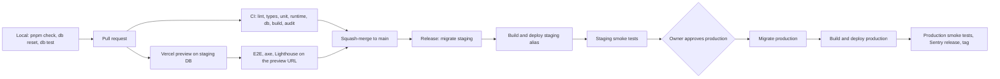
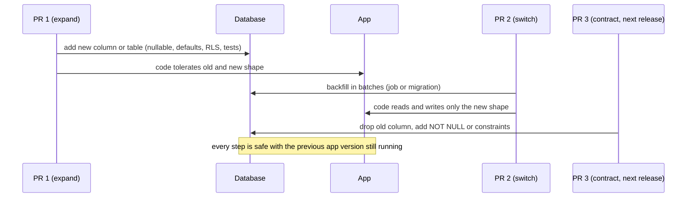

# DEV-05 — Environments, CI/CD & Release Engineering

> Status: **Draft v0.5** · Related: [14 DevOps](../14-devops-and-environments.md) (this document refines §1, §4 and §5 of it), [DEV-03](dev-03-supabase-workflow.md), [DEV-07](dev-07-quality-gates.md), ADR-012, ADR-021

---

## 1. Environment topology

| Environment | Web | Supabase | Deployed by | Data | Protection / indexing |
|---|---|---|---|---|---|
| **Local** | `localhost:3000`, `read.localhost:3000` | CLI stack | Developer | Seed + fixtures | — |
| **PR preview** | `*.vercel.app` per PR (content origin via preview host alias, SP-01) | Staging | Vercel Git integration (previews only) | Staging data; E2E creates `e2e-*` records and cleans up | Vercel deployment protection; `noindex` |
| **Staging** | `staging.eyasir329.dev`, `read.staging.eyasir329.dev` | Staging (`kahrpgvddpukjbwdxhlq`) | Release workflow on every merge to `main` | Seed + UAT content + beta rehearsal accounts | Protected alias; `noindex` |
| **Production** | `eyasir329.dev`, `read.eyasir329.dev` | Production | Release workflow after owner approval | Real content and readers | Public (holding page + `noindex` until launch) |

**Why production is not deployed by the Git integration:** a push to `main` would otherwise deploy
the app while the migration job is still running. The release workflow guarantees **migrate, then
deploy** for each environment, and adds an approval gate before production (confirmed by `SP-13`).

## 2. Hosts and DNS

| Record | Target | Assigned to |
|---|---|---|
| `eyasir329.dev` | Vercel | Production deployments |
| `www` | Vercel | 308 → apex |
| `read` | Vercel | Production (routed by `proxy.ts`) |
| `staging`, `read.staging` | Vercel | Aliased by the release workflow to the latest staging deployment (`vercel alias set`) |
| `mail` (Resend) | `SPF`, `DKIM` records | Transactional email |

`proxy.ts` recognises the content host from `NEXT_PUBLIC_CONTENT_URL` for each environment, so
`read.staging…` and preview aliases behave like `read.…`. Cookies stay host-only (`__Host-`), so
the two origins and the two environments never share sessions.

## 3. GitHub Actions workflows

| Workflow | Trigger | Jobs | Blocks |
|---|---|---|---|
| `ci.yml` | PR, push to `main` | `lint` · `typecheck` · `unit` (+ coverage) · `runtime` (build, ≤ 8 KB gzip, compatibility tests) · `db` (`supabase start`, `db reset`, `test db`, `db advisors`, types diff) · `build` (route budgets, secret grep) · `audit` | Merge |
| `e2e.yml` | Vercel `deployment_status` = success on a preview | Playwright + axe, Lighthouse CI against the preview URL (with the protection-bypass secret) | Merge |
| `release.yml` | Push to `main` (after CI) · manual re-run | `staging-migrate` → `staging-deploy` → `staging-smoke` → **`production` environment approval** → `prod-migrate` → `prod-deploy` → `prod-smoke` → tag + Sentry release | — |
| `db-backup.yml` | Nightly (UTC 02:30) | `supabase db dump` (schema, data, roles) → `age` encryption → artifact + private backup target; storage incremental copy | Alerts on failure |
| `contract-check.yml` | Weekly | Live calls to each judge endpoint with the owner handles, compared with recorded fixtures ([12 §9](../12-integrations-and-sync.md)) | Opens an issue on drift |
| `reset-staging.yml` | Manual, with typed confirmation | `supabase db reset --linked` on staging, fixture upload, test accounts | — |
| Renovate | Weekly | Dependency PRs (DEV-02 §6) | — |

### 3.1 `release.yml` in detail

| Job | Steps | Fails when |
|---|---|---|
| `staging-migrate` | `supabase link --project-ref $STAGING_REF` → `supabase db push` → `supabase db advisors` (warn) | Migration error |
| `staging-deploy` | `vercel pull --environment=preview` → `vercel build` → `vercel deploy --prebuilt` → `vercel alias set` to `staging…` and `read.staging…` | Build or deploy error |
| `staging-smoke` | Health endpoint; home; a topic on the content host; sign-in page; reader API `401` when signed out; headers | Any check fails |
| `production` (environment) | Waits for the owner's approval in GitHub | Rejected |
| `prod-migrate` | Link production → `supabase db push` | Migration error (RB-04) |
| `prod-deploy` | `vercel pull --environment=production` → `vercel build --prod` → `vercel deploy --prebuilt --prod` | Build or deploy error |
| `prod-smoke` | Same as staging smoke on production hosts; then create a Sentry release and a git tag | Any check fails → auto-alert + RB-03 |

Migrations and deploys for one environment never overlap: the workflow uses a `concurrency` group
per environment.

## 4. Secrets and environments

| Where | Holds | Access |
|---|---|---|
| GitHub Environment `staging` | `SUPABASE_ACCESS_TOKEN` (scoped to staging), `SUPABASE_DB_PASSWORD`, `STAGING_REF`, `VERCEL_TOKEN`, `VERCEL_ORG_ID`, `VERCEL_PROJECT_ID`, E2E bypass secret, test-account credentials | Workflows on `main` |
| GitHub Environment `production` | Scoped token for production, DB password, `PROD_REF`, Vercel values | Workflows on `main` **after owner approval** (required reviewer) |
| Vercel env (preview scope) | Staging Supabase URL/keys, app secrets for staging | Build/runtime of previews and staging |
| Vercel env (production scope) | Production Supabase URL/keys, app secrets | Production runtime |
| Supabase Vault (per project) | `app_base_url`, `cron_secret`, `revalidate_webhook_secret` | pg_cron jobs |
| Developer machine | `.env.local` (local keys only) | Never committed |

Rules: production secrets never appear in the `staging` environment or in PR workflows; tokens are
scoped and dated; rotation follows RB-11 (DEV-06).

## 5. Migration choreography (expand → migrate → contract)

| Rule | Why |
|---|---|
| Migrations are backward compatible with the currently deployed app | The workflow migrates before deploying, and an app rollback must keep working |
| Destructive changes ship at least one production release after the switch | Allows an instant app rollback without schema errors |
| One migration file = one transaction | A failure leaves earlier files applied and the failing file not applied (forward-fix, RB-04) |
| `lock_timeout` on DDL for hot tables | Avoid blocking readers during deploys |
| No down migrations | Fix forward; data loss is handled by restore (RB-10) |

## 6. Feature flags

Stored in `site_settings.flags` (JSON, cached with the `settings` tag and revalidated on change),
edited in WF-77 *Flags*, audited in `audit_log`. When `site.launch` is false, visitors get the
holding page while signed-in admins see the real site, so the owner can review production.
`noindex` is decided by the environment (every non-production host), not by a flag.

| Flag | Values | Local | Staging | Production (initial) | Flipped in | Removed |
|---|---|---|---|---|---|---|
| `site.launch` | bool | true | true | false | P8 launch (option C: v0.9) | Never (maintenance switch) |
| `accounts.signup` | `closed` / `invite` / `open` | open | open | closed | P5 beta → P8 launch | Kept (abuse lever) |
| `docs.public` | bool | true | true | false | P8 | After launch + 2 releases |
| `blog.public` | bool | true | true | false | P8 | After launch + 2 releases |
| `3d.s1` … `3d.s4` | bool | true | true | false | P7 per scene | Kept (performance lever) |
| `cp.page` | bool | true | true | false | P6 | After launch + 2 releases |
| Roadmap `runtime_mode` (per roadmap, not a flag) | `off` / `inject` / `self` | inject | inject | off | P5 rollout | — |
| `cp_platforms.enabled` / `scraping_enabled` (per platform) | bool | fixtures | off except soak | off → on | P6 | — |

## 7. Versions, tags and release notes

- Every merge to `main` reaches staging; production releases happen at least weekly during active
  phases and always at phase end.
- Tags: `v0.<phase>.<n>` for phase releases (e.g. `v0.3.2`), `v1.0.0` at public launch, `v1.1.x`
  for P6/P7 under option B.
- Sentry release = commit SHA, with source maps uploaded by the build.
- `CHANGELOG.md` generated from Conventional Commits at each tag; the owner-facing summary goes in
  the GitHub release.

## 8. Rollback matrix

| What broke | Mechanism | Time to recover |
|---|---|---|
| App code | Vercel instant rollback to the previous production deployment (RB-03) | Minutes |
| A feature | Flip its flag (§6) | ≤ 1 cache revalidation |
| A topic or post | Version rollback in admin or `bundle publish --version N` (RB-06) | ≤ 60 s |
| Reader runtime on a roadmap | `runtime_mode = off` + CDN purge (RB-12) | ≤ 60 s |
| A judge adapter | Platform kill switch (RB-08) | Immediate |
| Schema | Forward-fix migration (RB-04) | Hours |
| Data loss | Restore from the encrypted nightly dump into staging, copy rows back (RB-10) | ≤ 4 h RTO |

## 9. PR previews and test data

- Previews share the staging database, so E2E uses dedicated test accounts and prefixes every
  created record with `e2e-`; a teardown step deletes them, and `reset-staging.yml` cleans up any
  leftovers.
- Auth redirect URLs for previews are allowed only on the staging project (DEV-03 §6).
- Preview deployment protection stays on; CI uses Vercel's automation-bypass secret.
- Cron jobs never target previews (Vault `app_base_url` on staging points to `staging…`).

## 10. Platform limits that shape the pipeline

| Limit | Consequence |
|---|---|
| Vercel Hobby: limited cron, function duration limits, non-commercial use | Scheduling runs in pg_cron (ADR-010); CP runs are 50 s budgeted and cursor-resumable ([07 §9](../07-database-design.md)); upgrade triggers in [14 §9](../14-devops-and-environments.md) |
| Supabase Free: two active projects, pausing after inactivity, no PITR, no branching | Staging + production only; uptime pings and daily jobs keep projects active (RB-01); nightly dumps replace PITR; `Q-45` for Pro |
| GitHub Actions minutes (private repo) | Cache pnpm store, Playwright browsers and the Supabase Docker images; E2E only on previews that changed app code |
