# UX-01 — User Flows & Journeys

> Status: **Draft v0.4** · Related: [01 PRD §1.1, §4](../01-product-requirements.md), [19 Guest accounts](../19-guest-accounts-and-progress.md), [UX-00](ux-00-strategy-and-methods.md)

---

## 1. Flow inventory

| ID | Flow | Actor | Screens | Critical? |
|---|---|---|---|:-:|
| F-01 | Recruiter skim → CV | `P-01` | WF-10 → WF-18 | ✅ |
| F-02 | Engineer deep dive | `P-02` | WF-10 → WF-12 → WF-13 → WF-32 | ✅ |
| F-03 | Learner: read → sign in → track → continue elsewhere | `P-03` | WF-34 → WF-38 → WF-50 → WF-38 → WF-51 | ✅ |
| F-04 | Sign-in edge cases | Any | WF-50, WF-55 | ✅ |
| F-05 | Owner publishes a topic (and rolls back) | `P-04` | WF-68 → WF-69 → WF-66 | ✅ |
| F-06 | Owner writes and schedules an HTML post | `P-04` | WF-79 → WF-64 → WF-65 | ✅ |
| F-07 | Owner bulk-imports a phase | `P-04` | WF-70 | |
| F-08 | Visitor sends a message | `P-05` | WF-17 | |
| F-09 | Reader exports / deletes their data | `P-03` | WF-53 → WF-54 | |
| F-10 | Owner handles a failing judge sync | `P-04` | WF-60 → WF-73 | |
| F-11 | Visitor searches | Any | WF-02 → WF-19 | |

## 2. Journey maps

### 2.1 Recruiter (`P-01`) — "Should I shortlist this candidate?"

| Stage | Arrive | Orient | Verify | Act |
|---|---|---|---|---|
| **Doing** | Opens link from LinkedIn/CV on a phone | Reads name, role line, proof strip | Taps a featured project or the ICPC line | Taps *Download CV* |
| **Thinking** | "Is this the right person/role?" | "Full-stack, Next.js, CP… good" | "Is this real work?" | "I'll forward this" |
| **Feeling** | Hurried | Reassured if it's clear in 5 s | Confident if there are numbers | Satisfied |
| **Risks** | Slow load, splash animation | Vague headline | Case study too long | CV hidden |
| **Design response** | Text-first LCP; 3D lazy | Hero line + availability badge | Wall-label summary + "Results" first on mobile | CV button in hero, header menu and footer |

### 2.2 Learner (`P-03`) — "Keep going with the CP roadmap"

| Stage | Discover | Read | Decide to track | Continue |
|---|---|---|---|---|
| **Doing** | Opens `/docs/cp`, picks a topic | Reads sections, tries quizzes | Taps a disabled "mark read" box, then the chip | Next day opens `/me` on a laptop |
| **Thinking** | "Where do I start?" | "This is good" | "Why can't I tick this?" → "Oh, sign in" | "Where was I?" |
| **Feeling** | Curious | Absorbed | Mild friction | Relieved when it remembers |
| **Risks** | Too many topics | Interruptions | Feels like a paywall | Progress lost |
| **Design response** | Map with serials, "Start here", statuses | No pop-ups, chip is small | Inline tooltip on the disabled box + one-tap sign-in that returns to the same section | *Continue reading* card at the top of `/me` with a deep link |

### 2.3 Owner (`P-04`) — "Publish without fear"

| Stage | Prepare | Upload / write | Check | Publish | Recover |
|---|---|---|---|---|---|
| **Doing** | Generates bundles or opens the editor | Drops zip / writes HTML | Reads the report, previews on phone width | Publishes or schedules | Rolls back if needed |
| **Feeling** | Focused | Flow | Anxious → reassured | Confident | Calm (one click) |
| **Design response** | Templates, CLI | Autosave, drag-drop assets | Grouped warnings with fixes; device-width preview | Clear summary dialog ("v4 replaces v3") | Version list with *Roll back* |

## 3. Flows

### F-01 Recruiter skim → CV

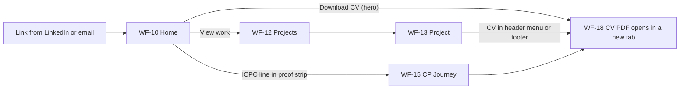

Success: ≤ 2 clicks from any entry page to the CV. No gate, no form.

### F-02 Engineer deep dive

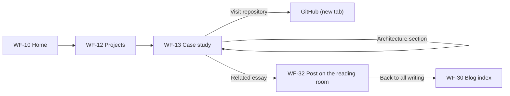

### F-03 Learner: read → sign in → track → continue

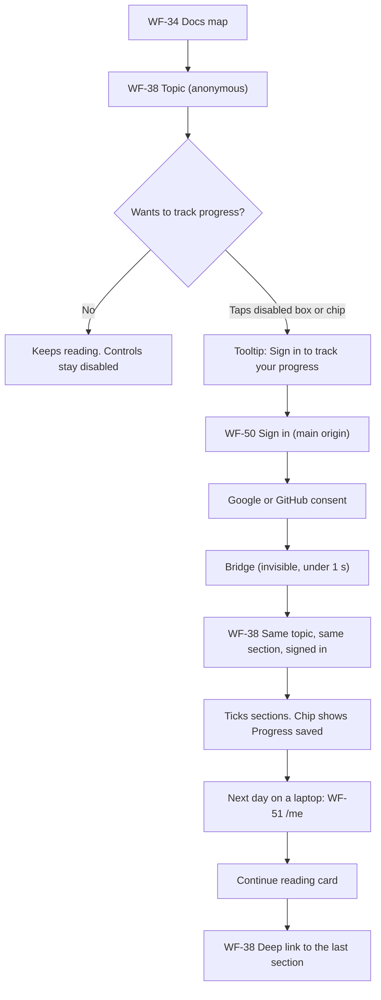

**Error paths:** consent cancelled → back on the topic with a toast "Sign-in cancelled. You can keep
reading." · network error while saving → chip shows "Saving…" then "Saved" when the queue flushes ·
session expired → chip shows "Sign in again to keep saving" (ticks queued locally meanwhile).

### F-04 Sign-in edge cases

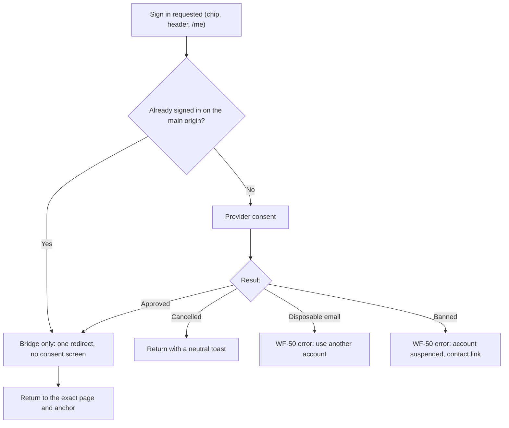

### F-05 Owner publishes a topic and rolls back

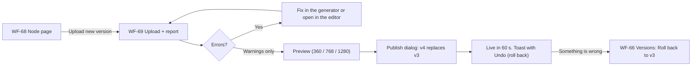

### F-06 Owner writes and schedules an HTML post

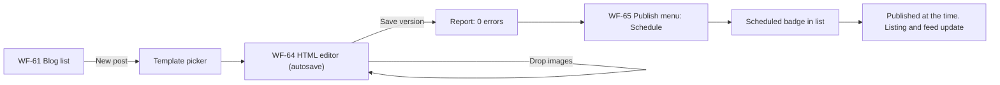

### F-07 Bulk import

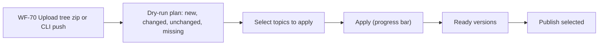

### F-08 Contact

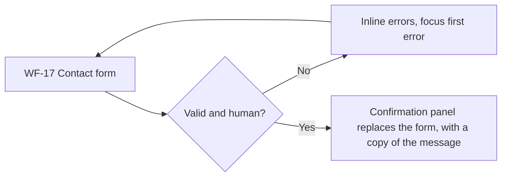

### F-09 Export / delete

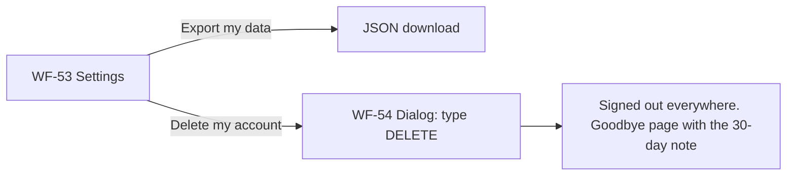

### F-10 Failing judge sync

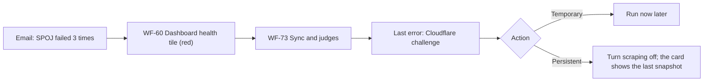

### F-11 Search

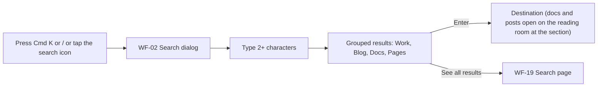
